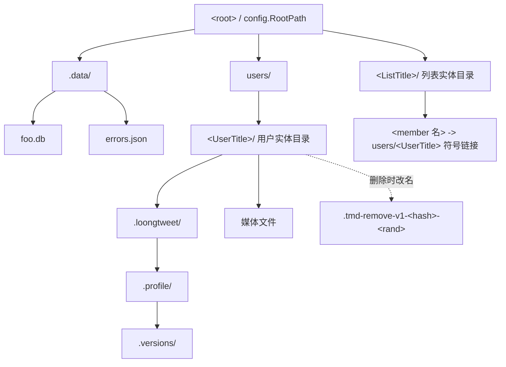
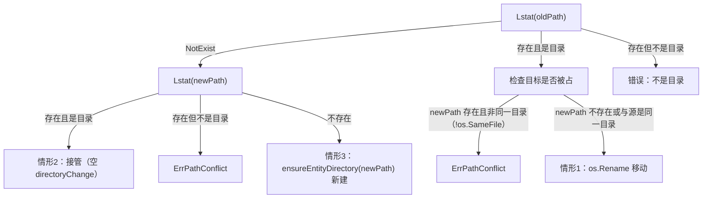
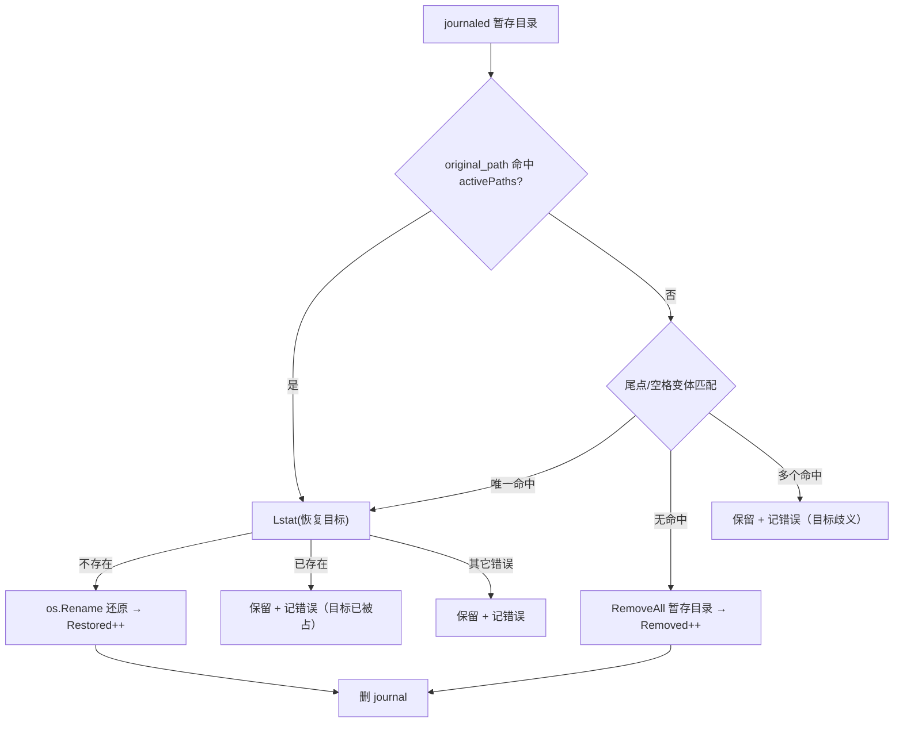

# 实体存储生命周期（Entity Storage Lifecycle）

> 维护说明：本文面向接手 `internal/entity/`、`internal/database/`（`user_entity.go`、`lst_entity.go`、`entity_removal_journal.go`）、`internal/downloading/list_sync.go` 的开发者，回答四个问题：**实体目录长什么样**、**Create/Rename/Remove 分别改了哪些状态**、**进程在中间被杀会留下什么**、**启动时怎么对账**。
> 全文事实均来自当前代码；凡属推断而非读到的结论都会显式标注 `[INFERENCE]`。符号锚点统一写作 `<文件>#<符号>`，不写行号。

---

## 1. 目录布局

实体（entity）是「一条数据库记录 + 一个同名磁盘目录」的绑定体。**目录名 = `user_entities.name` / `lst_entities.name`，目录父级 = `parent_dir` 列**，两列在 `Path()` 里直接拼接（`internal/entity/user.go#UserEntity#Path`、`internal/entity/list.go#ListEntity#Path`），中间没有任何缓存或映射表。父级两种取值：

- 用户实体：`path.StorePath.Users`，即 `<root>/users`（`internal/downloading/batch_any.go#BatchDownloadAny` 的 `realDir` 实参来自 `pathHelper.Users`）。
- 列表实体：`path.StorePath.Root`，即 `<root>` 本身（同上，`dir` 实参来自 `pathHelper.Root`）。



| 路径 | 角色 | 唯一实现 |
|------|------|----------|
| `<root>` | 存储根；`NormalizeRoot` 做 TrimSpace → 非空 → `filepath.Abs(filepath.Clean())` | `internal/path/store.go#NormalizeRoot` |
| `<root>/users` | **用户实体根**，所有推文媒体都落在这里 | `internal/path/store.go#NewStorePath`（`sp.Users = filepath.Join(root, "users")`，并对 Root/Users/Data 三处 `MkdirAll`） |
| `<root>/<ListTitle>` | **列表实体目录**，直接挂在 root 下，**不是** `users/` 的子目录 | `internal/downloading/list_download.go#syncListAndGetMembers` |
| `<root>/.data` | 数据库与错误 dump 的目录 | `internal/path/store.go#NewStorePath` |
| `<root>/.data/foo.db` | SQLite（`StorePath.DB`） | 同上 |
| `<root>/.data/errors.json` | 失败队列 dump（`StorePath.ErrorsPath`） | 同上 |
| `<UserDir>/.loongtweet/` | 推文元数据（`.json` / `.txt`），与媒体文件同级的隐藏目录 | `internal/downloading/tweet_download.go`（`filepath.Join(dir, ".loongtweet")`） |
| `<UserDir>/.loongtweet/.profile/` | profile 下载产物 | `internal/downloading/profile/downloader.go#ensureProfileDirs` |
| `<UserDir>/.loongtweet/.profile/.versions/` | profile 旧文件备份（`VersionManager`） | 同上 |
| `<ListDir>/<member 名>` | **符号链接**，指向成员用户实体目录的绝对路径；同名记录在 `user_links` 表 | `internal/downloading/entity.go#updateUserLink`、`internal/downloading/batch_download.go`（`os.Symlink(upath, linkpath)` 成功后写 `database.CreateUserLink`） |
| `<parent>/.tmd-remove-v1-<hash>-<rand>` | 删除暂存目录，与实体目录**同级**（见 §5） | `internal/entity/storage.go#stageEntityDirectoryRemoval` |

要点：

1. **列表实体目录不承载媒体**：批量下载把列表成员收集成 `userInListEntity{user, leid}`，随后 `BatchUserDownload` 用用户实体根（`realDir`）同步用户实体，下载目标取自用户实体自身路径（`internal/downloading/types.go#pathTarget.GetPath` → `Entity.Path()`）。列表目录里能看到的只有成员符号链接。查证清单媒体时请到 `users/` 下找，不要在列表目录里找。
2. **符号链接是权限敏感操作**：Windows 创建符号链接需要管理员权限；`user_links` 行的写入与链接创建绑定在同一处（`os.Symlink` 返回 `nil` 或 `IsExist` 才写库），失败只降级为一条汇总 Warn（`internal/downloading/batch_download.go` 的 `symlinkWarnCount`）。
3. **`.versions/` 只属于 profile 子树**：路径是 `<UserDir>/.loongtweet/.profile/.versions`（`profileDirName`/`profileSubDirName`/`versionsDirName` 三个常量定义在 `internal/downloading/profile/downloader.go`），不是用户实体目录的直接子目录。
4. **删除暂存目录与实体目录共享父级**，因此 `CleanupStagedDirectories` 既能扫配置的 root，也能从 journal 反推父目录（见 §6）。

---

## 2. 名称校验与遗留容忍

名称是唯一的安全边界：只要 `name` 能带 `/`、`\` 或 `..`，实体目录就能逃出 `parent_dir`。所以实体包提供两条互斥的解析路径：

| 入口 | 用于 | 校验强度 | 实现 |
|------|------|----------|------|
| `entityPath(parentDir, name)` | **调用方传入的新名字**（`Create`/`Rename`/`Sync` 的目标名）、尚未落库实体的 `Path()` | `ValidateName` 全量校验 | `internal/entity/storage.go#entityPath` |
| `storedEntityPath(parentDir, name)` | **已经从数据库读出来的名字**（`created == true` 的 `Path()`、`renameEntityDirectory` 的源路径、`Remove` 的目录路径、`entityDirectoryOwnedByAnother` 的兄弟路径） | `normalizeStoredName`：先做组件级校验，再在 Windows 上归一 | `internal/entity/storage.go#storedEntityPath` |

两者最后都落到 `joinEntityPath`：`parentDir == ""` 直接报错，否则 `filepath.Join(parentDir, name)`（`internal/entity/storage.go#joinEntityPath`）。

### 2.1 拒绝清单

`ValidateName` 依次执行三段校验，任一失败都返回包着 `entity.ErrInvalidName` 的错误（`internal/entity/errors.go#ErrInvalidName`）：

`validateNameComponent`（路径组件语义）：

| 拒绝条件 | 典型输入 | 错误文案片段 |
|----------|----------|--------------|
| 空名 / `.` / `..` | `""`、`"."`、`".."` | `%w: %q` |
| 含 NUL 字符 | `"nul\x00name"` | `name must be a single path component: %q` |
| 含路径分隔符 | `child/name`、`child\name` | 同上 |
| 绝对路径或 `filepath.Base(name) != name` | `/abs`、`a/b` | 同上 |

`isStagedDirectoryPrefix`（内部前缀保护，**大小写不敏感**）：

| 拒绝条件 | 典型输入 | 错误文案片段 |
|----------|----------|--------------|
| 以 `.tmd-remove-` 开头（忽略大小写） | `.tmd-remove-v1-...`、`.TMD-REMOVE-x` | `name uses an internal reserved prefix: %q` |

大小写不敏感是必须的：Windows 文件系统大小写不敏感，`".TMD-REMOVE-..."` 会指向与 `.tmd-remove-...` 相同的目录，若不拦就会被启动清扫当成普通实体目录/暂存目录而错判归属（`internal/entity/storage.go#isStagedDirectoryPrefix`）。

`validateWindowsCompatibleName`（跨平台可寻址性，**在所有平台上都执行**）：

| 拒绝条件 | 典型输入 | 错误文案片段 |
|----------|----------|--------------|
| 以空格或点结尾 | `"windows."`、`"windows "` | `name cannot end with a space or dot: %q` |
| 含 Windows 保留字符 | `:*?"<>|` 任一 | `name contains a Windows-reserved character: %q` |
| 含控制字符（`< 32`） | `"a\x1bb"` | `name contains a control character: %q` |
| 保留设备名 | `CON`、`con.txt`、`CON .txt`、`PRN`、`AUX.log`、`NUL`、`COM1`、`com9.txt`、`LPT1` | `name is reserved on Windows: %q` |

保留名判定细节：取第一个 `.` 之前的部分 → 大写 → 去尾部空格，再比对 `CON/PRN/AUX/NUL/CLOCK$/CONIN$/CONOUT$` 与前缀 `COM`/`LPT` 后跟 `1`–`9` 或上标 `¹²³` 的名字（`internal/entity/storage.go#isWindowsReservedPortName`）。所以 `CON .txt` 与 `com9.txt` 都会被拒。

### 2.2 遗留容忍：`normalizeStoredName`

历史版本写入的记录可能带尾点/尾空格（例如 `"foo."`）。Windows 的 Win32 路径解析会把 `foo.` 和 `foo` 解析到同一目录，因此**只在 Windows 上**做裁剪：

```
normalizeStoredName(name):
  validateNameComponent(name)                       # 组件级校验对所有平台一致
  if GOOS != "windows": return name                 # Linux/macOS 原样返回
  normalized = TrimRight(name, " .")
  validateNameComponent(normalized)                 # 裁剪后不能变成空/"."/".."
  validateWindowsCompatibleName(normalized)         # 裁剪后仍需跨平台可寻址
  return normalized
```

| 情形 | 结果 |
|------|------|
| Linux 上记录 `"foo."` | 原样返回 `"foo."`，磁盘目录就是 `foo.` |
| Windows 上记录 `"foo."` | 归一为 `"foo"`，指向裁剪后的目录 |
| 记录 `"..."` 或 `"   "`（Windows） | 裁剪后为空 → `ErrInvalidName: legacy name is not addressable on Windows: %q` |
| 记录含 Windows 保留字符（Windows） | `ErrInvalidName: legacy name is not safely addressable on Windows: %q` |

两个失败文案刻意带 `legacy name is ...` 前缀：这说明**记录本身已经不可寻址**，调用方（`Sync`）要用 `Rename` 迁移到合规名，而不是重试同一操作。`entity_test.go#TestSyncMigratesLegacyNamesWithTrailingWindowsCharacters` 覆盖这条迁移路径。

关键推论（也是 §5、§6 的跨平台哈希动机）：**「同一个数据库在不同平台上算出的目录路径可能不同」**。写库记录 `"foo."` 后把库搬到 Linux，路径仍是 `foo.`；反之从 Linux 带到 Windows，`Path()` 只认 `foo`。

### 2.3 空名记录为什么不可寻址

`validateNameComponent("")` 直接拒绝，所以：

- `Path()` 对 `name == ""` 的记录必然报错 —— 它不会“返回父目录”；
- 更重要的是：**`filepath.Join(parentDir, "")` 的结果就是 `parentDir`**。如果任何一处用空名拼路径并执行 `os.Rename`/`os.RemoveAll`，目标就会退化成整个 `users/` 根（或整个列表实体根），后果是删光所有用户媒体。

因此包内对空名记录做了**显式分流**，而不是“让校验兜住”：

| 操作 | 空名记录的处理 | 实现 |
|------|----------------|------|
| `Remove` | 只删数据库行，**完全不碰文件系统**（`if ue.record.Name == ""` 分支） | `internal/entity/user.go#UserEntity#Remove`、`internal/entity/list.go#ListEntity#Remove` |
| `Rename` | 走 `recoverEmptyStoredEntityDirectory(targetPath)`，只对新目标名做 `ensureEntityDirectory`（创建或接管），绝不把父目录当成源目录 | `internal/entity/storage.go#recoverEmptyStoredEntityDirectory` |

`recoverEmptyStoredEntityDirectory` 的注释把这一点写死了：“it never interprets the parent directory itself as the entity directory”。测试 `entity_test.go#TestSyncMigratesLegacyEmptyStoredNameWithoutTouchingParent` 与 `#TestRemoveDropsLegacyEmptyStoredNameWithoutTouchingParent` 断言父目录不被改动。

---

## 3. Create：双层锁 + 归属检查 + 回滚

`Create` 是「先落盘、再写库」的顺序（`internal/entity/user.go#UserEntity#Create`、`internal/entity/list.go#ListEntity#Create`，两者逻辑逐字对齐，只有 kind/ownerID 类型不同）。完整步骤：

| # | 步骤 | 失败时 |
|---|------|--------|
| 1 | `requireRecord()` + `db != nil` 前置检查 | 返回，无副作用 |
| 2 | **取实体锁** `lockEntityOperation("user", <uid>, parentDir)` | — |
| 3 | **取父级锁** `lockEntityStorageParent(parentDir)` | — |
| 4 | `ue.created` 已为真 → `already exists` | 返回 |
| 5 | **幂等重查** `database.LocateUserEntity(uid, parentDir)` | 查到 → 用库里的记录覆盖内存记录、`created = true`，**仍然返回 `already exists` 错误** |
| 6 | `entityPath(parentDir, name)` → `ValidateName` | 返回，无副作用 |
| 7 | `ensureEntityDirectory(path)` | 返回；`created` 标记本次是否真的新建 |
| 8 | **归属检查** `entityDirectoryOwnedByAnother(...)` | 查询失败 → `change.rollback(...)`（见下） |
| 9 | 目标被他人占用 → `ErrPathConflict` | `change.rollback(...)` |
| 10 | `database.CreateUserEntity` 落库 | 恢复内存 `Name`/`Id` 快照 → `change.rollback(...)` |
| 11 | `created = true` | — |

### 3.1 双层锁的分工

| 锁 | 键 | 保护的临界区 | 实现 |
|----|----|--------------|------|
| 实体锁 | `("user"/"list", ownerID, parentDir)` | 同一实体的 Create/Rename/Remove 互斥 | `internal/entity/operation_lock.go#lockEntityOperation` |
| 父级锁 | `("storage-parent", "", parentDir)` | **同一父目录下不同实体之间**的归属检查与文件系统变更 | `internal/entity/operation_lock.go#lockEntityStorageParent` |

父级锁的存在理由写在 `lockEntityStorageParent` 的注释里：归属检查与目录变更是「跨实体、共用同一父目录」的竞争点 —— A 创建 `foo`、B 改名成 `foo` 是两条不同实体的路径，实体锁彼此独立，必须靠父级锁串行化。

键中的 `parentDir` 经过 `operationParentDirKey`，它直接用 `comparablePath`（`filepath.Clean` + Windows 下小写），注释明确说明这是为了「复用单一实现避免两处规则漂移」（`internal/entity/operation_lock.go#operationParentDirKey`）。取锁顺序恒定（实体锁 → 父级锁），所以不存在死锁环；两把锁都用 `defer` 释放，panic 也能回收（`internal/entity/operation_lock_test.go#TestEntityOperationLockReleasesAfterRecoveredPanic`）。

### 3.2 幂等重查：为什么「查到」仍报错

第 5 步先于任何文件系统操作，命中说明**另一个进程/协程刚刚建好了同一条记录**。此时函数把库里的记录同步进内存对象并置 `created = true`，让调用方后续操作可用，但仍然返回 `already exists` 错误 —— **错误是给「本次请求」的，状态修复是给「这个对象」的**。

因此调用方必须把 Create 的失败当成「可能已经成功」：`entity.Sync` 只在 `!Recorded()` 时才调用 `Create`，所以在同一进程内不会撞上；跨进程并发（CLI + Server 同时跑）才会走这条分支。

### 3.3 `entityDirectoryOwnedByAnother`：为什么目录缺失也要拒绝

这个检查与「目标目录是否存在」**无关**，它只比对**数据库记录解析出的路径**：

1. 一条 SQL 拉出该 `parent_dir` 下的全部 `user_entities` 与 `lst_entities`（`UNION ALL`，带 `kind` 与 `owner_id`）；
2. 跳过与本次 owner 完全相同的行；
3. 对每一行调用 **`storedEntityPath`**（不是 `entityPath`）解析兄弟路径 —— 这一步让遗留名（`"foo."`）与大小写变体按与当前实体相同的规则归一，并让无法寻址的兄弟记录被静默跳过（`if err != nil { continue }`）；
4. 用 `comparablePath` 比较（Windows 下大小写不敏感）是否等于目标路径。

拒绝的两种真实成因（代码注释原话是「不同 owner 可能因命名归一化（遗留尾点/尾空格在 Windows 与无尾点记录映射到同一目录）或大小写变体共享同一目录」）：

- **归一化合流**：记录 A 是 `"foo."`、记录 B 是 `"foo"`，在 Windows 上解析到同一个目录；
- **大小写变体**：`"Foo"` 与 `"foo"` 在 Windows 上是同一目录。

**目录当前缺失也要拒绝**，因为冲突的本质是「两条记录指向同一目录」，而不是「目录已被占」。若此时放行并新建目录，就等于**亲手把两条记录钉死在同一个目录上**，之后双方的媒体与 `.loongtweet` 会互相覆盖（代码注释：`否则两个实体记录指向同一目录导致媒体混写`）。同一个检查在 `Rename` 里也要跑（见 §4），覆盖「目标目录不存在但记录存在」的窗口。

### 3.4 回滚的三种形态

`ensureEntityDirectory` 返回的 `directoryChange` 只描述**本次调用真正做的动作**（`internal/entity/storage.go#ensureEntityDirectory`）：

| 分支 | 场景 | `directoryChange` | `rollback` 行为 |
|------|------|-------------------|-----------------|
| `os.Mkdir` 成功 | 目录本次新建 | `created = true` | `os.Remove(newPath)` |
| `os.IsExist` 且是目录 | 目录本来就存在（可能是崩溃残留或用户手放） | 全空 | **什么都不做**（不能删别人的目录） |
| `os.IsExist` 但不是目录 | 同名文件挡路 | 返回错误 | — |

`rollback(operationErr)` 把回滚错误与业务错误 `errors.Join`，且把 `os.IsNotExist` 视为回滚成功（目录本来就不在，目的已达成）（`internal/entity/storage.go#directoryChange.rollback`）。

写库失败的回滚**只处理本次新建的目录**，因此有两条互补的测试：`entity_test.go#TestCreateRollsBackDirectoryWhenDatabaseWriteFails`（新建 → 必须删除）与 `#TestCreatePreservesExistingDirectoryWhenDatabaseWriteFails`（既有 → 必须保留）。

**归属检查自身失败（瞬时 `SQLITE_BUSY`/IO）也走回滚**，这一点容易漏：如果不回滚，本次新建的空目录会残留，而启动清扫只认 `.tmd-remove-*` 前缀，**没有任何机制会清理它**（代码注释与 `entity_test.go#TestCreateRollsBackDirectoryWhenOwnershipCheckFails` 都锁定了这条）。

### 3.5 冲突的返回码

归属冲突包装 `ErrPathConflict`（`internal/entity/errors.go#ErrPathConflict`），API 层映射为 **409**（见 §7）。而「已存在」这个错误**不带哨兵**：API 层并不暴露 `Create`（`internal/api/db_handlers.go` 只对既有记录调用 `Rename`/`Remove`），所以该分支只出现在下载流程内部 —— `entity.Sync` → `Create` 这一条链上。

---

## 4. Rename：六步收敛

`Rename` 的目标是「磁盘目录改名 + 数据库 name 列改名」这两步的**可恢复收敛**：任一步失败都要回到可重试的状态，任一步被并发抢先都要报 409 而不是静默覆盖（`internal/entity/user.go#UserEntity#Rename`）。

| # | 步骤 | 说明 |
|---|------|------|
| 1 | `requireRecord` / `db != nil` / **`ValidateName(name)`** | 校验在**取锁之前**：非法名不进临界区，也不产生任何文件系统副作用 |
| 2 | 实体锁 → 父级锁 | 与 §3.1 同款顺序 |
| 3 | `requireRecorded` → `refreshRecord` | 见 4.1 |
| 4 | **同名快路径**：`record.Name == name` | 不改名，只 `Path()` + `ensureEntityDirectory(path)` 补齐目录后返回 |
| 5 | **归属检查**：`entityPath(parentDir, name)` → `entityDirectoryOwnedByAnother` | 见 4.2 |
| 6 | **目录改名**：`renameEntityDirectory(parentDir, oldName, name)`（旧名为空时走 `recoverEmptyStoredEntityDirectory`） | 见 4.3 |
| 7 | **CAS 写库**：`database.UpdateUserEntityNameIfCurrent(db, id, oldName, name)` | 见 4.4 |
| 8 | 成功：内存 `record.Name = name` | — |

### 4.1 `refreshRecord`：先对齐乐观并发的起点

`refreshRecord` 按 `id` 重新读一行，然后做**稳定身份校验**（`internal/entity/user.go#UserEntity#refreshRecord`）：

| 检查 | 失败返回 |
|------|----------|
| `Id` 有效且 `> 0` | `has an invalid database id` |
| 行仍然存在 | `ErrNotFound`（`entity no longer exists`） |
| `UserId` 与 `operationParentDirKey(ParentDir)` 与内存一致 | `ErrConcurrentUpdate`（`stable identity changed`） |

只有「user_id + parent_dir 都没变」才把整行覆盖进内存。换句话说，**允许 name/统计字段被别处改新，不允许身份漂移**。刷新后的 `record.Name` 就是第 7 步 CAS 的期望值，这样并发改名的对手方会自然把 CAS 打成 0 行。

### 4.2 目标归属检查：补的是「目录不存在」的窗口

第 5 步与 §3.3 是同一个函数、同一套语义，针对的是不同窗口：

| 场景 | `renameEntityDirectory` 能否发现 | 归属检查能否发现 |
|------|-----------------------------------|------------------|
| 目标目录已被别的实体占用（真实目录存在） | ✅ `ErrPathConflict` | ✅ |
| 目标目录缺失，但**别的实体记录**归一化后指向同一路径 | ❌（磁盘上什么都没有） | ✅ |

代码注释把这个分工写明了：`目标目录已存在时 renameEntityDirectory 的 ErrPathConflict 也会拒绝，此检查覆盖目标目录缺失但记录存在的窗口`。

### 4.3 `renameEntityDirectory` 的三种情形

先解析两个路径：源用 `storedEntityPath`（容忍遗留名），目标用 `entityPath`（新名强制 `ValidateName`）；两者字符串相同则退化为 `ensureEntityDirectory`（`internal/entity/storage.go#renameEntityDirectory`）。



| 情形 | 磁盘状态 | 返回值 | 语义 |
|------|----------|--------|------|
| 1 源在、目标不在 | 正常改名 | `{oldPath, newPath, moved: true}` | 真正 `os.Rename` |
| 2 源**缺**、目标**在** | 崩溃残留或用户手放 | `{oldPath, newPath}` —— **全空标记** | **接管**：不动文件系统，让调用方去提交 DB 更新 |
| 3 源缺、目标也缺 | 目录从未落盘 | `ensureEntityDirectory(newPath)` | 新建目标目录 |
| — 目标被占（且与源不是同一目录） | — | `ErrPathConflict` | 拒绝，绝不覆盖 |

**情形 2 为什么要「接管」而不是报冲突**：上一次 Rename 可能已完成 `os.Rename` 但进程在「改名」与「CAS 写库」之间被杀或断电，此时磁盘上目标目录已是正确内容、数据库还停在旧名；用户手工把目录改成目标名也会产生**完全相同的文件系统状态**，两者在 FS 层不可区分。若一律报 `ErrPathConflict`，该实体将**永久卡死**（`Sync` 每次都会走到这里）。接管后由调用方写库完成收敛；这一步的 `directoryChange` 是空操作，意味着**第 7 步 CAS 失败时目录不会被移回**（它本来就不在 `oldPath`），保持现状等下次 `Sync` 重试。`entity_test.go#TestRenameSelfHealsWhenSourceMissingAndDestinationExists` 与 `#TestRenameSelfHealsThroughSyncAfterCrashWindow` 覆盖该路径。

**`os.SameFile` 而不是字符串比较**：`newPath` 与 `oldPath` 字符串不同但指向同一 inode 时（典型如 Windows 大小写变体改名 `foo` → `Foo`）不算冲突，直接走 `os.Rename`。

### 4.4 name-only CAS

```sql
UPDATE user_entities SET name=? WHERE id=? AND name=?     -- (newName, id, currentName)
UPDATE lst_entities  SET name=? WHERE id=? AND name=?
```

返回 `rows == 1` 表示成功；`internal/database/user_entity.go#UpdateUserEntityNameIfCurrent`、`internal/database/lst_entity.go#UpdateLstEntityNameIfCurrent`。

**为什么不会覆盖 `latest_release_time` / `media_count`**：`SET` 子句**只列了 `name` 一列**，其余列根本没有出现在 UPDATE 语句里，SQLite 对未列出的列保持原值。这与「先读后写整行」的实现有本质区别 —— 后者会把第 3 步刷新到的旧统计值写回去，抹掉并发进行的统计更新。`entity_test.go#TestUserRenamePreservesFreshStatistics` 锁定了这一点。

保留的第三列（`parent_dir`）同样不会被改名改写，这正好与「`parent_dir` 不可变」的 API 约定对齐（见 §7）。

若返回 `rows == 0`，说明期望名已经不是当前名，`Rename` 再查一次库以区分两种失败：

| 复查结果 | 返回 | 目录回滚 |
|----------|------|----------|
| 行不存在（`current == nil`） | `ErrNotFound` | `change.rollback(...)` |
| 行存在但名字已变 | `ErrConcurrentUpdate` | `change.rollback(...)` |
| 复查本身报错 | 包装后的查询错误 | `change.rollback(...)` |

回滚把目录从 `newPath` 移回 `oldPath`（`moved == true` 时）或删除本次新建的目录（`created == true` 时），空操作情形（§4.3 情形 2）什么都不做。回滚失败不会掩盖业务错误，而是 `errors.Join` 一起返回。

### 4.5 409 的两种来源

| 来源 | 哨兵 | 触发条件 | API 文案 |
|------|------|----------|----------|
| 路径冲突 | `ErrPathConflict` | 目标目录被占（§4.3）、或目标路径被别的实体记录占用（§4.2） | `Entity directory already exists`（用户实体的 `pathConflictMessage`），带原始错误 detail |
| 并发更新 | `ErrConcurrentUpdate` | CAS 返回 0 行且行仍存在（§4.4） | `Entity changed concurrently` |
| （对比）`ErrNotFound` | — | 行已消失 | **404**，不是 409 |

两者在 API 层都经 `writeEntityMutationErrorWithDetail` 输出，区别只在文案与是否带 detail（`internal/api/db_handlers.go#writeEntityMutationErrorWithDetail`）。

---

## 5. Remove：暂存改名 + journal + 提交

删除一个实体要同时撤销「数据库行」与「磁盘目录」，但文件系统与 SQLite 没有共同事务。解法是**三步法**：先把目录改名到一个不可能与正常实体同名的暂存名，再写一条 journal 记录这次改名，最后才删数据库行 —— **删行即提交点**（`internal/entity/user.go#UserEntity#Remove`、`internal/entity/list.go#ListEntity#Remove`）。

| 步 | 动作 | 失败时 |
|----|------|--------|
| 0 | `requireRecord` → 锁定（实体锁 → 父级锁）→ `requireRecorded` → `refreshRecord` | 返回 |
| 0' | 空名遗留记录：**只删行、不碰文件系统**（§2.3） | 返回 |
| 1 | `stageEntityDirectoryRemoval(db, path)`：改名 + 写 journal | 内部自行回滚 |
| 2 | `database.DelUserEntity(db, id)` | `staged.rollback(...)`（改名回去 + 删 journal） |
| 3 | 重置内存状态（`created = false`、`Id` 置无效）→ `staged.commit(db)` | `commit` 返回错误（journal 保留，留给下次启动清扫重试） |

### 5.1 暂存名与 journal

`stageEntityDirectoryRemoval` 的细节（`internal/entity/storage.go#stageEntityDirectoryRemoval`）：

1. `os.Lstat(path)`：**目录不存在 → 直接返回空 `stagedPath`**，后续 `rollback`/`commit` 都变成无操作。这条让「目录已被手工删掉」的记录仍能删干净。
2. 存在但不是目录 → 报错（宁可留错，也不删一个同名文件）。
3. `os.CreateTemp(filepath.Dir(path), stagedDirectoryPattern(path))` **占位拿名字**，随后立刻 `Close` + `Remove` 释放名字 —— 只为拿到一个同目录下唯一的名字，避免与并发方撞名。
4. `os.Rename(path, tempPath)` → 目录进入暂存态。**同目录改名**，不跨设备，几乎不可能失败。
5. `database.CreateEntityRemovalJournal(db, {StagedPath, OriginalPath})`。写 journal 失败时立即回滚（把目录改名回去），**不允许出现「目录已暂存但没有 journal」的新数据**。

暂存名格式：

```
.tmd-remove-v1-<sha256(归一化名) 前 16 字节的 hex，共 32 字符>-<随机后缀>
└──────┬──────┘└┬┘└──────────┬──────────┘
   保留前缀    版本       名称指纹
```

| 常量 | 值 | 位置 |
|------|----|------|
| `stagedDirectoryPrefix` | `.tmd-remove-` | `internal/entity/storage.go` |
| `stagedDirectoryVersionPrefix` | `.tmd-remove-v1-` | 同上 |
| `stagedDirectoryHashBytes` / `stagedDirectoryHashLength` | 16 / 32 | 同上 |

这个前缀在 `ValidateName` 里被**大小写不敏感**地保留（§2.1），所以用户无法手工造出一个看起来像暂存目录的实体名。

### 5.2 哈希为何先去尾点/尾空格

`stagedDirectoryNameHash` 先 `TrimRight(name, " .")` 再算 SHA-256，取前 16 字节 hex（`internal/entity/storage.go#stagedDirectoryNameHash`）。三个用途都依赖这个指纹一致：

1. **构造暂存名**（第 3 步的 `CreateTemp` 模式）；
2. **反查候选记录**：启动清扫把活跃记录按 `hash(记录目录名)` 建索引，再用暂存目录名解析出的哈希去查（§6）；
3. **校验 journal 自洽**：`normalizeRemovalJournal` 要求 `parseStagedDirectoryHash(暂存名) == stagedDirectoryNameHash(OriginalPath 的 base)`，否则整条 journal 被判非法（`internal/entity/storage.go#normalizeRemovalJournal`）。

必须裁剪的原因（代码注释原文）：Windows 把尾点/尾空格解析到与裁剪名相同的路径，`storedEntityPath` 也据此归一 —— 若指纹不裁剪，**同一个实体在 Windows 上算一个哈希、在 Linux 上算另一个**，于是「暂存目录名 ↔ 活跃记录」这一对映射在跨平台扫描时对不上，恢复会**静默退化为零候选**（即 §6.2 类别 D 的「保留」分支，暂存媒体再也回不到原位）。

而「匹配失败 = 删掉活媒体」那条更危险的路径在 **journaled 分支**：那里 `active` 判定失败会直接落到 `os.RemoveAll(stagedPath)`，把暂存目录当成「已提交的删除」清掉（§6.3）。所以指纹裁剪（保证候选可查）与 §6.4 的尾点/空格变体匹配（保证 `active` 判得准）是两道互补的保险，缺一就会出现「记录还活着、目录已被清掉」。

**中间的点不裁剪**：只有尾部的点会被 Win32 吞掉，扩展名里的点是真实字符（注释：`Interior dots (extensions) are preserved`）。

### 5.3 崩溃窗口与对应恢复

| 崩在哪 | 磁盘 | 数据库 | 启动对账的动作 |
|--------|------|--------|----------------|
| 改名之后、journal 之前 | 有暂存目录，**无 journal** | 行仍在 | 无 journal 的 v1 暂存目录：按指纹找回候选记录 → **改名恢复** |
| journal 之后、删行之前 | 暂存目录 + journal | 行仍在 | journal 命中且记录活跃 → **改名恢复**，删 journal |
| 删行之后、`commit` 之前 | 暂存目录 + journal | 行已删 | journal 命中但记录不存在 → **`RemoveAll` + 删 journal**（真正的提交） |

`commit` 的顺序是 `RemoveAll` → 删 journal：若 `RemoveAll` 失败，journal **故意保留**，下次启动重试（`internal/entity/storage.go#stagedDirectoryRemoval.commit`）。反方向的 `rollback` 则先确认原路径未被占用，再改名回去，最后删 journal（`#stagedDirectoryRemoval.rollback`）。

「删行即提交点」这条不变式的意义就在这张表里：**只要 journal 还在、行还在，恢复方向一律是「还原」，绝不会删除**。

---

## 6. 启动对账：`CleanupStagedDirectories`

启动时调用一次：`entity.CleanupStagedDirectories(db, pathHelper.Root, pathHelper.Users)`，位置在**数据库连接之后、Twitter 登录之前** —— 所以离线启动也会做对账；返回的错误只记一条 Warn，不阻断启动，`Restored`/`Removed` 非零时记一条 Info（`main.go#initializeClients`）。

```go
type StagedDirectoryCleanupResult struct { Removed int; Restored int }
```

`Restored` = 被改名还原的暂存目录数；`Removed` = 被 `RemoveAll` 清掉的暂存目录数。任何单点失败都 `errors.Join` 进**同一个返回错误**，扫描不会中途放弃（`internal/entity/storage.go#CleanupStagedDirectories`）。

### 6.1 扫描集合是怎么构造的

| 来源 | 内容 | 为何需要 |
|------|------|----------|
| 调用方实参 | `<root>`、`<root>/users` | 正常配置下的两个实体根 |
| 每条 journal | `filepath.Dir(journal.StagedPath)` | 即便 root 配置变了、旧父目录已不在配置里，也能扫到 |
| 每条活跃记录 | `parent_dir` 列（`user_entities` ∪ `lst_entities`） | 同上，覆盖历史 parent_dir |

除目录集合外还建两个索引：

- `activePaths`：全部活跃记录经 **`storedEntityPath`** 解析出的路径集合（解析失败的记录记一条错误并跳过）；
- `activeByParentAndHash`：`parentKey → hash(目录 base) → []路径`。同一 `(parent, hash)` 下**按 `comparablePath` 去重**，注释说明这是为了避免假歧义：遗留 `"foo."` 与 `"foo"` 归一化后指向同一目录，若不去重会被误判成「两个候选」而永久阻塞恢复（`storage_internal_test.go#TestCleanupStagedDirectoriesDeduplicatesSamePathCandidates`）。

journal 侧先经 `normalizeRemovalJournal` 过滤：路径必须绝对、`staged_path` 与 `original_path` 必须**同级**、暂存名必须能解析出哈希、且该哈希必须等于 `hash(original_path 的 base)`。任一不满足 → 记错误、**不采信该 journal**（`internal/entity/storage.go#normalizeRemovalJournal`）。两条 journal 指向同一暂存路径也记错误，只保留第一条。

扫描目录时按 `comparablePath` 去重；`os.ReadDir` 遇到 `IsNotExist` 静默跳过（配置里写了不存在的根不是错误）；只处理名字以 `.tmd-remove-` 开头（大小写不敏感）的条目。

### 6.2 五类条目的处置

| 类别 | 判定 | 动作 |
|------|------|------|
| A. 非常规目录 | `!info.IsDir()` 或带 `os.ModeSymlink` | journaled → 记错误保留；未 journaled → **静默跳过**（不跟随符号链接，`storage_internal_test.go#TestCleanupStagedDirectoriesDoesNotFollowSymlinks`） |
| B. 该路径本身是活跃实体目录 | 暂存路径 ∈ `activePaths` | journaled → 记错误保留（「既是活跃路径又是 journaled」属矛盾状态）；未 journaled → 静默跳过（历史上可能真有以此为名的实体记录，`#TestCleanupStagedDirectoriesPreservesReferencedLegacyPrefix`） |
| C. 有 journal | 暂存路径命中 `journalByStagedPath` | 按 §6.3 恢复或删除，然后删 journal |
| D. 无 journal + 有 v1 版本号 | `parseStagedDirectoryHash` 成功 | 按指纹找候选，唯一命中且目标空闲 → 改名还原；否则保留 |
| E. 无 journal + 无版本号（旧版残留） | 前缀命中但不匹配 v1 格式 | **一律保留**并记错误 |

D 与 E 都不允许 `RemoveAll`，理由写在代码注释里：**没有 journal 的暂存目录不能作为「行已被提交删除」的证据** —— 它可能是用户手工创建的、恰好撞上保留前缀的目录，也可能是一次 journal 之前中断的删除。只凭前缀就 `RemoveAll`，等于把「前缀碰撞」当成删除授权（`internal/entity/storage.go#CleanupStagedDirectories` 中的两处 retain 注释）。

### 6.3 journaled 分支：以「记录是否还在」定向



**「宁可保留也不删」的完整清单**（每一处都记一条错误，即 `CleanupStagedDirectories` 返回的 err 里能读到原因）：

1. journaled 的暂存路径不是常规目录（或无法 `Info()`）；
2. 暂存路径同时是活跃实体目录，且存在对应 journal；
3. journaled 但恢复目标**已存在**（含归一化变体已存在：`active recovery target ... already exists (normalized)`）；
4. journaled 但恢复目标**歧义**（同父目录下多个记录的裁剪名相同，`recovery target is ambiguous`）；
5. 未 journaled 的 v1 暂存目录：候选 **0 个**（`no matching active entity record`）或 **> 1 个**（歧义）；
6. 未 journaled 的旧版（无版本号）暂存目录：**无条件保留**。

反向的清理动作只有两个：journaled + 记录已消失 → `RemoveAll`；以及**收尾阶段**删除「journal 存在但暂存路径已不存在」的悬空 journal 行（`DeleteEntityRemovalJournal`，`TestCleanupStagedDirectoriesRemovesStaleJournal`）。

### 6.4 跨平台尾点/空格变体匹配

`ParentDir` 在不同平台上可能写成 `foo`（Windows 归一）或 `foo.`（Linux 原样），而 journal、暂存目录名、磁盘真实目录名可能来自另一平台，于是匹配点做了**双方向**兜底：

| 位置 | 情况 | 处理 |
|------|------|------|
| journal 分支（正向） | journal 的 `OriginalPath` **带**尾点（`foo.`），活跃记录是归一化名（`foo`） | 用裁剪名当恢复目标，命中的是记录的磁盘名（`storage_internal_test.go#TestCleanupStagedDirectoriesRestoresJournaledStageWithTrailingSuffix`） |
| journal 分支（反向） | journal 的 `OriginalPath` **是**裁剪名（Windows 源删除流程经 `storedEntityPath` 归一），活跃记录保留了尾点（Linux） | 在同父目录下找「裁剪后 base 相等」的记录：唯一命中 → 恢复到记录的实际路径；多个命中 → 保留（歧义）（`#TestCleanupStagedDirectoriesRestoresJournaledStageWithTrimmedOriginalPath`） |
| unjournaled v1 分支 | 记录路径带尾点、但磁盘目录已被 Windows 风格归一化成裁剪名 | 发现裁剪变体**已存在** → 保留暂存目录（`active recovery target ... already exists (normalized)`），不再改名覆盖 |

这些分支的共同取向是：**只要存在两种「说得通」的落点，就保留**。保存在磁盘上的媒体可以事后人工归位；被 `RemoveAll` 掉就没有第二次机会。

### 6.5 失败语义

| 情况 | 表现 |
|------|------|
| `db == nil` | 立即返回错误，不扫描 |
| 加载活跃记录失败 | 返回错误（对账无法在无记录集的情况下安全进行） |
| 加载 journal 失败 | 返回错误 |
| 单条 journal 非法 / 单目录 `ReadDir` 失败 / 单条目 `Info` 失败 | `errors.Join` 累积，**继续扫描其余目录** |
| 返回的 error 非 nil | `main.go#initializeClients` 记 `[startup] Staged entity directory cleanup incomplete error=...`，**启动继续** |

---

## 7. API 映射

实体的改名/删除只暴露 `PATCH` + `DELETE` 两个动作，路由注册在 `internal/api/server.go`，handler 在 `internal/api/db_handlers.go`：

| 路由 | 方法 | 进入实体层 | 说明 |
|------|------|------------|------|
| `/api/v1/db/user-entities/{id}` | `PATCH` | `UpdateUserEntityMetadata`（先）→ `Rename`（后） | 可同时改 `name` / `media_count` / `latest_release_time` |
| `/api/v1/db/user-entities/{id}` | `DELETE` | `Remove` | 删行 + 删目录 |
| `/api/v1/db/list-entities/{id}` | `PATCH` | `Rename` | 只支持 `name` |
| `/api/v1/db/list-entities/{id}` | `DELETE` | `Remove` | 删行 + 删目录 |
| `/api/v1/db/users/{id}` | `DELETE` | **级联**：循环 `Remove` 该用户的全部实体，再删 `users` 行 | 见 7.3 |
| `/api/v1/db/lists/{id}` | `DELETE` | **级联**：同上（list 实体） | |

### 7.1 状态码映射

handler 构造实体对象用 `NewUserEntityFromRecord` / `NewListEntityFromRecord`（把既有记录包成「已创建」实体），因此只可能走 `Rename`/`Remove`，不会走 `Create`。

| 状态 | 触发条件 | 判定位置 |
|------|----------|----------|
| 400 `Invalid entity ID` | 路径 `{id}` 不是无符号整数 | `internal/api/resource_handler.go#resolvePathID` |
| 400 `Invalid name` + detail | `ValidateName` 失败 | handler 预检（`PATCH` 里显式调 `entitypkg.ValidateName`，先于实体层） |
| 400 `Modifying parent_dir is not allowed` | body 里出现 `parent_dir` 字段 | `req.ParentDir != nil` 即拒 |
| 404 `Entity not found` | `entity.ErrNotFound`，或 `database.ErrEntityNotFound` 经 `TranslateError` 翻译 | `internal/api/db_handlers.go#writeEntityMutationErrorWithDetail` |
| 409 `Entity directory already exists`（user）/ `List entity directory already exists`（list） | `entity.ErrPathConflict` | 同上，带原始错误 detail |
| 409 `Entity changed concurrently` | `entity.ErrConcurrentUpdate` | 同上 |
| 其它 | 落库类错误 | `dbWriteError`（5xx） |

`TranslateError` 的作用是把数据库层哨兵 `database.ErrEntityNotFound` 在包边界统一成 `entity.ErrNotFound`，且**幂等**（已是 entity 错误则原样返回）—— 这样 handler 的 `switch` 只需匹配一种哨兵，直连 `database` 的调用点（如 `UpdateUserEntityMetadata`）也能得到同样的 404（`internal/entity/errors.go#TranslateError`）。

### 7.2 `parent_dir` 不可变

两个 `PATCH` handler 的请求体都带 `ParentDir *string`，只要非 nil 立即 400：

```go
if req.ParentDir != nil {
    s.writeError(w, http.StatusBadRequest, "Modifying parent_dir is not allowed")
    return
}
```

原因：`parent_dir` 是实体的身份一半（`LocateUserEntity` 的查询键就是 `user_id + parent_dir`），改它等于把记录**指向另一个目录树**，而磁盘上的媒体仍在原处 —— 会立刻制造出一批「记录在 A、目录在 B」的孤儿。改名（`name`）本身经过 CAS 只写 `name` 一列，也不会顺带改 `parent_dir`（§4.4）。前端把它渲染成只读字段（`internal/api/web3/app.js` 的 `Parent Dir (read-only)`）。

### 7.3 级联删除必须先走实体生命周期

`DELETE /api/v1/db/users/{id}` 的顺序是**先实体、后用户行**（`internal/api/db_handlers.go#handleDBUserDelete`）：

1. `countUserCascade` 失败 → **直接拒绝整个删除（fail-closed）**；
2. 循环 `QueryUserEntities` 分页取实体，逐个 `managed.Remove()`（走 §5 的暂存 + journal），直到查不到剩余实体；
3. 最后才 `database.DelUser`。

`DELETE /api/v1/db/lists/{id}` 是同一形状（`#handleDBListDelete`），但没有 `countUserCascade` 那一步 fail-closed 守卫 —— 它直接循环 `QueryLstEntities` 直到空。两处注释都点明了共同的取舍：**不依赖 count 的精度**（并发新建的实体可能让守卫失效），循环直到查空才可靠。

代码注释把理由写得很直白：`DelUser` / `DelLst` **本身就会在事务里 `DELETE FROM user_entities` / `lst_entities`**（`internal/database/user.go#DelUser` 还顺带删 `user_links`、`user_previous_names`），这条路径**绕过暂存与 journal**，于是磁盘上会留下**没有任何 journal 记录的孤儿媒体目录** —— 这正是 §6 无法安全回收的那类数据（无 journal 的目录一律保留）。所以级联删除必须把每个实体都推进正规生命周期。

### 7.4 幂等重试语义

| 场景 | 重试结果 |
|------|----------|
| `PATCH` 改名，第一次已成功但响应丢失 | 第二次 `refreshRecord` 读到目标名 → 命中同名的**快路径**（§4 第 4 步）→ `ensureEntityDirectory` 补齐目录 → **200** |
| `PATCH` 改名，第一次卡在「目录已改、库未改」 | 第二次走**接管**路径（§4.3 情形 2）→ 写库收敛 → **200** |
| `PATCH` 改名，第一次被判 409（目标被占） | 目录已回滚，重试与前次等价；仍然 409 —— 直到目标被腾空 |
| `PATCH` 改名 + 统计同时提交，改名被拒 | **统计字段已落库**；409 文案会追加 detail（`statistics were saved but the name change was rejected`），客户端不应把它当作「全部未生效」 |
| `DELETE`，第一次已成功 | 第二次 `refreshRecord` 查不到行 → `ErrNotFound` → **404**（视为「已完成」） |

最后一条的不变式来自 §5：**「行没了」就代表删除已提交**，所以重复 `DELETE` 得到 404 是正确收敛，而不是失败。

---

## 8. 禁止/必须清单与验证命令

### 8.1 必须

1. **新名走 `ValidateName`，库里的名走 `storedEntityPath`**。前者是安全边界，后者是遗留容忍；两者混用会把遗留名判死或把非法名放行（§2）。
2. **Create / Rename / Remove 的取锁顺序恒定为「实体锁 → 父级锁」**，用 `defer` 释放，顺序不得颠倒（§3.1）。
3. **归属检查必须在文件系统变更的边上跑**：Create 在 `ensureEntityDirectory` 之后、写库之前；Rename 在改目录之前（§3.3、§4.2）。
4. **所有文件系统变更都必须带上回滚句柄**：`directoryChange`（创建/移动）或 `stagedDirectoryRemoval`（暂存/还原），库写失败时立即回滚（§3.4、§5.1）。
5. **删除只能走三步法**：`stageEntityDirectoryRemoval` → 删数据库行 → `commit`。**任何时候都不允许对实体目录直接 `os.RemoveAll`**。
6. **空名遗留记录不得参与路径拼接**：Remove 只删行，Rename 只处理目标目录（§2.3）。
7. **`parent_dir` 一律只读**；改名只写 `name` 一列（§4.4、§7.2）。
8. **启动对账位置固定在「连库之后、登录之前」**，失败只记 Warn 不阻断启动（§6）。
9. **级联删除（`DELETE /api/v1/db/users/{id}`、`/lists/{id}`）必须先逐个实体走生命周期，再删父行**（§7.3）。

### 8.2 禁止

1. **禁止「先读整行再写回整行」实现改名** —— 会把并发期间的 `media_count` / `latest_release_time` 覆盖回旧值；用 `UpdateUserEntityNameIfCurrent` / `UpdateLstEntityNameIfCurrent` 的 name-only CAS。
2. **禁止用裸字符串比较路径**（`==` 或 `EqualFold`）代替 `comparablePath`（`filepath.Clean` + Windows 小写）；跨平台一致性的唯一入口。
3. **禁止跟随符号链接做递归删除**；暂存目录判定显式排除 `os.ModeSymlink`（§6.2 类别 A）。
4. **禁止对「无 journal 的暂存目录」执行 `RemoveAll`**，无论它看起来多像残留（§6.2 类别 D/E）。
5. **禁止改动暂存名格式而不给 `parseStagedDirectoryHash` / `normalizeRemovalJournal` 加迁移**：长度与分隔符都是硬编码解析（`internal/entity/storage.go` 的三个常量）。
6. **禁止改动 `stagedDirectoryNameHash` 的裁剪规则**：尾点/尾空格**必须**裁（跨平台指纹一致），中间的点**不可**裁（扩展名是真实字符）（§5.2）。
7. **禁止在未持有父级锁时做归属判断或目录改名** —— 这是两个实体撞进同一目录的唯一入口。
8. **禁止让 `entityDirectoryOwnedByAnother` 的失败路径跳过回滚**（会让孤儿空目录永久残留）（§3.4）。

### 8.3 验证命令

```bash
# 实体层全量（锁、存储内部、Create/Rename/Remove/Sync 全在这一个包）
go test ./internal/entity/ -count=1

# 只看与本文直接对应的用例
go test ./internal/entity/ -count=1 -v -run 'TestValidateName|TestStoredEntityPath|TestCreate|TestRename|TestRemove|TestSync|TestCleanupStagedDirectories|TestEntityOperationLock|TestEntityStorageParentLock'
go test ./internal/entity/ -run TestCleanupStagedDirectories -count=1 -v

# 数据库层（CAS 与 journal）
go test ./internal/database/ -count=1

# 符号链接同步
go test ./internal/downloading/ -run 'TestListSyncManager|TestUpdateUserLink' -count=1

# 编译与静态检查
go build ./...
go vet ./internal/entity/ ./internal/database/ ./internal/downloading/
```

### 8.4 结论与用例对照

| 结论 | 用例 |
|------|------|
| 新名拒绝表（含保留前缀大小写变体） | `internal/entity/storage_internal_test.go#TestValidateNameRejectsWindowsIncompatibleNames`、`#TestValidateNameRejectsStagedPrefixCaseVariants` |
| 遗留尾点/空格归一与迁移 | `storage_internal_test.go#TestStoredEntityPathHandlesLegacyWindowsSuffix`、`entity_test.go#TestSyncMigratesLegacyNamesWithTrailingWindowsCharacters` |
| 空名记录不动父目录 | `entity_test.go#TestSyncMigratesLegacyEmptyStoredNameWithoutTouchingParent`、`#TestRemoveDropsLegacyEmptyStoredNameWithoutTouchingParent` |
| Create 归属拒绝与回滚 | `#TestCreateRejectsDirectoryOwnedByAnotherEntity`、`#TestCreateAllowsSameOwnerDirectoryReuse`、`#TestCreateRollsBackDirectoryWhenOwnershipCheckFails` |
| Rename 崩溃窗口自愈 | `#TestRenameSelfHealsWhenSourceMissingAndDestinationExists`、`#TestRenameSelfHealsThroughSyncAfterCrashWindow`、`#TestRenameRollsBackWhenDatabaseRecordIsMissing` |
| 改名不覆盖统计 | `#TestUserRenamePreservesFreshStatistics` |
| 启动对账六种处置 | `storage_internal_test.go#TestCleanupStagedDirectories` 系列（`RetainsUnjournaledLegacyStage`、`RestoresInterruptedRemoval`、`RemovesCommittedRemoval`、`RetainsJournaledStageWhenRecoveryTargetExists`、`RestoresJournaledStageWithTrailingSuffix`、`RestoresJournaledStageWithTrimmedOriginalPath`、`DeduplicatesSamePathCandidates`） |
| 双层锁 | `operation_lock_test.go#TestEntityOperationLockSerializesSameKeyAndReleasesEntry`、`#TestEntityStorageParentLockSerializesDifferentOwners` |

### 8.5 症状 → 先看哪里

| 症状 | 先查 |
|------|------|
| 实体报 409 但目录看起来不存在 | 是否有另一条记录归一化/大小写变体指向同一路径（§3.3、§4.2） |
| 目录出现在新名下、库里还是旧名 | Rename 的接管情形（§4.3 情形 2），下次 `Sync` 会收敛 |
| `users/` 下出现空的 `.tmd-remove-v1-*` | journal 是否还在（`entity_removal_journal` 表）；有 journal 且行已删 = 等 `commit`（§5.3） |
| 磁盘有目录、库里没记录、启动也没删 | 无 journal 的暂存目录一律保留（§6.2）—— 需要人工确认后手动处理 |
| 改名后统计字段回退 | 是否有人改成了整行 UPDATE（§4.4） |
| 列表目录里找不到媒体 | 媒体在 `users/` 下（§1 要点 1） |
