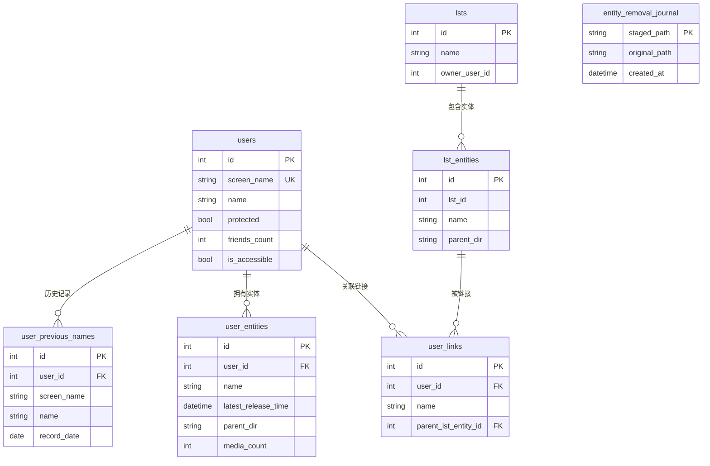
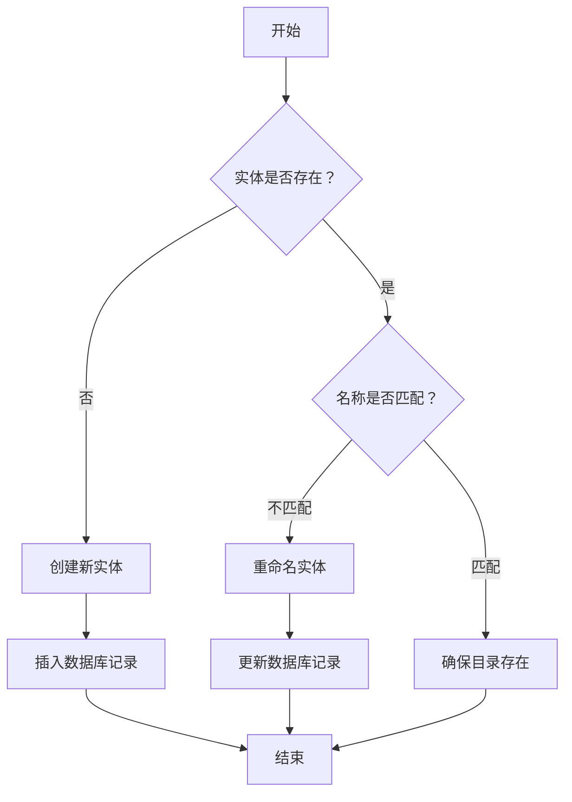
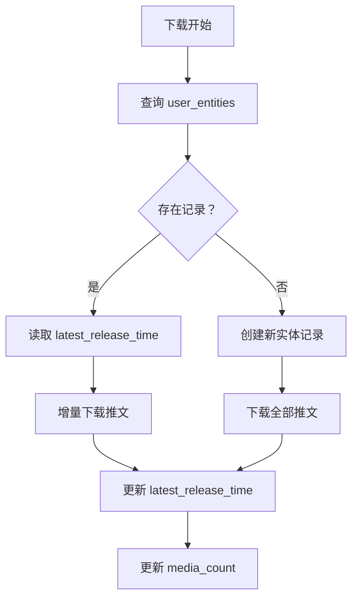
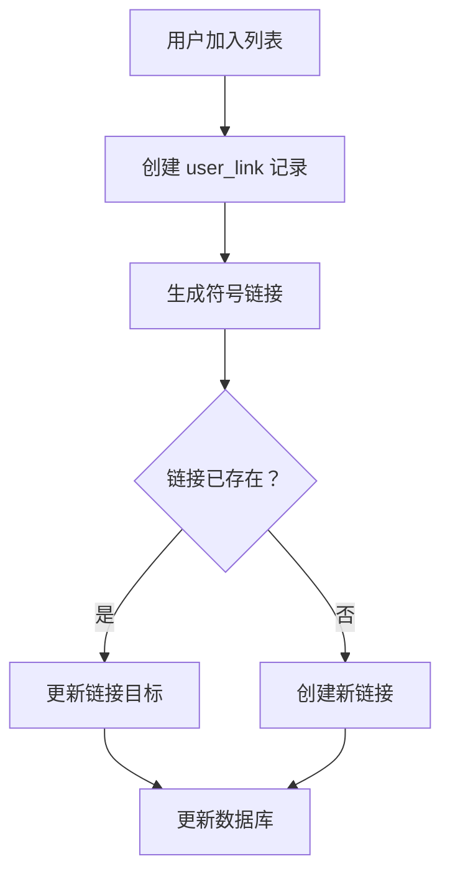

# foo.db 数据库技术文档

## 概述

`foo.db` 是 TMD（Twitter Media Downloader）项目的核心 SQLite 数据库文件，用于持久化存储用户信息、列表信息、下载实体记录以及用户与列表之间的关联关系。该数据库采用 SQLite3 实现，通过 `sqlx` 库进行 ORM 操作，支持 WAL（Write-Ahead Logging）模式以优化并发性能。

**数据库文件路径**: `<root_path>/.data/foo.db`（由 `internal/path/store.go#StorePath.DB` 解析）

**依赖库**:

- `github.com/jmoiron/sqlx` - SQL 扩展库
- `modernc.org/sqlite` - 纯 Go SQLite3 驱动

> **维护说明**: 为避免随行号漂移失效，本文档一律使用函数名/符号锚点（形如 `internal/database/schema.go#MigrateDatabase`、`internal/api/Server#authMiddleware`），不写具体行号。

***

## 1. 数据库架构设计

### 1.1 设计理念

数据库采用关系型模型设计，主要服务于以下业务场景：

1. **用户管理**: 存储 Twitter 用户基本信息及历史名称记录
2. **列表管理**: 存储 Twitter 列表及其成员结构
3. **下载跟踪**: 记录已下载的用户和列表实体，支持断点续传
4. **关联映射**: 建立用户与列表之间的多对多关系

### 1.2 连接配置

```go
// 连接字符串配置由 internal/database.FileDSN 统一生成
dsn, err := database.FileDSN(path, false)
if err != nil {
    return err
}
db, err := sqlx.Connect(database.DriverName, dsn)

// 关键参数说明:
// - _pragma=journal_mode(WAL): 启用预写日志模式，提升并发读写性能
// - _pragma=busy_timeout(30000): 设置锁等待超时时间为 30 秒
// - _time_format=sqlite: 使用 SQLite 原生时间格式（实际实现见 internal/database/sqlite.go#addSQLiteQueryDefaults）
```

`internal/database/sqlite.go` 提供 DSN 构造函数（另有 panic 版 `internal/database/sqlite.go#MustFileDSN`，供测试等"失败即不可继续"的场景使用）：

| 函数 | 用途 | 说明 |
| --- | --- | --- |
| `internal/database/sqlite.go#FileDSN` | 文件库 | 取绝对路径 → 转斜杠 → 生成 `file:///...` URI，再追加默认参数 |
| `internal/database/sqlite.go#MemoryDSN` | 内存库（测试） | 库名为 `tmd-mem-<uuid>`，**每次调用都是独立库名**，避免共享内存 DSN 在不同测试之间串扰；`sharedCache` 为真时额外加 `cache=shared` |

默认参数只有上面三条（`internal/database/sqlite.go#addSQLiteQueryDefaults`）。连接池由 `internal/database/sqlite.go#configureSQLiteConnection` 收敛为 `MaxOpenConns=1` / `MaxIdleConns=1` / `ConnMaxLifetime=30min` / `ConnMaxIdleTime=10min`，即所有 SQL 实际串行执行。

> **重要事实**: DSN 中**没有** `_pragma=foreign_keys(ON)`，代码库任何位置都未执行 `PRAGMA foreign_keys=ON`（`internal/database` 内只出现 `PRAGMA table_info` 与测试里的 `PRAGMA journal_mode`）。SQLite 默认 `foreign_keys=OFF`，因此下表声明的 `FOREIGN KEY` **运行时不强制**，级联删除由应用层事务实现，详见 [8.3](#83-数据一致性保障)。

### 1.3 初始化流程

启动顺序（`internal/database/connect.go#Connect`）：

1. `recoverInterruptedSQLiteReplacement(path)`: 处理上次进程在换名中途崩溃留下的 `.replacing` / `.migrating` 残留文件。存在 `foo.db.replacing` 时把原库恢复回 `path` 并清掉迁移目标；只有孤立的 `foo.db.migrating` 而**没有**原库时属于归属不明，**fail-closed** 直接报错，绝不让 SQLite 在 `path` 处新建一个空库。
2. 文件已存在 → `migrateExistingDatabase(path)`（旧格式库重建，见下文）。
3. `openSQLiteFile(path, false)` 打开连接。
4. `configureSQLiteConnection(db)` 收敛连接池。
5. `CreateTables(db)` → `MigrateDatabase(db)` → `NormalizeLegacyTimestamps(db)` → `validateDatabase(db)`。

```go
// 实际实现在 internal/database/connect.go#Connect
func Connect(path string) (*sqlx.DB, error) {
    recovered, err := recoverInterruptedSQLiteReplacement(path) // 处理 .replacing/.migrating 残留
    if err != nil {
        return nil, err
    }

    exists, err := utils.PathExists(path)
    // ...
    if exists {
        if err := migrateExistingDatabase(path); err != nil {
            return nil, err
        }
    }

    db, err := openSQLiteFile(path, false) // → DSN: file:///path?_pragma=journal_mode(WAL)&_pragma=busy_timeout(30000)&_time_format=sqlite
    if err != nil {
        return nil, fmt.Errorf("failed to connect to database at %q: %w", path, err)
    }

    configureSQLiteConnection(db)           // SetMaxOpenConns(1), SetMaxIdleConns(1), SetConnMaxLifetime(30min), SetConnMaxIdleTime(10min)

    CreateTables(db)                        // 自动创建表结构（含显式索引，见 internal/database/schema.go 的 schema/indexes 常量）
    if err := MigrateDatabase(db); err != nil {
        db.Close()
        return nil, err
    }
    // 旧版本可能以非 UTC 偏移写入 latest_release_time；失败仅告警，不阻塞启动（下次启动重试）
    _ = NormalizeLegacyTimestamps(db)
    if err := validateDatabase(db); err != nil {
        db.Close()
        return nil, err
    }
    return db, nil
}
```

### 1.4 两条迁移路径

**路径 A：就地幂等 ALTER/RENAME**（`internal/database/schema.go#MigrateDatabase`）

对可被当前驱动直接打开的库执行 3 条幂等迁移，重复执行安全；错误按内容识别（`duplicate column name`、`no such table`、`cannot rename`、目标列已存在的 `no such column`）后跳过：

1. `ALTER TABLE users ADD COLUMN is_accessible BOOLEAN NOT NULL DEFAULT 1`
2. `ALTER TABLE user_previous_names RENAME COLUMN uid TO user_id`
3. `ALTER TABLE lsts RENAME COLUMN owner_uid TO owner_user_id`

**路径 B：整库重建**（`internal/database/sqlite_migration.go#migrateExistingDatabase`）

仅当现有文件无法被当前驱动/当前 schema 使用（`validateDatabase` 失败）时触发：

1. 把 `foo.db`（连同 `-wal` / `-shm`，存在才拷）复制为 `foo.db.backup.<YYYYMMDD_HHMMSS>` 备份，迁移失败时删除备份（成功后保留作为最终安全网）；备份文件权限 `0600` 并 `fsync`。
2. 以备份为源、`foo.db.migrating` 为目标建新库：`CreateTables` → `MigrateDatabase`。
3. 在单个源事务/目标事务中逐表拷贝（users、user_previous_names、lsts、user_entities、lst_entities、user_links、entity_removal_journal）。
4. `validateDatabase` 目标库 + 行数校验（`validateRowCounts`）。
5. 关闭目标库，`replaceSQLiteFiles` 用 `foo.db.replacing` 作中转把新库搬到 `foo.db`（`os.Rename`，逐后缀处理 `""` / `-wal` / `-shm`）；第二步失败则把原库搬回 `path`，此窗口内崩溃由下次启动的 `recoverInterruptedSQLiteReplacement` 兜住。

> **注意**: 这不是版本号驱动的迁移——两者都没有版本号表，判定依据是"能否打开 + `validateDatabase` 是否通过"（`internal/database/sqlite_schema.go#requiredSchema`）。

***

## 2. 表结构定义

### 2.1 表概览

| 表名                    | 用途             | 主键   | 声明的外键                                                              |
| --------------------- | -------------- | ---- | ------------------------------------------------------------------ |
| `users`               | Twitter 用户基本信息 | `id` | 无                                                                  |
| `user_previous_names` | 用户历史名称记录       | `id` | `user_id` → `users.id`                                                 |
| `lsts`                | Twitter 列表信息   | `id` | 无                                                                  |
| `lst_entities`        | 列表下载实体记录       | `id` | 无                                                                  |
| `user_entities`       | 用户下载实体记录       | `id` | `user_id` → `users.id`                                             |
| `user_links`          | 用户与列表的关联       | `id` | `user_id` → `users.id`, `parent_lst_entity_id` → `lst_entities.id` |
| `entity_removal_journal` | 实体目录删除恢复日志 | `staged_path` | 无                                                             |

> **外键不生效**: 上表"声明的外键"只是 DDL 文本，运行时不强制（见 [1.2](#12-连接配置)）。7 张表共声明 4 条外键：`user_previous_names.user_id`、`user_entities.user_id`、`user_links.user_id`、`user_links.parent_lst_entity_id`。级联删除由应用层事务实现：`internal/database/user.go#DelUser`、`internal/database/lst.go#DelLst`、`internal/database/lst_entity.go#DelLstEntity`。

### 2.2 详细表结构

#### 2.2.1 users 表

存储 Twitter 用户的基本信息。

```sql
CREATE TABLE IF NOT EXISTS users (
    id INTEGER NOT NULL,              -- Twitter 用户 ID（全局唯一）
    screen_name VARCHAR NOT NULL,     -- 用户屏幕名称（@用户名）
    name VARCHAR NOT NULL,            -- 用户显示名称
    protected BOOLEAN NOT NULL,       -- 是否受保护（私密账户）
    friends_count INTEGER NOT NULL,   -- 关注数量
    is_accessible BOOLEAN NOT NULL DEFAULT 1, -- 是否可通过 API 正常访问（非封禁/注销）
    PRIMARY KEY (id),
    UNIQUE (screen_name)
);
```

**字段说明**:

- `id`: Twitter 用户唯一标识符，对应 API 中的 `user_id`
- `screen_name`: 用户唯一标识名，用于 URL 和提及（如 `@elonmusk`）
- `name`: 用户自定义显示名称（可包含特殊字符和表情）
- `protected`: `true` 表示私密账户，需关注后才能查看内容
- `friends_count`: 用户关注的其他用户数量
- `is_accessible`: `true` 表示用户可正常访问，`false` 表示用户已封禁/注销（v2.8.0 新增，默认 1）

#### 2.2.2 user\_previous\_names 表

记录用户历史名称变更，用于追踪改名历史。

> **注意**: 该表在 v3.4.19 中新增了全局查询功能，通过 `GET /api/v1/db/user-previous-names` 端点（含 `current_screen_name` 和 `current_name` 字段）支持按当前名称筛选历史记录，详见 [API_DOCUMENTATION.md](API_DOCUMENTATION.md) 第 21 节。

```sql
CREATE TABLE IF NOT EXISTS user_previous_names (
    id INTEGER NOT NULL,              -- 自增主键
    user_id INTEGER NOT NULL,         -- 用户 ID（外键）
    screen_name VARCHAR NOT NULL,     -- 历史屏幕名称
    name VARCHAR NOT NULL,            -- 历史显示名称
    record_date DATE NOT NULL,        -- 记录时间戳
    PRIMARY KEY (id),
    FOREIGN KEY(user_id) REFERENCES users (id)
);
```

**使用场景**: 当用户改名后，通过此表可以追溯到原始名称，便于文件关联。

#### 2.2.3 lsts 表

存储 Twitter 列表的基本信息。

```sql
CREATE TABLE IF NOT EXISTS lsts (
    id INTEGER NOT NULL,              -- 列表 ID
    name VARCHAR NOT NULL,            -- 列表名称
    owner_user_id INTEGER NOT NULL,   -- 列表所有者用户 ID
    PRIMARY KEY (id)
);
```

#### 2.2.4 lst\_entities 表

记录已下载的列表实体，用于文件系统映射。

```sql
CREATE TABLE IF NOT EXISTS lst_entities (
    id INTEGER NOT NULL,              -- 自增主键
    lst_id INTEGER NOT NULL,          -- 列表 ID
    name VARCHAR NOT NULL,            -- 实体名称（目录名）
    parent_dir VARCHAR NOT NULL COLLATE NOCASE,  -- 父目录路径（大小写不敏感）
    PRIMARY KEY (id),
    UNIQUE (lst_id, parent_dir)
);
```

**唯一约束**: 同一列表在同一父目录下只能有一个实体记录。

#### 2.2.5 user\_entities 表

记录已下载的用户实体，包含下载状态信息。

```sql
CREATE TABLE IF NOT EXISTS user_entities (
    id INTEGER NOT NULL,              -- 自增主键
    user_id INTEGER NOT NULL,         -- 用户 ID（外键）
    name VARCHAR NOT NULL,            -- 实体名称（目录名）
    latest_release_time DATETIME,     -- 最新推文下载时间（UTC 文本，字典序即时刻序）
    parent_dir VARCHAR COLLATE NOCASE NOT NULL,  -- 父目录路径
    media_count INTEGER,              -- 媒体文件数量
    PRIMARY KEY (id),
    UNIQUE (user_id, parent_dir),
    FOREIGN KEY(user_id) REFERENCES users (id)
);
```

**关键字段**:

- `latest_release_time`: 记录最新下载的推文时间，用于增量下载
- `media_count`: 统计该用户实体下的媒体文件总数

> **时间戳存储约定（重要）**: 该列以 TEXT 存储，SQLite 用 BINARY（字典序）比较文本值。若同列混有 `+08:00` 与 `+00:00` 偏移，同一时刻会排出不同顺序，`MAX()` / `<` 比较就可能保留更旧的基线，导致重复下载。
>
> - 所有写入路径必须先经 `internal/database/timestamps.go#NormalizeTime` 归一为 UTC：`internal/database/user_entity.go#SetUserEntityLatestReleaseTime`、`#UpdateUserEntityMetadata`、`#UpdateUserEntityTweetStat`（后者用 `CASE WHEN latest_release_time IS NULL OR latest_release_time < ?` 做基线比较，归一化在 `CASE` 之前完成）；上层 `internal/entity/user.go#UserEntity.SetLatestReleaseTime` 也做同样归一，保证内存值 == 存储值。
> - 启动时 `internal/database/timestamps.go#NormalizeLegacyTimestamps` 把旧版本写入的非 UTC 偏移值重写为 UTC，已是 UTC 的值不动，因此幂等；失败只告警不阻塞启动。
> - `record_date`（`user_previous_names`）由 `internal/database/user.go#RecordUserPreviousName` 以 `time.Now()` 直接写入，**不做** UTC 归一。

#### 2.2.6 user\_links 表

建立用户与列表实体之间的关联（符号链接）。

```sql
CREATE TABLE IF NOT EXISTS user_links (
    id INTEGER NOT NULL,              -- 自增主键
    user_id INTEGER NOT NULL,         -- 用户 ID（外键）
    name VARCHAR NOT NULL,            -- 链接名称
    parent_lst_entity_id INTEGER NOT NULL,  -- 列表实体 ID（外键）
    PRIMARY KEY (id),
    UNIQUE (user_id, parent_lst_entity_id),
    FOREIGN KEY(user_id) REFERENCES users (id),
    FOREIGN KEY(parent_lst_entity_id) REFERENCES lst_entities (id)
);
```

**用途**: 当用户属于多个列表时，通过符号链接在列表中创建用户目录的引用。

#### 2.2.7 entity_removal_journal 表

记录已移动到同级暂存目录、但尚未完成收口的实体目录删除。该内部表只保存崩溃恢复证据，不属于 Web 数据控制台公开的六张业务表。

```sql
CREATE TABLE IF NOT EXISTS entity_removal_journal (
    staged_path VARCHAR NOT NULL,              -- 版本化暂存目录的绝对路径
    original_path VARCHAR NOT NULL,            -- 删除前实体目录的绝对路径
    created_at DATETIME NOT NULL DEFAULT CURRENT_TIMESTAMP,
    PRIMARY KEY (staged_path)
);
```

**恢复规则**（`internal/entity/storage.go#CleanupStagedDirectories`）: 实体记录仍存在时将暂存目录恢复到 `original_path`；实体记录已经删除时清理暂存目录；无法证明归属的旧暂存目录保留并记录告警。

***

## 3. 索引设计

### 3.1 显式索引

共 12 条，逐字对应 `internal/database/schema.go` 的 `indexes` 常量：

```sql
CREATE INDEX IF NOT EXISTS idx_users_screen_name ON users(screen_name);
CREATE INDEX IF NOT EXISTS idx_users_name ON users(name);
CREATE INDEX IF NOT EXISTS idx_users_accessible ON users(is_accessible);
CREATE INDEX IF NOT EXISTS idx_users_protected ON users(protected);
CREATE INDEX IF NOT EXISTS idx_lsts_name ON lsts(name);
CREATE INDEX IF NOT EXISTS idx_lsts_owner ON lsts(owner_user_id);
CREATE INDEX IF NOT EXISTS idx_user_entities_user_id ON user_entities(user_id);
CREATE INDEX IF NOT EXISTS idx_user_entities_name ON user_entities(name);
CREATE INDEX IF NOT EXISTS idx_lst_entities_lst_id ON lst_entities(lst_id);
CREATE INDEX IF NOT EXISTS idx_user_links_user_id ON user_links(user_id);
CREATE INDEX IF NOT EXISTS idx_user_links_lst_entity ON user_links(parent_lst_entity_id);
CREATE INDEX IF NOT EXISTS idx_user_previous_names_user_id ON user_previous_names(user_id);
```

**设计目的**:
- `idx_users_*`: 加速用户查询（按名称、可访问状态、保护状态筛选）
- `idx_lsts_*`: 加速列表查询（按名称、所有者筛选）
- `idx_user_entities_*`: 加速用户实体查询（按用户ID、名称筛选）
- `idx_lst_entities_lst_id`: 加速列表实体查询（按列表ID筛选）
- `idx_user_links_*`: 加速用户链接查询（按用户ID、列表实体ID筛选）
- `idx_user_previous_names_user_id`: 加速历史名称查询（按用户ID筛选）

### 3.2 隐式索引

以下字段因 `UNIQUE` 约束自动创建唯一索引：

- `users.screen_name`
- `lst_entities(lst_id, parent_dir)`
- `user_entities(user_id, parent_dir)`
- `user_links(user_id, parent_lst_entity_id)`

### 3.3 索引使用场景分析

| 查询模式                                                               | 使用索引                          | 性能影响     |
| ------------------------------------------------------------------ | ----------------------------- | -------- |
| `SELECT * FROM user_links WHERE user_id = ?`                       | `idx_user_links_user_id`      | O(log n) |
| `SELECT * FROM users WHERE screen_name = ?`                        | `UNIQUE(screen_name)`         | O(log n) |
| `SELECT * FROM user_entities WHERE user_id = ? AND parent_dir = ?` | `UNIQUE(user_id, parent_dir)` | O(log n) |

***

## 4. 数据关系图



> 图中的连线是**逻辑关联**（由应用层维护），不是数据库强制的约束：`lsts ||--o{ lst_entities` 只能通过 `lst_entities.lst_id` 的应用层逻辑保证，因为 DDL 没有为它声明外键；其余连线的外键虽在 DDL 中声明，运行时同样不强制（见 8.3）。

***

## 5. 核心业务逻辑流程

### 5.1 用户实体管理流程



**代码实现**（`internal/entity/user.go`，下为要点摘录）：

```go
type UserEntity struct {
    record  *database.UserEntity
    db      *sqlx.DB
    created bool
}

// NewUserEntity: parentDir 先 filepath.Abs 归一，再按 (user_id, parent_dir) 查 user_entities。
// 查到记录 → created=true；查不到 → 返回一个尚未入库、待 Create 的实体（created=false，零值）。
func NewUserEntity(db *sqlx.DB, uid uint64, parentDir string) (*UserEntity, error) {
    absParentDir, err := filepath.Abs(parentDir)
    if err != nil {
        return nil, err
    }
    record, err := database.LocateUserEntity(db, uid, absParentDir)
    if err != nil {
        return nil, err
    }
    if record == nil {
        return &UserEntity{record: &database.UserEntity{UserId: uid, ParentDir: absParentDir}, db: db}, nil
    }
    return &UserEntity{record: record, db: db, created: true}, nil
}

// Create 仅对 created=false 的实体有效：created=true 时直接返回 "already exists"，
// 并用 (user_id, parent_dir) 复检一次以应对并发插入；随后建目录 + 归属检查，
// 最后 CreateUserEntity 落库并把 created 置为 true。
func (ue *UserEntity) Create(name string) error {
    if err := ue.requireRecord(); err != nil {
        return err
    }
    if ue.created {
        return fmt.Errorf("%s already exists", ue.description())
    }
    current, err := database.LocateUserEntity(ue.db, ue.record.UserId, ue.record.ParentDir)
    if current != nil {
        *ue.record = *current
        ue.created = true
        return fmt.Errorf("%s already exists", ue.description())
    }
    // ... 计算 path、确保目录存在、校验目录未被其他实体记录占用

    if err := database.CreateUserEntity(ue.db, ue.record); err != nil {
        return err
    }
    ue.created = true
    return nil
}
```

> 实体操作的互斥由 `internal/entity/operation_lock.go#lockEntityOperation` 以 (kind, ownerID, parentDir) 为键的应用层锁提供（`internal/entity/user.go#UserEntity.Create`、`internal/entity/user.go#UserEntity.Remove`、`internal/entity/list.go#ListEntity.Remove` 等均先加锁）。

### 5.2 下载进度跟踪流程



**关键代码**（`internal/entity/user.go#UserEntity.SetLatestReleaseTime`）:

```go
func (ue *UserEntity) SetLatestReleaseTime(t time.Time) error {
    if err := ue.requireRecorded(); err != nil {
        return err
    }
    // 与 DB 层一致（database.NormalizeTime）：存储与内存记录都归一为 UTC，
    // 避免文本序与时刻序分叉；归一化幂等，故对内存记录再归一一次以保持
    // 内存值 == 存储值。
    t = database.NormalizeTime(t)
    err := database.SetUserEntityLatestReleaseTime(ue.db, int(ue.record.Id.Int32), t)
    if err == nil {
        ue.record.LatestReleaseTime.Time = t
        ue.record.LatestReleaseTime.Valid = true
    }
    return err
}
```

### 5.3 用户 - 列表关联管理



***

## 6. 关键 API 接口说明

### 6.1 用户操作 API

#### CreateUser

实现：`internal/database/user.go#CreateUser`

```go
func CreateUser(db *sqlx.DB, usr *User) error
```

**功能**: 插入新用户记录\
**参数**:

- `db`: 数据库连接
- `usr`: 用户对象，包含 `Id`, `ScreenName`, `Name`, `IsProtected`, `FriendsCount`, `IsAccessible`\
  **返回值**: 错误信息

**SQL**:

```sql
INSERT INTO users(id, screen_name, name, protected, friends_count, is_accessible) 
VALUES(:id, :screen_name, :name, :protected, :friends_count, :is_accessible)
```

#### GetUserById

实现：`internal/database/user.go#GetUserById`

```go
func GetUserById(db *sqlx.DB, uid uint64) (*User, error)
```

**功能**: 通过 ID 查询用户\
**特殊处理**: 记录不存在时返回 `nil, nil` 而非错误（`internal/database/helpers.go#handleGetResultWithContext` 把 `sql.ErrNoRows` 转换为 `nil`）

#### UpdateUser

实现：`internal/database/user.go#UpdateUser`

```go
func UpdateUser(db *sqlx.DB, usr *User) error
```

**功能**: 更新用户信息（支持改名）

#### RecordUserPreviousName

实现：`internal/database/user.go#RecordUserPreviousName`

```go
func RecordUserPreviousName(db *sqlx.DB, uid uint64, name string, screenName string) error
```

**功能**: 记录用户历史名称（改名时调用），`record_date` 写 `time.Now()`（见 2.2.5 时间戳约定）

### 6.2 实体操作 API

#### CreateUserEntity

实现：`internal/database/user_entity.go#CreateUserEntity`

```go
func CreateUserEntity(db *sqlx.DB, entity *UserEntity) error
```

**功能**: 创建用户下载实体记录\
**自动处理**:

- 将相对路径转换为绝对路径（`internal/database/path_validation.go#normalizeEntityParentDir`）
- 返回自增 ID 并填充到实体对象

#### LocateUserEntity

实现：`internal/database/user_entity.go#LocateUserEntity`

```go
func LocateUserEntity(db *sqlx.DB, uid uint64, parentDir string) (*UserEntity, error)
```

**功能**: 定位用户实体（通过 `user_id` + `parent_dir` 唯一索引）\
**返回值**: 不存在时返回 `nil, nil`

#### SetUserEntityLatestReleaseTime

实现：`internal/database/user_entity.go#SetUserEntityLatestReleaseTime`

```go
func SetUserEntityLatestReleaseTime(db *sqlx.DB, id int, t time.Time) error
```

**功能**: 更新最新推文下载时间（入参先 `NormalizeTime` 归一为 UTC）\
**用途**: 断点续传标记

### 6.3 列表操作 API

与用户操作类似，提供 `internal/database/lst.go#CreateLst`、`#GetLst`、`#UpdateLst`、`#DelLst` 等函数。

### 6.4 关联操作 API

#### CreateUserLink

实现：`internal/database/user_link.go#CreateUserLink`

```go
func CreateUserLink(db *sqlx.DB, lnk *UserLink) error
```

**功能**: 创建用户 - 列表关联（`INSERT OR IGNORE`，重复关联静默跳过）

#### GetUserLinks

实现：`internal/database/user_link.go#GetUserLinks`

```go
func GetUserLinks(db *sqlx.DB, uid uint64) ([]*UserLink, error)
```

**功能**: 获取用户的所有列表关联（事务内按列表实体查询用 `internal/database/user_link.go#GetUserLinksByLstEntityId`）

***

## 7. 数据读写操作规范

### 7.1 写入操作规范

1. **路径标准化**: 所有路径字段在写入前必须转换为绝对路径
   ```go
   abs, err := filepath.Abs(entity.ParentDir)
   if err != nil {
       return err
   }
   entity.ParentDir = abs
   ```
2. **事务处理**: 多步写入（尤其级联删除）必须走事务。包内统一助手是 `internal/database/helpers.go#withTx`（`Beginx` + 失败回滚 + 提交失败回滚，禁止各调用点手写 Beginx/Rollback/Commit）；使用它的函数包括 `internal/database/lst.go#DelLst`、`internal/database/user.go#DelUser`、`internal/database/lst_entity.go#DelLstEntity`、`internal/database/user_link.go#CreateUserLink`。需要 `context` 的调用方用公共管理器 `internal/database/tx#Manager.RunInTransaction`（`BeginTxx` + 提交前检查 ctx），例如 `internal/downloading/list_sync.go#ListSyncManager.SyncListMembers`。两者分工见 `internal/database/helpers.go#withTx` 的注释——不要新增第三套事务助手。
3. **唯一性约束**: 插入前检查是否违反唯一约束，或使用 `INSERT OR IGNORE` / 条件更新
4. **数据库迁移**: 新增字段通过 `internal/database/schema.go#MigrateDatabase` 自动迁移，支持重复执行；新增表/列还要同步 `internal/database/sqlite_schema.go#requiredSchema`，否则启动时 `validateDatabase` 会直接报错
5. **级联删除必须显式写**（外键不生效，见 8.3）:
   - `internal/database/user.go#DelUser`: 先删该用户的 `user_links`、`user_entities`、`user_previous_names`，再删 `users`
   - `internal/database/lst.go#DelLst`: 先删该列表所有 `lst_entities` 下的 `user_links`，再删 `lst_entities`，最后删 `lsts`
   - `internal/database/lst_entity.go#DelLstEntity`: 先删该列表实体的 `user_links`，再删实体行
   - 目录侧的删除由 `internal/entity/storage.go#stageEntityDirectoryRemoval` 先改名到同级暂存目录并写 `entity_removal_journal`，删除成功后 `commit` 收口、失败 `rollback` 还原（`internal/entity/user.go#UserEntity.Remove`、`internal/entity/list.go#ListEntity.Remove`）

### 7.2 读取操作规范

1. **空值处理**: `sql.NullInt32` 和 `sql.NullTime` 字段需检查 `Valid` 标志
   ```go
   // internal/database/model.go#UserEntity
   type UserEntity struct {
       Id         sql.NullInt32 `db:"id"`
       LatestReleaseTime sql.NullTime `db:"latest_release_time"`
   }
   ```
   > 注意 `internal/database/model.go#NullInt32` 把无效值取 0（用于内存计算），而 `internal/database/sqlite_migration.go#nullInt32Value` 把无效值转成 `nil`（用于 INSERT 绑定让 SQLite 存 NULL）——两者语义有意不同，不要混用。
2. **错误处理**: `sql.ErrNoRows` 应转换为 `nil` 返回值

### 7.3 并发控制

- **WAL 模式**: 支持多读单写
- **busy\_timeout**: 设置最大等待时间避免死锁
- **连接池串行化**: `MaxOpenConns=1`（`internal/database/sqlite.go#configureSQLiteConnection`），应用内所有 SQL 实际串行
- **应用层锁**: `internal/entity/operation_lock.go#lockEntityOperation` 以 (kind, ownerID, parentDir) 为键保护实体目录/记录的关键操作（改名、删除等）；`internal/entity` 外部不要绕过它直接改目录

***

## 8. 异常处理机制

### 8.1 常见错误及处理

| 错误类型            | 触发场景     | 处理策略          |
| --------------- | -------- | ------------- |
| `sql.ErrNoRows` | 查询记录不存在  | 返回 `nil` 而非错误 |
| 唯一约束冲突          | 重复插入     | 检查后更新或忽略      |
| 孤儿行（引用不存在的记录）   | 数据库不强制外键，非法引用不会报错 | 由应用层级联删除保证（见 8.3），排查用 `PRAGMA foreign_key_check` |
| 路径转换失败          | 无效路径     | 返回错误并终止操作     |

### 8.2 错误处理示例

```go
func GetUserById(db *sqlx.DB, uid uint64) (*User, error) {
    stmt := `SELECT * FROM users WHERE id=?`
    result := &User{}
    err := db.Get(result, stmt, uid)
    
    if err == sql.ErrNoRows {
        result = nil
        err = nil  // 转换为 nil，调用方检查 nil 即可
    }
    if err != nil {
        return nil, err
    }
    return result, nil
}
```

> 上面是语义示意。实际代码把这段分支收敛成了泛型助手：`internal/database/helpers.go#handleGetResultWithContext`（`sql.ErrNoRows` → `(nil, nil)`，其他错误附带上下文包装），`internal/database/user.go#GetUserById` 等直接调用它，不再手写 `sql.ErrNoRows` 判断。

### 8.3 数据一致性保障

1. **外键声明不强制（重要）**: DDL 里声明了 4 条 `FOREIGN KEY`，但连接 DSN 未开启 `foreign_keys`，代码中也从未执行 `PRAGMA foreign_keys=ON`（`internal/database/sqlite.go#addSQLiteQueryDefaults` 只加 `journal_mode(WAL)`、`busy_timeout(30000)`、`_time_format=sqlite`）。因此：
   - 插入/更新可以引用不存在的 `users.id` / `lst_entities.id`，数据库**不会**报错；
   - 没有 `ON DELETE CASCADE`：删除父行**不会**自动删除子行，孤儿行必须由应用层级联删除处理——`internal/database/user.go#DelUser`、`internal/database/lst.go#DelLst`、`internal/database/lst_entity.go#DelLstEntity`（都在 `internal/database/helpers.go#withTx` 的单事务里按子表→父表顺序删除）；
   - 因此历史库中可能存在孤儿行，且**不要**在生产库上临时 `PRAGMA foreign_keys=ON`：历史孤儿行会让后续写入立即失败。
2. **唯一索引**: 防止重复记录——`users.screen_name`、`lst_entities(lst_id, parent_dir)`、`user_entities(user_id, parent_dir)`、`user_links(user_id, parent_lst_entity_id)`；两个 `parent_dir` 列都带 `COLLATE NOCASE`
3. **NOT NULL 约束**: 确保必填字段不为空

***

## 9. 性能优化策略

### 9.1 数据库层面优化

#### 9.1.1 WAL 模式优势

DSN 里实际写的是 `_pragma=journal_mode(WAL)`（`internal/database/sqlite.go#addSQLiteQueryDefaults`）——不是 `_journal_mode=WAL`。

```sql
-- 等价的本连接显式写法
PRAGMA journal_mode(WAL);
```

- **并发提升**: 读写不阻塞（SQLite 层面；本项目连接池 `MaxOpenConns=1`，所以应用内 SQL 仍是串行的）
- **崩溃恢复**: 更快的恢复速度
- **适用场景**: 读多写少的下载跟踪场景
- **副作用**: 会额外产生 `foo.db-wal` / `foo.db-shm` 两个文件，手工备份时必须一起处理（见 10.1）

#### 9.1.2 Busy Timeout

```sql
_pragma=busy_timeout(30000)
```

- 避免因短暂锁竞争导致的失败
- 锁等待超时 30 秒（常量 `sqliteBusyTimeoutMs = 30000`，`internal/database/sqlite.go`），适合长时间运行的下载任务

### 9.2 查询优化

#### 9.2.1 使用参数化查询

```go
// 推荐
db.Get(result, `SELECT * FROM users WHERE id=?`, uid)

// 不推荐：字符串拼接（SQL 注入风险）
```

#### 9.2.2 利用索引

```go
// 高效：通过唯一索引查询（internal/database/user_entity.go#LocateUserEntity）
LocateUserEntity(db, uid, parentDir)

// 高效：按主键查询（id 为主键，O(log n)）
GetUserEntity(db, id)  // 签名：GetUserEntity(db *sqlx.DB, id int)（internal/database/user_entity.go#GetUserEntity）

// 说明：user_entities.name 也有索引 idx_user_entities_name（internal/database/schema.go 的 indexes 常量）
```

### 9.3 批量操作优化

**当前实现**: 单条插入\
**建议优化**: 使用批量插入减少 I/O

```go
// 优化示例（伪代码）
tx := db.Begin()
for _, entity := range entities {
    tx.Exec(`INSERT INTO ...`, entity)
}
tx.Commit()
```

### 9.4 基准测试结果

```go
// 来自 internal/database/test/db_test.go 的基准测试
func BenchmarkUpdateUser1(b *testing.B) {
    benchmarkUpdateUser(b, 1)   // 单协程
}

func BenchmarkUpdateUser24(b *testing.B) {
    benchmarkUpdateUser(b, 24)  // 24 协程并发
}
```

**测试结论**:

- `BenchmarkUpdateUser1` / `BenchmarkUpdateUser6` / `BenchmarkUpdateUser12` / `BenchmarkUpdateUser24` 为并发 UpdateUser 基准（`internal/database/test/db_test.go`）
- 各协程数下吞吐量对比需在本机实测确认（当前无基准数据支撑），可运行：

```bash
go test ./internal/database/test/ -bench BenchmarkUpdateUser -benchmem
```

***

## 10. 维护要点

### 10.1 数据库备份

WAL 模式下数据可能还在 `-wal` 里，直接只拷 `foo.db` 会丢最近提交。二选一：

**A. 文件级拷贝（必须先停掉所有写进程）**：

```bash
cp <root_path>/.data/foo.db backup.db
cp <root_path>/.data/foo.db-wal backup.db-wal  # 如果有
cp <root_path>/.data/foo.db-shm backup.db-shm  # 如果有
```

**B. 使用 SQLite Backup API（可在线做一致性快照，推荐）**：

```bash
sqlite3 <root_path>/.data/foo.db ".backup '<out>/foo.db'"

# 没有 sqlite3 命令行时用 Python：
python -c "import sqlite3; s=sqlite3.connect(r'<root_path>/.data/foo.db'); d=sqlite3.connect(r'<out>/foo.db'); s.backup(d); d.close(); s.close()"
```

得到的是**单一文件**（已含 WAL 中已提交的内容），不需要再配 `-wal` / `-shm`。跨平台迁移工具 `tools/tmd-db-migrate.py` 在正式写入前就是这么备份的（`tools/tmd-db-migrate.py#backup_sqlite_database`，详见 [foo.db 跨平台迁移说明](foo.db%20跨平台迁移说明.md)）。

程序自身的旧库重建路径走的是 A 思路：把主库 + `-wal` + `-shm` 一起拷成 `foo.db.backup.<YYYYMMDD_HHMMSS>`（`internal/database/sqlite_migration.go#backupSQLiteFiles`），迁移失败则删除该备份，成功则保留为最终安全网。

### 10.2 数据清理

清理无效历史名称记录：

```sql
DELETE FROM user_previous_names WHERE record_date < date('now', '-1 year');
```

> `record_date` 由 `internal/database/user.go#RecordUserPreviousName` 以 `time.Now()`（本地时区，未归一为 UTC）写入，存储形如 `YYYY-MM-DD HH:MM:SS±HH:MM`；上面的字典序比较按日期部分仍然有效。

### 10.3 性能监控

定期检查数据库文件大小和表记录数：

```sql
SELECT 
    'users' as table_name, COUNT(*) as row_count FROM users
UNION ALL
SELECT 'user_entities', COUNT(*) FROM user_entities
UNION ALL
SELECT 'user_links', COUNT(*) FROM user_links
UNION ALL
SELECT 'entity_removal_journal', COUNT(*) FROM entity_removal_journal;
```

### 10.4 常见问题排查

#### 问题 1: 数据库锁死

**症状**: 操作长时间阻塞\

**背景**: 连接池 `MaxOpenConns=1`，所有 SQL 串行；一旦有事务未结束或进程持有 `BEGIN IMMEDIATE` 写锁，其他写入会一直等到 `busy_timeout`（30s）才报 `database is locked`。\
**解决**:

1. 检查是否有未提交的事务（异常路径未 `Rollback`）
2. 重启应用释放锁
3. 确认没有第二个进程/工具（如 `sqlite3`、迁移脚本）同时写同一个 `foo.db`

#### 问题 2: 数据不一致（孤儿行）

**症状**: 出现指向不存在记录的 `user_entities` / `user_links` / `user_previous_names` 行。外键声明运行时不强制（见 8.3），所以这类行不会被数据库阻止。\
**解决**:

1. 只读检查，不要在线开启外键：

```sql
PRAGMA foreign_key_check;

SELECT e.id, e.user_id FROM user_entities e
LEFT JOIN users u ON u.id = e.user_id WHERE u.id IS NULL;
```

2. 让应用层删除路径收口（`internal/database/user.go#DelUser`、`internal/database/lst.go#DelLst` 会级联清理子表），必要时人工清理后重启
3. **不要**执行 `PRAGMA foreign_keys = ON` 来"修好"：历史孤儿行会让后续写入立即失败，且该 PRAGMA 是**每连接**生效，无法靠一次性执行持久化

***

## 11. 开发指南

### 11.1 添加新表

1. 在 `internal/database/model.go` 中定义结构体
2. 在 `internal/database/schema.go` 的 `schema` 常量中添加 `CREATE TABLE` 语句（显式索引加到同一文件的 `indexes` 常量）
3. **同步注册到 `internal/database/sqlite_schema.go#requiredSchema`**（表名 → 列名清单），否则 `validateDatabase` 不会校验它，新库/旧库缺列也不会在启动时报错。目前只有内部表 `entity_removal_journal` 被显式豁免（见 `internal/database/schema_consistency_test.go#TestRequiredSchemaCoversSchemaTables` 的 `declared` 白名单），新增业务表必须登记
4. 在对应文件（`user.go`、`lst.go`、`user_entity.go` 等）中实现 CRUD 函数
5. 编写单元测试（表结构一致性另有 `internal/database/schema_consistency_test.go` 守护）

### 11.2 扩展现有表

在 `internal/database/schema.go` 的 `schema` 常量里加列（对旧库不生效，`CREATE TABLE IF NOT EXISTS` 不会改已存在的表），同时：

1. 更新 `internal/database/model.go` 的结构体与 `db` tag
2. 在 `internal/database/sqlite_schema.go#requiredSchema` 中登记新列
3. 在 `internal/database/schema.go#MigrateDatabase` 的 `migrations` 列表追加一条幂等 `ALTER TABLE ... ADD COLUMN`（重复执行会命中 `duplicate column name` 被安全跳过）

```go
// 示例：为 users 表添加 created_at 字段
// 1. schema 常量追加列（新库生效）
// 2. model.go
type User struct {
    // ... 现有字段 ...
    CreatedAt time.Time `db:"created_at"`
}
// 3. internal/database/sqlite_schema.go#requiredSchema["users"] 追加 "created_at"
// 4. internal/database/schema.go#MigrateDatabase 的 migrations 追加：
//    {`ALTER TABLE users ADD COLUMN created_at DATETIME DEFAULT CURRENT_TIMESTAMP`, nil}
```

### 11.3 编写测试

```go
func TestUserEntity(t *testing.T) {
    db := opentmpdb()
    defer db.Close()
    
    entity := generateUserEntity(db, 1, os.TempDir())
    
    // 测试创建
    if err := CreateUserEntity(db, entity); err != nil {
        t.Error(err)
        return
    }
    
    // 测试查询
    retrieved, err := GetUserEntity(db, int(entity.Id.Int32))
    if err != nil || *retrieved != *entity {
        t.Error("record mismatch")
    }
}
```

> 内存库请用 `internal/database/sqlite.go#MemoryDSN`（每次调用生成独立库名）建立连接，不要复用同一个内存 DSN，否则多个测试会串扰。

### 11.4 用户历史名称全局查询

v3.4.19 新增了全局历史名称查询功能：

- **端点**: `GET /api/v1/db/user-previous-names`
- **功能**: 查询所有用户的历史名称记录，返回结果包含当前用户名和 screen name
- **筛选**: 支持 `q` 参数按当前名称（screen_name 或 name）筛选
- **相关结构**: `UserPreviousNameWithCurrent`（含 `CurrentScreenName` 和 `CurrentName` 字段，`internal/database/model.go`）
- **相关实现**: `internal/database/query.go#QueryAllUserPreviousNames`、`internal/database/query.go#QueryUserPreviousNames`

***

## 12. 附录

### 12.1 完整 Schema 脚本

```sql
-- 完整数据库结构脚本
-- 生成时间：2026-03-27

CREATE TABLE IF NOT EXISTS users (
    id INTEGER NOT NULL,
    screen_name VARCHAR NOT NULL,
    name VARCHAR NOT NULL,
    protected BOOLEAN NOT NULL,
    friends_count INTEGER NOT NULL,
    is_accessible BOOLEAN NOT NULL DEFAULT 1,
    PRIMARY KEY (id),
    UNIQUE (screen_name)
);

CREATE TABLE IF NOT EXISTS user_previous_names (
    id INTEGER NOT NULL,
    user_id INTEGER NOT NULL,
    screen_name VARCHAR NOT NULL,
    name VARCHAR NOT NULL,
    record_date DATE NOT NULL,
    PRIMARY KEY (id),
    FOREIGN KEY(user_id) REFERENCES users (id)
);

CREATE TABLE IF NOT EXISTS lsts (
    id INTEGER NOT NULL,
    name VARCHAR NOT NULL,
    owner_user_id INTEGER NOT NULL,
    PRIMARY KEY (id)
);

CREATE TABLE IF NOT EXISTS lst_entities (
    id INTEGER NOT NULL,
    lst_id INTEGER NOT NULL,
    name VARCHAR NOT NULL,
    parent_dir VARCHAR NOT NULL COLLATE NOCASE,
    PRIMARY KEY (id),
    UNIQUE (lst_id, parent_dir)
);

CREATE TABLE IF NOT EXISTS user_entities (
    id INTEGER NOT NULL,
    user_id INTEGER NOT NULL,
    name VARCHAR NOT NULL,
    latest_release_time DATETIME,
    parent_dir VARCHAR COLLATE NOCASE NOT NULL,
    media_count INTEGER,
    PRIMARY KEY (id),
    UNIQUE (user_id, parent_dir),
    FOREIGN KEY(user_id) REFERENCES users (id)
);

CREATE TABLE IF NOT EXISTS user_links (
    id INTEGER NOT NULL,
    user_id INTEGER NOT NULL,
    name VARCHAR NOT NULL,
    parent_lst_entity_id INTEGER NOT NULL,
    PRIMARY KEY (id),
    UNIQUE (user_id, parent_lst_entity_id),
    FOREIGN KEY(user_id) REFERENCES users (id),
    FOREIGN KEY(parent_lst_entity_id) REFERENCES lst_entities (id)
);

CREATE TABLE IF NOT EXISTS entity_removal_journal (
    staged_path VARCHAR NOT NULL,
    original_path VARCHAR NOT NULL,
    created_at DATETIME NOT NULL DEFAULT CURRENT_TIMESTAMP,
    PRIMARY KEY (staged_path)
);

-- 索引（逐字对应 internal/database/schema.go 的 indexes 常量，共 12 条）
CREATE INDEX IF NOT EXISTS idx_users_screen_name ON users(screen_name);
CREATE INDEX IF NOT EXISTS idx_users_name ON users(name);
CREATE INDEX IF NOT EXISTS idx_users_accessible ON users(is_accessible);
CREATE INDEX IF NOT EXISTS idx_users_protected ON users(protected);
CREATE INDEX IF NOT EXISTS idx_lsts_name ON lsts(name);
CREATE INDEX IF NOT EXISTS idx_lsts_owner ON lsts(owner_user_id);
CREATE INDEX IF NOT EXISTS idx_user_entities_user_id ON user_entities(user_id);
CREATE INDEX IF NOT EXISTS idx_user_entities_name ON user_entities(name);
CREATE INDEX IF NOT EXISTS idx_lst_entities_lst_id ON lst_entities(lst_id);
CREATE INDEX IF NOT EXISTS idx_user_links_user_id ON user_links(user_id);
CREATE INDEX IF NOT EXISTS idx_user_links_lst_entity ON user_links(parent_lst_entity_id);
CREATE INDEX IF NOT EXISTS idx_user_previous_names_user_id ON user_previous_names(user_id);
```

### 12.2 相关文件清单

| 文件路径                             | 用途        |
| -------------------------------- | --------- |
| `internal/database/model.go`     | 数据模型定义    |
| `internal/database/schema.go`    | Schema 定义（`schema` / `indexes` 常量、`CreateTables`、`MigrateDatabase`） |
| `internal/database/sqlite.go`    | DSN 构造（`FileDSN` / `MemoryDSN`）、连接池配置、busy_timeout 常量 |
| `internal/database/sqlite_schema.go` | `requiredSchema` 与 `validateDatabase` 启动校验 |
| `internal/database/sqlite_migration.go` | 旧库整库重建（备份 / `.migrating` / `.replacing`、逐表拷贝、行数校验、崩溃恢复） |
| `internal/database/timestamps.go` | `NormalizeTime` / `NormalizeLegacyTimestamps`（UTC 归一） |
| `internal/database/connect.go`   | 数据库连接与启动顺序  |
| `internal/database/path_validation.go` | 路径归一化与校验（`normalizeEntityParentDir`） |
| `internal/database/user.go`      | 用户 CRUD 操作 |
| `internal/database/lst.go`       | 列表 CRUD 操作 |
| `internal/database/user_entity.go` | 用户实体 CRUD 操作 |
| `internal/database/lst_entity.go` | 列表实体 CRUD 操作 |
| `internal/database/user_link.go` | 用户链接 CRUD 操作 |
| `internal/database/entity_removal_journal.go` | 实体目录删除恢复日志 |
| `internal/database/helpers.go`   | 事务助手（`withTx`）与查询结果适配 |
| `internal/database/errors.go`    | 数据库层错误标记（`ErrEntityNotFound`；`ErrUserNotFound` 定义在 `user.go`） |
| `internal/database/tx/manager.go` | ctx 感知事务管理器 `Manager.RunInTransaction` |
| `internal/database/user_sync.go` | 用户同步操作    |
| `internal/database/query.go`     | 通用查询构建器   |
| `internal/database/test/`        | 数据库集成测试  |
| `internal/entity/`               | 实体管理封装（目录 + 记录的生命周期、`CleanupStagedDirectories`） |
| `internal/downloading/dumper.go` | 失败数据转储    |
| `internal/path/store.go`         | 解析 `{rootPath}/.data/foo.db` 等路径（`StorePath.DB`） |
| `main.go`                        | 数据库初始化入口  |
| `tools/tmd-db-migrate.py`        | 跨平台路径迁移工具（见同目录迁移说明） |

### 12.3 参考资料

- [SQLite 官方文档](https://www.sqlite.org/docs.html)
- [sqlx GitHub](https://github.com/jmoiron/sqlx)
- [SQLite WAL 模式详解](https://www.sqlite.org/wal.html)

***

## 文档版本

- **版本**: 1.3
- **更新日期**: 2026-09-23
- **作者**: AI Assistant
- **适用版本**: TMD v3.7.2
