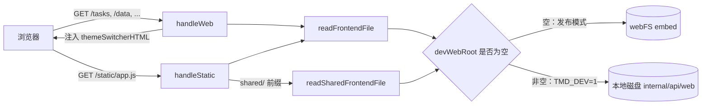
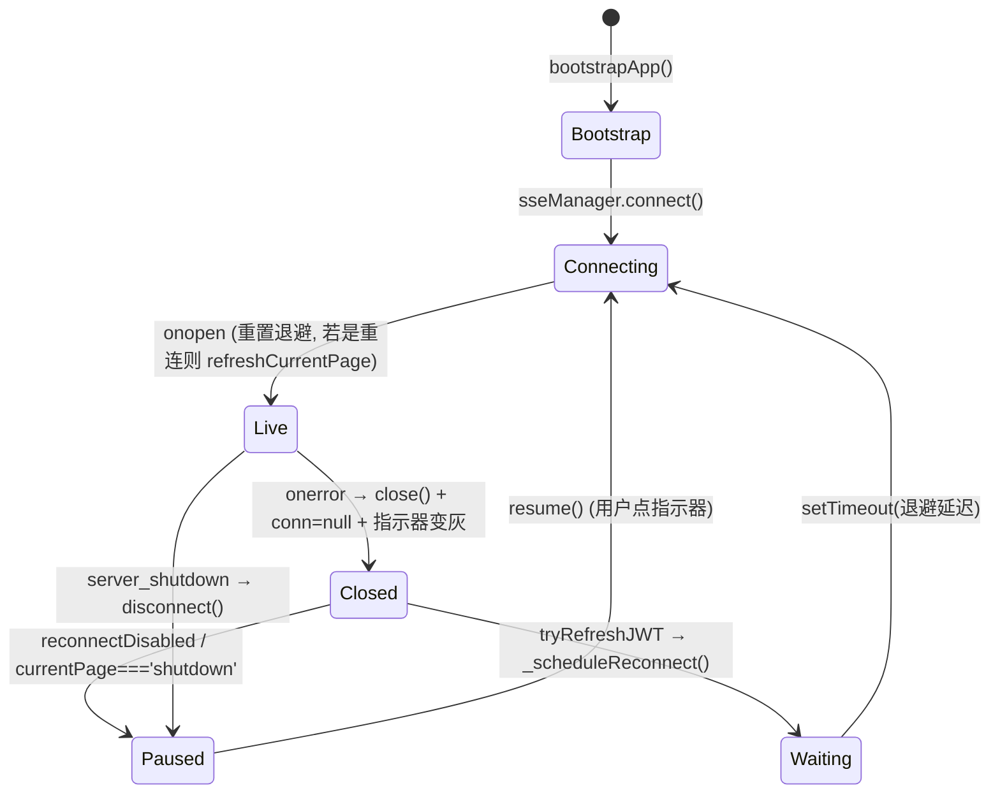

# 三主题前端架构与契约（web1 / web2 / web3）

> 维护说明：本文件描述 `internal/api/web/` 下三套 Web 主题的**共同架构、服务端契约、开发模式与陷阱**。规范摘要见 [[lat.md/api-server.md]] 的 Web UI / Shared Date-Time Contract / Web3 Console Theme / Web1 Console Architecture 四节；单主题实现细节见 `doc/web1-code-conventions.md`、`doc/web2-code-conventions.md`。
> 锚点约定：本文件一律用符号锚点（`internal/api/handlers.go#listThemes`、`internal/api/handlers.go#Server.handleWeb`），不写行号——行号必然漂移。
> 范围：**不覆盖**各主题内部的组件写法（那是单主题约定文档的职责），只覆盖三主题共享的那一层。

## 0. 这份文档解决什么问题

新增第 4 个主题、改主题切换、动静态资源路由、改时间字段编辑、调 SSE 重连时，你需要知道：
服务端在什么条件下才会发现你的主题、切换为什么重启后失效、`/static/...` 到底从哪个目录取文件、为什么 `datetime-local` 的值不能直接回传后端、以及哪些改动会连带打穿其它两个主题的测试。

**适用读者**：在 `internal/api/web/` 或 `internal/api/handlers.go` 下动手的开发者。

## 1. 共同形态：零构建 + embed

三套主题是**纯静态前端**：没有 npm、没有打包器、没有构建产物。Go 二进制通过 `//go:embed web/*`（`internal/api/handlers.go`）把整个 `web/` 目录打进可执行文件，服务端按当前主题从内存 FS 取文件。

```
internal/api/web/
├── shared/            # 主题共享资源（当前只有 1 个文件）
│   └── datetime.js    # UTC ⇄ 本地时间编辑转换（UMD，浏览器 + node:require 双用）
├── web1/              # 经典主题，中文界面
│   ├── index.html     # ≈150 行
│   ├── app.js         # ≈6500 行，单文件 SPA
│   └── styles.css     # ≈2400 行
├── web2/              # 轻量主题，英文界面
│   ├── index.html     # ≈100 行
│   ├── app.js         # ≈3400 行
│   └── styles.css     # ≈900 行
└── web3/              # 深色玻璃拟态控制台，英文界面
    ├── index.html     # ≈120 行
    ├── app.js         # ≈2100 行
    └── styles.css     # ≈540 行
```

### 每个主题的构成契约

| 文件 | 是否必需 | 作用 | 服务端如何取 |
|---|---|---|---|
| `index.html` | **必需** | 唯一入口页面 | 主题发现判据 + `handleWeb` 读取；`shared/` 无 index.html 因此永不被当作主题 |
| `app.js` | 必需（约定） | 全部逻辑，单文件 | `index.html` 里写 `<script src="/static/app.js">` |
| `styles.css` | 必需（约定） | 全部样式 | `index.html` 里写 `<link rel="stylesheet" href="/static/styles.css">` |
| 其它（图片、字体…） | 可选 | 按需 | 同目录下，用 `/static/<文件名>` 引用 |

### 三主题对照

| 维度 | web1 | web2 | web3 |
|---|---|---|---|
| 页面语言 | `zh-CN` | `en` | `en` |
| 客户端路由 | History API（`/`、`/tasks`、`/data`、`/schedules`、`/system`、`/logs`） | 同 web1 | hash（`#/dashboard`、`#/tasks`…） |
| 加载 `shared/datetime.js` | **否**（只用 `formatDate` 展示） | 是 | 是 |
| 日志流 DOM 上限 | `LOG_STREAM_MAX_LINES = 5000` | 5000（内联常量） | `LOG_MAX_LINES = 5000` |
| 状态值白名单 | `TASK_STATUS_INFO` / `getTaskStatusInfo` | `TASK_STATUS_WHITELIST` / `safeTaskStatus` | `TASK_STATUS_SAFE` / `safeStatus` |
| 转义工具 | `escapeHtml` / `escapeAttr` | `esc`（内容+属性共用）/ `jsEsc` | `esc` / `jsEsc` |
| 切换器摆放 | 用注入的默认悬浮位置 | 用注入的默认悬浮位置 | `enhanceThemeSwitcher()` 搬进侧边栏并由 `web3/styles.css` 重设样式 |

> 说明：客户端路由方式不同，直接决定**服务端要不要为它注册 SPA 路径**——见 §8 与 §11。

### 请求与资源流向



### 前端与 Go 代码之间只有 4 个耦合点

1. `//go:embed web/*`——新增主题目录会被自动纳入（无需改 embed 指令）。
2. 主题目录必须存在 `index.html`。
3. `index.html` **必须包含 `</body>`**——切换器注入依赖它。
4. 资源一律用 `/static/` 前缀引用，**不要**写成 `/static/web1/app.js`。

第 3 点是硬约束，见 §2 的注入逻辑。

## 2. 主题发现与切换

全部逻辑在 `internal/api/handlers.go` 的包级状态 + 三个 handler 里。

```go
// internal/api/handlers.go
var (
	themeMu       sync.RWMutex
	frontendTheme = "web1" // web1 / web2 / web3，运行时热切换（不写入 conf.yaml，重启回落 web1）
	devWebRoot    string   // TMD_DEV=1 时设为本地 web 目录路径
)
```

### 2.1 发现规则（`listThemes`）

| 模式 | 扫描方式 | 收录条件 |
|---|---|---|
| 发布模式（embed） | `webFS.ReadDir("web")` | `webFS.ReadFile("web/<name>/index.html")` 无错 |
| `TMD_DEV=1` | `os.ReadDir(devWebRoot)` | `os.Stat("<devWebRoot>/<name>/index.html")` 无错 |

- 只收录**目录**（`e.IsDir()`）；`shared/` 因为缺 `index.html` 被自然排除。
- 返回 `nil` 视为失败 → `handleGetThemes` 回 `500 Failed to list themes`。
- 顺序是 `fs.ReadDir` 的字典序；UI 未依赖该顺序（`themeSwitcherHTML` 的选项按返回顺序渲染）。

### 2.2 三个 API

| 方法 + 路径 | Handler | 行为 | 认证 |
|---|---|---|---|
| `GET /api/v1/config/theme` | `internal/api/handlers.go#Server.handleGetTheme` | 返回 `{theme: <当前>}` | **公开** |
| `GET /api/v1/config/themes` | `internal/api/handlers.go#Server.handleGetThemes` | 返回 `{themes: [...], current: "<当前>"}`；列出失败回 500 | **公开** |
| `POST /api/v1/config/theme` | `internal/api/handlers.go#Server.handleSetTheme` | body `{"theme":"web2"}`；成功回 `{theme}`，失败回 `400 Invalid theme: directory not found or missing index.html` | **公开** |

为什么必须公开：切换器的内联 JS 是**裸 `fetch`**，不带 `Authorization` 头，也不走各主题自己的 `api` 对象（见 §2.4）。若把它挪出公开路径，所有主题的切换按钮会 401。

**公开路径的实际匹配范围**（`internal/api/middleware.go#isPublicPath`）：

```go
// publicPaths 是**精确匹配**的免认证路径（map，不是前缀列表）
var publicPaths = map[string]struct{}{
	"/":                    {},
	"/favicon.ico":         {},
	"/tasks": {}, "/data": {}, "/schedules": {}, "/system": {}, "/logs": {}, // SPA 路由
	"/api/v1/health":       {},
	"/api/v1/auth/login":   {},
	"/api/v1/config/theme":  {},
	"/api/v1/config/themes": {},
}

// publicPathPrefixes 是唯一允许前缀匹配的公开路径（静态资源目录）
var publicPathPrefixes = []string{"/static/"}
```

判定顺序：先查 `publicPaths[path]`（精确），再对 `publicPathPrefixes` 用 `strings.HasPrefix`。**前缀匹配是被有意移除的**——`publicPaths` 的注释写明：用前缀匹配会让未来任何同前缀的新路由被静默放行（例如公开前缀 `/api/v1/config/theme` 会一并放行 `/api/v1/config/themes`，以及以后新增的 `/api/v1/healthz`）。因此 `/api/v1/config/theme` 与 `/api/v1/config/themes` 是**各自显式列出**的：切换器要先列主题再切换，两个端点都得免认证。早先的文档说"`themes` 是被 `theme` 前缀顺带放行"——那是前缀匹配时代的行为，已不成立。

### 2.3 目录名校验（`setFrontendTheme`）

```go
if theme == "" || strings.ContainsAny(theme, "/\\..") {
	return false
}
```

`ContainsAny` 检查的是**字符集合** `{ '/', '\', '.' }`，不是子串 `..`。由此得到两条硬约束：

- 主题名**不得包含任何 `.`**——`web1.5`、`v2.beta` 这类目录名会被直接拒绝，即使目录存在且含 `index.html`。
- 目录分隔符不可能进入主题名，因此不存在 `../` 逃逸；此校验与 §4 的静态路径校验是两道独立防线（切换主题名、静态文件名）。

校验通过后才做存在性检查（dev 走 `os.Stat`，embed 走 `webFS.ReadFile`），再写 `frontendTheme`。

### 2.4 切换器注入（`themeSwitcherHTML`）

切换器 HTML **不存在于任何主题文件里**，由服务端生成并注入：

```go
// internal/api/handlers.go#Server.handleWeb
switcher := themeSwitcherHTML()
data = bytes.Replace(data, []byte("</body>"), []byte(switcher+"</body>"), 1)
```

- 只替换**第一个** `</body>`（`bytes.Replace(..., 1)`）→ 每个主题的 `index.html` 必须有且合理放置 `</body>`。
- 注入的 DOM id 是对外契约：`#tmd-theme-switcher`、`#ts-toggle`、`#ts-panel`、`#ts-current`、`#ts-list`。
- 面板内选项类名 `ts-opt`，当前项加 `active`；按钮文本直接是主题目录名 `t`（**未转义**，见 §7 的说明）。
- 切换动作为 `fetch('/api/v1/config/theme', {method:'POST', ...})` 成功后 `window.location.reload(true)`。

### 2.5 主题是运行时内存态

| 事实 | 后果 |
|---|---|
| `frontendTheme` 是包级变量，**不写 `conf.yaml`** | 重启进程回落 `web1`（`TestHandleGetTheme_ReturnsDefault` 断言默认值为 `web1`） |
| 无持久化字段 | 想"记住上次主题"必须自己加配置项——当前**没有** |
| 全局可变 + 测试直接读写 | 任何改 `frontendTheme` 的测试**必须** `orig := getFrontendTheme(); defer setFrontendTheme(orig)`，否则污染同包其它测试（见 `server_test.go#TestHandleSetTheme_SwitchesToWeb2` 的写法） |
| 切换即时生效，无进程重启 | `readFrontendFile` 每次请求都读 `frontendTheme`，但前端已加载的页面不会自己变——必须 `reload` |

`themeMu` 是 `RWMutex`：读路径（`getFrontendTheme`、`readFrontendFile`）走 `RLock`，写路径（`setFrontendTheme`）走 `Lock`。新增读 `frontendTheme` 的代码必须走 `getFrontendTheme()`，**不要**直接读变量。

## 3. 开发模式（TMD_DEV=1）

### 3.1 开关与路径推导

```go
// internal/api/handlers.go#init
if os.Getenv("TMD_DEV") == "1" {
	_, filename, _, ok := runtime.Caller(0)
	if ok {
		devWebRoot = filepath.Join(filepath.Dir(filename), "web")
	}
}
```

`devWebRoot` 是**从源码文件位置反推**出来的绝对路径（`<repo>/internal/api/web`），不是配置项、不由命令行参数设置。

| 条件 | `devWebRoot` | `readFrontendFile` 数据源 |
|---|---|---|
| 未设 `TMD_DEV` | `""` | `webFS.ReadFile("web/<theme>/<name>")`（embed） |
| `TMD_DEV=1` | `<repo>/internal/api/web` | `os.ReadFile("<devWebRoot>/<theme>/<name>")`（磁盘） |
| `TMD_DEV=1` 且路径推导失败/不存在 | 非空但无效 | 读盘全部失败 → **没有 embed 兜底** |

最后一行是真实陷阱：`readFrontendFile` / `listThemes` 只看 `devWebRoot != ""`，不做降级。因此：

- **`-trimpath` 构建的二进制不要用 `TMD_DEV=1`**。`runtime.Caller(0)` 在 `-trimpath` 下返回裁剪后的导入路径（如 `github.com/unkmonster/tmd/internal/api/handlers.go`），据此拼出的 `devWebRoot` 是相对路径、磁盘上不存在，`GET /` 会直接 500 `Failed to load web page`。（`runtime.Caller` 在 `-trimpath` 下的具体返回值是 **Go 工具链行为，本仓库未实测** `[INFERENCE]`；代码侧确定的两件事是：发布构建确实用 `go build -trimpath`（`.github/workflows/go.yml`），且 `readFrontendFile`/`listThemes` 只看 `devWebRoot != ""`、**没有 embed 兜底**——所以只要路径推导结果不可读就必然 500。）
- 本仓库的本地开发入口是 `start-server.bat`：优先找现成二进制（`tmdp-Windows-amd64.exe`/`tmdp.exe`/`tmdp`/`tmd*.exe`）；都没有但本机有 Go 且有 `go.mod` 时，它先 `go build -ldflags "-X github.com/unkmonster/tmd/internal/api.Version=test" -o tmdp-test.exe .`，构建成功才 `set "TMD_DEV=1"` 并运行 `tmdp-test.exe -server %*`（即 `TMD_DEV=1` + 编译产物，而非源码直跑）；只有你**自己先设了** `TMD_DEV=1` 时，它才走 `go run . -server %*` 源码直跑。

### 3.2 热刷新范围

`TMD_DEV=1` 下三主题与 `shared/` 全部读磁盘：改 `index.html` / `app.js` / `styles.css` / `shared/datetime.js` 后**只需刷新浏览器**，无需重新编译。

> **embed 部署下不存在热刷新**：文件已进二进制，改盘上文件没有任何效果，必须重新编译。

### 3.3 `TMD_DEV=1` 与 embed 的差异是"资源集合"

`//go:embed web/*` 匹配的是 `web/` 的**直接子项**；Go embed 对匹配到目录的规则是递归包含整个子树，但**排除以 `.` 或 `_` 开头的文件**。

| 现象 | 原因 |
|---|---|
| dev 下一切正常，发布二进制里某张图片/脚本 404 | 文件名以 `.` 或 `_` 开头，embed 跳过；dev 走 `os.ReadFile` 无此限制 |
| dev 下改文件生效，embed 下不生效 | 预期行为，不是 bug |

所以**新增资源后必须在 embed 模式（不设 `TMD_DEV` 的已编译二进制）下实测一次**，不能只用 dev 模式验收。

### 3.4 web3 的跨源调试钩子：`window.TMD_DEV_BASE`

web3 是唯一把 API 源做成可注入的主题：

```js
// internal/api/web/web3/app.js
const apiBase = () => ((window.TMD_DEV_BASE) || '');
```

| 场景 | `window.TMD_DEV_BASE` | 实际 base | 结果 |
|---|---|---|---|
| embed 部署 / 正常 dev（同源） | 未定义（仓库内没有任何代码写它） | `''` | 所有请求走相对路径，即同源 |
| 用外部静态服务器托管 `web3/` 文件、API 在别处 | 手动在页面里设为 `http://127.0.0.1:25556` | 该绝对地址 | 跨源调用 API |

- 空串的意义就是"同源"：`undefined || ''` → `''`，与 web1（`api.base = ''`）、web2（`const API_BASE = ''`）的硬编码同源行为等价。
- 仓库内**没有**任何 Go 代码注入 `TMD_DEV_BASE`（全仓库仅出现在 `web3/app.js` 内）——它是留给外部调试方式手动设置的入口，不是产品功能。
- 跨源能跑通的前提是服务端 CORS 已放行一切来源：`buildHandler` 里 `cors.New(cors.Options{AllowedOrigins: []string{"*"}, ...})`（`internal/api/server.go`）。
- 与之配套的一个设计决定：web3 的 brand logo 走 hash 路由而不是整页跳转，注释写明是为"避免丢 SSE/状态，兼容 TMD_DEV_BASE"（`internal/api/web/web3/app.js#init` 附近）。整页跳转到相对路径会在跨源托管下丢掉 base 上下文。
- **web1 / web2 没有这个钩子**：base 硬编码为空串，跨源托管这两个主题需要先改代码。

## 4. 静态资源服务

```go
// internal/api/server.go#Server.buildHandler
mux.HandleFunc("GET /static/{$}", s.handleStatic)
mux.HandleFunc("GET /static/{path...}", s.handleStatic)
```

两条路由对应两种形态：`/static/`（空路径）与 `/static/<...>`。两者都进 `internal/api/handlers.go#Server.handleStatic`。

### 4.1 解析顺序

| 步骤 | 代码 | 结果 |
|---|---|---|
| 1 | `reqPath := r.PathValue("path")`；`reqPath == ""` → `http.NotFound` | `/static/` 恒 404 |
| 2 | `strings.Contains(reqPath, "..")` → `http.NotFound` | 原始路径含 `..` 直接 404 |
| 3 | `cleanPath := path.Clean("/" + reqPath)`，再 `TrimPrefix("/")` | 规范化 `.`、`..`、重复斜杠 |
| 4 | `HasPrefix(cleanPath, "shared/")` 分流 | `shared/x.js` → `readSharedFrontendFile`；其余 → `readFrontendFile` |
| 5 | 读失败 → `http.NotFound` | **404，不是 500**：不区分"文件不存在"与"IO 错误" |
| 6 | 按后缀定 MIME，`writeCachedContent(..., "no-cache")` | 见 4.3 |

三点必须记住：

- **第 2 步在第 3 步之前**，这是刻意的——先按原始字符串拒绝，再让 `path.Clean` 做规范化兜底，两道防线独立生效（`TestHandleStatic_PathTraversal` 覆盖 `../`、`../../`、`images/../../../` 三种形态）。
- 第 2 步是**子串**检查：文件名里含 `..`（例如 `my..file.css`）也会被拒。文件名不要出现连续两点。
- 第 4 步意味着**主题目录下的 `shared/` 子目录不可用**——`shared/foo.js` 永远被路由到共享目录，而不是"当前主题的 shared 子目录"。主题私有资源请放在其它名字的目录下。

### 4.2 路径到磁盘的映射

`index.html` 里写的 URL → 实际读取的文件：

| 页面里的引用 | 发布模式读取 | `TMD_DEV=1` 读取 |
|---|---|---|
| `/static/app.js` | `web/<当前主题>/app.js` | `<devWebRoot>/<当前主题>/app.js` |
| `/static/styles.css` | `web/<当前主题>/styles.css` | `<devWebRoot>/<当前主题>/styles.css` |
| `/static/shared/datetime.js` | `web/shared/datetime.js` | `<devWebRoot>/shared/datetime.js` |

**不要**写 `/static/web1/app.js`：那会被当成当前主题下的 `web1/app.js`，必然 404。主题名不出现在静态 URL 里——这也是"切换主题后同一套 URL 继续可用"的原因。

### 4.3 MIME 与缓存

`internal/api/handlers.go#Server.handleStatic` 的后缀映射（**白名单式**，未命中一律 `application/octet-stream`）：

| 后缀 | Content-Type |
|---|---|
| `.html` | `text/html; charset=utf-8` |
| `.css` | `text/css; charset=utf-8` |
| `.js` | `application/javascript; charset=utf-8` |
| `.json` | `application/json` |
| `.png` | `image/png` |
| `.jpg` / `.jpeg` | `image/jpeg` |
| `.svg` | `image/svg+xml` |
| 其它（`.woff2`、`.map`、`.webp`…） | `application/octet-stream` |

新增非常规资源类型时**必须在这里加 case**（本文件没有 `mime.TypeByExtension` 兜底）。

`internal/api/handlers.go#Server.writeCachedContent` 统一负责三个响应头：

```
Content-Type:  <上面映射的结果>
Cache-Control: no-cache
ETag:          "<sha256(body) 的 64 位 hex>"   ← contentETag()
```

- ETag 是**强校验**（无 `W/` 前缀），由内容 sha256 生成——内容变则 ETag 必变，与主题、路径无关。
- `ifNoneMatch`（`internal/api/handlers.go#ifNoneMatch`）解析 `If-None-Match`，按 `,` 拆分并 `TrimSpace`，匹配 `*`、精确相等、或剥掉 `W/` 后相等 → 回 **304 且不写 body**。
- `no-cache` 的语义是"可缓存但每次必须回源校验"，配合 ETag 使**改前端文件后普通刷新即生效**，不需要强刷。反之，若把它改成 `max-age` 长缓存，前端改动会长时间看不到。
- 若请求带 `Range` 等头做断点续传：本实现忽略，全量返回。

### 4.4 `/favicon.ico` 是特例

`GET /favicon.ico` 由 `internal/api/server.go#Server.handleFavicon` 处理：**返回一段硬编码 SVG**（`Content-Type: image/svg+xml`），与主题无关，也不带 ETag / Cache-Control。

三套主题的 `index.html` 各自内嵌 `data:image/svg+xml,...` 的 `<link rel="icon">`，**不请求**这个路径；该端点服务于浏览器对站点根 favicon 的默认探测。改主题配色**不会**影响它——它写死 `#2563eb`。

## 5. 共享时间契约（`shared/datetime.js`）

模块位置：`internal/api/web/shared/datetime.js`。UMD 包装 + `Object.freeze`，同时满足两个消费者：

- 浏览器：挂到全局 → `root.TMDDateTime = api`（`globalThis`），页面里直接用裸全局名。
- Node：`if (typeof module === 'object' && module.exports) module.exports = api` → 让 `internal/api/frontend_datetime_test.go` 能 `require` 真实发布文件来跑断言。

### 5.1 API 与语义

| 函数 | 输入 | 输出 | 非法输入 |
|---|---|---|---|
| `parse(value)`（内部） | 任意可被 `new Date()` 解析的值；空值 → `null` | `Date` 或 `null` | `NaN` 时间 → `null` |
| `TMDDateTime.toDateTimeLocal(value)` | UTC RFC3339（后端 `latest_release_time` 等） | **本地墙钟**字符串 `YYYY-MM-DDTHH:mm:ss`（19 字符，无毫秒、无时区后缀） | `''` |
| `TMDDateTime.toRFC3339(value)` | `<input type="datetime-local">` 的本地墙钟值 | **UTC** `YYYY-MM-DDTHH:mm:ssZ`（毫秒被剥除、统一 `Z`） | `''` |

```js
function toDateTimeLocal(value) {
  const date = parse(value);
  if (!date) return '';
  const local = new Date(date.getTime() - date.getTimezoneOffset() * 60000);
  return local.toISOString().slice(0, 19);
}
function toRFC3339(value) {
  const date = parse(value);
  return date ? date.toISOString().replace(/\.\d{3}Z$/, 'Z') : '';
}
```

两个函数构成**往返对**：`toRFC3339(toDateTimeLocal(x)) === x`（当 `x` 无毫秒时）。这是可以断言的，见 5.3。

### 5.2 为什么必须统一（不统一的真实后果）

1. **`datetime-local` 的值不带时区。** `<input type="datetime-local">` 的值形如 `2026-08-09T20:30`，浏览器与后端对它的解释完全依赖各自的时区设置。
2. **后端对"带偏移"和"不带偏移"是两套语义**。`internal/downloading/mark_downloaded.go#ParseMarkTimeValue` 的注释写得很明确：

   > Values with a zone offset (RFC3339, produced by the API path) are parsed as absolute instants; values without a zone offset (CLI path, user-entered local wall clock) are interpreted in the server's local timezone.

   即：直接把 `datetime-local` 的裸值发给 API，会被服务端**按服务器时区**解释。浏览器在 UTC+8、服务器在 UTC 时，用户选 20:30，实际写入 20:30Z——偏移 8 小时，且**没有任何报错**。`internal/downloading/mark_time_test.go#TestParseMarkTimeValue` 用 `rfc3339_with_offset_keeps_instant` 与「无时区按服务器本地墙钟」两个用例把这两套语义钉死。
3. **后端 `latest_release_time` 走 PATCH 时只认 RFC3339**（`internal/api/db_handlers.go`：`time.Parse(time.RFC3339, ...)`），失败回 `400 Invalid latest_release_time format, use RFC 3339 (e.g. 2024-12-18T15:30:00Z)`。
4. **展示方向也不要裸显示 UTC**。后端的 `latest_release_time` 一律以 UTC RFC3339 出参（`internal/api/resource_handler.go`：`e.LatestReleaseTime.Time.UTC().Format(time.RFC3339)`），web1 用 `formatDate`（`d.toLocaleString()`）转到浏览器本地时区展示，非法值显示 `-`。

**结论（必须遵守）**：任何 `datetime-local` 控件的**写入方向必须先 `.toRFC3339()`**，**回填方向必须先 `.toDateTimeLocal()`**，两端都不许把原始字符串直接塞进请求或 `value=`。

### 5.3 谁在用

| 主题 | 加载 `datetime.js` | 写入方向 | 回填方向 |
|---|---|---|---|
| web2 | 是（`<script src="/static/shared/datetime.js">`） | `TMDDateTime.toRFC3339(v)`：DB 实体/链接编辑、user/list/following 的 mark 时间 | `TMDDateTime.toDateTimeLocal(item[f.key])`：`f.dateTime` 字段 |
| web3 | 是 | 同上（`TMDDateTime.toRFC3339(v)`） | `f.dateTime ? TMDDateTime.toDateTimeLocal(item[f.key])` |
| web1 | **否** | `getOptionalTimestamp()` 里用等价的 `new Date(value).toISOString()`（**带毫秒**，如 `...:00.000Z`） | 仅展示：`formatDate()` → `toLocaleString()` |

两点必须知道：

- `toRFC3339` 剥掉毫秒（正则 `/\.\d{3}Z$/`），web1 的 `toISOString()` **不剥**。两者后端都接受——`ParseMarkTimeValue` 的 `rfc3339_with_milliseconds` 用例证明带毫秒的 RFC3339 能正确解析（毫秒落在 `Nanosecond()` 上）。差异是**格式风格**，不是 bug；但新代码请统一用 `TMDDateTime.toRFC3339`，别再复制第三份转换逻辑。
- web1 的失败行为是**抛错给用户**（`throw new Error('请输入有效的标记时间')`），`TMDDateTime` 是 **fail-closed 返回空串**。后者更安全（空串 → 后端按"未指定"处理，而不是写入一个错时间），但也意味着**调用方必须自己判断空串**，否则会把 `''` 当成合法值发出去。

### 5.4 fail-closed 的边界

`parse` 对空值返回 `null` 而不是"现在"：`toDateTimeLocal('')` → `''`，`toRFC3339('')` → `''`。这是刻意的——空输入不能悄悄变成当前时间。调用方要区分"用户没填"（省略字段）与"用户填了非法值"（提示错误），不能只看返回值真假。

## 6. SSE 客户端生命周期

每个主题各持有**两条独立的 EventSource**：

| 流 | 端点 | 事件名 | 参数 |
|---|---|---|---|
| 任务流 | `GET /api/v1/sse/tasks` | `tasks`、`schedules`、`notification`、`server_shutdown` | 仅 `token`（SSE 无法设自定义头，回退查询参数） |
| 日志流 | `GET /api/v1/logs/stream` | `log`（+ 心跳帧） | `level`、`domain`、`q`、`token` |

### 6.1 认证：为什么 token 在 URL 里

`EventSource` 不能带 `Authorization` 头。`internal/api/middleware.go#Server.authMiddleware` 因此显式支持查询参数回退：

```go
token := extractBearerToken(r)
// SSE 端点无法设置自定义头，回退到查询参数
if token == "" {
	token = r.URL.Query().Get("token")
}
```

- **Header 优先于 `?token=`**：两者同时存在时以头为准。
- 未启用 `api_key` 时全部放行，`?token=` 可有可无——这正是 `appendJWTToken` 写成 `if (jwt) params.append(...)` 的原因。
- 日志流已认证时必须**重新建连**才能换 token；web1 的 `setLogLevel` / `setLogDomain` 就是"先 `disconnectLogSSE()` 再 `connectLogSSE()`"，用同一个模式处理筛选变更。

**`/api/v1/logs/stream` 只认 `level` / `domain` / `q`**（`internal/api/sse_logs.go#Server.handleLogStream`）；`start_time` / `end_time` / `page` / `pageSize` 会被忽略，`level` 非法直接 `400 Invalid log level`。

> 因此 web2 / web3 在客户端补时间窗过滤（`logLineInWindow` 之类的判断），web1 干脆不发这些参数。**不要把"后端会按时间窗过滤"当前提**——加到 URL 上不会报错，但也不会生效，结果是刷出窗口外的行。

### 6.2 任务流状态机（以 web1 `sseManager` 为准）

`internal/api/web/web1/app.js#sseManager` 的字段就是这套契约：

| 字段 | 初始值 | 作用 |
|---|---|---|
| `conn` | `null` | 当前 EventSource；非空即"已有连接" |
| `reconnectTimer` | `null` | 待触发的重连定时器 |
| `baseReconnectDelay` | `2000` | 退避基数（ms） |
| `maxReconnectDelay` | `30000` | 退避上限（ms） |
| `reconnectAttempts` | `0` | 连续失败次数 |
| `reconnectDisabled` | `false` | `true` = 主动断开，不再自动重连 |
| `_everConnected` | `false` | 首次连上之前不显示"已断开" |



**单飞（single-flight）三处**，缺一个就会出现并发重连 / 重复建连：

| 守卫 | 位置 | 作用 |
|---|---|---|
| `if (this.conn) return` | `sseManager.connect()` | 已有连接不重复建 |
| `if (this.reconnectTimer) return` | `sseManager._scheduleReconnect()` | 已有待触发定时器不再排一个 |
| `if (this._refreshPromise) return this._refreshPromise` | `sseManager` 依赖的 `api._tryRefreshJWT()` | 并发 401 共享同一次 refresh |

web3 用另一种等价写法：`connectSSE()` 开头 `if (sseSource) return;`；web2 是"入口先清理"式——`connectSSE()` 先 `clearTimeout(sseReconnectTimer)` 并 `close()` 旧 source，靠幂等而非守卫。

### 6.3 退避与恢复

| 主题 | 任务流首延迟 | 增长 | 上限 | 连接成功后 | 放弃条件 |
|---|---|---|---|---|---|
| web1 | 2000 ms | ×2（`2^(attempts-1)`） | 30000 ms | 重置 delay + attempts；若 `wasReconnect` → `refreshCurrentPage()` | 不放弃 |
| web2 | 1000 ms | ×2 | 30000 ms | `sseReconnectDelay = 1000`，按当前页局部刷新 | 不放弃 |
| web3 | 2000 ms | ×2 | 30000 ms | `sseReconnectDelay = 2000` + `checkHealth()` | 不放弃 |

要点：

- **`onopen` 必须重置退避**。首次 `new EventSource` 到 `onopen` 之间不会有任何事件；若只在收到 `tasks` 事件时才重置，长时间没有任务推送的安静期会让 `attempts` 一直涨到上限，之后一次抖动就要等 30 秒。web1 的注释写得很直白：*"连接成功即重置指数退避：无任务事件推送的安静期不会让退避永久涨到上限"*。
- **`onerror` 先 `close()` 再置 `null`**。`EventSource` 自带重连，不清掉的话会和服务端退避叠加成两套重连。
- web1 独有的健康探测：`reconnectAttempts >= 10 && attempts % 5 === 0` 时打一次 `api.getHealth()` 探活，失败只记日志、不改变重连节奏。
- web1 的 `_updateIndicator` 维护 `class`（`connected`）、`title` 与 `aria-label`；`role="status"` + `aria-live="polite"` 是 `index.html` 里的**静态标记**（函数不碰这两个属性）。

### 6.4 `_logGen` 代际守卫与 `_tasksEpoch`

这是"旧响应覆盖新状态"这类竞态的通用解法：**发起请求时捕获代际，回包时比对，不等就丢弃**。

| 守卫 | 捕获 | 递增时机 | 丢弃条件 |
|---|---|---|---|
| `_logGen`（web1 / web2） | `const gen = _logGen`（在 `loadLogsMore` 里） | `refreshLogs()`、筛选变更 | `if (gen !== _logGen)` → 回退页码/直接 return |
| `_tasksEpoch`（web1）/ `_tasksRESTEpoch`（web2） | REST `GET /tasks` 发起时 | SSE 应用新快照（`debouncedTasksUpdate`）时 | 在途 REST 旧响应作废，不覆盖 SSE 推来的新快照 |
| `_dbTabSeq`（web2）/ `dbGen`（web3） | tab 切换时 | 切 tab | 旧 tab 的迟到响应丢弃 |
| `schedGen`（web3） | 加载调度时 | 重载 | 同上 |

`_logGen` 还解决日志特有的顺序问题：`loadMore` 是"往前插旧页"，若在途期间发生了筛选变更，插进去的是**旧筛选条件下的行**。web1 在 `finally` 里仍调 `trimLogStream()`，已注释说明"暂停/翻页路径同样受 5000 行上限约束，防止 DOM 无界增长"。

### 6.5 日志流：rAF 批量、行数上限、重连上限

| 机制 | web1 | web2 | web3 |
|---|---|---|---|
| 行数上限 | `LOG_STREAM_MAX_LINES = 5000` + `_prependedCount` 配额 | 内联 `5000 + _prependedCount` | `LOG_MAX_LINES = 5000`，配额 `Math.min(prepended, LOG_MAX_LINES)` |
| 批量插入 | `_logBatch` + `requestAnimationFrame` 合并成一次 `DocumentFragment` 插入 | 同 web1（`_logBatch` + rAF + `DocumentFragment`） | 单行 append |
| 重连曲线 | `min(2000 * 1.5^(n-1), 30000)` | 同 web1 | `min(1000 * 1.5^min(n,8), 30000)` |
| 放弃阈值 | `n > 60` → `toast` 提示刷新页面 | `n > 60` → `toast` 提示按 Refresh | `n >= 60` → 静默停止 |
| 重连前刷新 JWT | `api._tryRefreshJWT().finally(reconnect)`（**无条件**尝试，注释：无 2 分钟窗口限制） | `tryRefreshJWT('LogSSE', reconnect)`（2 分钟窗口） | 无 |

为什么必须有上限：日志流是**只增不减**的 DOM。没有 `trimLogStream`，长时间挂着的页面会持续吃内存并让每次插入的布局成本线性上涨。`_prependedCount` 的存在是为了"用户回翻加载的旧页不被立刻削掉"——上限临时放宽到 `5000 + _prependedCount`，同时避免 `prepended` 随回翻次数无限膨胀（web3 额外用 `Math.min(prepended, LOG_MAX_LINES)` 封顶）。

`_logReconnectAttempts` 的归零有两个触发点（`onopen` 与收到 `log` 事件），web1 注释解释了原因：*"连接成功即重置计数：日志流安静（无新日志事件）时计数器也要归零，否则跨多次独立断连累计 60 次后即使重连成功也会被误判为永久断开"*。

横切覆盖主题时，日志流是**唯一没有统一实现**的一环：三条独立实现，行为在"放弃阈值"与"JWT 刷新时机"上就有分歧。改其中一条时，另两条不会跟着变。

### 6.6 401 → `X-Token-Type` 驱动的三种处理

服务端在 401 响应上带 `X-Token-Type`（`internal/api/middleware.go#Server.authMiddleware` + `internal/api/middleware.go#writeAuth401`）：

| 值 | 触发条件 | 客户端应做 |
|---|---|---|
| `expired` | JWT 签名有效但已过期（`isJWTExpiredError(jwtErr)`） | 调 `POST /api/v1/auth/refresh` 续期，成功后**重试原请求** |
| `invalid` | JWT 完全无效，或 API Key 比对失败 | 弹认证框重新登录 |
| `missing` | 请求里根本没有 token（头与 `?token=` 都空） | 弹认证框（或提示需要认证） |

`writeAuth401` 只在头未设置时才写入，所以业务侧显式指定的类型不会被覆盖。

**web1 的统一处理**（`internal/api/web/web1/app.js#api.request`）：

```js
if (res.status === 401) {
  const tokenType = res.headers.get('X-Token-Type') || '';
  const haveJWT = !!localStorage.getItem('tmd_jwt_token');
  if (haveJWT && tokenType !== 'invalid' && tokenType !== 'missing') {
    const refreshed = await this._tryRefreshJWT();
    if (refreshed && !extra._retried) {
      return this.request(method, path, body, { ...extra, _retried: true });
    }
  }
  const authErr = makeUnauthorizedError(tokenType);
  requireAuthentication(authErr);
  throw authErr;
}
```

必须保留的两个细节：

- `_retried` 标志：refresh 成功但重试仍 401 时**不再递归**，直接进认证流程，否则无限循环。
- 重试走**完整** `this.request()`，重新从 `localStorage` 读新 JWT——不要缓存旧 token 复用。

**SSE 路径不经过 `api.request`**，走的是 `internal/api/web/web1/app.js#tryRefreshJWT`：

```js
function tryRefreshJWT(label, done) {
  const token = localStorage.getItem('tmd_jwt_token');
  if (!token) { done(false); return; }
  const expiry = localStorage.getItem('tmd_jwt_expiry');
  if (!expiry || new Date(expiry) - new Date() >= 2 * 60 * 1000) { done(false); return; }
  api._tryRefreshJWT().then(refreshed => { ...; done(refreshed); });
}
```

- **2 分钟窗口**：只在"剩余有效期不足 2 分钟"或"无 `expiry` 记录"时才真的刷新，否则直接回调。
- 无 token → `done(false)`，**重连照旧**（免认证部署是常态，不能因为没 token 就不重连）。
- `done` 回调无论刷新成功与否都会被调用，所以 `_scheduleReconnect()` 一定被排上。
- 定时续期是另一条独立路径：`startJWTRefreshLoop()` 每 **45 分钟**跑一次 `refreshJWTIfNeeded`，只在剩余不足 30 分钟时真正刷新。

### 6.7 无 JWT 时的暂停 ≠ 放弃

| 主题 | 暂停条件 | 恢复方式 |
|---|---|---|
| web3 | 无 JWT 且**认证框打开**（`_authDialogOpen`）→ 不排重连（避免后台噪音） | `hideAuth()` 里 `if (!sseSource && !_authDialogOpen) { sseReconnectDelay = 2000; connectSSE(); }` |
| web2 | 首次加载时无 JWT 且 `_sseAuthChecked` 尚未置位 → 推迟建连，等 `checkAuth` 结论 | 认证流程完成后重新 `connectSSE()` |
| web2 | 有 JWT 但 `_authDialogOpen` → 停止退避 | 同上 |
| web1 | `reconnectDisabled`（`disconnect()` 设置）或当前页是 `shutdown` | `resume()` |

### 6.8 指示器是"恢复连接"，不是"重跑初始化"

```js
// internal/api/web/web1/app.js（事件监听区）
document.getElementById('sseIndicator').onclick = () => {
  sseManager.resume();
  sseManager.refreshCurrentPage();
};
```

- `resume()` 只做三件事：`reconnectDisabled = false`、清掉待触发定时器、`connect()`。
- `refreshCurrentPage()` 按当前页分派到对应刷新函数（overview / tasks / data / schedules / logs 各一条，system 再按 `_systemTab` 细分），并用 `_safeRefresh` 包裹避免重连刷新弹错误提示（`refreshTasks({ silent: true })`）。
- **不要在这里调 `init()`**：`internal/api/web/web1/app.js#init` 是被 `_initPromise` 记忆化的单飞函数，重复调用只会拿到同一个 promise（不会重建页面，也不会重新 `bootstrapApp`），点了没反应。而且 `bootstrapApp()` 会把页面状态重置为首次加载的样子，丢失用户在页面上的选择。
- 重连后自动刷新走同一条路径：`onopen` 里 `if (wasReconnect) this.refreshCurrentPage()`——**不要**在 `onerror` 里刷新（那时服务端很可能不可达，只会堆积失败请求）。

## 7. 前端安全

### 7.1 按输出上下文转义

| 主题 | 文本上下文 | 属性上下文 | 内联 JS 字符串上下文 |
|---|---|---|---|
| web1 | `escapeHtml(str)`（`textContent` 往返） | `escapeAttr(str)`（显式替换 `& " ' < > \``） | —（web1 用 `data-action` 委托，不拼内联 `onclick`） |
| web2 | `esc(str)`（`textContent` 往返） | `esc(str)`（同一个函数，因为它的输出含 `&quot;`） | `jsEsc(str)`（转义 `\ ' "` 与换行） |
| web3 | `esc(str)`（正则替换 `& < > " '`） | `esc(str)` | `jsEsc(str)` |

三条规则：

1. **属性和文本用不同的函数**——`escapeHtml` 只保证"不会变成标签"，它**不转义引号**，放进 `value="..."` 就能闭合属性。web1 因此有两个函数；web2/web3 的 `esc` 已经转义引号，可以一函数两用（但**不要**用 `esc` 去拼内联 JS 字符串，那是 `jsEsc` 的活）。
2. **内联 JS 字符串必须用 `jsEsc`**：web3/web2 大量使用 `onclick="fn('...')"` 这一风格（见 `doc/web2-code-conventions.md` 的差异表），拼进去的值如果不是 `jsEsc` 过的，一个单引号就能注入任意脚本。
3. **优先用 `textContent` / `createElement` 而非拼字符串**。web1 的 `toast`、`authDialog` 走 `textContent`；日志行是**逐行**由 `renderLogEntry()` 生成 HTML 字符串、先写进游离节点、再并入一次 `DocumentFragment` 插入（`_logBatch` + rAF），因此不会出现"整体 `innerHTML` 拼装"，也不需要对已插入的行做 `querySelectorAll` 后处理。

### 7.2 后端状态值必须先白名单映射再入 class / text

后端返回的 `status` 会被拼进 CSS class，**class 名是可控注入点**（`" onclick=..."` 之类）。三主题都做了白名单：

| 主题 | 白名单 | 未命中时 |
|---|---|---|
| web1 | `TASK_STATUS_INFO` + `getTaskStatusInfo()` | 回落到固定 class（`tag-queued` / `status-unknown`），文本 `status \|\| '未知'` 并**再经 `escapeHtml`** |
| web2 | `TASK_STATUS_WHITELIST = ['queued','running','completed','failed','cancelled']` + `safeTaskStatus()` | `'unknown'` |
| web3 | `TASK_STATUS_SAFE = {queued:1,...}` + `safeStatus()` | `'queued'` |

另有 `taskStatusTag()`（web1）对未知状态**直接返回空串**（不渲染徽章）。规律是一致的：**允许进 class 的只有固定字面量，后端字符串只能进已转义的文本节点。**

### 7.3 密码掩码哨兵：不把明文回传浏览器

后端对敏感字段出参前先掩码（`internal/api/config_handlers.go#maskSensitive`）：

```go
runes := []rune(s)
if len(runes) <= 6 { return "***" }
return string(runes[:3]) + "•••" + string(runes[len(runes)-3:])
```

由此形成三个前端必须遵守的哨兵协议：

| 哨兵 | 含义 | 前端何时发 |
|---|---|---|
| `__KEEP_OLD__` | 保留该字段原值 | 密码框为空（非 `api_key` 字段） |
| `__CLEAR__` | 显式清空 | 仅 `api_key`（清空 = 关闭认证） |
| 掩码值（含 `•••` 或等于 `***`） | **拒绝** | 永不该发 |

服务端在 `handleSaveConfigFields` / `resolveCookieSaveValue` 里对掩码值直接 `400`：

> `Field %q contains a masked placeholder value. Leave it empty to keep the current value, or enter the actual value.`

前端因此必须：**密码框的 `value` 留空**（web2/web3 用 `value=""` + `placeholder="Leave empty to keep current"`），并不能把 `f.value` 回填进 password 输入框。web3 在 `saveConfigFields()` 里还做了客户端侧的 `v.includes('•••')` 拦截。cookies 走另一条路：用 `data-orig` 比较决定是否发 `__KEEP_OLD__`（web2 注释：*"未修改的字段发 `__KEEP_OLD__`：后端按数组索引取原值（掩码值原样回传会被拒绝）"*；web3 的注释则强调*"携带服务器 index（后端 `__KEEP_OLD__` 按 index 优先，位置兜底）"*——分工不同，别把两段注释混记成一份）。

**API Key 明文不进浏览器存储**：web1 的安全面板注释明确写了"不持久化 API Key 明文到 localStorage（web2 的 `tmd_api_key` 行为有意不复刻）"。三主题在 `api_key` 变更后都会清掉本地 JWT 会话（因为旧 JWT 对应旧 key，已失效）：
- web1：`clearStoredAuth()`
- web2 / web3：`localStorage.removeItem('tmd_jwt_token' / 'tmd_jwt_expiry')`

### 7.4 日志导出用 fetch + blob，不让 JWT 进 URL

```js
// internal/api/web/web1/app.js#exportLogs
// 用 fetch + Authorization 头 + blob 下载，避免 JWT 进入 URL（浏览器历史/扩展可见）
const res = await fetch('/api/v1/logs/export', {
  headers: { 'Authorization': 'Bearer ' + (localStorage.getItem('tmd_jwt_token') || '') }
});
...
const blob = await res.blob();
const url = URL.createObjectURL(blob);
a.download = 'tmd2.log';
setTimeout(() => URL.revokeObjectURL(url), 10000);
```

- **禁止**把导出做成 `<a href="/api/v1/logs/export?token=...">`：JWT 会留在浏览器历史、代理日志、Referer 里。
- web1 的导出还接了统一的 refresh 链：401 → `api._tryRefreshJWT()` → 成功则重试一次 → 仍失败才 `requireAuthentication`。
- 三主题都遵守同一形态（web2 `exportLogs`、web3 `logExport`），且都用 `URL.revokeObjectURL` 回收。
- **`?token=` 只允许出现在 EventSource 上**（§6.1），那是 API 无法设头的唯一补偿手段。

### 7.5 其它已落地约束

| 项 | 位置 | 说明 |
|---|---|---|
| 原型污染防护 | web1 `deepMerge` | `__proto__` / `constructor` 键不进状态树 |
| 日志 ANSI 剥离 | 三主题各自 `stripAnsi` | 后端 `TextFormatter` 带色，不清掉会污染 DOM 文本 |
| 安全响应头 | `internal/api/middleware.go#securityHeadersMiddleware` | `X-Content-Type-Options: nosniff`、`X-Frame-Options: SAMEORIGIN`、`Referrer-Policy: same-origin`——对 Web UI 与静态资源同样生效 |
| 主题名未转义 | `themeSwitcherHTML()` 里 `b.innerHTML = ... + t` | 主题名来自服务端目录扫描（受 §2.3 的 `/ \ .` 拒绝约束），不是用户输入；但若将来允许自定义主题名，这里需要转义 |

## 8. 主题一致性约束

三主题界面语言、布局、组件风格都可以不同，但**下面四类契约必须一致**，否则同一份 `conf.yaml` 在不同主题下行为不同。

### 8.1 同一后端字段的标签与取值范围

数值字段的上下界只有一个真源：`internal/config/config.go` 的常量。

```go
MinFileNameLen         = 50
MaxFileNameLen         = 245
MaxDownloadRoutine     = 100
MinUserFetchConcurrent = 1
MaxUserFetchConcurrent = 35
```

`internal/api/config_handlers.go#buildConfigFieldMeta` 用这些常量生成**提示文案**（`Placeholder`）：

| 字段 | `Placeholder` 文本 |
|---|---|
| `max_download_routine` | `1-100, default <fd.Default>`（100 是字面量） |
| `max_user_fetch_concurrent` | `1-%d, default <fd.Default>`，用 `config.MaxUserFetchConcurrent` |
| `max_file_name_len` | `%d-%d, default <fd.Default>`，用 `config.MinFileNameLen` / `config.MaxFileNameLen` |

但**输入框的 `max` 属性是三个主题各自硬编码的**，形式完全相同的三元表达式：

```js
max="${f.name === 'max_download_routine' ? '100' : f.name === 'max_user_fetch_concurrent' ? '35' : '245'}"
```

出现位置（4 处）：

| 位置 | 说明 |
|---|---|
| web1 `renderConfigForm` 内的字段模板 | 渲染 `max` |
| web1 保存校验（`saveConfigForm`） | `const max = el.max !== '' ? parseInt(el.max, 10) : (el.name.includes('routine') ? 100 : 245)`——注意这里的兜底把"非 routine 字段"统一按 `245` 处理 |
| web2 配置表单 | 渲染 `max` |
| web3 `renderConfigFields` | 渲染 `max`（保存侧是 `saveConfigFields`） |

**漂移风险（务必知道）**：改 `config.MaxFileNameLen` 只会改后端的 `Placeholder` 文案，**不会**改前端 `max=""`，也不会改 web1 的 `parseInt` 兜底。结果是提示写 300、输入框仍卡 245，或者反过来让用户输入后端会拒绝的值。**改这些常量时必须同步改 4 处前端字面量**，且 `max_file_name_len` 的下界（`MinFileNameLen = 50`）当前**没有**在前端体现。

> 字段顺序也是契约：`max_user_fetch_concurrent` 必须紧跟 `max_download_routine`（`internal/config/config_test.go` 有专门断言，注释写明"in Web field order"）。三主题都按后端返回的字段数组顺序渲染，所以顺序由后端决定。

### 8.2 主题切换器的 DOM/样式契约

`themeSwitcherHTML()` 生成的结构是**跨主题接口**，各主题可以搬位置、改样式，但**不得改 id/class**：

| 选择器 | 归属 | 谁依赖 |
|---|---|---|
| `#tmd-theme-switcher` | 根容器（内联 `position:fixed;bottom:16px;left:16px`） | web3 搬移 + 重设样式；web1/web2 用默认悬浮位置 |
| `#ts-toggle` | 圆形按钮（默认内容为 `🎨`） | web3 里被替换为 SVG 图标 + "Theme" 文本 |
| `#ts-panel` | 面板（`display:none`，`.open` 才显示） | web3 的 `aria-controls` / `aria-expanded` |
| `#ts-current` | 当前主题文本（`Current: <t>`） | — |
| `#ts-list` / `.ts-opt` | 选项容器 / 单个选项（当前项加 `.active`） | — |

web3 的改造（`internal/api/web/web3/app.js#enhanceThemeSwitcher`）是"主题自行摆放与调风格"的参考实现：

1. `target.appendChild(widget)` 把切换器移进 `.sidebar-bottom`；
2. `button.innerHTML = iconSVG('palette', 17) + '<span>Theme</span>'` 换掉 emoji（web3 的视觉契约禁止 emoji，见 8.3）；
3. 补无障碍属性：`role="button"`、`tabindex="0"`、`aria-label`、`aria-controls="ts-panel"`、`aria-expanded`，并支持 Enter / Space 激活；
4. `web3/styles.css` 用 `#tmd-theme-switcher ... !important` 覆写注入的内联样式（含 `position:relative !important; inset:auto !important` 与面板上浮 `bottom:48px`），移动端再补 44px 触控尺寸。

时序注意：切换器 HTML 是**在 `app.js` 之后**注入到 `</body>` 前的，所以必须在 `init()` 之后异步执行——web3 用的是 `setTimeout(enhanceThemeSwitcher, 0)`（注释：*"switcher markup is injected after app.js"*）。同步调用会拿不到 `#tmd-theme-switcher`。web3 的防护是 `if (!widget || !target || !button || !panel) return;`——找不到就静默跳过，不会崩。

### 8.3 视觉与无障碍底线

| 约束 | 出处 | 具体内容 |
|---|---|---|
| 移动端触控目标 ≥ 44px | `internal/api/web3_frontend_test.go#TestWeb3ThemePresentationContract` | 900px 断点内 `.btn/.tab/.icon-btn`、`.nav-item/.checkbox-line/.toggle`、切换器按钮与选项都 `min-height: 44px`；**窄屏（560px）不得把 `.btn.xs` 缩到 36px** |
| 中等宽度不横向溢出 | 同上 | `901px–1220px` 区间把 `.log-filter-bar` 折成两列 |
| 表单必须有显式 label | 同上（web3）+ web1/web2 的 `form-group > label` 惯例 | 含 `sr-only` 视觉隐藏 label 的写法（`<label class="sr-only" for="authKey">`） |
| Tab 语义 | 同上 | 分段控件用 `role="tablist"` / `role="tab"` / `role="tabpanel"` + 方向键导航 |
| 长日志行可读 | 同上 | `white-space: pre-wrap; overflow-wrap: anywhere` |
| 背景连续性 | 同上 | `html { background: var(--bg-0); }`、`min-height: 100dvh`、`background: transparent; font: inherit`（原生控件主题化） |
| reduced-motion | web1 / web3 的 `index.html` 内联块 | **全量**覆盖写在内联 `<style>` 里；新增动画元素必须加进该列表，不要在 `styles.css` 另写一份 |
| 禁止 emoji 呈现 token | web3 测试的 `forbidden` 列表 | web3 的 `index.html` + `app.js` + `styles.css` 里不得出现 `🎨`、`📋`、`⚠️`，也不得用 `background-attachment: fixed` |

CSS 变量双份定义（只有 web1 / web3 有）：`index.html` 内联 `:root` 是**防 FOUC 的最小变量集**，`styles.css` 是全集，两处必须一致——web1 与 web3 的内联块都加了互引注释；**web2 没有内联 `:root` 块**（它的 `index.html` 只 link `/static/styles.css`），所以别指望三个主题对称。

### 8.4 客户端路由 ↔ 服务端 SPA 路径

web1 与 web2 使用 History API，路径必须是服务端已注册的那 6 个（`internal/api/server.go#Server.buildHandler`）：

```go
mux.HandleFunc("GET /{$}", s.handleWeb)
mux.HandleFunc("GET /tasks", s.handleWeb)
mux.HandleFunc("GET /data", s.handleWeb)
mux.HandleFunc("GET /schedules", s.handleWeb)
mux.HandleFunc("GET /system", s.handleWeb)
mux.HandleFunc("GET /logs", s.handleWeb)
```

web1 的 `ROUTE_TO_PAGE` / `PAGE_TO_ROUTE`（`internal/api/web/web1/app.js`）是与这张表一一对应的**映射副本**。两端必须同步：

| 症状 | 原因 |
|---|---|
| 站内导航正常，刷新 `/xxx` 404 | 前端 `updateURL` 推了新路径，但 mux 没注册 |
| 刷新回到首页 | 前端 `ROUTE_TO_PAGE` 缺该项，落到 `\|\| 'overview'` |

web3 用 hash 路由（`#/dashboard` 等），**不需要**额外注册路径；代价是主题切换触发 `location.reload()` 后必须自己从 `location.hash` 恢复当前页（`internal/api/web/web3/app.js#init` 的第一行注释就是这个原因）。

## 9. 新增一个主题：步骤清单

### 9.1 必须做

| # | 步骤 | 为什么 |
|---|---|---|
| 1 | 建目录 `internal/api/web/<name>/`，名字**不含 `.` `/` `\`** | `setFrontendTheme` 的 `strings.ContainsAny(theme, "/\\..")` 会拒绝含点的名字 |
| 2 | 放 `index.html` | `listThemes` 的收录判据 + `handleWeb` 读的文件名 |
| 3 | `index.html` 内必须有 `</body>` | 切换器注入靠 `bytes.Replace(data, "</body>", ..., 1)` |
| 4 | 放 `app.js` / `styles.css`，用 `/static/app.js`、`/static/styles.css` 引用 | 静态路径相对**当前主题目录**解析，不带主题名 |
| 5 | 需要时间编辑时加 `<script src="/static/shared/datetime.js"></script>` | 复用 §5 的 UTC⇄本地契约，别自己写第二份 |
| 6 | 认证沿用同一套 localStorage 键：`tmd_jwt_token`、`tmd_jwt_expiry` | 三主题共享登录态；换键名会导致切主题后要重新登录 |
| 7 | 若用 History API 路由 → 在 `internal/api/server.go#Server.buildHandler` 注册对应 `mux.HandleFunc("GET /<path>", s.handleWeb)` | 否则站内跳转正常、刷新 404（§8.4） |
| 8 | 后端状态值走白名单映射再入 class；文本/属性/内联 JS 分别用对应转义函数 | §7.1、§7.2 |
| 9 | 时间字段：回填 `TMDDateTime.toDateTimeLocal()`，提交 `TMDDateTime.toRFC3339()` | §5.2 |
| 10 | 密码字段留空 = `__KEEP_OLD__`（`api_key` 可发 `__CLEAR__`），**不得**回填掩码值 | §7.3 |
| 11 | 资源文件名不以 `.` 或 `_` 开头 | embed 会跳过这类文件，dev 模式却正常（§3.3） |
| 12 | 跑一次 embed 模式验收 | dev 通过 ≠ 发布通过 |

**不需要做的事**：不用改 `//go:embed web/*`（新目录自动纳入）；不用改 `listThemes` / 三个 theme API；不用加构建配置；不用动 `conf.yaml`（主题是运行时内存态）；不用注册切换器（服务端注入）。

### 9.2 建议做

| 项 | 参考实现 |
|---|---|
| 内联 `:root` 最小变量集防 FOUC + 全量 `prefers-reduced-motion` 覆盖 | web1 / web3 的 `index.html` |
| 移动端 ≥44px 触控目标、显式 label、`aria-live` 状态区 | §8.3 |
| 切换器默认位置即可，需要搬家再写 `enhanceThemeSwitcher` 之类的迁移函数 | web3 |
| 图标用内联 SVG（web3 明确禁 emoji） | web3 `iconSVG()` |
| 日志流加 `trimLogStream` 行数上限 | §6.5 |
| 旧响应代际守卫 | §6.4 |

### 9.3 文档与测试

| 项 | 是否必须 |
|---|---|
| 本文档 §1 对照表加一行 | 是 |
| 新建 `doc/<name>-code-conventions.md`（段落布局、转义函数、命名约定） | 建议（web1 / web2 都有） |
| 新增 `internal/api/<name>_frontend_test.go` 静态契约断言 | 按需。web3 有（`TestWeb3ThemePresentationContract`），web2 有（`TestWeb2DefinesEntityMutationEndpoints`），web1 没有——**这是"是否需要"的现实判据：把易回归的静态契约（无障碍属性、必需的 script 标签、禁用的呈现 token）固化成字符串断言** |
| 扩展浏览器 E2E | 按需。`tools/web1-e2e/08-theme-switch.js` 只覆盖 web1↔其他主题的往返；新增主题不会被自动覆盖 |

> 测试函数名的发现方式：`grep -rn "func Test" internal/api/*_frontend_test.go`。新增静态契约测试时**沿用同包 + 直接 `os.ReadFile(filepath.Join("web", "<name>", "app.js"))`** 的模式（相对包目录读盘，而不是走 embed），这样 dev 模式下也能跑。

## 10. 验证命令

### 10.1 语法与静态检查

```bash
# 三个 app.js + 共享模块的语法自检（CI 用 Node 22）
node --check internal/api/web/web1/app.js
node --check internal/api/web/web2/app.js
node --check internal/api/web/web3/app.js
node --check internal/api/web/shared/datetime.js

go vet ./...
```

### 10.2 Go 侧测试（函数名均已确认存在）

```bash
# 共享时间契约：真实执行发布中的 datetime.js（node 缺失时自动 t.Skip）
go test ./internal/api/ -run 'TestFrontendDateTimeRoundTrip|TestSharedFrontendDateTimeAssetIsEmbedded' -count=1

# Web 页面与静态资源：缓存头、If-None-Match、路径遍历、空路径
go test ./internal/api/ -run 'TestHandleWeb|TestHandleStatic' -count=1

# 主题 API：默认值、切换、非法 body、非法目录、列表
go test ./internal/api/ -run 'TestHandleGetTheme|TestHandleSetTheme|TestHandleGetThemes' -count=1

# 主题静态契约（前端资源内容断言）
go test ./internal/api/ -run 'TestWeb2DefinesEntityMutationEndpoints|TestWeb3ThemePresentationContract' -count=1
```

**已知覆盖缺口**（不要以为"测试全绿"就覆盖了）：

| 未覆盖项 | 原因 |
|---|---|
| `handleWeb` 读文件失败 → 500 分支 | `TestHandleWeb_Error` 是 `t.Skip`（embed 固定成功，无法在测试里模拟读失败） |
| MIME 分支 `.png/.jpg/.svg/.json/.html/未知后缀` | 对应的 `TestHandleStatic_*` 全是 `t.Skip`（测试构建里没有这些 embed 文件），**只有 `.css` / `.js` 被真正验证** |
| ~~`setFrontendTheme` 的 `ContainsAny("/\\..")` 逐字符判定~~ | **已覆盖**：`internal/api/handlers_test.go#TestSetFrontendThemeRejectsUnsafeAndMissingValues` 逐条断言 `""`/`"/"`/`"\\"`/`".."`/`"../web1"`/`"web1/.."`/`"web1\\web2"`/`"web1."`/`".web1"`/`"web-not-a-theme"`/`"shared"` 全被拒且当前主题不变（含点目录名的拒绝已有断言） |
| 浏览器实际渲染（布局 / 触控尺寸 / 焦点） | Go 侧只做字符串断言；布局靠 `tools/web3-e2e/01-responsive-logs.js` 量几何 |

`TestHandleWeb_*` / `TestHandleStatic_*` 直接调 handler，测试辅助函数 `serveStatic` 会手动 `req.SetPathValue("path", ...)` 模拟 mux 的路径参数——绕过 mux 的测试拿不到路径参数，必须照抄这个写法。

### 10.3 独立运行（真实服务）

```bash
# 发布形态：不设 TMD_DEV，验证 embed 资源
go run . -server                    # 默认端口 25556（-port / TMD_PORT 可改）

# 开发形态：磁盘资源 + 热刷新
#   Windows: set TMD_DEV=1 && go run . -server
#   或直接跑仓库脚本 start-server.bat（自动注入 TMD_DEV=1）
```

打开 `http://localhost:25556/`（服务端启动日志会同时打印 localhost 与主网卡 IP 两个地址）。冒烟检查主题切换：

```bash
curl -s http://127.0.0.1:25556/api/v1/config/themes
curl -s -X POST -H "Content-Type: application/json" \
     -d '{"theme":"web3"}' http://127.0.0.1:25556/api/v1/config/theme
curl -s http://127.0.0.1:25556/api/v1/config/theme
```

缓存头与 304 冒烟（应看到 `Cache-Control: no-cache` 与 `ETag: "..."`）：

```bash
curl -sI http://127.0.0.1:25556/static/app.js
curl -sI -H 'If-None-Match: "<上一步的 ETag>"' http://127.0.0.1:25556/static/app.js   # 期望 304
```

### 10.4 浏览器侧

| 目标 | 做法 |
|---|---|
| web3 响应式布局几何 | `node tools/web3-e2e/mock-server.js 25558`，打开 `http://127.0.0.1:25558/`，在 901 / 1000 / 1216 / 390 四个宽度执行 `tools/web3-e2e/01-responsive-logs.js`，看返回的 `passed` |
| web1 全量交互回归 | 按 `tools/web1-e2e/README.md`：起隔离实例（独立端口、独立 `TMD_HOME`、`TMD_DEV=1`）→ 登录 → 在页面上下文执行 `tools/web1-e2e/run-all.js`（目录可用环境变量 `TMD_WEB1_E2E_DIR` 覆盖） |
| 主题往返 | `tools/web1-e2e/08-theme-switch.js`（会 `location.reload()`，必须分阶段执行并在结束时切回原主题） |

E2E 只覆盖 web1 与 web3 的几何，**web2 没有浏览器套件**——改 web2 的交互只能手动验证。

### 10.5 CI 的等价命令

`.github/workflows/go.yml` 的 `verify` job（tag 推送时触发；工作流里那两行 `paths-ignore` 对 tag push 不生效，是死配置，理由见 `doc/architecture.md` 的 CI/CD 一节）：

```bash
go test -race -count=1 ./...
go vet ./...
npx --yes lat.md@0.12.2 check
```

注意 `-race`：任何在测试里改 `frontendTheme` 的代码必须 `defer setFrontendTheme(orig)` 复原，否则同包并发测试会互相污染（`themeMu` 只保证数据竞争安全，不保证测试间隔离）。

## 11. 改这里会波及什么

### 11.1 改动点 → 波及面

| 你改了 | 会波及 | 必须同步 |
|---|---|---|
| `internal/api/web/shared/datetime.js` 的任一函数签名/返回值 | web2、web3 的 DB 实体/链接编辑、mark 时间提交（共 6+ 处调用） | `internal/api/frontend_datetime_test.go`（两个测试都钉死行为）；`TestWeb2DefinesEntityMutationEndpoints` / `TestWeb3ThemePresentationContract` 里的字符串断言 |
| 删掉 `shared/datetime.js` | `TestSharedFrontendDateTimeAssetIsEmbedded` 失败；web2/web3 编辑表单运行时报 `TMDDateTime is not defined` | — |
| `themeSwitcherHTML()` 的 id/class | web3 `enhanceThemeSwitcher()`（找不到即静默 return，按钮消失而不是报错）、web3 移动端 CSS 的 `!important` 选择器、`TestWeb3ThemePresentationContract` 的 cssBlock 断言 | 同步 `web3/styles.css` 与 web3 测试 |
| 改 `frontendTheme` 的初始值 | `TestHandleGetTheme_ReturnsDefault` 断言 `"web1"`；`listThemes` 的 `current` 字段 | — |
| 给主题名放行 `.` | `setFrontendTheme` 的逃逸面（`.` 是唯一可能的路径语义字符）；现有静态路径校验独立，但主题名会进入文件拼接 | 同步加白名单/正则 |
| `/static/{$}` 或 `/static/{path...}` 路由形态 | 所有主题的 `<link>`/`<script>`；`handleStatic` 依赖 `r.PathValue("path")` | `handlers_test.go#serveStatic` 的 `SetPathValue` 写法 |
| `handleStatic` 的后缀映射 | 三主题全部资源；未命中后缀回 `application/octet-stream`（浏览器可能拒绝执行脚本/样式） | 加 case |
| `writeCachedContent` 的 `Cache-Control` | 所有页面与静态资源的刷新行为（改成 `max-age` 会让前端改动"看不到"） | `TestHandleWeb_CacheHeaders` / `TestHandleStatic_CacheHeaders` / `TestHandleStatic_IfNoneMatch` |
| `//go:embed web/*` 改为显式子目录列表 | **遗漏新主题不会被发现**；且 embed 的 `.`/`_` 前缀排除规则改变 | 保持 `web/*` |
| 新增/改名 SPA 路径（web1 / web2 的 History API） | `internal/api/server.go#Server.buildHandler` 的 6 条 `GET` 路由、web1 的 `ROUTE_TO_PAGE`/`PAGE_TO_ROUTE`、`TestHandleWeb_DifferentRoutes` | 三处一起改 |
| `listThemes` 的收录条件 | `GET /api/v1/config/themes` 出参、切换器的选项列表（它**直接**用返回值渲染） | `TestHandleGetThemes_ReturnsList`（断言含 `web1`/`web2`） |
| 三主题里同一个数值字段的 `max` | §8.1 的 4 处字面量 + Go 常量 + `Placeholder` 文案 | 全量同步，否则 UI 与后端约束不一致 |
| 把 `/api/v1/config/theme` 移出公开路径 | 三主题的切换器（裸 fetch、无 Authorization）→ 全部 401 | `internal/api/middleware.go#publicPaths`（精确匹配表；`/api/v1/config/themes` 是另一行，别只删一个） |
| 让 `index.html` 不再含 `</body>` | 切换器注入静默失效（`bytes.Replace` 找不到目标，不报错） | — |
| 新增日志流实现 | §6.5 的三份实现的差异；`LOG_*_MAX_LINES` | — |

两处**静默失败**尤其危险——不报错、不崩溃，只是功能没了：

1. `</body>` 缺失 → 切换器不出现（`bytes.Replace` 无匹配不报错）。
2. `enhanceThemeSwitcher` 找不到元素 → web3 里切换器不进侧边栏（函数开头直接 `return`）。

### 11.2 必须 / 禁止（本子系统硬性清单）

**必须**

1. 新主题目录名不含 `.`、`/`、`\`（否则 `setFrontendTheme` 拒绝，`POST /config/theme` 回 400）。
2. 主题目录必须有 `index.html`，且该文件含 `</body>`。
3. `index.html` 里的资源引用一律 `/static/<文件名>`（`shared/` 资源写 `/static/shared/<文件名>`），**不得**带主题名。
4. 任何 `datetime-local` 写入前经 `TMDDateTime.toRFC3339()`，回填经 `TMDDateTime.toDateTimeLocal()`；`shared/datetime.js` 是唯一时间转换实现，新代码不得复制第三份（web1 的历史实现保留，但不要新增）。
5. 后端状态值入 class 前必须经白名单映射（三主题各自的白名单函数）；入文本前必须转义；入内联 JS 字符串必须 `jsEsc`。
6. 新增非常规资源扩展名时，必须在 `internal/api/handlers.go#Server.handleStatic` 加 MIME case。
7. 新增 History API 路由时，必须同步 `buildHandler` 与前端路由映射表。
8. 测试里改动 `frontendTheme` 必须 `defer setFrontendTheme(orig)` 复原。
9. 跨主题共享的 localStorage 键名固定为 `tmd_jwt_token` / `tmd_jwt_expiry`，新主题不得另起名字。
10. 发布前必须在 **embed 模式**（不设 `TMD_DEV` 的二进制）实测一次。

**禁止**

1. **禁止引入构建步骤**（npm / bundler / 转译）。零构建是架构决定：`//go:embed` + 原生 JS 让二进制自带完整 Web UI，也免掉前端依赖供应链。新增第三方库前请先确认不能手写。
2. **禁止把主题名或 `/static/web1/...` 式路径写进任何主题的 HTML**——主题切换后同一套 URL 必须继续可用。
3. **禁止把 JWT 放进 URL**（`?token=` 只允许用于 EventSource，因为 SSE 无法设请求头）。日志导出必须走 fetch + `Authorization` + blob。
4. **禁止把掩码值（含 `•••` 或 `***`）或明文 API Key 回传/落盘**：密码框留空并用 `__KEEP_OLD__`，只有 `api_key` 允许 `__CLEAR__`；不得把 API Key 存进 `localStorage`。
5. **禁止把后端返回的字符串直接拼进 class / 内联事件属性**（`status`、`type`、目录名等）。
6. **禁止把后端异步任务改写成前端同步等待/轮询**（对应 `lat.md/development.md` 的 "Don't convert async server tasks to sync HTTP"）：下载接口返回 `202 + task_id`，进度只走 SSE。
7. **禁止在新主题里绕过统一的 REST/SSE 契约另造端点或另建状态源**（对应 "Don't bypass `service.DownloadService` with duplicate logic"）：三主题必须调同一组 API。
8. **禁止整文件重排/格式化** `app.js`（web1 单文件约 6500 行；全文件 reindent 会让 diff 无法 review，对齐 `lat.md/development.md` 的 "Don't format the whole repo"）。
9. **禁止在 `themeSwitcherHTML()` 里改动 id/class 而不改 web3 的对接代码与测试**。
10. **禁止仅凭 dev 模式验收就发布**：以 `.` 或 `_` 开头的资源文件在 embed 里不存在，dev 下却完全正常。

## 12. 症状 → 根因速查

| 症状 | 最可能的根因 | 章节 |
|---|---|---|
| `GET /` 回 500 `Failed to load web page` | `TMD_DEV=1` 但 `devWebRoot` 指向不存在路径（`-trimpath` 构建、或在错误的工作目录下运行）——**没有 embed 兜底** | §3.1 |
| 点了主题切换器没反应 | `POST /api/v1/config/theme` 被移出公开路径 → 裸 fetch 拿到 401 | §2.2 |
| 切换成功，重启后回到 web1 | 预期行为：`frontendTheme` 是内存态，不写 `conf.yaml` | §2.5 |
| `config/themes` 里少了新主题 | 目录缺 `index.html`——`listThemes` **只按这一条收录**，不做名字校验 | §2.1 |
| `config/themes` 列得出来、却切不过去 | 目录名含 `.`：`listThemes` 仍会列出它（它只看 `IsDir()` + `index.html`），但 `POST /api/v1/config/theme` 会被 `setFrontendTheme` 的 `ContainsAny` 拒成 400 | §2.3 |
| 切换器整体不出现 | 当前主题 `index.html` 缺 `</body>`（`bytes.Replace` 静默无匹配） | §2.4 |
| `/static/xxx` 404，但文件确实在主题目录里 | URL 里带了主题名（如 `/static/web1/xxx`）；或文件名含 `..`（子串拒绝）；或想用主题私有的 `shared/` 子目录 | §4.1 / §4.2 |
| 改了前端文件，浏览器没变化 | 跑的是 embed 二进制（需重编译）；或静态资源 `Cache-Control` 被改成 `max-age` | §3.2 / §4.3 |
| 资源 200 但浏览器不认（字体/脚本被拒） | 后缀不在 MIME 白名单，回落到 `application/octet-stream` | §4.3 |
| 标记时间 / `latest_release_time` 差几小时，**无任何报错** | 把 `datetime-local` 的裸值直接提交，被服务端按**服务器时区**解释 | §5.2 |
| 非法时间被当成合法值写入 | 未判断 `toRFC3339` 的 fail-closed 空串返回 | §5.4 |
| `TMDDateTime is not defined` | `index.html` 漏了 `<script src="/static/shared/datetime.js">` | §5.3 |
| 任务流每 30 秒重连一次、控制台刷退避日志 | 401（token 过期且 refresh 失败）；或改了 `api_key` 后旧 JWT 未清 | §6.6 |
| 任务流正常但日志流不再刷新 | 日志流的放弃阈值（web1/web2 `>60`、web3 `>=60`）被跨多次断连累计触发 | §6.5 |
| 页面挂几小时后变卡 | 日志流缺 `trimLogStream` 上限，DOM 无界增长 | §6.5 |
| 点 SSE 指示器毫无反应 | 处理函数里调了 `init()`（被 `_initPromise` 记忆化，等于空操作），而不是 `resume()` + `refreshCurrentPage()` | §6.8 |
| 回翻日志时行数在上限附近跳变 | `_prependedCount` 临时放宽上限：web1 / web2 **不封顶**（借多少加多少：`LOG_STREAM_MAX_LINES + _prependedCount` / `5000 + _prependedCount`），只有 web3 用 `Math.min(prepended, LOG_MAX_LINES)` 封顶（最多再借 5000 行） | §6.5 |
| 站内导航正常，浏览器刷新 `/tasks` 得到 404 | 前端推了新路径但 `buildHandler` 没注册 | §8.4 |
| 密码字段保存后变成 `abc•••xyz` 或被后端 400 | 前端把掩码值回传（未用 `__KEEP_OLD__` / 未清空输入框） | §7.3 |
| 表格里出现畸形 class 或凭空多出属性 | 后端状态值未过白名单就拼进 class | §7.2 |
| web3 里切换器浮在内容上、遮挡健康状态 | `enhanceThemeSwitcher()` 没生效（DOM id 被改）→ 退回默认 `position:fixed` 悬浮 | §8.2 |
| 主题相关测试随机失败、互相污染 | 测试改了 `frontendTheme` 但没有 `defer setFrontendTheme(orig)` | §2.5 / §10.5 |
| dev 下一切正常，发布二进制里某资源 404 | 文件名以 `.` 或 `_` 开头，被 embed 排除 | §3.3 |
