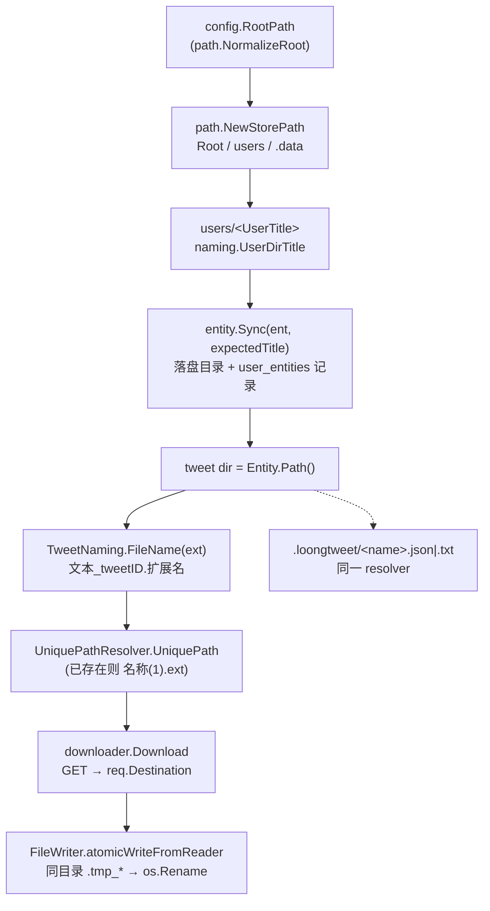

# 命名与落盘路径（Naming & Paths）

> 维护说明：本文面向接手 `internal/naming/`、`internal/utils/fs.go`、`internal/downloader/`、`internal/path/` 的开发者，回答三个问题：**文件名/目录名是怎么算出来的**、**写盘时到底发生了什么**、**改哪一行会波及哪些已落盘文件**。
> 规范摘要见 lat.md/utility-contracts.md 的 Filesystem Paths / Windows File Names / Domain Naming 三节，以及 lat.md/download-pipeline.md 的 Media extension selection 一节（`lat check` 校验的是那些摘要，本文不复述它们，只写操作流程、预算数字与陷阱）。
> 全文事实均来自当前代码；凡属推断而非读到的结论都会显式标注 `[INFERENCE]`。

---

## 1. 全景：一个媒体文件的路径是怎么推出来的



一句话：**目录名由 `naming` 决定并由 `entity` 登记，文件名由 `naming` 决定并由 `utils.UniquePathResolver` 去重，落盘由 `downloader.DefaultFileWriter` 原子完成。** 三段的职责边界很硬，跨段改逻辑是绝大多数命名类 bug 的来源。

| 环节 | 唯一实现 | 备注 |
|------|----------|------|
| 根目录归一化 | `internal/path/store.go#NormalizeRoot` | TrimSpace → 非空 → `filepath.Abs(filepath.Clean())` |
| 用户目录名 | `internal/naming/user_naming.go#UserDirTitle` | 全仓库唯一入口，`resolveUserTitle` / `syncUserAndEntity` / mark / jsonfile 都走它 |
| 列表目录名 | `internal/naming/list_naming.go#NewListNamingFromBase` | 保 `(listID)` 后缀 |
| 推文文件名 | `internal/naming/tweet_naming.go#TweetNaming#FileName` | 文本 + `_<tweetID>` + 规范化扩展名 |
| 扩展名推导 | `internal/utils/fs.go#MediaExtFromUrl` | 推文媒体专用；profile 走另一条更保守的规则 |
| 名称清洗 | `internal/utils/fs.go#WinFileNameWithMaxLen` / `#WinFileNameWithMaxLenStable` | 两套语义，见 §3 |
| 去重 | `internal/utils/fs.go#UniquePath` / `#UniquePathResolver` | 见 §5 |
| 原子写 | `internal/downloader/file_writer.go#DefaultFileWriter#Write` | 见 §6 |

---

## 2. 字节预算模型：`max_file_name_len`

### 2.1 配置链路

| 位置 | 事实 |
|------|------|
| `internal/utils/fs.go#DefaultMaxFileNameLen` | 常量 **158**（注释：为扩展名与碰撞后缀预留空间） |
| `internal/config/config.go` | `MinFileNameLen = 50`、`MaxFileNameLen = 245`；字段名 `max_file_name_len`、环境变量 `TMD_MAX_FILE_NAME_LEN` |
| 字段 Setter | 空值 → `utils.DefaultMaxFileNameLen`；非法值 → 默认；否则 `clampInt(n, 50, 245)` |
| 配置归一化 | `normalizeInt(conf.MaxFileNameLen, 0, MinFileNameLen, MaxFileNameLen)` —— **0 表示"用默认值"**，负数归零 |
| `internal/api/config_handlers.go#HandleConfig` | `MaxFileNameLen == 0` 时回填 `utils.DefaultMaxFileNameLen` |
| `internal/downloading/types.go#RuntimeOptions.normalizedMaxFileNameLen` | `<= 0` 时回填 `utils.DefaultMaxFileNameLen`（双层兜底，见 `internal/service/download_service.go#runtimeOptions` 注释） |
| `internal/downloading/profile/types.go#DefaultConfig` | `MaxFileNameLen: utils.DefaultMaxFileNameLen` |

**预算是 UTF-8 字节，不是字符数。** 所有截断都经过 `internal/utils/fs.go#TruncateUTF8`：按字节切且不会把 rune 切一半；`maxLen <= 0` 返回空串（命名层因此把 `maxLen <= 0` 视为"产出空名"）。

### 2.2 `ExtReserveLen = 8`

`internal/naming/base.go#ExtReserveLen = 8`，含义是**扩展名（含前导点）最多 8 字节**。`normalizeExtension` 的最终截断就是 `TruncateUTF8("."+core, ExtReserveLen)`，所以 `.jpg`/`.webp`/`.m3u8` 原样保留，`.abcdefghijk` 会变成 `.abcdefg`（`TestTweetNaming_FileName` 的 `extension respects reserved budget` 用例）。

### 2.3 三个命名器的预算分配

| 命名器 | 稳定身份（不可截断） | 预算公式 | 158 时的实际余量 |
|--------|----------------------|----------|------------------|
| `TweetNaming` | `_<tweetID>`（`idPart`） | `maxTextLen = maxLen - len("_"+tweetID) - ExtReserveLen`，下限 0 | 19 位 ID → 文本 130 字节 + 20 字节 id + ≤8 字节扩展名 |
| `UserNaming` | `(screenName)`（X 规则下 ≤15 ASCII → 后缀 ≤17 字节） | `fitNameWithSuffix(name, suffix, maxLen)`：`TruncateUTF8(name, maxLen-len(suffix)) + suffix` | 显示名 ≤141 字节 + 后缀 |
| `ListNaming` | `(listID)` | 同上；标题已带 `(id)` 时先剥离再加回 | 标题 ≤145 字节 + 后缀 |

关键实现细节（都读自源码，改预算时逐条对照）：

- `TweetNaming#textPartFor`：文本截到 `maxTextLen` 后为空则用字面量 `tweet`；`baseName = 文本 + "_" + tweetID`。
- `TweetNaming#logBaseName`：**只用于日志**，额外 `TrimRightFunc(unicode.IsSpace)`，长度不受 `maxLen` 约束。
- `UserNaming`：`screenName` 为空时整份预算给显示名（空则 `user`）；`parenthesizedIdentity` 在 `maxLen < 3` 时退化为不带括号的裸截断。
- `ListNaming`：`isNilListNamer` 用 `reflect` 识别 typed-nil，nil 输入 → `list`；标题为空且 `id != 0` → `list(id)`。
- `UserNaming`/`ListNaming` 结尾统一过 `internal/naming/base.go#finalizeName`（`TrimSpace` + `WinFileNameWithMaxLen`），`TweetNaming` 不过这一步（见 §3）。
- `sanitizeNamePart` 会先给片段加前缀 `x` 再清洗、再剥掉：目的是避免片段恰好等于 `CON` 时被当成保留设备名提前加 `_`，让域后缀有机会补上（真正的保留名复检发生在 `finalizeName`/`guardReservedFileName`）。

> 三个命名对象**构造后不可变**（`TestTweetNaming_Concurrent` / `TestUserNaming_Concurrent` / `TestListNaming_Concurrent` 就是这条契约的回归测试）。任何"在 `TweetNaming` 上缓存可变状态"的改动都会破坏并发安全。

---

## 3. 两套清洗策略：`WinFileNameWithMaxLen` vs `WinFileNameWithMaxLenStable`

`internal/utils/fs.go#sanitizeFileNameCore` 是共享核心，两个变体的差别只在核心之后的步骤：

| 步骤 | `WinFileNameWithMaxLen` | `WinFileNameWithMaxLenStable` |
|------|-------------------------|-------------------------------|
| 剔除 URL（`reURL`） | ✅ | ✅ |
| 剔除 `[/\\:*?"<>\|]` | ✅ | ✅ |
| `\r` 删除、`\n` → 空格 | ✅ | ✅ |
| 其他控制字符（`< 0x20`、`0x7f`）删除 | ✅ | ✅ |
| 按 UTF-8 字节预算截断 | ✅ | ✅ |
| `TrimRight(" .")` 尾点/尾空格 | ✅（共两次：保留名前后各一次） | ❌ 保留 |
| 保留设备名前缀 `_` | ✅ | ❌ |
| 最终 `TruncateUTF8(maxLen)` | ✅ | ❌（核心内已按预算截断） |
| **用途** | 目录名（用户/列表）、profile 标题、配置清洗 | **推文文本**（进 `TweetNaming`） |

**为什么推文文本必须用 Stable 版本。** 旧版本写推文媒体名时不裁剪首尾空白与尾点，已经落盘的文件形如 `Hello world._1355100264760393735.jpg`。升级后如果改成裁剪，同一推文重新拉取会算出 `Hello world_1355100264760393735.jpg`：旧文件变孤儿、媒体被重新下载一次。CHANGELOG 顶部也记录了这次"恢复旧版裁剪语义"的修复。

**控制字符为什么两个版本都剔除。** 含控制字符的名字在 Windows 上本就创建不出来，不存在需要兼容的旧文件；而在 Linux/macOS 上控制字符合法，所以旧版本可能真的写过 `a\x01b_123.jpg`，升级后同一推文会得到 `ab_123.jpg`——一次性重复下载 + 孤儿文件，不损坏数据。这是刻意的取舍，不是遗漏。

**边界例子（`TestTweetNaming_FileName` 逐条覆盖）：**

| 输入文本 | 结果文件名 | 说明 |
|----------|-----------|------|
| `"Hello world."` | `Hello world._123.jpg` | 尾点保留 |
| `"Hello world "` | `Hello world _123.jpg` | 尾空格保留（空格在内部，Windows 可创建） |
| `" hello"` | ` hello_123.jpg` | 前导空格保留 |
| `"a\tb"` | `ab_123.jpg` | 控制字符剔除 |
| `"CON"` | `CON_123.jpg` | 不是保留名（stem 是 `CON_123`），不加 `_` |
| `""` | `tweet_123.json` | 空文本回落 |

> 陷阱：推文文本**全是空格**时不会回落到 `tweet`——`textPartFor` 只在结果为空串时才回落，而 Stable 清洗保留空格，`"   "` 非空，于是文件名以空格开头（`test/tweet` 两条回落分支都不触发）。`TestTweetNaming_FileName` 的用例表里没有全空格输入，这一条改动前应先补用例。

**目录名为什么要裁剪。** `internal/entity/storage.go#validateWindowsCompatibleName` 明确拒绝"以空格或点结尾"的实体名，`internal/entity/sync.go#Sync` 在建目录/改名时都会先 `ValidateName`。因此用户/列表目录名必须走 `WinFileNameWithMaxLen`：把推文用的 Stable 变体拿去当目录名，会直接让 `Sync` 返回 `ErrInvalidName`，该用户目录再也建不出来。

---

## 4. 扩展名：单一规则，没有旧名兼容查找

### 4.1 `MediaExtFromUrl` 的判定顺序

```mermaid
flowchart LR
  U[URL] --> P["GetExtFromUrl = path.Ext(url.Parse(u).Path)"]
  P --> C{"ext 含 ':' ?"}
  C -- 是 --> T["截到首个 ':' 之前<br/>xyz.jpg:large → .jpg"]
  C -- 否 --> E{"ext == \"\" ?"}
  E -- 否 --> R[ext]
  E -- 是 --> F["twimgFormatExt(u)<br/>仅 twimg 主机 + format 查询参数"]
  F --> R2["返回 '' 时调用方回落 .jpg"]
```

| URL | 扩展名 | 依据 |
|-----|--------|------|
| `https://pbs.twimg.com/media/xyz.jpg:large` | `.jpg` | 冒号截断 |
| `https://pbs.twimg.com/media/xyz.png:orig` | `.png` | 冒号截断 |
| `https://video.twimg.com/.../abc.mp4` | `.mp4` | 路径扩展名通吃 |
| `https://pbs.twimg.com/media/xyz?format=jpg&name=medium` | `.jpg` | `format` 回落 |
| `https://pbs.twimg.com/media/xyz?format=JPG` | `.jpg` | `format` 先 lowercase |
| `https://pbs.twimg.com/media/xyz?format=../evil` | `""` | 非 `[a-z0-9]` 拒绝 |
| `https://example.com/media/xyz?format=png` | `""` | **非 twimg 主机不认 `format`** |
| `https://example.com/media/xyz` | `""` | 无信息 |
| `://invalid-url` | 错误 | `url.Parse` 失败 |

- `GetExtFromUrl` 用 `path.Ext`（不是 `filepath.Ext`）：URL path 永远是正斜杠，Windows 上 `filepath.Ext` 会按 `\` 切分而失效。
- `twimgFormatExt` 只接受 **小写化后**、字符全为 `[a-z0-9]`、长度 ≤5 的值；主机必须是 `twimg.com` 或 `*.twimg.com`（`isTwitterMediaHost`，末尾点会被去掉）。
- 调用方 `internal/downloading/tweet_download.go#downloadTweetMedia`：`ext, err := utils.MediaExtFromUrl(u); if err != nil || ext == "" { ext = ".jpg" }`。

### 4.2 `normalizeExtension` 做了什么

`internal/naming/base.go#normalizeExtension` 是扩展名进入文件名的唯一闸门，顺序为：

1. `TrimSpace`；
2. 取**最后一个** `\` 或 `/` 之后的部分（防 `../jpg` 这类拼接出子路径）；
3. 只保留 `[字母 数字 . - _]`（Unicode 字母/数字，非 ASCII 也留）；
4. `Trim(" .")`；空则返回 `""`；
5. `TruncateUTF8("."+core, ExtReserveLen)`。

由此可确认：扩展名**不可能**引入路径分隔符，也不可能超过 8 字节；`jpg`（无点）会被补成 `.jpg`，`.` 会退化成空串。

### 4.3 最后一道复检与"没有兼容查找"

- `TweetNaming#FileName` = `guardReservedFileName(baseName + normalizeExtension(ext))`；`guardReservedFileName` 调 `utils.IsWindowsReservedFileName`（`CON`/`PRN`/`AUX`/`NUL`/`CLOCK$`/`CONIN$`/`CONOUT$`/`COM1-9`/`LPT1-9` 及 `CON.txt` 形态）。推文名永远带 `_id` 后缀，所以这是纵深防御而非真实改名路径。
- **不存在旧命名查找。** `TweetNaming.LegacyFileNames`、目录级碰撞索引、旧文本清洗器、`Tweet.LegacyURLs` 都已删除。一条历史命名规则被替换后，重新处理该推文只会**用新规则重新下载**：如果新旧文件名不同，旧文件留在原地成为孤儿；如果文件名相同（文件已存在），会被去重器改名成 `名称(1).ext`（§5）。没有"先找找旧文件"这一步，任何在 `naming` 里加回查找逻辑的改动都会引入第二个真相源。
- **`EnsurePhotoHighQuality` 不是命名逻辑。** 它只改查询参数（`name=4096x4096`，已有 `orig`/`4096x4096` 时不动）且跳过视频，不碰 path，因此不会改变扩展名推导结果；`downloadTweetMedia` 是"用原始 URL 推扩展名、用升级后 URL 下载"。改这条链路时不要顺手把 `MediaExtFromUrl` 的入参换成 `downloadURL`——今天结果相同，但会把两件事耦合起来。
- **profile 走另一条更保守的规则**：`internal/downloading/profile/downloader.go#imageExtFromURL` = `GetExtFromUrl` + lowercase + 白名单 `{.jpg,.jpeg,.png,.gif,.webp}`，否则 `.jpg`。它不看 `format` 查询参数，也与 `MediaExtFromUrl` 无关。

---

## 5. 去重：`UniquePath` 与 `UniquePathResolver`

| 维度 | `utils.UniquePath(path)` | `utils.UniquePathResolver.UniquePath(path)` |
|------|--------------------------|---------------------------------------------|
| 判据 | 只查磁盘（`PathExists` = `os.Lstat`） | 磁盘 **+ 已预留集合** |
| 未落盘路径 | 每次都会重新返回同一个名字 | 首次即预留，第二次起递增 |
| 零值可用 | 不适用 | ✅（`reserved` 为 nil 时惰性初始化，`TestUniquePathResolver_ZeroValue`） |
| nil 接收者 | — | 回落到 `UniquePath` |
| 路径归一化 | 无 | `filepath.Abs`（失败退 `Clean`），**Windows 上再 `ToLower`** |
| 空路径 | `ErrEmptyPath` | `ErrEmptyPath` |
| 上限 | `maxUniquePathRetries = 10000` 次后报错 | 同左 |
| 生产调用点 | 仅测试与 benchmark（`TweetNaming#FilePath` 的无 resolver 版本） | `internal/downloading/tweet_download.go#BatchDownloadTweet` 创建，全批次共享 |

**递增规则**（`nextUniquePathCandidate`）：

- 形如 `名称(N).ext`（`N` 为十进制数字，且未超 `int` 上限）→ `名称(N+1).ext`；
- 其他情况 → `名称(1).ext`；
- dotfile 特判：`filepath.Ext(".env") == ".env"`，代码在 `ext == base` 时把 ext 置空，于是得到 `.env(1)` 而不是 `.ext` 形态（`TestUniquePath_PreservesDotfileName`）。

**Windows 大小写语义**：预留 key 在 Windows 上 lowercase，因此 `Tweet.jpg` 与 `tweet.jpg` 视为同一路径（`TestUniquePathResolver_UsesPlatformPathSemantics`，该用例在非 Windows 上 `t.Skip`）。

**必须理解的一点：名称已存在 ⇒ 不会覆盖。** `UniquePathResolver.UniquePath` 在磁盘检查命中时会直接换名，所以**重新下载同一推文的媒体不会就地覆盖原文件，而是在同目录追加 `名称(1).jpg`、`(2)`…** `TestUniquePath_WithFiles`（存在文件 → `testfile(1).txt`）与 `TestTweetNaming_FilePathWithResolver`（同 resolver 两次调用 → `test_123.jpg` / `test_123(1).jpg`）分别固定了这两个分支。`[INFERENCE]` 顺带影响：反复重跑同一批下载会累积 `(N)` 文件直到 10000 次上限报错。

**并发语义**：resolver 内部一把 `sync.Mutex` 保护 `reserved`，同一批次的所有 worker 共享同一个 resolver，因此"同批次内两条推文算出同名"也能被拆开。它是**降级而非正确性保证**的那一半在 `FileWriter` 侧（§6 的 256 槽哈希锁）。

---

## 6. 写盘：`DefaultFileWriter`

### 6.1 非流式 `Write`（推文媒体、JSON/TXT 元数据都走这条）

1. `getLock(req.Path)` → `locks[hash%256]`（`hash = hash*31 + byte`），加锁；
2. **可选** `SkipUnchanged`：先 `fileExists`，大小相同再比 MD5（`computeFileHash` vs `computeDataHash`），全等 → 直接 `Success`，不写；
3. **可选** `CreateVersion`：文件存在且 `versionManager != nil` 时 `CreateVersion`，成功后置 `result.Versioned`；
4. `atomicWriteFromReader`：`MkdirAll(dir, 0755)` → `os.CreateTemp(dir, pattern)` → `io.CopyBuffer`（**64KB** 缓冲）→ `Close` → `os.Rename(tempPath, path)`；
5. `setModTime`：`os.Chtimes`，**失败只 `log.Warnf`，不影响 `Success`**；
6. 返回 `WriteResult{Success, NewSize, OldSize, Versioned}`。

临时文件细节：

- 建在**目标同目录**（`filepath.Dir(path)`），保证 `os.Rename` 是同卷原子替换（Windows 上 `os.Rename` 走 `MoveFileEx(REPLACE_EXISTING)`）。
- pattern 默认 `.tmp_*`；当**基础名**匹配 `tweetIDRe = _(\d+(\(\d+\))?)\.\w+$` 时改为 `.tmp_*_<tweetID>`，让残留文件可追溯回推文（例如 `text_1355100264760393735.jpg` → `.tmp_<random>_1355100264760393735`）。
- `defer os.Remove(tempPath)`：失败路径会清理，但**进程被强杀时残留不会被任何清理逻辑回收**（全仓库只有这两处出现 `.tmp_`）。

### 6.2 流式 `Write`（`req.IsStream()`，>10MB 走这条路）

流程同上，但：

- `SkipUnchanged` **退化为只比大小**（无法预先算 hash），且要求 `size > 0` 才判断；
- 失败重试时由 `internal/downloader/downloader.go` 在 size 不符时 `os.Remove(req.Destination)` 后重下；
- 落盘仍用同一个 `atomicWriteFromReader`。

### 6.3 谁开、谁不开 `SkipUnchanged` / `CreateVersion`

| 写入方 | `SkipUnchanged` | `CreateVersion` | 说明 |
|--------|-----------------|-----------------|------|
| 推文媒体（`downloadTweetMedia` → `DownloadRequest.Options`） | ❌ | ❌ | 只设 `SetModTime: &tweet.CreatedAt`；`downloader` 原样透传零值 |
| 推文 `.loongtweet/*.json` / `*.txt` | ❌ | ❌ | 只设 `ModTime`，写入失败仅告警（`writeAuxiliaryTweetFile`） |
| Profile 头像/横幅/描述/`profile.json` | ✅（`profile.DefaultConfig().SkipUnchanged = true`） | ✅（`EnableVersioning = true`） | 内容未变则静默跳过，变更时按需备份 |
| 版本备份文件本身 | ❌ | ❌ | `CreateVersion` 内部 `WriteRequest{Path, Data}`，不含 Options |

**语义差异必须记住**：推文媒体既不做 MD5 比对也不做版本备份——它的"幂等"完全靠文件名（文本 + id + 规范化扩展名）与去重器，而不是靠内容比对。

---

## 7. 版本备份：`.versions/`

`internal/downloader/version_manager.go#DefaultVersionManager`：

- `NewVersionManagerWithWriter(versionsDirName, fw)`：空目录名 → `.versions`；生产调用点 `internal/service/download_service.go#initDownloader` 传 `.versions`；`fw` 为 nil 时用内部 `fallbackWriter`（`NewFileWriter(nil)`），`TestVersionManager_WithoutFileWriter_Fallback` 覆盖。
- `CreateVersion(sourcePath)` 顺序：**空路径报错 → 切 stem/ext → 空 stem 置 `_unknown` → `os.ReadFile(source)` → `MkdirAll(versionsDir)` → 写备份**。`ReadFile` 先于 `MkdirAll` 是有意为之：源文件不存在时不会留下空目录。
- 备份路径：`filepath.Join(filepath.Dir(source), versionsDirName) / "<stem>_<timestamp><ext>"`。
- **时间戳格式**：`time.Now().Format("20060102_150405")` + `fmt.Sprintf("_%d", time.Now().Nanosecond()%1000)` —— 最后一段是**纳秒模 1000（0–999）**，不是毫秒；同一秒内最多 1000 个不同后缀。两次 `time.Now()` 分别取值，跨秒边界可能出现"秒字段与后缀来自不同时刻"的组合（无害，但别把它当严格单调序）。
- 空 stem 保护针对 `.gitignore` 这类无主文件名（`TestVersionManager_CreateVersion_DotFile`），空路径与不存在的文件各有独立用例（`TestVersionManager_CreateVersion_EmptyPath` / `_NonExistentFile`）。
- `CleanupOldVersions(maxAge)` **当前无调用方**（源码 TODO 已注明，全仓库 grep 只有定义、测试与 CHANGELOG 提及），所以 `.versions/` 只增不减，别假设磁盘占用会自动收敛。
- 备份目录位置：目标文件所在目录 + `.versions`，即
  - profile：`users/<UserTitle>/.loongtweet/.profile/.versions/`
  - 推文：不产生备份

---

## 8. `StorePath`：根目录与固定子路径

`internal/path/store.go`：

| 字段 | 值 | 说明 |
|------|-----|------|
| `Root` | `NormalizeRoot(root)` | TrimSpace → 非空 → `filepath.Abs(filepath.Clean(root))` |
| `Users` | `Root/users` | 所有用户/列表实体目录的父目录 |
| `Data` | `Root/.data` | 隐藏数据目录 |
| `DB` | `Root/.data/foo.db` | SQLite |
| `ErrorsPath` | `Root/.data/errors.json` | 推文失败转储 |
| `JSONErrorsPath` | `Root/.data/json_errors.json` | JSON 重放失败转储 |

`NewStorePath` 的**副作用**：对 `Root`、`Users`、`Data` 依次 `os.MkdirAll(0755)`，任一失败即返回错误并返回 nil（`TestNewStorePath`、`BenchmarkNewStorePath` 覆盖）。它是**幂等且可重入**的：`internal/service/download_service.go#storePathFor`、`internal/api` 的 errors 汇总接口、`main.go` 启动流程都会各自调用一次，不要试图"缓存成全局单例"——调用点本来就允许并发重复创建（`store_test.go` 有并发用例）。

其他固定目录名（都不是配置项，硬编码）：

| 路径片段 | 定义处 | 内容 |
|----------|--------|------|
| `.loongtweet` | `internal/downloading/profile/downloader.go` 的 `profileDirName` 与 `saveTweetJson`/`saveLoongTweet` | 推文 `*.json`/`*.txt`；profile 在其下再套一层 |
| `.loongtweet/.profile` | `profileSubDirName` | `avatar.jpg`、`banner.jpg`、`description.txt`、`profile.json`、`.versions/` |
| `.data` | `path.NewStorePath` | DB 与错误转储 |
| `.tmd-remove-v1-<hash>-*` | `internal/entity/storage.go` 的 `stagedDirectoryVersionPrefix` | 实体目录删除的暂存名，启动时由 `entity.CleanupStagedDirectories` 回收 |

`internal/downloading/profile/storage.go#FileStorageManager.GetFilePath` 是 profile 文件名（`avatar.jpg` 等）的唯一来源；`GetFilePathWithExt` 在扩展名白名单命中时给 `avatar`/`banner` 换后缀。

---

## 9. 禁止 / 必须

**必须**

1. 生成任何落盘名称时**必须**走 `naming` 包：目录用 `naming.UserDirTitle` / `naming.NewListNamingFromBase(...).SanitizedTitle()`，媒体文件用 `naming.TweetNaming#FileName`。新增入口（CLI/API/JSON 重放）一律复用，不要各自内联清洗。
2. 推文媒体路径**必须**用 `TweetNaming#FilePathWithResolver`（批次共享 `utils.NewUniquePathResolver()`）。无 resolver 的 `TweetNaming#FilePath` 只服务测试与 benchmark。
3. 实体（用户/列表）目录名**必须**能通过 `internal/entity/storage.go#ValidateName`：单一路径组件、不以空格或点结尾、不含 Windows 保留字符、非保留设备名。
4. 任何"按长度截断"的实现**必须**以 UTF-8 字节为单位并走 `utils.TruncateUTF8`。
5. 改动任何清洗/扩展名/预算逻辑时，**必须**同时评估"已落盘文件名是否变化"，并在 CHANGELOG 里写清一次性重下载与孤儿文件的影响。

**禁止**

1. 禁止在命名器之外拼文件名或目录名（例如 `filepath.Join(dir, tweet.Text+".jpg")`）：会绕过预算、保留字符清洗、保留设备名复检与去重。
2. 禁止把 `WinFileNameWithMaxLenStable` 用于实体目录名（尾点/尾空格会被 `ValidateName` 拒绝，`Sync` 直接报错）。
3. 禁止把 `normalizeExtension` 的结果当作路径安全校验使用（它只保证字节预算与字符集，不是路径校验器）；也禁止跳过它直接拼扩展名。
4. 禁止给推文媒体开启 `SkipUnchanged` 或 `CreateVersion`：媒体不做内容比对、不做版本备份是既有契约（也就意味着别指望 `.versions/` 里找到媒体旧版本）。
5. 禁止假设"同名就覆盖"：磁盘上已存在的目标会被去重成 `名称(1).ext`。
6. 禁止为旧命名规则写兼容查找/别名（`LegacyFileNames` 一类机制已被有意删除）；规则变更的代价就是"重新下载一次 + 旧文件留成孤儿"。
7. 禁止在 `naming` 的命名对象上引入可变状态或包级可变变量（`MaxFileNameLen` 曾是可变的全局量，已改为参数注入；并发一致性测试就是为守住这条）。
8. 禁止绕开 `path.NormalizeRoot` / `NewStorePath` 自己拼 `root/users`（大小写、相对路径、绝对化语义会不一致）。

---

## 10. 改这里会波及什么

| 你改了 | 直接影响 | 连带影响 |
|--------|----------|----------|
| `WinFileNameWithMaxLen`（清洗语义） | 用户/列表/profiled 目录名 | `entity.Sync` 会 `os.Rename` 磁盘目录并更新 DB 记录（改名风暴）；若新名以空格/点结尾，`ValidateName` 拒绝 → 目录不再创建；旧目录成孤儿（`CleanupStagedDirectories` 只处理 `.tmd-remove-*`，不会回收这类改名遗留） |
| `WinFileNameWithMaxLenStable` | 推文媒体文件名 | 已下载文件变孤儿 + 重新下载；`tweetIDRe` 仍能匹配（它只看 `_<id>.ext`），因此临时文件命名不受影响 |
| `normalizeExtension` / `ExtReserveLen` | 媒体与元数据文件名、文本预算 | 全量改名 → 一次性重下载；`.loongtweet/*.json|txt` 同样改名 |
| `MediaExtFromUrl` / `twimgFormatExt` | 扩展名 | 文件名变化 → 重下载；profile 的 `imageExtFromURL` 是独立实现，不受影响 |
| `max_file_name_len` 默认值/上限 | 三个命名器的预算 | 目录名与文件名同时变 → 目录重命名 + 媒体重下载 |
| `UserDirTitle` / `NewListNamingFromBase` | 目录名 | `entity.NewUserEntity`/`NewListEntity` → `entity.Sync` → 目录重命名；symlink（`list_sync.go`/`entity.go`）指向旧路径会失效并被重建 |
| `UniquePath` / `nextUniquePathCandidate` | 去重后缀规则 | 影响重下载落地名与 `(N)` 递增；不改变"已存在则不覆盖"这一点，除非显式删除磁盘检查 |
| `FileWriter` 临时文件/锁 | 并发写与原子性 | 临时文件建到别的目录会破坏 `os.Rename` 原子性；256 槽锁改小会放大同路径并发冲突（它是"同路径串行"的**唯一**保证） |
| `CreateVersion` 时间戳/stem | `.versions/` 文件名 | 旧备份不会被重命名；`_unknown` 前缀约定改变会让旧备份与新备份混排 |
| `StorePath` 子路径 | 整个存储布局 | `Root/users` 改名等于所有实体目录失联（DB 里存的是相对父目录 + 名字，见 `entity.Sync`）；`.data` 改名等于换库 |

---

## 11. 如何验证

### 11.1 单元测试（按子系统切分，函数名均已在仓库中确认存在）

```bash
# 命名器：预算、截断、扩展名规范化、保留名复检、并发一致性
go test ./internal/naming/ -count=1
go test ./internal/naming/ -run 'TestTweetNaming_FileName|TestTweetNaming_baseName_Truncation|TestUserNaming_PreservesScreenNameIdentity|TestListNaming_PreservesExistingIDSuffix|TestExtReserveLen' -count=1

# 文件系统工具：两套清洗、扩展名推导、去重（含 Windows 大小写语义）
go test ./internal/utils/ -count=1
go test ./internal/utils/ -run 'TestWinFileNameWithMaxLen$|TestWinFileNameWithMaxLenStable|TestMediaExtFromUrl|TestGetExtFromUrl|TestUniquePath' -count=1
go test ./internal/utils/ -run 'TestUniquePathResolver' -count=1

# 落盘与版本备份：原子写、跳过、备份、并发同路径/不同路径
go test ./internal/downloader/ -count=1
go test ./internal/downloader/ -run 'TestFileWriter|TestVersionManager' -count=1

# 存储路径派生与 MkdirAll 副作用
go test ./internal/path/ -run TestNewStorePath -count=1
```

### 11.2 端到端（命名规则最接近"独立运行"的方式）

命名子系统没有独立可执行入口，最接近真实验证的是 CLI 单用户下载（需要一个可用 `config.yaml`；`root_path` 决定落盘位置，`max_file_name_len` 决定预算）：

```bash
go run . -user <screen_name>          # 拉取该用户的推文与媒体，按 naming 规则落盘
go run . -user <screen_name> -noprofile   # 跳过 profile，只看媒体命名
go run . -jsonfolder <path>           # JSON 重放路径，目录名由 UserDirTitle 现算
```

验证要点：`users/<UserTitle>/` 目录名是否等于 `naming.UserDirTitle(...)` 的结果；媒体文件名是否为 `<清洗后文本>_<tweetID><规范化扩展名>`；把同一命令再跑一次，观察是否出现 `名称(1).ext`（这既验证了去重、也验证了"不覆盖"的行为）。

### 11.3 基准与全仓库门禁

```bash
go test ./internal/naming/ -run '^$' -bench 'BenchmarkTweetNaming' -benchmem   # 命名热路径
go test ./internal/path/ -run '^$' -bench BenchmarkNewStorePath -benchmem      # 启动路径
go test -race -count=1 ./internal/naming/ ./internal/utils/ ./internal/downloader/ ./internal/downloading/
go vet ./...
npx --yes lat.md@0.12.2 check    # 与 CI 的 verify 门禁一致（.github/workflows/go.yml）
```

`go test -race` 是这条链路上最有价值的一条：命名对象不可变 + `UniquePathResolver` 加锁 + `FileWriter` 256 槽锁三者任一被破坏，只有 race 检测能稳定抓到。

### 11.4 手工核对清单

1. `doc/naming-and-paths.md` 里出现的每个符号（`TweetNaming#FileName`、`WinFileNameWithMaxLenStable`、`nextUniquePathCandidate`…）在源码里能搜到。
2. 改命名规则后，`users/` 下是否出现同一实体的两个目录（改名遗留）——用 `read users/` 目视即可。
3. 媒体目录里是否出现 `.tmp_*` 残留（强杀进程后可能出现，当前无自动清理）。
