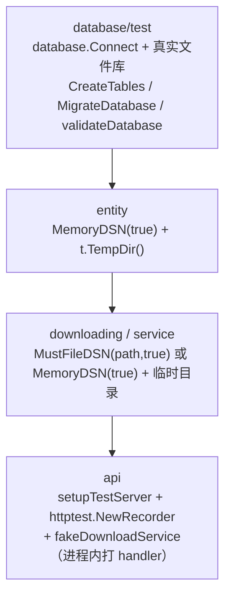
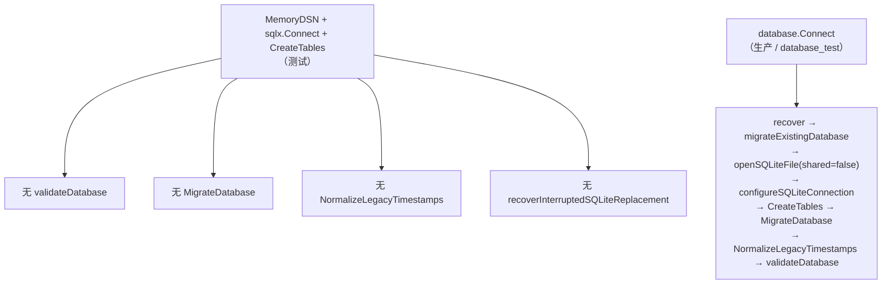
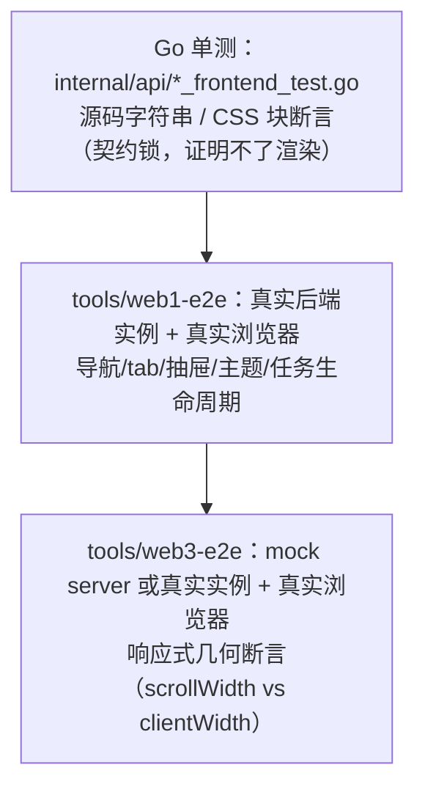

# 测试策略、约定与工具链

> 维护说明：本文件描述 TMDP 的**测试基础设施、硬性约定、断言质量标准与验证命令**。规范摘要见 [[lat.md/development.md]] 的 Testing & CI 一节（含 Network Timeout Tests、Test Fixture Privacy 两个子节）与 What NOT to Do 一节。为避免行号漂移，本文一律使用符号锚点（`包#函数`），不写具体行号。改动测试基础设施后请同步更新本文件。

**解决什么问题**：动手写/改测试之前，需要知道"测试放哪、基础设施怎么起、哪些写法会被打回、改完用什么命令验证、改这里会波及什么"。
**适用读者**：要新增测试、修测试、或调整 `internal/database` / `internal/api` 测试脚手架的开发者。

## 1. 规模与分布

复核命令（仓库根执行）：

```bash
# 测试文件总数
find . -name "*_test.go" -not -path "./node_modules/*" | wc -l
# 顶层测试函数总数
grep -rh "^func Test" --include=*_test.go . | wc -l
# 子测试数量（t.Run 调用点）
grep -rh "t.Run(" --include=*_test.go . | wc -l
```

> **数字会漂移，以命令输出为准。** 下面的快照取 `1f5ff79`（2026-09-23）：**94 个测试文件 / 1196 个 `func Test` / 401 处 `t.Run`**。上一版记的 1184 / 393 是更早的快照——加删测试后不要只改数字，顺手确认结论段是否还成立。

| 目录 | 测试文件 | `func Test` | 性质 |
|---|---:|---:|---|
| `internal/api` | 25 | 418 | **集成**：`setupTestServer` 起完整 handler 栈（`httptest.NewRecorder` + 内存库 + `fakeDownloadService`） |
| `internal/downloading` | 16 | 143 | **集成**：真实临时目录 + 文件库/内存库 + 自定义 `RoundTripper` |
| `internal/downloading/profile` | 3 | 34 | **集成**：`httptest.Server` 驱动超时/取消语义 |
| `internal/database/test` | 13 | 97 | **集成**：外部测试包 `database_test`，真实文件库 + 建表/迁移/WAL |
| `internal/database` | 3 | 12 | 单元：schema 文本一致性、迁移原子替换（纯文件 IO） |
| `internal/service` | 3 | 64 | 混合：接口/依赖校验 + 纯函数（`effectiveAutoFollow`、`shouldFollowMember`） |
| `internal/entity` | 3 | 53 | **集成**：内存库 + 真实临时目录（路径校验/暂存目录/符号链接） |
| `internal/twitter` | 4 | 41 | 混合：纯解析 + `httptest` + 冷却/限流状态机 |
| `internal/logging` | 4 | 36 | 单元：脱敏、ANSI 剥离、轮转 |
| `internal/downloader` | 1 | 44 | **集成**：`httptest.Server` 流式下载/重试/并发 |
| `internal/cli` | 2 | 45 | 单元 + `httptest`（executor） |
| `internal/scheduler` | 1 | 39 | 状态机 |
| `internal/config` | 2 | 38 | 单元 + 文件 IO（备份/恢复） |
| `internal/utils` | 1 | 33 | 纯函数（1 处真实 HTTP：`resty.NewWithClient(server.Client())`） |
| `internal/bot` + 6 个平台包 | 7 | 33 | 混合：`IsAllowed`/格式化/`Stop` 幂等 |
| `internal/naming` | 1 | 20 | 纯函数（文件名/路径/截断） |
| `internal/consolelog` | 1 | 19 | 并发、环形缓冲、管道重组 |
| `internal/path` | 1 | 12 | 纯函数 |
| `internal/database/tx` | 1 | 2 | 事务管理器 |
| 仓库根（`main_test.go` / `signal_test.go`） | 2 | 13 | 启动参数解析、信号订阅 |
| **合计** | **94** | **1196** | |

分布特征：

- **集成测试集中在 `internal/api` + `internal/downloading` + `internal/database/test` + `internal/entity`**（共 57 文件 / 711 测试）。它们共享同一套脚手架：内存库或临时目录 + 内存 HTTP 栈，**不碰真实网络、不碰 `%APPDATA%\.tmd2`**。
- **纯单元测试集中在 `internal/naming`、`internal/path`、`internal/utils`、`internal/logging`（脱敏部分）、`internal/consolelog`**：无 IO、无 DB、可直接按测试函数名跑。
- 只有 **2 个外部测试包**：`internal/database/test`（13 文件全部 `package database_test`）与 `internal/entity/entity_test.go`（`package entity_test`）。前者用于从外部验证 `database` 包的公开 CRUD 契约；后者与同目录的包内测试（`storage_internal_test.go`、`operation_lock_test.go` 是 `package entity`）配合，专门测不可导出符号。



（箭头表示"上层脚手架建立在更接近生产的初始化之上"，**不**表示包之间的 import 依赖；实际 import 方向见 `lat.md/development.md` 的 Dependency Rules。）

## 2. 测试基础设施

### 2.1 三个 DSN 入口（先选对入口，再谈其他）

| 入口 | 用途 | shared cache | 连接池配置 | 调用点 |
|---|---|---|---|---|
| `database.MemoryDSN(sharedCache)` | 单元/集成测试的内存库 | 测试一律传 `true` | 无（用 `sqlx` 默认池） | **25 处**：`internal/api/server_test.go`(11)、`internal/api/db_handlers_test.go`(1)、`internal/database/test/*`(9 文件各 1)、`internal/database/tx/manager_test.go`(1)、`internal/downloading/profile/downloader_test.go`(1)、`internal/entity/storage_internal_test.go`(1)、`internal/service/download_service_test.go`(1) |
| `database.MustFileDSN(path, sharedCache)` | 测试用临时文件库 | 全部传 `true` | 无 | **4 处**：`internal/downloading/test_helper_test.go`、`internal/database/test/db_test.go`(2)、`internal/database/test/connect_test.go` |
| `database.Connect(path)` | **生产**文件库 | `openSQLiteFile(path, false)` | `configureSQLiteConnection` | 仅生产与 `internal/database/test` |

`database.MemoryDSN` 的完整形态：

```go
// internal/database/sqlite.go#MemoryDSN
name := "tmd-mem-" + uuid.NewString()
return "file:" + name + "?mode=memory&" + query.Encode()
```

**为什么每次调用都生成唯一库名**（源码注释原文：*每个测试/调用使用独立的内存库名称，避免共享内存 DSN 在不同测试之间串扰*）：`cache=shared` 时，**同名**内存库在**同一进程内跨连接共享**。如果 DSN 固定为 `file::memory:?cache=shared`，那么同一个 `go test ./internal/api/` 进程里所有测试会共用一张库——`CreateTables` 幂等、但数据行互相可见，测试顺序一变就出现"幽灵数据"。唯一名字让每个 `MemoryDSN` 调用拿到一张干净库。

**为什么 `sharedCache` 必须传 `true`**：`mode=memory` + 非共享缓存时，SQLite 的内存库**绑定到单条连接**；池一旦开第二条连接就是一张空库（表都不存在）。仓库当前所有调用点都写 `MemoryDSN(true)`，`MemoryDSN(false)` **没有调用点**。新增测试照抄 `true`。

内存库与生产库的**行为差异**（写测试时必须知道）：



也就是说：**迁移、schema 校验、时间戳归一化这三条路径，只有 `internal/database/test` 覆盖得到**。在 `internal/api` / `internal/downloading` 里用内存库写的测试，验证不了它们。

### 2.2 文件库 DSN 与路径规范化

`database.FileDSN` 会把路径转成绝对路径、`filepath.ToSlash`，并在 Windows 盘符路径前补 `/`，再拼成 `file:///C:/...` 形式；`MustFileDSN` 只是 `FileDSN` 的 panic 包装（测试脚手架里用它避免到处写 `if err != nil`）。

`internal/database/sqlite.go#addSQLiteQueryDefaults` 给**两种 DSN**统一注入：

| 查询参数 | 值 | 作用 |
|---|---|---|
| `_pragma` | `journal_mode(WAL)` | 并发读不阻塞；`internal/database/test/connect_test.go#TestConnect_WALMode` 直接断言 `PRAGMA journal_mode == "wal"` |
| `_pragma` | `busy_timeout(30000)` | 由 `sqliteBusyTimeoutMs` 决定（30s），避免瞬时锁冲突直接报 `SQLITE_BUSY` |
| `_time_format` | `sqlite` | 由 `sqliteTimeFormat` 决定，统一时间扫描格式 |

`internal/database/sqlite.go#configureSQLiteConnection` 只对**文件库生产连接**生效：`SetMaxOpenConns(1)` / `SetMaxIdleConns(1)`（SQLite 写串行化）/ `ConnMaxLifetime(30m)` / `ConnMaxIdleTime(10m)`。`internal/database/test/connect_test.go#TestConnect_ConnectionPoolSettings` 断言 `MaxOpenConnections == 1`。

驱动是 `modernc.org/sqlite`（纯 Go，`internal/database/sqlite.go` 中 blank import），`DriverName = "sqlite"`。**这一点与发布构建对齐**：CI 用 `CGO_ENABLED=0` 交叉编译六个平台，纯 Go 驱动是前提，所以测试里**不要**引入需要 CGO 的 SQLite 依赖或 `mattn/go-sqlite3`。

### 2.3 各包的测试脚手架（照抄现成的，不要另起一套）

| 脚手架 | 位置 | 它做了什么 |
|---|---|---|
| `setupTestDB` | `internal/downloading/test_helper_test.go` | `t.TempDir()/test.db` + `MustFileDSN(path, true)` + `CreateTables`；**不** `Close`（调用方 `defer db.Close()`） |
| `setupTestDB` | `internal/api/db_handlers_test.go` | `MemoryDSN(true)` + `CreateTables` |
| `setupTestServer` / `setupTestServerWithAppRoot` | `internal/api/server_test.go` | 建库 + `CreateTables` + 构造 `config.Config{RootPath: t.TempDir(), ...}` + `NewServer`，并注册三条 `t.Cleanup`（关 `taskManager`、`downloadQueue.CloseAndWait`、`authRateLimit.Stop`） |
| `serveAPI` | `internal/api/server_test.go` | `httptest.NewRecorder()` + `server.buildHandler().ServeHTTP(rr, req)` —— **进程内**打完整中间件链，不开 socket |
| `newMultipartUploadRequest` | `internal/api/server_test.go` | 构造上传用的 multipart 请求 |
| `openStorageTestDB` | `internal/entity/storage_internal_test.go` | `MemoryDSN(true)` + `CreateTables` + `t.Cleanup(db.Close)` |
| `createTestDependencies` | `internal/service/download_service_test.go` | 组装 `service.Dependencies` |
| `captureDownloadLog` | `internal/downloader/downloader_test.go` | 抓取下载器日志输出（用于日志契约断言） |
| `environmentWithTimezone` | `internal/api/frontend_datetime_test.go` | 复制 `os.Environ()` 并覆写 `TZ`，用于跨时区断言 |
| `cssBlock` | `internal/api/web3_frontend_test.go` | 从 CSS 文本中切出某个 `@media` 块 |

**`setupTestServer` 的三条 `t.Cleanup` 是必需的**：漏掉 `downloadQueue.CloseAndWait` 会留下后台 goroutine，`-race` 全包跑时表现为超时或竞争报告。

### 2.4 测试替身（本仓库的三种风格）

1. **channel 捕获型**（推荐用于"任务是否真的执行了"）：`internal/api/server_test.go#fakeDownloadService` 用 `batchCalls chan batchDownloadCall` 把调用参数投出来，测试 `select` 等待。同步点落在 channel 上，没有 sleep。
2. **自定义 `http.RoundTripper` 型**（推荐用于网络错误/重试）：`internal/downloading/retry_batch_test.go#retryUserMediaTransport` 第一次返回 `errors.New("connection reset by peer")`，第二次返回正常响应，并用互斥锁计数 `CallCount()`。断言直接落在"发了几次请求"上。
3. **接口能力探测型**：`internal/api/middleware_test.go#mockResponseWriter` / `#mockHijacker` / `#mockFlusher` / `#mockPusher`，用来验证中间件对可选接口（Hijack/Flush/Push）的降级分支。

其他替身：`internal/downloading/tweet_download_test.go#mockTweetDownloader` / `#mockTweetFileWriter`、`internal/database/helpers_test.go#mockSqlResult`、`internal/api/download_queue_audit_test.go#stubResponseWriter`、`internal/naming/naming_test.go#mockListBase`。

**注意**：替身是**测试文件内**定义的（如 `fakeDownloadService` 在 `server_test.go` 里）。不要为了复用把 fake 提到生产包——`internal/service/progress.go#NopReporter` 是唯一一个生产包内的"空实现"，它服务生产代码路径（`downloadServiceImpl.getReporterOrDefault` 的 nil 兜底），不是测试替身。

## 3. 硬性约定

### 3.1 Fixture 隐私：只用合成标识符与保留域名

来源：`lat.md/development.md` 的 Test Fixture Privacy 一节（*Do not put real tweet ids, user ids, media URLs, CDN URLs, or copied live-download log snippets in tests*）。

| 类别 | ✅ 仓库既有做法 | ❌ 禁止 |
|---|---|---|
| tweet id / user id | `1000000000000000001`…`1000000000000000006`（`internal/downloader/downloader_test.go`、`internal/downloading/tweet_download_test.go`） | 真实雪花 ID |
| 主机名 | `example.invalid`（9 个测试文件使用）、`httptest.Server` 的 `server.URL` | 真实域名 / 真实 CDN 主机 |
| 媒体 URL | 需要"生产主机形状"时保留主机、路径与 id 合成：`https://pbs.twimg.com/media/xyz?format=png&name=large`、`https://video.twimg.com/tweet_video/123.mp4` | 拷贝真实下载 URL |
| 日志片段 | 手写期望串：`tweet_id=1000000000000000001 source="unit_test" attempt=1 max_retries=2 url="https://example.invalid/media.bin?tag=test"` | 从生产日志复制整行 |
| 用户名 | `alice` / `bob` / `testuser` / `slow_user` | 真实账号 |

**该表已复核（2026-09-23）**：`internal/utils/utils_test.go#TestMediaExtFromUrl` 的全部用例都用合成 `xyz` 路径（`https://pbs.twimg.com/media/xyz.jpg:large`、`xyz.png?name=4096x4096` 等），没有真实 CDN 媒体文件名残留。以后若在该表里看到形状不同的字面量，按下面这条判据处理。

判据（写新 fixture 时自问）：**这个字符串能否被反向查到某个真实账号/推文？** 能，就换成合成值。

### 3.2 网络测试：同步在可观测的服务端事件上，不要赌毫秒

来源：`lat.md/development.md` 的 Network Timeout Tests 一节（*Avoid 20-50 ms timing assumptions because full-package runs can delay local HTTP scheduling*）。

本仓库已固化的三种正确同步模式（照抄）：

**模式 A —— 服务端"已收到请求"信号 + `sync.Once`**（`internal/downloader/downloader_test.go#TestDownloader_Download_RetryLogIncludesCallerContext`）

```go
var getOnce sync.Once
firstGetServed := make(chan struct{})
server := httptest.NewServer(http.HandlerFunc(func(w http.ResponseWriter, r *http.Request) {
    if r.Method == "HEAD" { // 流式判定分支：Content-Length 超过 streamThreshold
        w.Header().Set("Content-Length", fmt.Sprintf("%d", streamThreshold+1))
        w.WriteHeader(http.StatusOK)
        return
    }
    w.WriteHeader(http.StatusServiceUnavailable) // 触发下载器重试
    getOnce.Do(func() { close(firstGetServed) })
}))
go func() { <-firstGetServed; cancel() }() // 取消发生在"服务端确实收到 GET"之后
```

**模式 B —— 服务端阻塞在 `r.Context().Done()`，测试给宽松上界**（`internal/downloading/profile/downloader_test.go#TestProfileDownloader_DownloadFileTimeoutCancelsHTTPBodyRead`）

```go
server := httptest.NewServer(http.HandlerFunc(func(w http.ResponseWriter, r *http.Request) {
    w.Header().Set("Content-Length", "1")
    w.WriteHeader(http.StatusOK)
    if flusher, ok := w.(http.Flusher); ok {
        flusher.Flush() // 先让客户端拿到响应头，再卡住 body
    }
    if r.Method == http.MethodHead {
        return
    }
    close(blockCh)
    <-r.Context().Done() // 服务端等待客户端取消，而不是睡固定毫秒
}))
// 断言：elapsed > time.Second 才算失败（被测配置 FileDownloadTimeout = 20ms，但断言上界给 1s）
select {
case <-blockCh:
case <-time.After(time.Second):
    t.Fatal("test server was not reached by avatar GET")
}
```

注意这里的 **20ms 是被测配置值，不是断言窗口**；断言上界是 1s。这是该模式下唯一可接受的"小超时"用法。

**模式 C —— gate channel + `select` 死锁兜底**（`internal/api/server_test.go#TestServer_QueueAllowsDifferentTargetWhenCancelledTaskDetached`）

```go
firstStarted  := make(chan struct{})
releaseFirst  := make(chan struct{})
secondStarted := make(chan struct{})
// 任务体：close(firstStarted); <-releaseFirst
select {
case <-secondStarted:
    t.Fatal("second task should wait while first task holds the slot")
case <-time.After(100 * time.Millisecond):
}   // 100ms 是"不应发生"的负向窗口，不是"应该发生"的正向等待
```

规则总结：

| 用途 | 允许 | 说明 |
|---|---|---|
| 等"某事发生" | `select` + `chan` + `time.After(2~3s)` 兜底 | 2~3s 只是死锁保护，正常路径走 channel |
| 断言"某事不发生" | `select` + `default`（立即）或 `time.After(100ms)` | 需要给调度留窗口时用 100ms 级别，并写清注释 |
| 缩短重试等待 | 覆写包级变量（见 3.4） | 不要靠"跑得够快" |
| **禁止** | `time.Sleep(20ms)` 后断言状态、断言 `elapsed < 50ms` | 全包 `-race` 跑时本地 HTTP 调度会被拖慢 |

### 3.3 `httptest` + Resty：给 Resty 传 `server.Client()`

需要"真的发一次 HTTP 请求"时，把 `httptest.Server` 自带的 client 交给 Resty，而不是让 Resty 用默认 client：

```go
// internal/utils/utils_test.go（TestCheckRespStatus 一族）
server := httptest.NewServer(...)
defer server.Close()
// Bind Resty to the test server's client so this unit test does not
// inherit proxy or transport state from the host environment.
client := resty.NewWithClient(server.Client())
```

原因（源码注释原文）：**避免宿主环境的代理/传输状态进入测试契约**。`readme.md` 的 `proxy_url` 一行写明：留空时*使用 `HTTP_PROXY`/`HTTPS_PROXY` 环境变量代理*——开发者机器上往往设了这些变量，默认 client 会走代理，于是同一份测试在 CI 绿、在本地红（或反之）。

现状盘点，写新测试时按这个优先级选：

| 场景 | 用什么 | 仓库实例 |
|---|---|---|
| 只需要一个固定响应 | `httptest.Server` + `resty.NewWithClient(server.Client())` | `internal/utils/utils_test.go` |
| 需要注入网络错误/计数请求 | 自定义 `http.RoundTripper` + `client.SetTransport(tr)` | `internal/downloading/retry_batch_test.go#retryUserMediaTransport` |
| 测 handler 本身 | `httptest.NewRecorder()` + `server.buildHandler().ServeHTTP`，**不开 socket** | `internal/api/server_test.go#serveAPI` |
| 测 SSE 头/取消 | `httptest.NewRequest` + `httptest.NewRecorder` + 自造 `http.ResponseWriter`（`internal/api/sse_test.go` 的 `errorResponseWriter` / `sseMockResponseWriter` / `observedSSEWriter`） | `internal/api/sse_test.go` |

### 3.4 并行：本仓库刻意不开 `t.Parallel()`

复核：`grep -rn "t.Parallel()" --include=*_test.go .` → **0 处**；`grep -rn "testing.Short()" --include=*_test.go .` → **0 处**。

这不是遗漏，而是当前测试架构的隐含前提：

- `internal/downloading/types.go#userFetchRetryDelay` 是**包级可变变量**（默认 60s）。`internal/downloading/retry_batch_test.go#TestBatchUserDownloadRetryMainLoop` 通过"保存旧值 → 设为 10ms → `defer` 还原"来缩短重试等待。**一旦给这类测试加 `t.Parallel()`，`-race` 会立刻在包级变量上报数据竞争。**
- `internal/api/server_test.go` 里 `server.downloadQueue.cancelGrace = 50 * time.Millisecond` 是**实例字段**，同一个 `*Server` 不能在并行测试间共享；每个测试用 `setupTestServer(t)` 建独立实例即可。

结论：**新增测试不要加 `t.Parallel()`**；如果确实需要，必须同时确认它不读写包级可变状态、不共享 `*Server`/`*sqlx.DB`。

### 3.5 `@lat:` 注释：只给"锁定规范条款"的测试加

Go **测试文件**里只有 2 处：

- `internal/api/web3_frontend_test.go#TestWeb3ThemePresentationContract` → `// @lat: [[lat.md/api-server#API Server#Web3 Console Theme#Presentation Contract]]`
- `internal/api/frontend_datetime_test.go#TestFrontendDateTimeRoundTrip` → `// @lat: [[lat.md/api-server#API Server#Web UI#Shared Date-Time Contract]]`

（全仓另有 2 处**非测试**锚点：`internal/utils/fs.go` 的生产函数与 `tools/tmd-download-button.user.js`；`lat check` 认的是链接，不限文件类型。）

用途：把测试挂到 `lat.md/` 的 spec 章节，`lat check code-refs` 会校验链接存在（注释放在**被测测试函数上方**，不要放文件头；一个 spec 章节只挂一处）。**普通回归测试不要加**。

### 3.6 表驱动与命名

- 表驱动是主流：`internal/logging/sanitize_test.go#TestStripANSIPreservesUTF8Text`、`internal/entity/storage_internal_test.go#TestValidateNameRejectsWindowsIncompatibleNames`、`internal/utils/utils_test.go#TestMediaExtFromUrl`。表项 `name` 用中文或英文短句描述**行为差异**（如 `"legacy large size tag"`、`"allowed/COM0"`），不要写 `"case1"`。
- 子测试名直接进 `go test -run` 的过滤路径：`-run 'TestValidateNameRejectsWindowsIncompatibleNames/allowed'`。
- 测试函数名遵循 `Test<被测符号>_<行为>` 或 `Test<被测符号><场景>`，**行为**部分写结果而不是实现（`...EnqueueAfterCloseReturnsError`、`...PreservesCreationMetadata`、`...FailsClosedForMalformedQuery`）。这类名字天然挡住"测接线"的测试——因为写不出行为描述。

## 4. 断言质量

判据（一句话）：**删掉被测实现的一个非平凡分支，这个测试会红吗？** 不会红，就说明它在测接线/实现细节，而不是行为。

### 4.1 值得写：本仓库的真实正例

| 测试 | 它锁住的是什么 |
|---|---|
| `internal/api/download_queue_audit_test.go#TestDownloadQueueEnqueueAfterCloseReturnsError` | **真实错误身份**：`assert.ErrorIs(err, ErrQueueClosed)` —— 调用方能靠 `errors.Is` 分辨"被拒绝"与"排队成功"，而不是断言错误字符串 |
| `internal/api/task_manager_entryid_test.go#TestRetryTaskPreservesCreationMetadata` | **状态转移 + 不变量**：重试后的任务仍带 `EntryID`（重试不得丢失创建期元数据） |
| `internal/api/auth_refresh_age_test.go#TestRefreshRejectsAncientExpiredToken` / `#TestRefreshAcceptsFreshExpiredToken` | **边界两侧**（阈值 = `internal/api/auth_jwt.go#jwtMaxRefreshAge` 的 24h，**自 `IssuedAt` 起算**）：90 天前**签发**（89 天前过期）的 JWT 必须 401；30 分钟前签发、1 分钟前过期的必须 200 且**换发新 token**（`assert.NotEqual(recentToken, resp.Data.Token)`） |
| `internal/api/body_limit_test.go#TestDecodeBodyRejectsOversizedJSON` / `#TestDecodeBodyAcceptsNormalJSON` | **边界两侧**：超限拒绝 / 正常接受 |
| `internal/service/download_service_test.go#TestEffectiveAutoFollowDisabledWhenFollowMembersEnabled` | **优先级不变量**：`FollowMembers` 压过 `AutoFollow` |
| `internal/service/download_service_test.go#TestShouldFollowMemberMatchesDownloadFiltering` | 纯函数的多分支真值表（含 nil 入参） |
| `internal/entity/storage_internal_test.go#TestStoredEntityPathRejectsUnsafeNames` | **安全不变量**：`""`/`.`/`..`/`../escape`/`child/name`/`child\name`/`nul\x00name` 一律 `ErrInvalidName`；`runtime.GOOS == "windows"` 时另加 `" "` 与 `"..."` 两个用例 |
| `internal/entity/storage_internal_test.go#TestCleanupStagedDirectoriesDoesNotFollowSymlinks` | 启动清扫不得跟随符号链接（真实 FS 上验证，不是 mock） |
| `internal/entity/storage_internal_test.go#TestCleanupStagedDirectoriesRetainsUnjournaledLegacyStage` | **失败即安全**：无日志记录的暂存目录必须保留，`cleanup.Removed == 0` |
| `internal/logging/sanitize_test.go#TestSanitizeURLFailsClosedForMalformedQuery` / `#TestSanitizeURLFailsClosedForInvalidURL` | **fail-closed**：解析失败时输出 `malformed_query=[redacted]` / `invalid-url=[redacted]`，且断言 `NotContains(secret)` |
| `internal/logging/sanitize_test.go#TestStripANSIPreservesUTF8Text` | 回归保护：ANSI 剥离不得截断多字节字符（中文/俄文/emoji/日文逐条断言相等） |
| `internal/database/schema_consistency_test.go#TestSchemaColumnsMatchRequiredSchema` | **单一事实源守护**：`schema.go` 的 `CREATE TABLE` 文本与 `sqlite_schema.go` 的 `requiredSchema` 列集必须一致；`#TestRequiredSchemaCoversSchemaTables` 做反向覆盖 |
| `internal/downloading/retry_batch_test.go#TestBatchUserDownloadRetryMainLoop` | **可观测计数**：`CallCount() == 2`（一次可重试失败 + 一次成功）、进度回调 `completed == 1`、`summary.TotalEntities == 1` |
| `internal/api/server_test.go#TestServer_QueueSkipsCancelledPendingTaskAndRunsNextSameTarget` | **调度不变量**：取消的 pending 任务不得执行（`select` + `default` 断言"未发生"），同目标后继任务必须启动 |
| `internal/consolelog/hub_test.go#TestHubRemovesSlowSubscriberOnOverflow`、`#TestHubCloseIsTerminalAndRetainsSnapshot` | 生命周期/终态语义 |
| `internal/database/test/connect_test.go#TestConnect_WALMode`、`#TestConnect_ConnectionPoolSettings` | 对**可观测的 DB 状态**（`PRAGMA journal_mode`、`MaxOpenConnections`）断言，而非断言"调用了某函数" |
| `internal/api/frontend_datetime_test.go#TestFrontendDateTimeRoundTrip` | 跨时区真实往返（`TZ=Asia/Singapore` / `America/New_York`），node 缺失时 `t.Skip` |

### 4.2 需要避免：坏断言的形状

判据同 §4 开头：**删掉被测实现的一个非平凡分支，这个测试会红吗？** 下面列的是"不会红"的典型形状。

本节**刻意不登记"当前仓库里有哪几个实例"**：形状是稳定的，实例清单不是——它每轮清理都会漂移，登记本身就会过期（上一版的实例清单在 `e6f770a` 之后即已失效，见 §4.2.1）。清理时按形状逐条判断，不要照单比对。

| 形状 | 为什么它是坏断言 | 示意 |
|---|---|---|
| **同义反复 / 字段回声** | 断言"刚赋进去的值等于刚赋进去的值"，实现怎么改都成立 | `opts.AutoFollow = autoFollow` 之后 `assert.Equal(t, autoFollow, opts.AutoFollow)`；`info := MarkedUserInfo{UserID: 12345}` 之后断言 `info.UserID == 12345` |
| **接线断言** | 只证明"对象被造出来了"，不证明它做了什么；构造函数被清空也照样过 | `assert.NotNil(t, service)`、运行时的 `assert.True(t, ok)`（类型断言）、`assert.NotNil(t, impl.deps)`、逐个 `assert.NotNil(t, server.xxx)` |
| **转发断言** | 测的是"构造函数把参数存下来了"——字段赋值本身已经保证的事 | `impl, _ := NewDownloadService(deps)` 之后 `assert.Equal(t, deps, impl.deps)` |
| **mock 回声 / 测测试替身本身** | 断言替身记下了刚喂给它的东西；替身不是产品代码，没有可回归的行为 | `assert.Equal(t, mockReporter, reporter)`；专门为 `MockProgressReporter` 的 getter 写行为测试 |
| **源码字符串断言** | `assert.Contains(source, "dbUserEntityUpdate:")` 一类：改个变量名就红，而前端真的坏了它未必红。**例外见下** | 同上 |
| **导入抑制脚手架** | 文件末尾的 `var _ = sync.Once{}` / `var _ = errors.Is` / `var _ = time.Second` 只是删代码后忘了删 import 的残留，零断言 | 同上 |

**源码字符串断言的例外**：它作为**契约锁**仍有价值——`internal/api/web3_frontend_test.go#TestWeb3ThemePresentationContract` 的定位见 `tools/web3-e2e/README.md`：*locks the CSS contract without pretending that source-string assertions prove rendered geometry*，即**只当契约锁用，并明确知道它证明不了渲染结果**。用它的前提是：同一契约另有浏览器 E2E（或别的行为测试）覆盖渲染/运行结果，且测试里写明这一点。不满足这个前提的源码字符串断言就是坏断言。

**可接受的形式**（与上面的"接线断言"对照）：`internal/service/download_service_test.go#TestDownloadServiceImpl_InterfaceCompliance` 只有一行 `var _ DownloadService = (*downloadServiceImpl)(nil)` —— **编译期**接口满足性检查，零运行成本且永不误报。运行时用 `assert.True(t, ok)` 做同一件事才属于接线断言。

删任何一条断言前先答：**删掉它之后，哪个真实缺陷会在它这里变红？** 答不上来就是坏断言；对源码字符串断言还要多走一步——先确认别的测试已覆盖同一契约。

#### 4.2.1 历史清理记录（已移除，勿再引入）

`e6f770a`（*fix: close security, concurrency and data-integrity gaps*，提交说明里的 *drop assertions that cannot fail on a real defect*；该提交对 `internal/service/download_service_test.go` 是 −288/+14 行，对 `internal/api/download_queue_audit_test.go` 是 −7 行）删掉了下列**全部**实例，登记在此只为防止回潮：

- `internal/service/download_service_test.go#TestDownloadOptions_AllCombinations`、`#TestDownloadOptions_Combinations` —— 同义反复
- `internal/service/download_service_test.go#TestDownloadServiceImpl_Struct` —— 接线断言
- `internal/service/download_service_test.go#TestDownloadServiceImpl_DependenciesVariations` —— 转发断言
- `internal/service/download_service_test.go#TestDownloadServiceImpl_ValidReporterHandling` —— mock 回声
- `internal/service/download_service_test.go#TestMockProgressReporter_*`（`_Recording` / `_MultipleTasks` / `_EmptyCalls` / `_ProgressStages` / `_ResultVariations`）—— 测测试替身本身
- `internal/api/download_queue_audit_test.go` 末尾的 `var _ = sync.Once{}` / `var _ = errors.Is` / `var _ = time.Second` —— 导入抑制脚手架
- `internal/api/types_test.go#TestUserDownloadTaskData` 的 `wantScreen` 字段回声（`assert.Equal(t, tt.wantScreen, tt.data.ScreenName)`）—— 同一函数里的 `assert.JSONEq` 属于 §4.1 的 wire 契约锁，**保留**

`internal/api/web2_frontend_test.go#TestWeb2DefinesEntityMutationEndpoints` 作为源码字符串契约锁**保留**，理由见 §4.2 的例外说明。

## 5. 禁止 / 必须清单

派生自 `lat.md/development.md` 的 What NOT to Do 与上文各节的代码约束，并具体化到测试子系统。

### 禁止（NEVER）

1. **NEVER 把真实生产数据写进测试**：真实 tweet id / user id / 媒体 URL / CDN URL / 复制的线上日志行。用 `1000000000000000001`、`example.invalid`、`server.URL`、`alice`/`bob`。见 §3.1。
2. **NEVER 用 20–50ms 时序假设做正向等待**（`time.Sleep(20ms)` 后断言状态、断言 `elapsed < 50ms`）。正向等待一律 `select` + channel + 2~3s 死锁兜底。见 §3.2。
3. **NEVER 让 Resty 用默认 client 打 `httptest.Server`**：传 `server.Client()`，否则宿主代理/传输状态进入契约。见 §3.3。
4. **NEVER 给读写包级可变状态（如 `internal/downloading/types.go#userFetchRetryDelay`）或共享 `*Server`/`*sqlx.DB` 的测试加 `t.Parallel()`**。全仓目前 0 处 `t.Parallel()`。见 §3.4。
5. **NEVER 用 `MemoryDSN(false)`**：内存库会绑到单条连接，池开第二条连接就看不到表。所有调用点都是 `MemoryDSN(true)`。
6. **NEVER 在内存库测试里断言迁移/schema 校验/时间戳归一化行为**：`MemoryDSN` + `sqlx.Connect` 路径根本不跑 `validateDatabase`/`MigrateDatabase`/`NormalizeLegacyTimestamps`。这类断言只能放 `internal/database/test`（走 `database.Connect`）。见 §2.1。
7. **NEVER 改 DB schema 而不同步两处列清单**：`internal/database/schema.go` 的 `CREATE TABLE` 文本与 `internal/database/sqlite_schema.go#requiredSchema` 必须同时改，否则 `TestSchemaColumnsMatchRequiredSchema` 会红；新增**表**还要在 `#TestRequiredSchemaCoversSchemaTables` 的 `declared` 里显式声明或补 `requiredSchema` 条目。（对应 What NOT to Do 的 *Don't change DB schema without migration + test*）
8. **NEVER 把 403/404 媒体错误塞进重试链路**：`internal/downloading/retry_user_test.go` 的真值表锁定 **404**，`internal/downloader/downloader_test.go#TestDownloader_DownloadStream_404DoesNotRetry`（数 GET 次数）与 `internal/downloading/tweet_download_test.go#TestDownloadTweetMedia_SkipsNonRetriableStatus` 也只用 404 用例；**403** 的判定在 `internal/downloader/downloader.go#IsNonRetriableStatusError`（`utils.IsStatusCode(err, 403) || utils.IsStatusCode(err, 404)`），当前没有直接喂 403 的测试，所以放宽它不会立刻变红——改动这条链路时要自己补一个 403 用例。（对应 *Don't put 403/404 media errors in retry queue*）
9. **NEVER 把异步任务改成同步断言**：服务端任务经队列异步执行，测试用 channel 等结果，不要为了好测而让 handler 同步返回。（对应 *Don't convert async server tasks to sync HTTP*）
10. **NEVER 留下未回收的测试资源**：用 `setupTestServer` 就不要再手工造 `Server`；自造时必须注册 `t.Cleanup`（`taskManager.Close`、`downloadQueue.CloseAndWait`、`authRateLimit.Stop`、`db.Close`）。泄漏的 goroutine 在 `-race` 全包跑时表现为超时/竞争报告。
11. **NEVER 为了让改动"有测试"而写只断言 `NotNil` / 不报错 / 长度增长的测试**，也不要断言源码字符串（`assert.Contains(source, "dbXxxUpdate:")`）来冒充行为测试。见 §4.2。
12. **NEVER 用改断言的方式让坏行为通过**：如果一个测试锁的是文案/实现细节而你的改动合理，删掉它；不要把它重新钉到新文案上。
13. **NEVER 全仓批量格式化**（对应 *Don't format the whole repo*）：测试文件同样适用，只格式化你改动的部分。
14. **NEVER 在测试里绕过 `service.DownloadService`**：CLI 与 API 都走同一个 service；测试要覆盖 service 契约，不要在测试里复制一份下载逻辑。（对应 *Don't bypass service.DownloadService with duplicate logic in CLI and API*）

### 必须（MUST）

1. **MUST 先跑一次待改包的全量测试再动手**：`go test ./internal/<pkg>/ -count=1`，确认基线是绿的，避免把既有红当自己的回归。
2. **MUST 让每个测试自建隔离状态**：`t.TempDir()`（不要写死路径、不要写仓库内路径）、`MemoryDSN(true)`、独立 `*Server`。
3. **MUST 在测试里显式 `defer db.Close()` 或 `t.Cleanup(db.Close)`**：`internal/downloading/test_helper_test.go#setupTestDB` 故意不关，调用方负责。
4. **MUST 用 `-race` 跑涉及 goroutine / 队列 / 并发的包**：`go test -race -count=1 ./internal/api/ ./internal/downloading/ ./internal/consolelog/`。
5. **MUST 让测试名描述行为结果**（`...ReturnsError` / `...Preserves...` / `...FailsClosed...`），而不是实现步骤。
6. **MUST 在新增"锁定规范条款"的测试上按需加 `// @lat:` 注释**，且放在被测测试函数正上方、一个 spec 章节只挂一处。见 §3.5。
7. **MUST 在新增/修改行为后同步 `lat.md/` 并跑 `lat check`**（AGENTS.md 的 checklist 第 10、11 项）。
8. **MUST 为新的测试基础设施留锚点**：新增脚手架函数时用 `包#函数名` 形式在本文件补一行，别让人再猜。

## 6. 命令与 CI

### 6.1 本地命令（`lat.md/development.md` 的 Testing & CI 一节列出的标准集）

```bash
# 全量
go test ./...
go test -race -count=1 ./...
go vet ./...
lat check                      # 校验 lat.md 的 md 引用 / code-refs / 目录索引 / 段落

# 构建（跑隔离实例前）
go build -o tmdp.exe .
```

`-count=1` 是**必须**的：Go 默认缓存测试结果，同一份代码第二次跑会直接复用上次结论，掩盖"刚才到底跑没跑"。

### 6.2 按包 / 按测试函数跑（写测试时的主循环）

```bash
# 单包（改哪个包跑哪个包）
go test ./internal/downloading/ -count=1

# 单包 + 竞态（涉及 goroutine / 队列 / 并发）
go test -race -count=1 ./internal/api/
go test -race -count=1 ./internal/downloading/
go test -race -count=1 ./internal/consolelog/

# 单测试函数（下列函数名均已在仓库中核实存在）
go test ./internal/downloading/ -run TestBatchUserDownloadRetryMainLoop -count=1 -v
go test ./internal/api/        -run TestDownloadQueueEnqueueAfterCloseReturnsError -count=1 -v
go test ./internal/api/        -run TestRefreshRejectsAncientExpiredToken -count=1 -v
go test ./internal/entity/     -run TestValidateNameRejectsWindowsIncompatibleNames -count=1 -v
go test ./internal/logging/    -run TestStripANSIPreservesUTF8Text -count=1 -v
go test ./internal/database/   -run TestSchemaColumnsMatchRequiredSchema -count=1 -v
go test ./internal/database/test/ -run TestConnect_WALMode -count=1 -v
go test ./internal/downloader/ -run TestDownloader_DownloadStream_404DoesNotRetry -count=1 -v

# 子测试过滤（表驱动用例名直接进 -run 路径）
go test ./internal/entity/ -run 'TestValidateNameRejectsWindowsIncompatibleNames/allowed' -count=1 -v

# 根包（启动参数解析 / 信号）
go test . -count=1
```

包路径速查（`go test` 用目录路径，不是 import path 的包名）：

| 内容 | 命令里的路径 |
|---|---|
| 仓库根（`main_test.go`、`signal_test.go`） | `.` |
| 外部数据库测试包 `package database_test` | `./internal/database/test/` |
| 其余 | `./internal/<包名>/` |

本仓库**没有** `-short` 分支、**没有** `t.Parallel()`（见 §3.4），所以不需要 `-p 1` 之类的串行化开关。

### 6.3 CI：`verify` 门禁

`.github/workflows/go.yml`，**只在 tag push（`v*`）时触发**（`on.push.tags: ["v*"]`；未定义 `branches`/`tags-ignore`，所以普通分支 push 与 PR 都不触发）——因此**改文档不会触发 CI**。但要注意**原因不是**工作流里那两行 `paths-ignore: ["**/*.md", "doc/**"]`：GitHub 的 path filter 只对 branch push 求值，**对 tag push 不生效**（官方 workflow syntax：*Path filters are not evaluated for pushes of tags*），而本工作流只由 tag push 触发，所以那两行是**死配置**——任何 tag push 都会完整跑一遍 `verify`，与 tag 里改了哪些文件无关。真正的原因是没有任何以 branch push / PR 为触发条件的工作流（`lat.md/development.md`：*Ordinary branch/PR CI remains a separate delivery decision*）。另有一个 `.github/workflows/docker.yml` 同样 tag 触发（也带一份同样失效的 `paths-ignore`，另有 `workflow_dispatch`），但**不跑测试**，只构建并推送镜像。

`verify` job（`ubuntu-latest`）的步骤即"发布前必须全绿"的定义：

```yaml
- uses: actions/checkout@v4
- uses: actions/setup-go@v5
  with: { go-version-file: go.mod }        # 版本来自 go.mod 的 go 1.25.0
- run: go test -race -count=1 ./...        # 全量 + 竞态
- run: go vet ./...
- uses: actions/setup-node@v4
  with: { node-version: "22" }             # lat check 需要 node
- run: npx --yes lat.md@0.12.2 check       # 版本钉死，避免上游漂移
```

要点：

- **`lat check` 被钉在 `lat.md@0.12.2`**，本地跑请对齐版本，否则可能因上游规则变化出现"本地红/CI 绿"。
- **`go vet` 不是可选项**，它在 `verify` 里和 `-race` 同级。
- `lat check` 依赖 node 22；`internal/api/frontend_datetime_test.go#TestFrontendDateTimeRoundTrip` 也依赖 node（`exec.LookPath("node")` 失败时 `t.Skip`），所以本地无 node 时那一条会被跳过而不是失败。

### 6.4 构建矩阵与版本注入

`release-build` job 依赖 `verify`，`fail-fast: false`，矩阵 `os × arch` = **6 个组合**（`ubuntu-latest` / `windows-latest` / `macos-latest` × `amd64` / `arm64`）：

```bash
GOARCH=<arch> CGO_ENABLED=0 go build -trimpath \
  -o "bin/tmdp-${os_name}-${arch}${suffix}" -v \
  -ldflags "-w -s -X github.com/unkmonster/tmd/internal/api.Version=${GITHUB_REF_NAME}" .
```

| 元素 | 值 / 作用 |
|---|---|
| `CGO_ENABLED=0` | 纯静态交叉编译；这也是 `modernc.org/sqlite` 纯 Go 驱动成为硬前提的原因 |
| `-trimpath` | 二进制里不含构建机路径 |
| `-w -s` | 去 DWARF / 符号表，压体积 |
| `-X .../internal/api.Version=<tag>` | 注入版本号；`internal/api/version.go#Version` 的默认值是 `"dev"` |
| `suffix` | Windows 为 `.exe` |
| 产物 | `bin/tmdp-{windows,linux,darwin}-{amd64,arm64}[.exe]`，`upload-artifact` 的 `if-no-files-found: error` 保证漏构建直接失败 |

随后 `release` job 下载全部 artifact（`pattern: binaries-*`、`merge-multiple: true`）、`sha256sum * > checksums.txt`、`softprops/action-gh-release@v2` 发布。

**本地复现版本注入**：

```bash
go build -trimpath -o tmdp-test.exe -ldflags "-w -s -X github.com/unkmonster/tmd/internal/api.Version=v0.0.0-local" .
```

## 7. 前端 E2E 工具链

前端有两层验证，职责互补：



`tools/web3-e2e/README.md` 把定位写得很明确：*This browser check complements `internal/api/web3_frontend_test.go`, which locks the CSS contract without pretending that source-string assertions prove rendered geometry.* —— Go 侧锁契约，浏览器侧证明几何。

### 7.1 `tools/web1-e2e/`（web1 主前端，framework-free）

```
tools/web1-e2e/
├── helpers.js        # 注入到页面上下文的 __e2e 助手对象
├── run-all.js        # 套件入口（按固定顺序 eval 9 个测试文件）
├── 01-navigation.js      # 6 主页面导航 + 渲染
├── 02-system-tabs.js     # 4 tab 可见性互斥 + 三编辑器高级/简易模式（作用域限定）
├── 03-data-tabs.js       # 6 表 tab 的 dataSubPage 切换
├── 04-task-tabs.js       # 7 任务表单渲染
├── 05-schedules.js       # 添加/删除/撤销规则、无变化保存 dirty 清理（回归点）、raw 编辑器
├── 06-logs.js            # 级别筛选、导出按钮
├── 07-drawer-a11y.js     # 抽屉焦点、Tab 陷阱、Shift+Tab 反向、Esc
├── 08-theme-switch.js    # 切换器选项 + 往返切换（最后跑）
└── 09-task-lifecycle.js  # mark 任务创建→渲染→详情抽屉→Esc（不消耗 Twitter 配额）
```

**依赖什么**：

- omp 的 `xd://browser`（`tab.evaluate` 页面上下文、`page.on('dialog')`、`tab.goto`）——**不是** Playwright/Puppeteer 项目。
- 一个**隔离的后端实例**：端口 `25557`（**不要连生产 `25556`**），`TMD_DEV=1`（磁盘直读前端资源），`TMD_HOME` / `TMD_ROOT_PATH` 指向临时目录，`TMD_API_KEY` 为本地测试 key。
- 浏览器已打开 `http://127.0.0.1:25557/` 并完成 API Key 登录（`authOverlay` 消失），主题处于 **web1**。

**不依赖什么**：没有任何 npm 包、没有测试框架、没有 `package.json`（仓库根也没有 `package.json`）。每个测试文件是可在页面里 `eval` 的纯脚本。

**怎么跑**：

```js
// 在 xd://browser 的 run code 中执行
(async () => {
  const fs = await import('node:fs');
  const code = fs.readFileSync('C:/Users/leeexx/Documents/NewProject/tmd/tools/web1-e2e/run-all.js', 'utf8');
  return await eval(code);
})()
```

输出 `{ results: [{ file, name, passed, checks }], allPassed, total, failedCount }`。单文件运行同理：**先注入 `helpers.js`，再 eval 目标文件**（`run-all.js` 就是这么做的：`const code = helperSrc + '\n' + ';' + src;`）。

`run-all.js` 的行为细节（改套件时会碰到）：

- 顺序是 `01…07, 09, 08` —— **`08-theme-switch` 故意放最后**，因为它触发 `location.reload()` 会销毁 evaluate 上下文。
- 跑完 `08` 后，它用后端 API 读回主题（`GET /api/v1/config/theme`），若不是 `web1` 就 `POST /api/v1/config/theme {theme:'web1'}` 切回，再 `tab.goto('...?e2e=' + Date.now())` 重新加载。
- 注册了 `page.on('dialog', d => d.accept())`，自动接受"未保存修改"确认框，避免 `evaluate` 被阻塞。
- 套件目录可用环境变量 `TMD_WEB1_E2E_DIR` 覆盖（默认值硬编码为上面那条仓库路径）。

**helpers.js 里固化的四条交互纪律**（写新测试必须遵守，注释里写了原因）：

| 纪律 | 实现 | 为什么 |
|---|---|---|
| 每次交互前**重新 `querySelector`** | `clickByText` / `clickAction` / `byAction` 内部现查 | SPA 点击常触发 `render()` 全量重建，旧元素脱离 DOM 后 `.click()` **不派发事件** |
| 断言**可见性**而非存在性 | `vis(el)` = `computed display !== 'none' && visibility !== 'hidden'` | 所有面板都预渲染在 DOM 里，隐藏的也存在；security tab 不可见 bug 曾因此漏检 |
| 按钮用 **`data-action`** 锚定 | `byAction(action, scope)` / `clickAction` | 文案会变（暂停后按钮是"继续"不是"恢复"） |
| 多编辑器页面**限定 `scope`** | 所有查找函数带 `scope` 参数（默认 `document`） | system 三个面板各有模式按钮，全局取第一个会点到错误面板 |

其余助手：`nav(page, waitMs)`（点 `.nav-item[data-page]` 并回读 `store.state.currentPage`）、`systemPanel(tab)` / `systemTabVisible(tab)`（切 tab 并返回 `{found, active, visible}`）。

**已知陷阱**（README 的"陷阱清单"，写测试前必读）：页面重载销毁上下文（分阶段处理）；`secClear` 清 JWT 后各页面 401，后续测试全废（跑套件前必须已登录，中途不要清会话）。

**维护约定**：新增页面/交互 → **先加/扩展测试文件再改产品代码**；按钮文案/结构变更 → 优先更新 `data-action` 锚点，文案锚点只用于没有 `data-action` 的元素；改调度保存逻辑 → 必须保留 `05-schedules` 的 `dirty-cleared` 检查（回归点）。

### 7.2 `tools/web3-e2e/`（web3 控制台，响应式几何）

```
tools/web3-e2e/
├── mock-server.js        # 只读静态资源 + 空 API 响应的本地服务器
└── 01-responsive-logs.js # 在页面上下文执行，返回几何检查结果
```

**两种跑法**：

1. **真实实例**：在 web3 主题下，于浏览器页面上下文执行 `01-responsive-logs.js`，分别在 **901 / 1000 / 1216 / 移动端（如 390）** 像素宽度下跑一遍。
2. **隔离布局检查（不需要后端）**：

```powershell
node tools/web3-e2e/mock-server.js 25558
# 然后打开 http://127.0.0.1:25558/
```

`mock-server.js` 只用 node 内置模块（`node:fs` / `node:http` / `node:path`），从 `internal/api/web/` 直接读四个资源：

| 路径 | 文件 |
|---|---|
| `/` | `web3/index.html` |
| `/static/app.js` | `web3/app.js` |
| `/static/styles.css` | `web3/styles.css` |
| `/static/shared/datetime.js` | `shared/datetime.js` |

API 一律返回 `{success:true,data:…}` 包装（`JSON.stringify({ success: true, data: apiData(url) })`），其中 `data` 是硬编码空数据：`/api/v1/tasks` → `[]`、`/api/v1/health` → `{status:'ok',version:'test'}`、`/api/v1/queue/status` → `{status:'idle',queue_size:0}`、`/api/v1/logs` → `{logs:[],totalPages:1}`、`/api/v1/logs/stats` → `{}`，其余 `/api/v1/*`（排除含 `/stream`、`/sse/` 的路径）→ `{}`，其他路径 → `204`。**它不读真实配置与数据库**，端口来自 `process.argv[2]`（默认 `25558`），启动后把实际 URL 打到 stdout。资源响应带 `Cache-Control: no-store`，避免改 CSS 后拿到缓存。

**断言什么**：`01-responsive-logs.js` 点 Logs 导航后，对四件事求布尔值：

| check | 判据 |
|---|---|
| `documentFits` | `documentElement.scrollWidth <= clientWidth + 1` |
| `contentFits` | `.content` 的 `scrollWidth <= clientWidth + 1` |
| `filterFits` | `.log-filter-bar` 的 `scrollWidth <= clientWidth + 1` |
| `controlsFit` | 筛选栏**每个直接子元素**的 `getBoundingClientRect()` 都落在视口内（`left >= -1 && right <= innerWidth + 1`） |

返回 `{ passed, viewport, dimensions, checks }`；`dimensions` 里带上 `[clientWidth, scrollWidth]` 便于失败时直接看出溢出量。

### 7.3 两者的边界（不要混淆）

| | `tools/web1-e2e` | `tools/web3-e2e` |
|---|---|---|
| 后端 | **必须**真实隔离实例（25557） | 可真实实例，也可 `mock-server.js`（25558） |
| 资源来源 | `TMD_DEV=1` 时磁盘直读；否则嵌入式资源（改完要重启） | mock 直接读仓库文件（`internal/api/web/`） |
| 依赖 | omp 浏览器工具（`tab.evaluate` / `page.on` / `tab.goto`） | 仅 node 内置模块 |
| 断言 | DOM 可见性 / 状态字段 / 抽屉与焦点行为 | 布局几何（`scrollWidth` vs `clientWidth`、元素矩形） |
| 是否消耗 Twitter 配额 | 否（`09` 用 mark 任务，不发请求） | 否（无后端或空数据） |
| 失败时的取证 | `checks[]` 逐项 `{name, pass}` | `dimensions` 里的数值对 |

## 8. 新增测试检查清单

### 8.1 什么时候**值得**留下一个永久测试

只有满足下面**任一**条，才把它提交为 `*_test.go`：

1. **锁住一个可观测契约**，且未来有人会不小心破坏它：wire 格式（`internal/api/types_test.go#TestUserDownloadTaskData` 的 `assert.JSONEq` 部分）、错误身份（`ErrQueueClosed`）、HTTP 状态码与响应头。
2. **边界与优先级**：阈值两侧（`internal/api/auth_jwt.go#jwtMaxRefreshAge` = 24h，自 `IssuedAt` 起算：90 天前签发必 401 / 1 分钟前过期仍可续期）、`FollowMembers` 压过 `AutoFollow`、Windows 保留名 `CON`/`LPT1` vs 允许的 `COM0`/`LPT10`。
3. **不变量**：安全（路径逃逸、符号链接、脱敏 fail-closed）、数据一致性（`latest_release_time` 的 UTC 归一化）、单一事实源（schema 文本 vs `requiredSchema`）。
4. **状态转移 / 生命周期**：任务 queued→running→completed/failed、队列关闭后的终态、`Hub.Close` 的终态语义、订阅退订后 channel 关闭。
5. **真实错误路径**：解析失败、DB 错误、HTTP 403/404 不进重试、取消上下文、超时后 body 读取被取消。
6. **回归**：一个**曾经真实发生过**的 bug，且修复前该测试会红、修复后变绿（仓库里带 `P1-2` / `P2-6` 注释的测试就是这类）。

### 8.2 什么时候**用一次性脚本**代替

用 `bash` / 临时 Go 程序 / `xd://browser` 的一次性 eval，**不要**提交为测试：

- **只是证明这次改动有效**（smoke test）：跑起来、走一遍改动的路径、看输出。证据是输出本身，不需要固化成断言。
- **探索性实验**：还在确定行为该是什么的时候。
- **需要真实网络 / 真实 Twitter 配额 / 真实 `%APPDATA%\.tmd2` 配置**的验证。这类只能手工或隔离实例跑，不能进 `go test ./...`（CI 无凭据，且会污染用户数据）。
- **验证渲染结果**：交给 `tools/web1-e2e` / `tools/web3-e2e`，不要用 Go 断言 HTML 字符串来假装证明渲染（见 §7）。
- **只断言"没报错"**的检查：这种检查不该以任何形式留下。

判据：**这个断言在未来有人改坏对应行为时会红吗？** 不会红 → 一次性脚本。

### 8.3 提交前逐条自查

| # | 检查 | 依据 |
|---|---|---|
| 1 | 用了 `MemoryDSN(true)` 或 `t.TempDir()`，没有写死路径 | §2.1 / §2.2 |
| 2 | fixture 全是合成 id / `example.invalid` / `server.URL`，无真实数据 | §3.1 |
| 3 | 网络等待同步在 channel / 服务端事件上，没有 `Sleep(20ms)` 式断言 | §3.2 |
| 4 | Resty 拿到了 `server.Client()`，或走自定义 `RoundTripper` | §3.3 |
| 5 | 没有加 `t.Parallel()`（除非已确认不碰包级变量与共享实例） | §3.4 |
| 6 | 所有 goroutine / DB / `*Server` 都在 `t.Cleanup` 或 `defer` 里收口 | §5 禁止 10 |
| 7 | 断言落在行为/边界/不变量上，没有字段回声、mock 回声、源码字符串 | §4 |
| 8 | 测试名描述行为结果 | §3.6 |
| 9 | 若改了 DB schema：`schema.go` 与 `requiredSchema` 两处同步 | §5 禁止 7 |
| 10 | `go test ./internal/<pkg>/ -count=1` 绿；涉及并发再跑一次 `-race` | §6.2 |
| 11 | 动了 `lat.md/` 描述的行为 → 更新 `lat.md/` 并跑 `lat check` | AGENTS.md checklist |
| 12 | 新增脚手架/约定 → 在本文件补一行（`包#函数名` 锚点） | 本文件维护说明 |

## 9. 改这里会波及什么

改测试基础设施（而不是加一个普通测试）时，下面这些调用方会一起受影响。

### 9.1 `internal/database/sqlite.go`（DSN 与连接池）

| 改什么 | 波及 |
|---|---|
| `MemoryDSN` 的唯一库名逻辑 | **25 个调用点**：`internal/api/server_test.go`（11 处）、`internal/api/db_handlers_test.go`、`internal/database/test/*`（9 个文件各 1 处）、`internal/database/tx/manager_test.go`、`internal/downloading/profile/downloader_test.go`、`internal/entity/storage_internal_test.go`、`internal/service/download_service_test.go`。去掉唯一名 → 同包内跨测试串扰，表现为顺序相关的幽灵失败 |
| `addSQLiteQueryDefaults` 的 `_pragma` | 生产与测试**同时**受影响（`FileDSN` 与 `MemoryDSN` 共用）。去掉 `journal_mode(WAL)` → `internal/database/test/connect_test.go#TestConnect_WALMode` 红；去掉 `busy_timeout` → 并发测试偶发 `SQLITE_BUSY` |
| `configureSQLiteConnection` 的 `MaxOpenConns(1)` | `internal/database/test/connect_test.go#TestConnect_ConnectionPoolSettings` 直接断言；放宽到 >1 会让 WAL 下的写并发语义变化，波及 `internal/downloading/list_sync_test.go#TestListSyncManager_ConcurrentAccess` 一类并发测试 |
| `DriverName` 常量 | `sqlx.Connect(database.DriverName, ...)` 的所有调用点 + `internal/database/connect.go#Connect` |

### 9.2 测试脚手架函数

| 改什么 | 波及 |
|---|---|
| `internal/downloading/test_helper_test.go#setupTestDB` | `internal/downloading` 包内 **10 个测试文件**依赖它（当前工作区该包共 17 个测试文件：本 helper + 10 个调用方 + 6 个不调用它的；§1 表里的 16 是 commit `1f5ff79` 的快照，差的那一个正是把 `test_helper.go` 重命名成 `*_test.go` 产生的）。改成内存库会丢掉"真实文件库 + WAL"的覆盖；改成自动 `Close` 会与调用方现有的 `defer db.Close()` 双关 |
| `internal/api/server_test.go#setupTestServer` / `#setupTestServerWithAppRoot` | `internal/api` 的绝大多数集成测试。**去掉任何一条 `t.Cleanup`**（`taskManager.Close` / `downloadQueue.CloseAndWait` / `authRateLimit.Stop`）都会在 `-race` 全包跑时暴露为 goroutine 泄漏或竞争报告 |
| `internal/api/server_test.go#serveAPI` | 所有"进程内打 handler"的 API 测试；改成真开 socket 会让测试受宿主代理影响（正是 §3.3 要避免的） |
| `internal/api/db_handlers_test.go#createTestServer` | `internal/api/auth_refresh_age_test.go` 等直接构造 `authRateLimiter` 的测试 |
| `internal/entity/storage_internal_test.go#openStorageTestDB` | `internal/entity` 的路径/暂存目录/清扫测试 |

### 9.3 测试依赖的**生产**符号（改动它们会红一片）

| 生产符号 | 谁在断言它 |
|---|---|
| `internal/database/schema.go` 的 `CREATE TABLE` 文本 + `internal/database/sqlite_schema.go#requiredSchema` | `internal/database/schema_consistency_test.go` 的两个测试（双向覆盖） |
| `internal/database/connect.go#Connect` 的初始化序列 | `internal/database/test/connect_test.go`（`TestConnect_*` 系列，含 WAL、池设置、旧 schema 重建、中断替换恢复） |
| `internal/downloading/types.go#userFetchRetryDelay` | `internal/downloading/retry_batch_test.go#TestBatchUserDownloadRetryMainLoop`（覆写它缩短等待）。改成 `const` 或加锁会直接编译失败/红 |
| `internal/service/progress.go#NopReporter` | `internal/service/download_service_test.go#TestDownloadServiceImpl_NilReporterHandling`（断言 nil reporter 被替换为 `*NopReporter`） |
| `internal/api/version.go#Version` | CI 的 `-ldflags -X` 注入；默认值 `"dev"` |
| `internal/downloader/downloader.go#IsNonRetriableStatusError`（403/404 分类） | 直接测试**缺失**：`internal/downloading/retry_user_test.go` 的真值表只覆盖 404，`internal/downloading/tweet_download_test.go#TestDownloadTweetMedia_SkipsNonRetriableStatus` 与 `internal/downloader/downloader_test.go#TestDownloader_DownloadStream_404DoesNotRetry` 也只用 404 —— 放宽 403 分支不会立刻变红 |
| `internal/consolelog` 的 `Hub` 生命周期 | `internal/consolelog/hub_test.go` 的 19 个测试（环形缓冲、慢订阅者剔除、Close 终态、捕获管道） |
| `internal/api/web/{web1,web2,web3}` 前端资源 | `internal/api/handlers_test.go`（静态资源/缓存头/路径穿越）、`internal/api/web2_frontend_test.go`、`internal/api/web3_frontend_test.go`、`internal/api/frontend_datetime_test.go`，以及 `tools/web3-e2e/mock-server.js` 的四个资源映射（**改前端文件名/路径必须同步这里**） |
| `internal/api` 的主题 API（`GET`/`POST /api/v1/config/theme`） | `tools/web1-e2e/run-all.js` 用它把主题切回 web1 |

### 9.4 改 CI 会波及什么

| 改什么 | 波及 |
|---|---|
| `.github/workflows/go.yml` 的 `verify` 步骤 | 发布门禁。删掉 `go vet` / `lat check` 会让漂移（文档链接、schema 分叉）失去拦截 |
| `go-version-file: go.mod` | Go 版本单一来源在 `go.mod`（`go 1.25.0`）；改它等于改 CI 与所有开发者的工具链 |
| `lat.md@0.12.2` 版本钉 | 本地 `lat check` 与 CI 的一致性；升级要同时更新 `AGENTS.md` 与 `lat.md/development.md` 的记述 |
| `paths-ignore` 里的 `doc/**` | **死配置**：写在 `on.push` 下、对 tag push 不生效，删掉它不会改变任何运行结果。**改本文档不会触发 CI 的真正原因是没有任何 branch push / PR 触发的工作流**；文档正确性靠 review，不靠流水线 |
| 矩阵 `os × arch` | 6 个产物名 `bin/tmdp-{os}-{arch}[.exe]`，`release` job 的 `sha256sum` 与 `upload-artifact` 的 `if-no-files-found: error` 都依赖它 |
| `-ldflags` 的 `-X ...internal/api.Version` | 包路径写死；移动 `Version` 变量所在包会静默注入失败（版本回落成 `"dev"`，不会有测试报错） |
