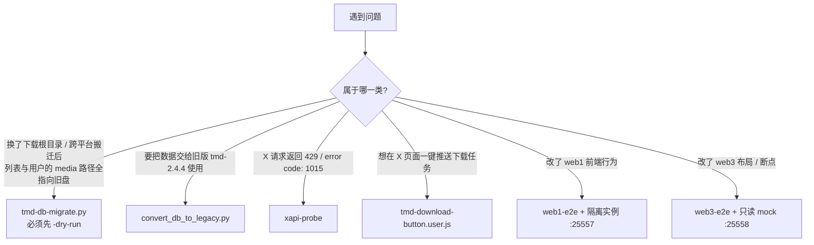
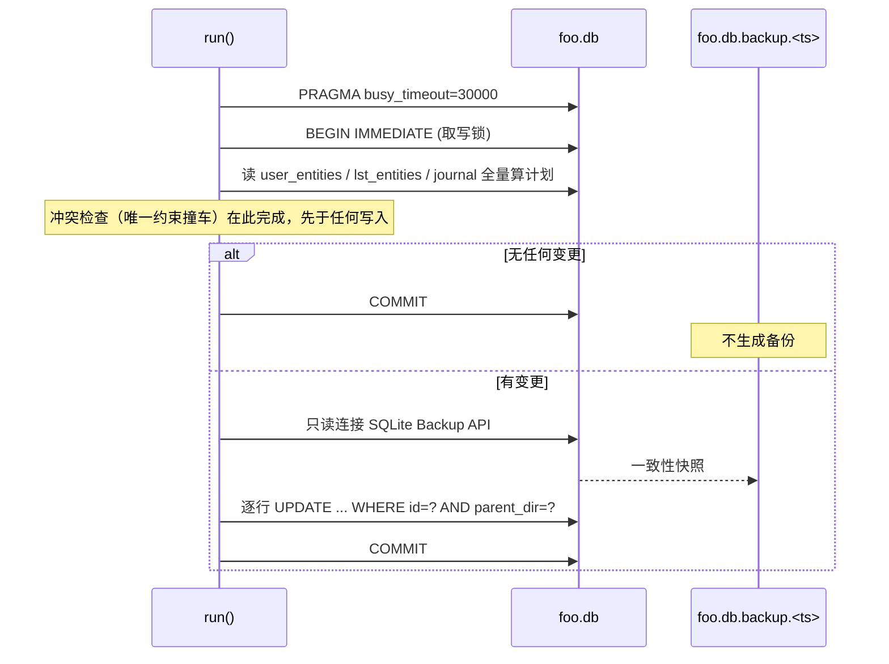
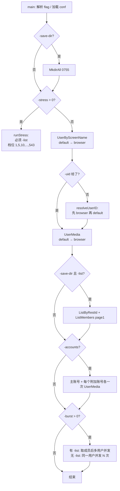

# tools/ 工具集文档

> 维护说明：本文件面向**要动手用/改 `tools/` 下工具的人类开发者**，回答"这个工具做什么、怎么跑、有什么坑、怎么验证、改它会波及什么"。规范摘要（agent 向）见 [[lat.md/development.md]] 的 X API Probe Tool 与 What NOT to Do 两节、[[lat.md/database.md]] 的独立迁移工具一节、[[lat.md/api-server.md]] 的 Userscript Remote API Access 一节。为避免随行号漂移失效，本文件一律用**符号锚点**（`路径#符号`），不写 `文件:行号`。

`tools/` 是**开发期工具目录**，不是产品运行路径的一部分：数据库迁移/格式转换、X API 诊断、Tampermonkey 用户脚本、两套浏览器回归脚本。除 `tools/xapi-probe`（属于主 Go module，会被 `go vet ./...` 编译）外，其余工具**不进入 CI**。

## 1. 工具总览

| 工具 | 运行环境 | 做什么 | 会改数据吗 | CI 覆盖 |
|---|---|---|---|---|
| `tools/tmd-db-migrate.py` | Python 3（仅 stdlib） | 重写 `foo.db` 里历史存储根路径（`parent_dir` 等） | **会**：原地改库 + 生成一致性备份 | 否 |
| `tools/test_tmd_db_migrate.py` | Python 3 `unittest` | 上者的单元测试（9 个用例） | 只在 `tempfile` 目录里建库 | 否 |
| `tools/convert_db_to_legacy.py` | Python 3 | 新版 tmd 库 → tmd-2.4.4 旧版格式（**历史工具**：无调用方、无测试，见 §3 状态栏） | 生成新文件；**会 `os.remove` 同名目标**，无 dry-run | 否 |
| `tools/xapi-probe/main.go` | Go（属主 module） | 诊断 X GraphQL 的 HTTP 429 / `error code: 1015` | 只读 X；`-save-dir` 会写响应体到磁盘 | `go vet ./...`、`go test ./...` 会编译它 |
| `tools/tmd-download-button.user.js` | Tampermonkey | X 个人页注入"推送下载"按钮 | 向 TMD 服务发一次下载任务请求 | 否 |
| `tools/web1-e2e/` | omp 浏览器内 JS | web1 前端浏览器回归（helpers + 入口 + 9 个测试文件） | 会真实新增/删除 1 条调度规则、1 个 mark 任务 | 否 |
| `tools/web3-e2e/` | Node + omp 浏览器 | web3 响应式布局验收 + 只读 mock server | mock 与脚本均只读 | 否 |

`readme.md` **没有**逐工具说明：它只在文档索引表里链接了 `doc/tools.md`（`readme.md` 中唯一一处 `tools/` 命中，描述为"`tools/` 下迁移/转换/探针/E2E 脚本用法"），grep `xapi`、`probe`、`tmd-db-migrate`、`convert_db` 均无命中；命令口径以 `lat.md/development.md` 的 X API Probe Tool 一节为准，本文件与之保持一致。



## 2. tmd-db-migrate.py —— 存储根路径重写

> 规范摘要见 [[lat.md/database.md]] 的 Migrations 一节末段（介绍 `tools/tmd-db-migrate.py#migrate_parent_dirs_in_sqlite_file`）。面向操作者的长文另有 [foo.db 跨平台迁移说明](foo.db%20跨平台迁移说明.md)。本节只讲**怎么安全地跑、会踩什么坑、怎么验证**。

### 2.1 它到底改什么

数据库位置是 `{rootPath}/.data/foo.db`（[[lat.md/database.md]] 首节）。下载根目录的**绝对路径**被冗余存进多处，搬迁根目录后必须整体重写：

| 表.列 | 语义（依据） | 漏改的后果 |
|---|---|---|
| `user_entities#parent_dir` | 用户实体媒体的实际父目录（唯一约束 `UNIQUE(user_id, parent_dir)`） | 列表/详情指向旧盘，标记已下载与目录归属判断错位 `[INFERENCE]` |
| `lst_entities#parent_dir` | 列表实体的父目录（`UNIQUE(lst_id, parent_dir)`） | 同上，列表重复落盘 `[INFERENCE]` |
| `entity_removal_journal#staged_path` | 删除流程把目录改名成的 versioned 暂存目录（[[lat.md/database.md]] 的 Entity Storage Lifecycle 一节） | 启动对账找不到暂存目录，恢复/清理行为不确定 |
| `entity_removal_journal#original_path` | 暂存前的原目录 | 同上 |

`entity_removal_journal` 在旧库里可能不存在，`#_table_exists` 判定后直接跳过（`#_collect_removal_journal_updates` 返回 `0, []`），不是错误。

### 2.2 入口与参数

- 函数入口：`#migrate_parent_dirs_in_sqlite_file(db_path, from_root_raw, to_root_raw, dry_run=False) -> MigrationResult`
- CLI 入口：`#run`（返回进程码），参数表由 `#_build_parser` 定义：`-db/--db`、`-from-root/--from-root`、`-to-root/--to-root` 必填，`-dry-run/--dry-run` 可选。
- `from-root` 与 `to-root` **必须都是绝对路径**（`parse_portable_path` 后检查 `absolute`），否则 `MigrationError`。

### 2.3 干跑 vs 正式写入

| 维度 | `-dry-run` | 正式写入 |
|---|---|---|
| 连接方式 | `#_readonly_database_uri`：`Path(db).resolve().as_uri() + "?mode=ro"` | 直接 `sqlite3.connect(db_path)` |
| 事务 | 不开（`isolation_level=None`，纯自动提交） | 先 `BEGIN IMMEDIATE` 取写锁 |
| 备份 | **不生成** | 有变更时调 `#backup_sqlite_database` |
| 写入 | 无 | `#_apply_updates` / `#_apply_removal_journal_updates` 条件更新后 `COMMIT`；异常时 `ROLLBACK` |
| 典型输出首行 | `dry_run=true` | `dry_run=false` + `backup=<路径>` |

正式写入的**执行顺序**（来自 `#migrate_parent_dirs_in_sqlite_file` 的控制流，别打乱）：



### 2.4 备份语义

- 命名：`<db_path>.backup.YYYYMMDD_HHMMSS_ffffff`（`#_reserve_backup_path`）。
- 用 `os.open(candidate, O_CREAT|O_EXCL|O_WRONLY, 0o600)` **独占占位**，同名时退化为 `.1`、`.2`…最多 100 次，仍失败则抛 `MigrationError`；因此**永不覆盖旧备份**。
- 内容由 `#backup_sqlite_database` 通过 SQLite Backup API（`source.backup(destination)`，源连接是 `mode=ro`）拷出，是**含已提交 WAL 内容的单一一致性快照**——不需要另外复制 `-wal`/`-shm`。
- 写完后 `os.chmod(0o600)` + `fsync`；中途任何 `OSError`/`sqlite3.Error` 都会先 `unlink` 占位文件再抛错。
- 备份落在 `-db` 的**同一目录**，需要该盘有足够空间。
- `.gitignore` 含 `*.backup.*`，备份不会被误提交。

### 2.5 路径匹配规则（不依赖运行平台）

`#parse_portable_path` 自己识别风格，因此在 Linux 上能处理 Windows 库、在 Windows 上能改成 Docker/Linux 路径：

| 输入形态 | style | 匹配规则 |
|---|---|---|
| `F:\twitter_dl`、`D:/archive` | `windows`，`volume_id` 为小写盘符（`"f:"`、`"d:"`） | 盘符比较**大小写不敏感**（`casefold`），段内比较也不敏感 |
| `\\server\share\root` | `windows`（UNC），`volume_id="server/share"` | host/share 必须齐全，否则报 `missing host/share components`；比较不敏感 |
| `/data`、`/mnt/archive` | `posix`，`volume_id="/"` | 段比较**严格区分大小写** |
| `users`、`..\x`、`a\b`（无盘符/无前导 `/`） | 相对路径 | **永不改写**，原样返回 |

- 归一化：`#_clean_portable_segments` 把 `\` 统一成 `/`，用 `posixpath.normpath` 消掉 `.`/`..`，再丢弃空段。所以 `\\server\share\root\nested\..\users` 能正确匹配根 `\\server\share\root`（测试用例 `test_unc_paths_normalize_parent_segments_before_matching`）。
- 前缀裁剪：`#_trim_portable_prefix` 要求 style 相同、双方都 absolute、`volume_id` 相同、候选段数 ≥ 根段数；任一不满足即不匹配。
- 重建：`#build_portable_path` 用目标风格拼回；余段为空时 Windows 盘符输出 `D:\`，UNC 输出 `\\host\share`，POSIX 输出 `/`。

### 2.6 典型命令（先干跑，再写入）

```bash
# 1) 干跑：只读连接，零副作用。先看计数与 samples，确认没有"意外命中"
python tools/tmd-db-migrate.py -db "F:\twitter_dl\.data\foo.db" -from-root "F:\twitter_dl" -to-root "/data" -dry-run

# 2) 计数/样例核对无误后，再正式写入（会先生成一致性备份，再在一个事务内改）
python tools/tmd-db-migrate.py -db "F:\twitter_dl\.data\foo.db" -from-root "F:\twitter_dl" -to-root "/data"
```

`--db`、`--from-root`、`--to-root`、`--dry-run` 是等价长选项（[foo.db 跨平台迁移说明](foo.db%20跨平台迁移说明.md) 用长选项写法）。

### 2.7 输出与退出语义

`#run` 的 stdout 固定顺序：

```text
dry_run=false
user_entities: 12/25 updated
lst_entities: 2/4 updated
entity_removal_journal: 0/0 updated
backup=F:\twitter_dl\.data\foo.db.backup.20260509_224500_123456
samples:
- user_entities id=1: "F:\\twitter_dl\\users" -> "/data/users"
- lst_entities id=3: "F:\\twitter_dl" -> "/data"
no changes required          # 仅当三个计数全为 0 时追加
```

| 情况 | 退出码 | 说明 |
|---|---|---|
| 正常（含"无变更"） | 0 | `no changes required` 也是成功 |
| `MigrationError`（文件不存在、非绝对根、冲突、写锁超时、并发改动…） | 1 | stderr 打印 `migration failed: <原因>` |
| 参数用法错误（缺 `-db` 等） | 2 | argparse 自身退出，不经 `#run` |

`MigrationResult` 字段：`backup_path`、`user_entities_total/updated`、`lst_entities_total/updated`、`removal_journals_total/updated`、`samples`。`samples` 最多 10 条（`#MAX_SAMPLES`），只是给人看的抽样，**不是**完整变更清单。

### 2.8 踩坑清单

1. **只改数据库，不搬文件。** 脚本里没有任何目录移动逻辑：媒体目录必须**已经**在新位置，工具只负责把记录里的旧根改成新根。
2. **没有变更就不会有备份**（`#migrate_parent_dirs_in_sqlite_file` 在 `has_updates == false` 时直接 `COMMIT` 返回）。看不到 `backup=` 不代表失败；重复跑第二次必然是 0 变更、无备份（测试 `test_apply_uses_consistent_backup_and_migrates_recovery_paths` 显式断言了这一点）。
3. **先停服务再写入。** 写路径先 `BEGIN IMMEDIATE` 拿写锁，`PRAGMA busy_timeout=30000`；服务端若有写事务，30 秒后失败 `[INFERENCE]`（依据：`#SQLITE_BUSY_TIMEOUT_MS` 与 `BEGIN IMMEDIATE`）。干跑是只读的，服务运行中也能跑。
4. **冲突在写之前就拒绝**：若目标路径会被同一 owner 的另一行占用（按 `owner|目标路径小写` 去重），`#_collect_updates` 直接抛 `would create duplicate owner/path pair`，此时**既没备份也没写入**（测试 `test_conflict_fails_before_backup_or_write`）。需要人工决定改名/删除后再跑。
5. **journal 两列必须同时命中**：`staged_path` 与 `original_path` 一个命中一个不命中 → 抛 `must migrate together`；合并后 `staged_path` 重复 → 抛 duplicate `staged_path`（测试 `test_split_recovery_journal_mapping_is_rejected`）。这类数据通常意味着 journal 行已被手工改动。
6. **并发改动会被发现**：条件更新是 `UPDATE <table> SET parent_dir=? WHERE id=? AND parent_dir=?`，`cursor.rowcount != 1` 即抛 `changed while migration was running`，整个事务 `ROLLBACK`。
7. **备份与库同目录**：库在只读盘、空间不足、或目录不可写时，备份阶段就失败（占位文件会被清理）。先确保同目录可写且有足够空间。
8. **干跑用 `mode=ro`**：如果库处于"缺 `-shm` 等不干净的 WAL 状态"，只读打开可能失败 `[INFERENCE]`；此时直接走正式写入路径（它会取写锁并自行维护 `-wal`/`-shm`），或先让 TMD 正常启动一次完成恢复。
9. **别把备份命名搞混**：本工具的 `foo.db.backup.<ts>` 与 `internal/database/sqlite_migration.go#recoverInterruptedSQLiteReplacement` 处理的 `.replacing` / `.migrating` 是两套完全不同的机制，不要互相顶替。
10. **不要手工先改一部分 `parent_dir` 再跑**：条件更新只认旧值，手改过的行会被跳过，剩下的行照旧迁移，最终库内路径不统一。

### 2.9 如何验证

```bash
# 全部单元测试（9 个用例，全部在 tempfile 里建库，不碰真实数据）
python tools/test_tmd_db_migrate.py -v

# 只跑单个用例（unittest 接受 "类名.方法名" 形式）
python tools/test_tmd_db_migrate.py -v DatabaseMigrationTests.test_conflict_fails_before_backup_or_write
python tools/test_tmd_db_migrate.py -v PortablePathTests.test_windows_drive_remap_is_case_insensitive

# 纯语法自检
python -m py_compile tools/tmd-db-migrate.py
```

| 用例 | 锁定的行为 |
|---|---|
| `PortablePathTests.test_windows_drive_remap_is_case_insensitive` | 盘符/段大小写不敏感 |
| `PortablePathTests.test_unc_and_posix_paths_keep_platform_semantics` | UNC 与 POSIX 各自语义（POSIX 大小写敏感） |
| `PortablePathTests.test_unc_paths_normalize_parent_segments_before_matching` | `..`/`.` 归一化后匹配 |
| `PortablePathTests.test_relative_paths_are_not_rewritten` | 相对路径不动 |
| `DatabaseMigrationTests.test_dry_run_is_read_only_and_reports_all_path_tables` | 干跑不写库、不产备份、三张路径表都统计 |
| `DatabaseMigrationTests.test_apply_uses_consistent_backup_and_migrates_recovery_paths` | 备份内容为改前值 + journal 同步迁移 + 二次运行为 no-op |
| `DatabaseMigrationTests.test_legacy_database_without_removal_journal_still_migrates` | 缺 journal 表仍能迁移 |
| `DatabaseMigrationTests.test_conflict_fails_before_backup_or_write` | 冲突早于备份与写入 |
| `DatabaseMigrationTests.test_split_recovery_journal_mapping_is_rejected` | journal 两列必须同时迁移 |

这些用例**不在 CI 里**（`.github/workflows/go.yml` 只跑 Go 与 `lat check`），改完脚本必须自己跑一遍。

### 2.10 改这里会波及什么

- **`parent_dir` 的写入方**：`internal/entity/` 的实体生命周期（`internal/entity/storage.go#storedEntityPath`、`internal/entity/user.go#NewUserEntity`、`internal/entity/list.go#NewListEntity`）决定库里存什么形态的路径。若那边改了归一化/遗留名（尾随点/空格）处理，本工具的段比较规则要同步复核——工具按"归一化后逐段比较"，不做尾随点/空格归一。
- **新增绝对路径列或表**：必须同时扩展 `#_collect_migration_plan`，否则迁移后旧根仍残留在库里。
- **唯一约束语义变化**：`user_entities`/`lst_entities` 的 `UNIQUE(owner, parent_dir)` 是冲突预检查的根据；约束变了，`#_collect_updates` 的 key 构造也要跟着变。
- **journal 表结构变化**：`entity_removal_journal` 的列名/主键（`staged_path`）被 `#_collect_removal_journal_updates` 直接读；改表名或主键会让这段静默跳过（`#_table_exists` 为假）或报错。
- **文档锚点**：`lat.md/database.md` 的 Migrations 一节与 [foo.db 跨平台迁移说明](foo.db%20跨平台迁移说明.md) 都引用了 `tools/tmd-db-migrate.py`；删改函数名会同时打断这两处引用。

## 3. convert_db_to_legacy.py —— 新库降级为 tmd-2.4.4 旧库

> **状态：历史工具**（能用，但按"不再维护"对待）。判定依据：
> - **无仓内调用路径**：全仓检索 `convert_db_to_legacy` 只命中 `CHANGELOG.md` 与 `doc/` 下的文档，没有任何 Go / Python / JS 代码或 CI 步骤调用它——它只有"人手敲命令行"这一条入口。
> - **无测试**：仓库里没有针对它的测试（`tools/test_tmd_db_migrate.py` 只覆盖 `tmd-db-migrate.py`）；改动只能靠手工跑一次再抽查输出库（§3.5 末尾的命令）。
> - **无 CI**：见 §8.1 的表格；`python -m py_compile tools/convert_db_to_legacy.py` 只做语法自检。
> - **破坏性**：目标路径已存在即 `os.remove` 重建，**没有 dry-run、没有备份开关**（下面 §3.2 第 2 步、§3.4）；这与 §8.4 对新工具的"必须提供只读预演"要求相抵触，所以它是**遗留例外**，不要拿它当新工具的模板。
> - 这份文件自 `1c27c8e`（2026-06-25，"move convert_db_to_legacy.py to tools/"）移入 `tools/` 后未再改动，仍是 177 行。

### 3.1 用途与方向

脚本 docstring 写明方向：**新版 tmd 库 → 旧版 tmd-2.4.4 兼容库**，即"降级导出"，用于把新版本数据交给旧版程序读取。它是**单向**的：没有旧→新的反向路径（那由 `internal/database/sqlite_migration.go#migrateExistingDatabase` 在启动时负责）。

```bash
python tools/convert_db_to_legacy.py <新版db路径> <输出旧版db路径>
# 例：python tools/convert_db_to_legacy.py new_tmd.db legacy_tmd.db
```

### 3.2 它做了什么

1. 源库不存在 → `[ERROR] 新版数据库文件不存在: ...`，`sys.exit(1)`。
2. **目标路径已存在 → 直接 `os.remove` 删除**（打印 `[INFO] 已存在同名文件，已删除: ...`），无确认、无备份。
3. 在目标路径新建一个只含旧版 schema 的库（`old_cur.executescript(old_schema)`）。
4. 逐表 `SELECT` 源库 → `executemany` 写目标库，共 6 步，每步打印 `[n/6] ...` 与 `→ N 条记录`。
5. `old_conn.commit()`，打印 `[DONE] 转换完成，旧版数据库已写入: ...`。

列级差异（脚本内建表语句与 SELECT 语句对照得出）：

| 表 | 处理 | 细节 |
|---|---|---|
| `users` | 丢列 | 新版 `is_accessible` 不写入旧版；其余 5 列同名复制 |
| `user_previous_names` | 改名 | 新版 `user_id` → 旧版 `uid` |
| `lsts` | 改名 | 新版 `owner_user_id` → 旧版 `owner_uid` |
| `lst_entities` | 直拷 | `id, lst_id, name, parent_dir` |
| `user_entities` | 直拷 | `id, user_id, name, latest_release_time, parent_dir, media_count` |
| `user_links` | 直拷 | `id, user_id, name, parent_lst_entity_id` |

### 3.3 会丢失什么

| 丢失项 | 说明 |
|---|---|
| `users.is_accessible` | 用户可达性标记被丢弃（旧版 schema 无此列） |
| `entity_removal_journal` 整表 | 旧版 schema 里没有这张表，删除恢复日志**完全不迁移** |
| 绝大多数索引 | 旧版 schema 只建了 `idx_user_links_user_id`；`idx_users_screen_name`、`idx_lsts_owner` 等全部不存在 |
| 目标文件原有内容 | 目标路径被 `os.remove` 后重建 |

`entity_removal_journal` 缺失的影响：旧库启动时按 [[lat.md/database.md]] 的 Entity Storage Lifecycle 对账，未记入 journal 的遗留暂存目录不会被自动清理/恢复。

### 3.4 安全与数据保护（重要）

- **目标路径会被无条件删除**：脚本 `os.remove(legacy_db_path)` 不看内容、不备份。别把有价值的旧库路径当第二个参数。
- **失败不清理**：脚本没有 `try/except`，中途异常（源库缺表 → `sqlite3.OperationalError`）会带着 traceback 退出；已创建的输出文件**不会**被删除。`executescript` 会先提交 DDL，所以半成品通常是一个"只有 schema、没有数据"的库 `[INFERENCE]`。
- **不启用外键检查**：脚本未 `PRAGMA foreign_keys=ON`，因此源库里已有的孤儿行会被原样复制，不会报错。
- **不动源库**：脚本对源库只执行 `SELECT`，没有任何写语句（连接是普通读写模式，未加 `?mode=ro`——与 `tmd-db-migrate.py` 的 `#_readonly_database_uri` 不同）。
- 输出库没有任何版本/校验标记，**无法**从文件本身判断它对应哪个新版本 schema。

### 3.5 已知边界

- 只处理这 6 张表；新版若新增表，脚本不会提示，也不会迁移。
- 若新版 schema 又改了列名（如 `user_id` 再次重命名），脚本会在 `SELECT` 阶段以 `no such column` 失败——它不做任何 schema 探测或兼容分支。
- 目标文件权限沿用进程 umask，脚本不 `chmod`。
- 不在 CI、没有单元测试；验证方式只有"跑一次后打开旧库抽查"。

```bash
# 抽查转换结果（表与行数）
python -c "import sqlite3,sys;c=sqlite3.connect(sys.argv[1]);print(c.execute(\"SELECT name FROM sqlite_master WHERE type='table' ORDER BY name\").fetchall());print('users',c.execute('SELECT COUNT(*) FROM users').fetchone())" legacy_tmd.db
```

### 3.6 改这里会波及什么

- 新版 schema 增删列（`internal/database/schema.go` 的 `schema` 常量）时，本脚本的 SELECT/INSERT 列表会静默错位或报错——**改 schema 必须回来核对本脚本**。
- 旧版列名（`uid`/`owner_uid`）一旦改动，转换出的库对 tmd-2.4.4 就不再可用。
- 本脚本没有测试保护，任何修改都只能靠手工抽查。

## 4. xapi-probe —— 429 / Cloudflare 1015 诊断

> 规范摘要见 [[lat.md/development.md]] 的 X API Probe Tool 一节（含命令示例）与 [[lat.md/development.md]] 的 What NOT to Do；实测结论见 [api-response-observations.md](api-response-observations.md)。

### 4.1 诊断目标

包注释写得很直白：判定 **为什么 Twitter/X GraphQL 请求返回 HTTP 429 `error code: 1015`**，手段是对同一批 GraphQL 端点发两种请求头风格的请求并对比。它把失败原因在四类假设之间做区分：API 变更 / 请求头被 Cloudflare 判定为机器人 / 代理出口 IP / 账号状态与突发负载。

### 4.2 参数的实际语义

flag 定义全部在 `#main` 中（`flag.*Var`），下列语义来自定义与使用点：

| flag | 类型 / 默认 | 实际语义 |
|---|---|---|
| `-conf` | string，空 | conf.yaml 路径；空则用 `<app root>/conf.yaml`。app root 解析见 `#defaultAppRoot`：`TMD_HOME` → Windows `%APPDATA%\.tmd2` → `~/.tmd2` |
| `-user` | string，`backdoorgf` | 要探测的 screen name（注意默认值是真实账号名，不改就用它） |
| `-uid` | string，空 | 已知 user id；给了就跳过 UserByScreenName 解析步骤 |
| `-list` | string，空 | list id（十进制）。两种作用：配合 `-burst` 时改为"取真实成员 + 对不同用户并发 UserMedia"；配合 `-save-dir` 时额外抓 `ListByRestId` 与 `ListMembers` 第一页 |
| `-delay` | duration，`3s` | 串行探测之间的间隔，以及 stress 每档之间的间隔；**不**作用于并发请求内部 |
| `-skip-media` | bool | 跳过 UserMedia 相关探测（只做 UserByScreenName） |
| `-burst` | int，`0` | 单次探测之后追加 N 个并发 UserMedia 请求；`0` 关闭 |
| `-accounts` | bool | 主账号 + `additional_cookies.yaml` 中每个有效账号各发一次 UserMedia，逐次 sleep `-delay` |
| `-save-dir` | string，空 | 保存响应体的目录（`os.MkdirAll(..., 0755)`）；**每个**探测响应都会写盘，见 `#saveResponse` |
| `-stress` | int，`0` | 加压档位上限（并发数）；**必须配合 `-list`**。`>0` 时 `#main` 只走 `#runStress`，其余探测流程全部跳过 |

凭据来源：`config.ReadConf(confPath)`，要求 `cookie.auth_token` 与 `cookie.ct0` 都非空，否则 stderr 报 `conf.yaml is missing cookie.auth_token or cookie.ct0` 并 `os.Exit(1)`。附加账号来自 conf.yaml 同目录的 `additional_cookies.yaml`（`config.ReadAdditionalCookies`），其中 `AuthToken` 或 `Ct0` 为空的条目被跳过。

### 4.3 执行流程



stress 细节（`#runStress`）：

- 档位固定为 `1,5,10,20,50,100,150,200,250,300,400,500,543`，只跑 `≤ -stress` 的那些。
- 每档 N 个并发 goroutine，请求按 `accounts[i%len(accounts)]` 与 `ids[i%len(ids)]` 轮转分摊，URL 固定 `UserMedia count=5`；成员用 browser 风格客户端取，加压请求用 default 风格客户端。
- 一旦某档出现含 `error code: 1015` 的 429，打印 `First 1015 429: ...` 并**立即结束**；只有非 1015 的 429 则记录档位继续加压。
- 档与档之间 sleep `-delay`（最后一档不 sleep）。
- 上下文超时：stress 10 分钟，其它模式 90 秒。

### 4.4 "默认头 vs 浏览器风格头"对比的意义

| 风格 | 客户端构造 | 实际带的头 |
|---|---|---|
| default（app-like） | `#newProbeClient(..., browser=false)` | 只有 `twitter.SetClientAuth` 设的 `Authorization: Bearer <bearer>`、`auth_token`/`ct0` cookie、`X-Csrf-Token`——**与产品请求一致** |
| browser（Chrome-like） | `#newProbeClient(..., browser=true)` | 在上一行基础上 `SetHeaders(browserHeaders)`：Chrome/131 UA、`Accept`、`Accept-Language: en-US,en;q=0.9`、`Origin`/`Referer: https://x.com`、`Sec-Fetch-*`、`X-Twitter-Active-User: yes`、`X-Twitter-Client-Language: en` |

产品侧确实只设最小头：`internal/twitter/client.go#SetClientAuth` 只有 bearer + cookie + CSRF（**产品代码里**唯一显式 `User-Agent` 在登录流程取 `https://x.com/home` 的那处请求；探针自己的 `browserHeaders` 另有一份，正是本行要对比的"browser 风格"）。因此：

- **default 429/1015、browser 200** → 大概率是 Cloudflare 对"不像浏览器"的请求拦截；修产品需要补头，而不是换账号。
- **两者都 429** → 更像限流、账号状态或代理出口 IP 问题；接着用 `-accounts`（换账号）和 `-conf`/`proxy` 对比（换出口）继续二分。
- 两种风格都用同一个 `conf.ProxyURL`，所以"出口 IP"这个变量不是靠风格切换来排除的，而是靠 `-conf` 指向不同配置。

### 4.5 凭据脱敏保证（以及三个例外）

保证来自包注释（"It never prints auth_token, ct0, Authorization, Cookie, or Set-Cookie values."），代码侧可核对：

- 认证只通过 `twitter.SetClientAuth` 注入（`internal/twitter/client.go#SetClientAuth`：bearer + `auth_token`/`ct0` cookie + `X-Csrf-Token`），`main.go` 从不打印请求头。
- `#result.Print` 只输出 `Name / URL / Error / Status / Retry-After / Rate-Limit / Cf-Ray / Server / Content-Type / Body`，Body 截断到 400 字符并追加 `...(truncated)`。
- 打印的 URL 只含 `variables` / `features` / `fieldToggles` 查询串（`screen_name`、`userId`、`listId`），不含凭据。
- 报错只回显状态码与响应体（如 `#resolveUserID` 的 `UserByScreenName status=%d body=%s`），响应体里没有本机凭据。

必须知道的**例外**：

| 例外 | 位置 | 风险 |
|---|---|---|
| 启动行会**原样打印 `conf.ProxyURL`** | `#main` 的 `Probe config: conf=... proxy=%s` | 若代理 URL 内嵌 `user:pass@`，凭据会进终端/日志 |
| `-save-dir` 落盘**原始响应体**，权限 `0644` | `#saveResponse`（自己会打印 `Warning: raw API response body may contain sensitive data`） | 429 的 Cloudflare 页面、含个人数据的 JSON 都会留盘 |
| 保存文件重名直接覆盖 | `#saveResponse` 用 `os.WriteFile` | 无排他保护，会覆盖同目录同名文件 |

`tools/xapi-probe/saved-api-json/` 已被 `.gitignore` 忽略，抓下来的响应体不会进版本库。

### 4.6 典型命令（与 [[lat.md/development.md]] 完全一致）

```bash
# 单次请求：default 头 vs 浏览器风格头，直连或走 conf 里的代理
go run ./tools/xapi-probe -user backdoorgf -uid 1620929133340495873

# 针对单个用户的并发突发
go run ./tools/xapi-probe -user backdoorgf -uid 1620929133340495873 -burst 100

# 取真实 List 成员并对不同用户并发 UserMedia
go run ./tools/xapi-probe -user backdoorgf -uid 1620929133340495873 -list 2018637651323310440 -burst 242

# 每个已配置账号各发一次 UserMedia（主账号 + additional_cookies.yaml）
go run ./tools/xapi-probe -user backdoorgf -uid 1620929133340495873 -accounts

# 保存原始响应 JSON 供人工检查
go run ./tools/xapi-probe -user backdoorgf -uid 1620929133340495873 -list 2033597792896069633 -save-dir tools/xapi-probe/saved-api-json

# 加压斜坡：找出 429/1015 出现的并发档位（使用全部已配置账号）
go run ./tools/xapi-probe -stress 543 -list 2033597792896069633 -delay 2s
```

### 4.7 踩坑清单

1. **它是负载发生器，不是只读探针**：`-burst` / `-stress` 会真实消耗 X 配额，可能把账号推进风控；`-delay` 是唯一的节流阀。别对主力账号长时间加压。
2. **`-stress` 缺 `-list` 时静默成功**：只打印 `stress mode requires -list` 然后 `return`，退出码仍是 0——别把它当"跑过了"。
3. **`-stress` 忽略其它探测 flag**：`-user`/`-uid`/`-burst`/`-accounts` 都不生效，只认 `-list`、`-delay`、`-conf`、`-save-dir`（且 stress 流程不会落盘响应体）。
4. **GraphQL 路径在本文件里硬编码**：`userByScreenNamePath`、`userMediaPath`、`listByRestIdPath`、`listMembersPath` 是 `main.go` 自己的常量。当前与 `internal/twitter/api.go` 中各 `Path()` 的 hash 一致，但**不会自动同步**；Twitter 轮换 hash 后产品改了而探针没改，探针会持续 400/404，很容易被误读成"又被限流了"。
5. **`-list` 依赖产品代码**：成员获取走 `internal/twitter/list.go#GetLst` 与 `#GetMembers`（count=200），要求主账号对该列表可见；失败时打印 `GetLst error` / `GetMembers error` 并跳过后续加压。
6. **`-burst` 有无 `-list` 是两种实验**：无 `-list` 是对**同一个** `UserMedia count=100` URL 并发 N 次（同用户限流最容易触发）；有 `-list` 才是分散到不同成员。解读时别把两者混为一谈。
7. **`-accounts` 需要先解析出 user id**：`-uid` 与 UserByScreenName 都失败时只打印 `No resolved user id; skipping account probes`，其余步骤继续。
8. **退出码不表达探测结果**：只有 conf 加载失败、凭据缺失、`-save-dir` 建目录失败会 `os.Exit(1)`；观测到 429/1015 依然是退出码 0。要判定"是否复现"，得看 stdout 的 `Status:` / `Status counts:`。
9. **未显式设置代理时不会调用 `SetProxy`**：是否走系统代理取决于 Resty/Go 传输层默认行为，本仓库没有约束 `[INFERENCE]`。

### 4.8 验证与波及

```bash
# 编译与静态检查（该包属于主 module，CI 的 go vet ./... 会覆盖）
go vet ./tools/xapi-probe
```

它没有单元测试：正确性只能靠"对着已知 429 的账号/出口跑一次，看两种风格的 Status 差异是否符合预期"。

改这里会波及：

- `internal/twitter/client.go#SetClientAuth`（default 风格的语义就是它）——若产品补了浏览器头，探针的"default"就不再代表产品行为，对比结论失效。
- `internal/twitter/api.go` 的 GraphQL hash/feature 常量——探针必须手工同步（见坑 4）。
- `internal/config` 的 `Config.Cookie/ProxyURL` 字段与 `ReadAdditionalCookies`——探针与产品同 module，改字段名会直接编译失败（`go vet ./...` 会拦），但改语义不会。

## 5. tmd-download-button.user.js —— Tampermonkey 推送按钮

> 规范摘要见 [[lat.md/api-server.md]] 的 Userscript Remote API Access 一节（`@connect *` 的语义与远端部署要求）。脚本第 21 行自身也挂了 `// @lat: [[lat.md/api-server#API Server#Userscript Remote API Access]]` 锚点。

### 5.1 它是什么、装在哪

- 一个 **Tampermonkey 用户脚本**，版本号写在脚本头 `@version`：当前 **1.2.1**（无构建注入，改脚本要手改这个号）。
- 元数据：`@match https://x.com/*` 与 `https://twitter.com/*`；`@grant GM_xmlhttpRequest / GM_getValue / GM_setValue / GM_registerMenuCommand`；`@connect *`；`@run-at document-idle`；`@license MIT`；`@namespace https://github.com/tmd-tool/tmd`。
- 仓库里**只有这一份**（`**/*.user.js` 仅命中它），不随二进制/Web 资源分发：装法是 Tampermonkey 面板 → 新建脚本 → 粘贴 `tools/tmd-download-button.user.js` → 保存（或把文件拖进浏览器窗口）。

### 5.2 配置 API 地址与 Key

| 项 | 存储键 | 默认值 | 修改方式 |
|---|---|---|---|
| API 地址 | `tmd_api_url` | `http://localhost:25556` | Tampermonkey 菜单 → `🔧 设置 TMD API 地址` |
| API Key | `tmd_api_key` | 空串（= 不带认证头） | Tampermonkey 菜单 → `🔑 设置 TMD API Key` |

- API 地址保存前会去掉尾部所有 `/`；Key 保存前 `trim`。
- 只有 Key 非空时才附加 `Authorization: Bearer <key>`；空 Key 时请求裸发。
- 服务端若配置了 `api_key`，空 Key 请求会被 `internal/api/middleware.go#authMiddleware` 拒为 401（`WWW-Authenticate: Bearer realm="TMD API"`），按钮会显示失败 toast。

### 5.3 运行时行为

- **注入**：只在个人主页（`primaryColumn` 内存在 `[data-testid="UserName"]`）注入 `#tmd-download-btn`，插在"更多"按钮左侧。定位优先 `[data-testid="userActions"]`，退化时按 `role=button` + 三个点 SVG path（小写 `m3 12` + `12c0-1.1`）+ `aria-label`/`title` 含 `more`/`更多` 双重校验。
- **点击**：`POST {api}/api/v1/users/{screenName}/download`，body `{"auto_follow": true}`，超时 10 s；成功判据是 **2xx 且 `data.success`**。按钮状态 `default → loading → success/error`，3 秒后复位，同时弹 toast（成功时带 `task_id`）。
- **用户名**：从 `location.pathname` 用 `/^\/([a-zA-Z0-9_]{1,15})(?:\/|$|\?)/` 提取，并排除 `home`/`explore`/`search`/`notifications`/`messages`/`settings`/`i`/`compose`/`lists`/`bookmarks`/`communities`/`jobs` 等保留名。
- **SPA 适配**：hook `history.pushState`/`replaceState` + 监听 `popstate`；`MutationObserver` 200 ms 去抖补注入；注入失败按 `INJECT_MAX_RETRIES = 15` × `INJECT_RETRY_INTERVAL = 1000 ms` 重试；离开个人页时移除按钮。
- **主题适配**：按 `data-color-mode`（`MutationObserver`）与 `prefers-color-scheme` 动态重写内联 `<style>`。

### 5.4 它不绕过服务端认证（`@connect *` 的含义与风险）

`@connect *` 是**通配的出网许可**：脚本元数据是静态的，而 API 地址由用户在运行时配置，所以只能通配（[[lat.md/api-server.md]] 原文口径）。它：

- **只**授予脚本向任意主机发请求的资格；
- **不**公开 TMD 服务，**不**绕过服务端 API Key，**不**改变 `authMiddleware` 的判定。

风险与要求：

1. 通配同时意味着脚本可向任意主机发送数据（含当前用户名与 API Key）；脚本来源必须可信，避免使用来路不明的二次分发版本。
2. Key 存在 Tampermonkey 的 GM 存储中；"设置 API Key"菜单会把**当前 Key 作为 prompt 默认值回显**，共享屏幕时等于泄露。
3. 远端部署必须给服务端配 `api_key` 并把服务限制在可信网络（[[lat.md/api-server.md]] 同节要求）；默认 `http://localhost:25556` 是明文 HTTP。
4. `@match` 只覆盖 x.com/twitter.com，但**目标 API 地址可任意**——填错就是把浏览到的用户名发给了陌生服务器。

### 5.5 边界与坑

- 只支持个人主页 `/用户名`；列表页/搜索结果页不注入（列表推送走 Web UI 或 API）。
- DOM 依赖 X 的 `data-testid` 与三个点 SVG path，均为硬编码；X 改版即失效。
- 注入重试上限 15 次 × 1 s，慢加载页面可能放弃注入。
- 无幂等：按钮 3 秒后复位，再点会**重复入队**同一用户名（服务端不会去重拦截）。
- 只认 `data.success`；HTTP 200 但 `success:false` 走失败分支（例如 API Key 无效或参数被拒）。
- `GM_xmlhttpRequest` 由 Tampermonkey 以扩展权限发出，因此不受 x.com 页面同源/CORS 限制——这正是它能 POST 到 `localhost` 的原因 `[INFERENCE]`（依据：脚本以 `GM_xmlhttpRequest` 而非 `fetch` 发送跨源请求）。

### 5.6 改这里会波及什么

- **后端路由与响应契约**：脚本打到 `internal/api/server.go` 注册的 `POST /api/v1/users/{screen_name}/download`（处理器 `#handleUserDownloadRoute`，成功返回 202）。改路径、改 body 字段（`auto_follow`）或改响应里 `data.task_id` 的位置，脚本不会编译报错，只会运行时 400/404 或 toast 显示 `-`。
- **认证方式**：脚本固定用 `Authorization: Bearer <api_key>`；服务端若不再接受 API Key 作为 Bearer（`internal/api/middleware.go#authMiddleware`），按钮会 401。
- **lat 锚点**：脚本第 21 行的 `// @lat: [[lat.md/api-server#API Server#Userscript Remote API Access]]` 与 [[lat.md/api-server.md]] 的对应小节互相引用，改脚本时不要删这行注释。
- **X 页面结构**：`primaryColumn`/`UserName`/`userActions`/三点 SVG path 任一变化都会让注入静默失效（脚本只会在控制台之外表现为"按钮不出现"）。

## 6. web1-e2e —— web1 前端浏览器回归

> 规范摘要见 [[lat.md/api-server.md]] 中描述 `tools/web1-e2e/` 覆盖范围的那一段。套件自带 [README](../tools/web1-e2e/README.md)，本节的增量是"启动参数从哪来、字段与真实行为不一致的地方、不覆盖什么"。

### 6.1 它是什么

**不用任何测试框架**的浏览器回归套件：每个文件都是能在 omp 浏览器（`xd://browser` 的 `tab.evaluate` / `tab.run`）里直接执行的纯脚本，返回结构化检查报告。

| 文件 | 作用 |
|---|---|
| `helpers.js` | 注入 `window.__e2e` 助手：`vis` / `byAction` / `clickAction` / `clickByText` / `clickBtnContaining` / `nav` / `systemPanel` / `systemTabVisible` / `wait` |
| `run-all.js` | 入口：逐个读文件、拼 `helpers + ';' + 测试源码`、独立 evaluate、汇总 |
| `01-navigation.js` … `09-task-lifecycle.js` | 9 个测试文件（编号即文件名，无 0 号） |

存在的理由（README 原话）：把历次手动实测的教训固化下来——首轮自动化回归曾因测试方法错误产生 4 个"假警报"。

### 6.2 启动隔离实例（不要连生产 25556）

```powershell
# PowerShell：临时目录 + 环境变量注入凭据，端口 25557
$env:TMD_HOME      = "$env:TEMP\tmd-e2e"
$env:TMD_ROOT_PATH = "$env:TEMP\tmd-e2e\downloads"
$env:TMD_API_KEY   = "local-test-key"
$env:TMD_DEV       = "1"                 # Web 资源走磁盘目录，改前端不必重新 embed
go run . -server -port 25557
```

- `-server` / `-port` 由 `main.go#parseBootstrapArgs` 解析；不指定端口时默认 25556，也可用 `TMD_PORT`（`main.go#serverPortFromEnv`）。
- `TMD_HOME` 决定 conf.yaml 位置（`main.go#resolveAppRootPath`：`TMD_HOME` → `%APPDATA%\.tmd2` → `~/.tmd2`）。该目录**没有** conf.yaml 但环境变量已覆盖时，`internal/config/config.go#loadStartupConfig` 走 env fallback（`UsedEnvFallback`），不会交互式提问；`TMD_ROOT_PATH`/`TMD_AUTH_TOKEN`/`TMD_CT0`/`TMD_API_KEY` 都是 `config.GetFieldDefs` 里登记的 EnvName。
- 默认主题是 web1（`internal/api/handlers.go` 的 `frontendTheme`，运行时可热切、重启回落 web1）。
- 之后用浏览器打开 `http://127.0.0.1:25557/` 并完成 API Key 登录（authOverlay 消失）。**套件跑之前必须已登录**；`secClear` 清掉 JWT 会让后续所有页面 401、测试集体失效。

### 6.3 怎么跑

```js
// 在 omp 浏览器的 run code 里执行（把路径换成你的仓库路径）
(async () => {
  const fs = await import('node:fs');
  const code = fs.readFileSync('C:/Users/leeexx/Documents/NewProject/tmd/tools/web1-e2e/run-all.js', 'utf8');
  return await eval(code);
})()
```

- 单文件同理：先注入 `helpers.js` 源码，再 eval 目标文件（入口正是这么拼的：`helperSrc + '\n' + ';' + src`，每个文件一次独立 evaluate）。
- 目录用环境变量 `TMD_WEB1_E2E_DIR` 覆盖；**默认值是硬编码绝对路径** `C:/Users/leeexx/Documents/NewProject/tmd/tools/web1-e2e`，换机器/换目录必须设置该变量。
- 执行顺序固定：`01 → 02 → 03 → 04 → 05 → 06 → 07 → 09 → 08`。08 会 `location.reload()`，所以放最后；README 的覆盖表里 08 排在 09 前面，以 `run-all.js` 的数组为准。
- 入口注册了 `page.on('dialog', d => d.accept().catch(() => {}))`，自动确认 raw 编辑器的"未保存修改"弹窗，避免 evaluate 卡死。
- 08 结束后入口会用后端 API 读 `/api/v1/config/theme`，若已被切成 web2 就 POST 切回 web1，再 `?e2e=<ts>` 重载页面。

### 6.4 产物

```js
{ results: [ { file, name, passed, checks: [ { name, pass } ] } ],
  allPassed, total, failedCount }
```

抛异常的测试被兜成 `{ file, name, passed: false, checks: [{ name: 'exec', pass: false, error }] }`（error 截断 300 字符）。**注意**：`run-all.js` 头部注释写的是 `failed`，实际字段名是 `failedCount`。

### 6.5 断言风格（三条硬规则，写新测试必须遵守）

1. **可见性 ≠ 存在性**：断言用 `h.vis(el)`（computed `display`/`visibility`）或 `classList`，不要 `!!document.querySelector(...)`——所有面板都预渲染在 DOM 里，隐藏的也在。security tab 的不可见 bug 就是这么漏掉的。
2. **点击前重新查询 DOM**：SPA 点击常触发 `render()` 全量重建，旧元素脱离 DOM 后 `.click()` 不派发事件。`h.clickAction` / `h.clickByText` / `h.byAction` 内部都重新 `querySelector`；自己写循环时要照做（03 号注释即此意）。
3. **优先 `data-action` 锚点，必要时限定 `scope`**：按钮文案会变（暂停后是"继续"而非"恢复"）；system 页三个编辑器各有模式按钮，不传 `scope` 会点到第一个匹配的面板。

### 6.6 覆盖范围与副作用

| 文件 | 覆盖 | 副作用 |
|---|---|---|
| `01-navigation` | 6 个主页面可达 + `#contentContainer` 有内容 | 只读 |
| `02-system-tabs` | 4 个 tab 可见性互斥 + 三编辑器高级/简易模式（作用域限定） | 切换编辑器模式后切回 |
| `03-data-tabs` | 6 个 dataSubPage 切换 + 搜索框 + 分页栏 | 只读 |
| `04-task-tabs` | 7 个任务表单各至少 1 个输入控件 | 只读 |
| `05-schedules` | 新增(POST) → 无变化保存（`dirty-cleared` 回归点）→ 删除(DELETE) → raw 编辑器 | **真实写调度**：创建并删除 1 条 `target=barackobama` 的规则 |
| `06-logs` | 日志流可见、INFO 级别筛选、导出按钮存在 | 只读 |
| `07-drawer-a11y` | 抽屉焦点移入、Tab 陷阱循环、Shift+Tab 反向、Esc 关闭 | 只读 |
| `08-theme-switch` | 切换器选项存在 + 往返切换 | 改主题并 reload 页面 |
| `09-task-lifecycle` | 创建 mark 任务 → 渲染 → 详情抽屉 → Esc | **真实创建 1 个 `mark_downloaded` 任务**（不消耗 Twitter 配额） |

### 6.7 它**不**覆盖什么

- 真实下载链路：媒体落盘、去重、标记已下载、Twitter 配额相关路径（09 特意选 mark 任务就是为了不碰这些）。
- web2 / web3 的 UI 行为（web2 仅在 08 号被"顺带 reload"一次，没有断言）。
- 后端 Go 逻辑与数据一致性——那是 `go test ./...` 的领域。
- SSE 长连接时序、JWT 过期/刷新链、bot 通知、飞书/微信回调。
- 鉴权矩阵（未登录、错 Key 的 401 行为）：套件前提就是"已登录"。
- 无快照/基线对比，也不是 CI 的一环：失败只代表"那一刻的这次运行失败"。

### 6.8 踩坑清单

1. **默认目录是硬编码绝对路径**，换机器不设 `TMD_WEB1_E2E_DIR` 会读不到文件（`fs.readFileSync` 直接抛）。
2. **别把实例开到 25556**（生产端口），README 明确要求隔离实例 + 独立 `TMD_HOME`。
3. **05 号对脏环境只做了一半清理**：它只删"没有 id 的未保存规则"，不清理服务端已有规则；若服务端已有同 target 规则，`新增 1` 的 toast 断言可能失败 `[INFERENCE]`。
4. **05 号结尾删的是 `data-index="0"`**：正常流程下 index 0 是刚新增的那条；一旦新增失败，index 0 可能是既有规则，保存后会把真实规则删掉 `[INFERENCE]`。
5. **等待多为固定 sleep**（如 09 的 2500 ms、05 的 3000 ms）：慢机器/冷启动会假失败，重跑前先确认不是时序问题。
6. **08 号必然销毁 evaluate 上下文**（reload），不要和别的检查塞进同一次 evaluate。
7. **依赖 omp 浏览器运行时**：脚本用到 `tab`/`page` 全局与页面全局 `store`、`drawer`；在裸 Playwright/puppeteer 里不能直接跑。
8. **改前端后先跑套件再提交**：README 的维护约定要求"新增页面/交互先加测试文件再改产品代码"，且改调度保存逻辑必须保留 `dirty-cleared` 检查。

### 6.9 改这里会波及什么

套件把前端实现细节当锚点用，改前端就等于改测试契约：

| 改动位置 | 会打断 |
|---|---|
| `data-action` 名称（`navigateToSystemSchedules`、`addScheduleItem`、`removeScheduleItem`、`saveScheduleForm`、`createMarkTask`、`logExport`、`showTaskDetail`） | 02 / 05 / 06 / 09 |
| 面板 id（`systemConfigPanel`、`systemCookiesPanel`、`systemSchedulesPanel`、`systemSecurityPanel`）与 `.system-tabs .tab[data-tab]` | 02（`h.systemPanel` / `h.systemTabVisible` 硬编码了映射表） |
| `store.state` 字段（`currentPage`、`dataSubPage`、`_scheduleFormItems`、`_scheduleFormDirty`、`tasks`） | 01 / 03 / 05 / 09（断言直接读 store） |
| 表单控件 id（`#sf_target_0`、`#sf_schedule_value_0`、`#sf_type_0`、`#markUsers`） | 05 / 09 |
| 抽屉组件（`drawer.open` / `drawer.el` / `#drawerTitle`） | 07 / 09 |
| 日志页结构（`#log-stream`、`.log-entry`） | 06 |
| 主题切换器（`#ts-toggle`、`#ts-panel`、`#ts-list .ts-opt`、`#ts-current`） | 08 |

反向也成立：改这些测试文件等于改"前端必须保留的契约"，产品代码要跟着对齐（README 的维护约定就是为此写的）。

## 7. web3-e2e —— web3 响应式布局验收

> 规范摘要见 [[lat.md/api-server.md]] 中把 `tools/web3-e2e/01-responsive-logs.js` 与 `internal/api/web3_frontend_test.go#TestWeb3ThemePresentationContract` 并列的那一段。套件自带 [README](../tools/web3-e2e/README.md)。

### 7.1 两个文件

| 文件 | 作用 |
|---|---|
| `mock-server.js` | 只读 mock：静态资源 + 空/固定 API 响应，让 web3 能在隔离环境里渲染 |
| `01-responsive-logs.js` | 在页面上下文执行的**几何**检查（不注入任何 helpers） |

### 7.2 启动 mock server

```powershell
node tools/web3-e2e/mock-server.js 25558
# 启动后打印：http://127.0.0.1:25558/
```

- 端口取自 `process.argv[2]`，默认 25558；**只绑定 `127.0.0.1`**。
- 静态映射是硬编码的 4 条（根目录 = `internal/api/web`），与 `internal/api/web/web3/index.html` 的引用一一对应：

| 请求路径 | 仓库文件 | Content-Type |
|---|---|---|
| `/` | `web3/index.html` | `text/html; charset=utf-8` |
| `/static/styles.css` | `web3/styles.css` | `text/css; charset=utf-8` |
| `/static/shared/datetime.js` | `shared/datetime.js` | `application/javascript; charset=utf-8` |
| `/static/app.js` | `web3/app.js` | `application/javascript; charset=utf-8` |

- API：`/api/v1/*`（且路径不含 `/stream`、`/sse/`）一律返回 `{"success":true,"data":...}`，其中 `/tasks→[]`、`/health→{status:"ok",version:"test"}`、`/queue/status→{status:"idle",queue_size:0}`、`/logs→{logs:[],totalPages:1}`、`/logs/stats→{}`、其它 `{}`；SSE 路径与其余所有请求返回 **204**。
- 因此它**不读** conf.yaml、foo.db 或任何凭据，也不会触发真实下载——可以放心对着它做布局验证。
- 它不模拟 SSE 流：web3 前端连不上日志流属预期现象，只影响实时刷新，不影响布局断言 `[INFERENCE]`。

### 7.3 跑 `01-responsive-logs.js`

- 在 **web3 主题激活**的页面上下文里执行脚本内容；README 要求在宽度 **901 / 1000 / 1216 / 390**（移动）下各跑一次。
- 脚本先点 `.nav-item[data-page="logs"]` 并等 600 ms，然后取 `document.documentElement`、`.content`、`.log-filter-bar`；任一选择器缺失直接返回 `{ passed:false, error }`。
- 4 个布尔检查：

| 检查 | 判据 |
|---|---|
| `documentFits` | `root.scrollWidth <= root.clientWidth + 1` |
| `contentFits` | `.content` 的 `scrollWidth <= clientWidth + 1` |
| `filterFits` | `.log-filter-bar` 的 `scrollWidth <= clientWidth + 1` |
| `controlsFit` | filter 的每个子元素 `getBoundingClientRect()` 都落在视口内（容差 ±1px） |

- 返回 `{ passed, viewport: {width, height}, dimensions: { document, content, filter }, checks }`，`passed` 是 4 个检查的与。

### 7.4 与 Go 契约测试的分工

- `internal/api/web3_frontend_test.go#TestWeb3ThemePresentationContract` 锁的是 **CSS 契约**：44px 触摸目标、900px 移动断点内不得有更窄的小按钮覆盖、Logs 中间宽度网格、tab 语义、标签、本地 SVG 图标、日志换行。它是源码级字符串断言。
- `01-responsive-logs.js` 锁的是**渲染后的真实几何**（"源码字符串断言不能证明布局不溢出"，README 原话口径）。
- 两者互补：几何检查过不了 → 一定有真问题；几何检查过了也不能说明 CSS 契约没退化。改 web3 布局时两个都要跑。

### 7.5 不覆盖什么 / 坑

- 不覆盖 web1、web2；不覆盖交互流程（除了点一次 Logs 导航）；不做截图/视觉回归对比。
- **静态映射是硬编码**：web3 新增静态资源或改文件名后，mock 会返回 204，页面可能整体不渲染——改资源路径必须同步 `mock-server.js` 的 `assets` 表。
- 只绑回环地址、无 TLS；端口冲突时换参数。
- 依赖本地 Node（CI 用 `node-version: "22"`），脚本本身是 CommonJS `'use strict'` 风格。
- 与 web1 套件不同：这里**没有** `window.__e2e` helpers，直接 `document.querySelector`；它是一次性几何探针，DOM 结构（`.content`、`.log-filter-bar`、`.nav-item[data-page="logs"]`）一变就要改。

## 8. 工具的共同边界与新增工具约定

### 8.1 它们不在 CI 里（只有一个例外）

`.github/workflows/go.yml` 只在 tag push（`v*`）时跑 `go test -race -count=1 ./...`、`go vet ./...`、`npx --yes lat.md@0.12.2 check`（其中 `actions/setup-node@v4` 装 Node 22 只为最后那条）；`docker.yml` 只构建镜像。仓库里**没有**任何会执行 `tools/` 下 Python / JS 工具的 CI job。

| 工具 | CI 是否执行 / 编译 |
|---|---|
| `tools/xapi-probe/*.go` | **是**：属于主 module 的包，`go vet ./...`、`go test ./...` 会编译它（它自己没有测试用例） |
| `tools/tmd-db-migrate.py` + `tools/test_tmd_db_migrate.py` | 否 |
| `tools/convert_db_to_legacy.py` | 否 |
| `tools/tmd-download-button.user.js` | 否 |
| `tools/web1-e2e/`、`tools/web3-e2e/` | 否（依赖 omp 浏览器运行时 / 手工启 Node） |

推论：改 `xapi-probe` 会被 release 门禁拦住编译错误；改 Python / JS 工具**没有任何自动门禁**，必须自己按 §8.3 的命令跑一遍。

### 8.2 共同边界

- **不替代 `go test ./...`**：这些工具做诊断、迁移、UI 回归，不承担产品契约测试的职责。
- **跨平台程度不一**：`tmd-db-migrate.py` 自己解析路径风格（可在 Linux 上处理 Windows 库，反之亦然）；e2e 脚本依赖 omp 浏览器运行时与硬编码绝对路径；`convert_db_to_legacy.py` 输出文件权限依赖进程 umask。
- **凭据文件的忽略状态（已核实）**：根 `.gitignore` 明列 `conf.yaml`、`additional_cookies.yaml`、`bot_config.yaml`、`schedules.yaml`、`.tmd2/`，另有 `/config/`、`.env*`、`tools/xapi-probe/saved-api-json/`、`*.backup.*`。也就是说"固定名字的凭据文件不会进版本库"这一层是有的；但**其余名字的产物不受保护**：把 `TMD_HOME` 指向仓库目录时，工具/运行期生成的其他文件（改名后的凭据副本、临时库、导出的响应体等）仍可能落进工作区。加上仓库规则本来就禁止 `git add -A`，提交前仍要 `git status` 自查。
- **不属于产品运行路径**：删掉 `tools/` 不影响 `tmdp` 主二进制（`go build .` 只编译根包）；唯一牵连是 `go vet ./...` / `go test ./...` 会编译 `tools/xapi-probe`。

### 8.3 本文件所有命令的汇总

| 目的 | 命令 |
|---|---|
| 迁移工具单元测试（9 个用例） | `python tools/test_tmd_db_migrate.py -v` |
| 只跑某个用例 | `python tools/test_tmd_db_migrate.py -v DatabaseMigrationTests.test_conflict_fails_before_backup_or_write` |
| Python 语法自检 | `python -m py_compile tools/tmd-db-migrate.py tools/convert_db_to_legacy.py` |
| 迁移干跑（只读，零副作用） | `python tools/tmd-db-migrate.py -db <foo.db> -from-root <old-root> -to-root <new-root> -dry-run` |
| 迁移正式写入 | 同上，去掉 `-dry-run` |
| 探针编译检查 | `go vet ./tools/xapi-probe` |
| 探针单次对比 | `go run ./tools/xapi-probe -user <screen_name> -uid <user_id>` |
| 探针加压斜坡 | `go run ./tools/xapi-probe -stress 543 -list <list_id> -delay 2s` |
| JS 语法检查（用户脚本/e2e/入口） | `node --check tools/tmd-download-button.user.js`（对 `tools/web1-e2e/*.js`、`tools/web3-e2e/*.js` 同理） |
| web3 只读 mock | `node tools/web3-e2e/mock-server.js 25558` |
| web1 隔离实例 | `go run . -server -port 25557`（配合 §6.2 的 `TMD_HOME`/`TMD_ROOT_PATH`/`TMD_API_KEY`/`TMD_DEV`） |
| 真正的产品门禁 | `go test -race -count=1 ./...`、`go vet ./...`、`lat check` |

### 8.4 新增工具时的约定（必须 / 禁止）

**必须**

- 必须放在 `tools/<name>/` 并附同目录 README（沿用 `web1-e2e`/`web3-e2e` 的做法）；单文件工具放 `tools/` 根，并在文件头写 usage（`tmd-db-migrate.py` 的模块 docstring 就是范例）。
- 必须使用**合成数据**：假 id（如 `1000000000000000001`）、保留域名（`example.invalid`）、`httptest` 本地 URL；禁止真实 tweet id / user id / 媒体 URL / CDN URL / 真实下载日志片段（[[lat.md/development.md]] 的 Test Fixture Privacy）。
- 只要工具会写数据，必须提供只读预演（`-dry-run` 或等价物）+ 可回滚语义（备份或明确的一次性输出文件）。
- 输出必须可机读或可 grep：e2e 套件返回结构化对象，迁移工具输出逐行 `key=value`，别只打印自由文本。
- 必须在 README 里写清：会写什么、写到哪、失败时留下什么、凭据从哪来。

**禁止**

- 禁止把凭据做成命令行参数或写进 README/示例；探针类工具应当读 `conf.yaml`（像 `xapi-probe` 那样复用 `config.ReadConf`）。
- 禁止在工具里复制一套产品逻辑绕过服务层（[[lat.md/development.md]] 的 What NOT to Do：不要绕过 `service.DownloadService` 重复实现）。
- 禁止把工具接进产品运行路径（不要从 `internal/api`、`internal/service` 反向 import `tools/`）；只允许工具 → 产品这个方向。
- 禁止跳过 `-dry-run` 直接对真实数据库执行写入。
- 禁止把工具加进 CI 却不给它配独立的 workflow job——当前 CI 不会执行它们，别以为"文件在仓库里"就有门禁。
- 禁止静默跳过：`xapi-probe -stress` 缺 `-list` 时只打印一行仍 `exit 0`，这是反面教材；新工具要么返回非 0 退出码，要么在 README 里显式写明跳过条件。

## 9. 按症状索引

| 症状 / 任务 | 去哪 |
|---|---|
| 换了下载根目录/跨平台搬迁后，列表与用户实体的 media 路径全指向旧盘 | §2，先 `-dry-run` 再写入 |
| 想知道备份文件叫什么、能不能删、为什么这次没生成备份 | §2.4、§2.7、§2.8 坑 2 |
| 迁移报 `would create duplicate owner/path pair` 或 `must migrate together` | §2.8 坑 4、坑 5 |
| 要把数据交给旧版 tmd-2.4.4 读取 | §3（注意它会删同名目标、丢 `is_accessible` 与删除日志） |
| X 请求返回 429 / `error code: 1015`，要区分是限流还是 Cloudflare | §4 |
| 想确认探针有没有泄露凭据 | §4.5（含三个例外） |
| 想在 X 页面一键推送下载任务 | §5 |
| 改了 web1 前端，要跑回归 | §6（先起隔离实例 25557） |
| 改了 web3 布局 / 断点 | §7（mock 25558 + 四个宽度） |
| 新增一个 `tools/` 下的工具 | §8.4 |
| 确认"我改的工具到底有没有门禁" | §8.1 |
