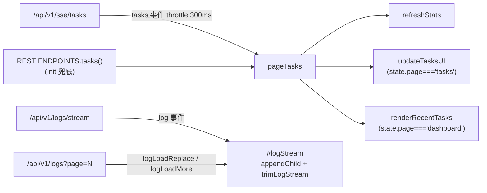
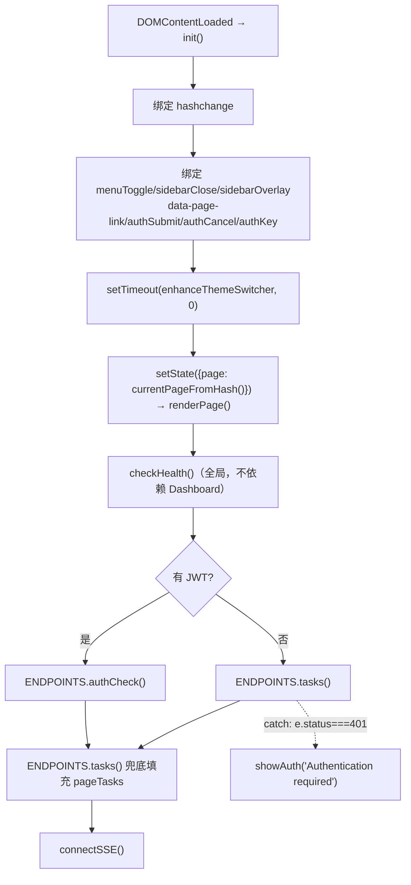

# web3 前端代码规范速查

> 维护说明：本文件描述 `internal/api/web/web3/`（暗色玻璃拟态运维控制台）的**结构、约定与常见陷阱**，面向接手 web3 的开发者。为避免随行号漂移失效，除文件级规模外一律用**函数名/选择器/常量名**锚点（如 `internal/api/web/web3/app.js#renderPage`、`internal/api/web/web3/styles.css#.log-filter-bar`），不写具体行号。改动 web3 行为后如涉及新约定，请同步更新本文件。
>
> 规范摘要见 [[lat.md/api-server.md]] 的 **Web3 Console Theme** 与 **Presentation Contract** 两节；静态契约由 `internal/api/web3_frontend_test.go#TestWeb3ThemePresentationContract` 锁定，本文件中的"必须/禁止"清单与该测试是同一份契约的两种表述。

## 与 web1 / web2 的核心差异

三套主题共用后端 REST + SSE 契约，但**前端约定完全不同**，不要跨主题复制代码。

| 特性 | web1 | web2 | web3 |
|---|---|---|---|
| 事件系统 | `data-action` 统一 dispatch | `onclick="fn()"` 内联 + 部分 `addEventListener` | **纯 `onclick` / `onchange` / `onkeydown` 内联**（app.js 内 66 处 `onclick="`），无 `data-action`、无事件委托 |
| 函数导出 | 模块对象方法 | 底部 `window.X = X` | **顶层 `function` 声明即全局**，app.js 内没有任何 `window.X =` 赋值 |
| Toast | `toast.show(msg, type)` | `toast(msg, type)` | `toast(msg, type, ms)`，`type ∈ {ok, err, warn, info}`（**不是** web2 的 `success`/`error`） |
| Modal | `drawer.open()` 预建组件 | `openModal(html)` 动态创建 | `openModal(html)` + `closeModal()`，**额外内置 Esc 关闭与 Tab 焦点陷阱** |
| 转义 | `escapeHtml` / `escapeAttr` | `esc`（内容+属性共用） | `esc`（HTML 内容）+ `jsEsc`（内联 onclick 字符串参数） |
| 状态管理 | `store.setState/subscribe` | 模块级 `let` 变量 | `state` + `setState`（**`subscribe` 已定义但无消费者**）+ `pageTasks` + 各页模块级对象 |
| CSS 状态类 | `tag-queued` 等 | `badge-queued` 等 | `badge-queued` 等（同 web2 命名） |
| 按钮类 | `btn btn-secondary` | `btn btn-ghost` | `btn primary` / `btn ghost` / `btn danger` / `btn sm` / `btn xs` |
| 路由 | `navigateTo` + hash 映射表 | `navigateTo` + `renderPage` | `#/dashboard` 等 hash 路由，`PAGES` 表驱动 |
| 主题切换器 | Go 注入的 🎨 浮标 | Go 注入浮标 | Go 注入的 `#tmd-theme-switcher`，由 `enhanceThemeSwitcher` **搬进侧栏底部** |
| 无障碍 | `role="link"` + 抽屉焦点管理 | 未系统化 | **tablist/tab/tabpanel + 方向键导航 + 44px 触控目标**（由测试锁定） |
| 构建 | 零构建 | 零构建 | 零构建（`'use strict'` 经典脚本，无模块、无打包器） |

共同点：三者的 HTML 都经 `Server#handleWeb` 注入同一段主题切换器（`themeSwitcherHTML`），切换器标记在所有主题中都**不是**主题文件自带的。

## 文件结构

```
internal/api/web/web3/
├── index.html      # 单页骨架（~120 行）：防 FOUC 内联变量 + 全量 reduced-motion + 侧栏/顶栏/Toast/Auth 静态标记
├── app.js          # 全部 JS（~2100 行 / ~117KB），单文件、零构建、经典脚本（非 module）
└── styles.css      # 全部样式（~540 行 / ~26KB），玻璃拟态变量体系
```

三个文件通过 `//go:embed web/*`（`internal/api/handlers.go#webFS`）打包进二进制，经 `Server#handleStatic` 以 `/static/app.js`、`/static/styles.css` 暴露；`index.html` 由 `Server#handleWeb` 返回并**在 `</body>` 前注入主题切换器**。另有共享资产 `/static/shared/datetime.js`（`internal/api/web/shared/datetime.js`，由 `readSharedFrontendFile` 单独提供）。

### index.html 的三块职责

| 块 | 内容 | 约束 |
|---|---|---|
| `<head>` 内联 `<style>` | 防 FOUC 最小变量集（9 个：`--bg-0 --bg-1 --accent --text-1 --text-2 --ok --warn --err --info`）+ 全量 `prefers-reduced-motion` 覆盖 | **值与 `styles.css` 的 `:root` 逐字相同**，改配色必须同步两处（两侧都有互引注释） |
| `<body>` 静态标记 | `#sidebar`（含 `#nav` 导航 + `#sidebarBottom` 健康/版本 + 主题切换器落点）、`#sidebarOverlay`、`#menuToggle`、`#pageTitle`、`#sseBadge`、`#content`、`#toastRoot`、`#authOverlay` | 页面内容全部由 JS 渲染进 `#content`；只有这些**外壳元素**是静态的 |
| `<script>` 顺序 | 先 `/static/shared/datetime.js`，后 `/static/app.js` | 顺序被测试锁定（`requiredIndex` 断言 `<script src="/static/shared/datetime.js"></script>` 存在）；app.js 在顶层就引用 `TMDDateTime`，颠倒会报 `TMDDateTime is not defined` |

`index.html` 的导航项是 `<a class="nav-item" href="#/dashboard" data-page="dashboard">`：**不 `preventDefault`**，靠原生 hash 跳转 + `hashchange` 监听驱动渲染；`data-page` 值必须与 `PAGES` 的键一致（`renderPage` 用它给导航项加 `.active`）。

`index.html` 中**没有任何 emoji 图标**，所有图标都是内联 SVG（测试禁止 `🎨` / `📋` / `⚠️` 出现在三个资产里）。

## app.js 段落布局

段落顺序即文件顺序；每段以 `/* ---------- 段落名 ---------- */` 注释开头（**新增代码放进对应段，不要另起风格**）。

| # | 段落 | 代表符号 |
|---|---|---|
| 1 | 工具函数 | `esc` / `jsEsc` / `throttle` / `fmtDur` / `relTime` / `stripAnsi` / `ICON_PATHS`（17 个图标路径）/ `iconSVG(name, size)` |
| 2 | API 层 | `apiBase()`（`window.TMD_DEV_BASE \|\| ''`）/ `fetchWithTimeout(url, opts, timeoutMs)` / `API`（`_refreshPromise`、`get/post/put/patch/delete`、`request`、`_json`、`_doRefreshJWT`、`_tryRefreshJWT`） |
| 3 | ENDPOINTS | 75 个后端端点绑定（见下节） |
| 4 | 状态 | `state` / `listeners` / `setState` / `subscribe` / `pageTasks` |
| 5 | Toast | `toastIcons` / `toast(msg, type, ms)` |
| 6 | Modal | `currentModal` / `openModal(html)` / `closeModal()` / 模块级 `document` keydown（Esc + Tab 焦点陷阱） |
| 7 | Sidebar（移动端） | `openSidebar` / `closeSidebar` |
| 8 | Auth | `_authDialogOpen` / `_authLastFocused` / `showAuth(message)` / `hideAuth()` / `submitAuth()` |
| 9 | 任务工具 | `TASK_STAGE_TEXT` / `getStageText` / `getTaskPct` / `TASK_TYPE_NAMES` / `taskTypeName` / `taskTarget` / `TASK_STATUS_SAFE` / `safeStatus` / `taskTypeIcon` / `syncTabs(containerID, activeLabel)` / 模块级方向键 tab 导航 keydown |
| 10 | 调度工具 | `normalizeEntry(item)` / `schedToForm(s)`（调度条目 ↔ 表单双向转换） |
| 11 | Tasks 页 | `_errorsData` / `renderTasks` / `updateTasksUI` / `taskRowHTML` / `updateTaskRow` / `cancelTask` / `retryTask` / `deleteTask` / `cancelAllQueued` |
| 12 | 任务表单（inline） | `TASK_FORM_LABELS` / `taskFormType` / `TASK_FORM_HTML` / `TASK_FORM_OPTS` / `TASK_FORM_NO_OPTS` / `TASK_FORM_NORETRY_ONLY` / `TASK_FORM_NORETRY_OPTS` / `renderTaskFormInline` / `switchTaskForm` / `checkedOpts` / `areaLines` / `submitTaskForm(type, action)` |
| 13 | 失败记录 | `errorsGen` / `loadErrors` / `toggleErrorsPanel` / `updateErrorsPanel` / `retryAllErrors` / `clearAllErrors` |
| 14 | 任务详情 | `openTaskDetail(id)` |
| 15 | Data 页 | `DB_TABS`（6 张表）/ `DB_STAT_LABELS` / `DB_EDIT_FIELDS` / `dbState` / `dbGen` / `renderData` / `dbSwitchTab` / `dbSearchSubmit` / `dbRefresh` / `dbLoad` / `renderDBTable` / `dbRowHTML` / `dbSort` / `dbChangePage` / `renderDBPagination` / `openDBDetail` / `dbSaveUserDetail` / `openDBListDetail` / `dbSaveListDetail` / `openDBEdit` / `dbSaveEdit` / `dbDelete` |
| 16 | Schedules 页 | `schedState` / `schedGen` / `renderSchedules` / `schedLoad` / `schedToggleMode` / `renderSchedView` / `saveSchedRaw` / `triggerAllSchedules` / `triggerSchedule` / `reloadSchedules` / `toggleSchedule` / `deleteSchedule` / `scheduleFormHTML` / `seTypeChange` / `readScheduleForm` / `openScheduleEdit` / `saveScheduleForm` |
| 17 | 路由 | `PAGE_TITLES` / `PAGES` / `currentPageFromHash` / `navigateTo(page, replace)` / `renderPage` |
| 18 | Settings 页 | `settingsTab` / `settingsGen` / `renderSettings` / `settingsSwitch(tab)` |
| 19 | 主题切换 | `renderTheme(body)` / `switchTheme(theme)` |
| 20 | 配置字段 | `CONFIG_FIELD_LABELS` / `configFieldLabel` / `renderConfigFields` / `saveConfigFields` |
| 21 | Cookies | `renderCookies` / `addCookieRow` / `saveCookies` |
| 22 | Security | `getJWTStatus` / `renderSecurity` / `secStatus` / `secLogin` / `secTest` / `secRefresh` / `secClear` / `renderServerSection` / `shutdownServer` |
| 23 | Raw config | `renderRawConfig` / `saveRawConfig` |
| 24 | Logs 页 | `logState` / `logSSE` / `logReconnectAttempts` / `LOG_MAX_LINES` / `logLineInWindow` / `renderLogs` / `logApplyFilters` / `logRefresh` / `logParams` / `logEntryHTML` / `copyLogTweetId` / `logLoadReplace` / `logLoadMore` / `trimLogStream` / `toggleLogPause` / `logRefreshManual` / `logConnect` / `disconnectLogSSE` / `logStartStream` / `logLoadStats` / `logExport` |
| 25 | Dashboard | `renderDashboard` / `loadDashboard` / `updateStat` / `refreshStats` / `renderRecentTasks` / `progressHTML` / `_dlBusy` / `quickDownload` |
| 26 | Health | `checkHealth` |
| 27 | SSE | `sseSource` / `sseReconnectDelay` / `sseReconnectTimer` / `updateSseBadge` / `connectSSE` |
| 28 | 主题切换器增强 | `enhanceThemeSwitcher` |
| 29 | 初始化 | `init` + `document.addEventListener('DOMContentLoaded', init)` |

### 段落定位要点（易找错的地方）

- **路由段（17）在 Settings 段（18）之前**，不是文件末尾；末尾是 SSE 与 init。
- **`syncTabs` 与方向键 keydown 都在"任务工具"段（9）**，不属于路由或某个页面——它们是 Tasks/Data/Settings 三处分段控件共用的。
- **`enhanceThemeSwitcher`（28）在 SSE 段之后、init 之前**，是 init 显式调用的最后一个增强函数。
- **`openModal` 的焦点陷阱 keydown 在 Modal 段（6）**，与方向键 tab keydown（段 9）是两个独立的 `document` 监听器，互不干扰。

## 命名与事件约定

### 全局函数：顶层声明即全局

app.js 是**经典脚本**（无 `type="module"`），因此顶层 `function foo() {}` 自动挂在 `window` 上，内联 `onclick="foo()"` 才能解析。由此派生两条硬规则：

1. **被内联事件调用的函数一律用 `function` 声明**。顶层 `function` 声明会成为 `window` 属性；顶层 `const`/`let` 只进全局词法环境、**不成为 `window` 属性**。内联属性处理器的作用域链以全局作用域收尾，所以 `const` 形式在多数浏览器里也能解析到——但那时函数就不再是 `window` 属性，任何走 `window['name']`、跨 iframe、或由 `setTimeout('name()')` 字符串求值的路径都会失败。现状全部是 `function` 声明，保持一致。（`[INFERENCE]`：后半段关于 `window` 属性缺失导致失败的具体路径是推断，未在仓库内实测。）
2. **重命名函数必须同步所有内联字符串**。函数名以字符串形式散落在模板字面量里（66 处 `onclick`），改名后编译/语法检查都不会报错，只在运行时点击才炸。

### 内联事件是唯一模式

```js
// 静态按钮
'<button class="btn primary" onclick="saveConfigFields()">Save</button>'

// 携带参数：参数一律过 jsEsc（不是 esc）
'<button class="btn xs ghost" onclick="deleteTask(\'' + jsEsc(t.task_id) + '\')">Del</button>'

// 模板字面量内同样如此
`<button class="btn xs ghost" onclick="dbSort('${c}')" onkeydown="if(event.key==='Enter'||event.key===' ')dbSort('${c}')">`
```

| 场景 | 用法 |
|---|---|
| HTML 内容插值 | `esc(x)` |
| 内联事件参数 / 属性值（引号内） | `jsEsc(x)` |
| 纯代码常量（如 `TASK_FORM_LABELS` 的键、`DB_TABS.id`） | 可裸插 `${id}`，因为这些值由代码定义，不含引号 |
| 需要同时键盘可达 + 鼠标可点 | 补 `role="button" tabindex="0"` + `onkeydown`（如 Data 页表头排序） |

**没有 `data-action` 体系，也没有事件委托**：不要新增 `document.addEventListener('click', …)` 做统一分发，那是 web1 的模式。唯一的两个 `document` keydown 监听器见下表。

### DOM 事件监听分布

| 监听目标 | 注册处 | 用途 |
|---|---|---|
| `document` keydown | Modal 段（模块级） | Esc 关闭打开中的 modal / auth；Tab 与 Shift+Tab 在 `currentModal` 或 `.auth-card` 内循环 |
| `document` keydown | 任务工具段（模块级） | 方向键/Home/End 在 `[role="tab"]` 之间移动并 `click()` |
| `document` keydown | index.html `#authKey`（init 绑定） | Enter 提交认证 |
| `document` DOMContentLoaded | 文件末 | 调用 `init()` |
| `window` hashchange | `init` | 同步 `state.page` 并 `renderPage()` |
| `#menuToggle` / `#sidebarClose` / `#sidebarOverlay` | `init`（`onclick` 属性赋值） | 移动端抽屉开合 |
| `[data-page-link]` | `init`（`addEventListener`） | brand logo → `navigateTo('dashboard')`，规避整页刷新 |
| `#logStream` scroll | `logStartStream`（用 `dataset.scrollBound` 去重） | 滚到顶部自动 `logLoadMore()` |
| `.toast` mouseenter/mouseleave | `toast()` 内 | 悬停暂停自动消失 |

### 命名规则

| 对象 | 约定 | 示例 |
|---|---|---|
| 页面渲染函数 | `render<Page>(root)` | `renderTasks` / `renderDashboard` |
| 页面局部刷新 | `update<What>` / `render<What>View` | `updateTasksUI` / `renderSchedView` |
| 异步加载 | `<域>Load` / `<域>Refresh` | `dbLoad` / `logRefresh` |
| 动作 | 动词开头，与内联 onclick 同名 | `cancelTask` / `saveCookies` |
| 模块级状态 | `xxxState` / `xxxGen` / `_xxx` | `dbState` / `dbGen` / `_dlBusy` |
| 后端端点 | 资源 + 动词，全部收在 `ENDPOINTS` | `dbUserEntityUpdate` / `triggerAllSchedules` |
| 私有/一次性标记 | 前导 `_` | `_errorsData` / `_authLastFocused` / `_refreshPromise` |
| CSS 类 | kebab-case，语义化 | `.filter-bar` / `.stat-card` / `.badge-running` |

## 状态与并发守卫

### 三套并行的状态载体

| 载体 | 定义 | 用途 | 注意事项 |
|---|---|---|---|
| `state` + `setState` | 段 4 | 只存 `page` / `tasks` / `health` / `queue` / `errors` / `schedules` / `sseConnected` | `subscribe(fn)` 已定义但**全文件无调用点**；`state.tasks` / `state.errors` / `state.schedules` 初始化后**从未被写入或读取**（任务真身是 `pageTasks`）。改这两处不会有人响应，别指望"改 state 自动重渲染" |
| `pageTasks` | 段 4 | SSE `tasks` 事件的实时快照 | **唯一**的任务数据源；`refreshStats` / `updateTasksUI` / `renderRecentTasks` 都读它。初始值由 `init` 里的一次 REST `ENDPOINTS.tasks()` 兜底填充 |
| 各页模块级对象 | 段 11-24 | `dbState` / `schedState` / `logState` / `settingsTab` / `taskFormType` | 跨页面切换**不重置**（`renderLogs` 特意从 `logState` 回填控件以保留筛选意图） |

### 代际守卫（防止旧响应覆盖新响应）

web3 **不用 AbortController**，统一用"递增计数器 + 响应回来比对"：

| 计数器 | 递增处 | 丢弃条件 |
|---|---|---|
| `dbGen` | `dbLoad()` 开头 | `gen !== dbGen` → 直接 `return`，不动 DOM |
| `schedGen` | `schedLoad()` 开头 | `gen !== schedGen` → 丢弃 |
| `errorsGen` | `loadErrors()` 开头 | `gen === errorsGen` 才 `updateErrorsPanel()` |
| `settingsGen` | `settingsSwitch(tab)` 开头 | 旧 promise 完成时 `gen !== settingsGen` → **递归重渲染当前 tab**（`settingsSwitch(settingsTab)`），而不是清空 body |
| `logState.gen` | `logRefresh()` / `logApplyFilters()` 开头 | `logLoadReplace` / `logLoadMore` 比对后丢弃；`logLoadMore` 失败时还要 `logState.page--` 回滚页码 |

`renderSchedView` 用另一种守卫：闭包捕获 `const modeSnapshot = 'raw'`，`schedulesRaw()` 返回后比对 `schedState.mode !== modeSnapshot` 才写 DOM（防"请求 raw 期间用户切回 form"）。

**新增异步加载路径必须二选一**（计数器或快照），否则快速切 tab / 翻页会出现旧内容覆盖新内容。

### 互斥与一次性锁

| 锁 | 位置 | 作用 |
|---|---|---|
| `_dlBusy` | `quickDownload` | 防连点创建重复任务；同时 `disabled` 按钮 |
| `busyLocked`（局部） | `submitTaskForm` | 读 `#taskFormBody button` 是否已 `disabled`，锁定整组按钮，`finally` 解锁 |
| `currentModal` | `openModal` / `closeModal` | 单例弹窗，开新弹窗先关旧的；保存 `_lastFocused` 用于关闭后还原焦点 |
| `_authDialogOpen` | `showAuth` / `hideAuth` | 认证框去重 + 抑制 SSE 重连噪音 |
| `API._refreshPromise` | `API._tryRefreshJWT` | JWT 刷新去重：并发 401 只发一次 `/auth/refresh` |
| `logSSE` | `logConnect` | 非空即已连接，直接 `return`（幂等连接） |
| `stream.dataset.scrollBound` | `logStartStream` | 防止每次进 Logs 页重复绑定 scroll 监听 |

### 数据流总览



## hash 路由

### 路由表

| 路由 | `PAGES` 成员 | 页面标题 | 备注 |
|---|---|---|---|
| `#/dashboard` | `renderDashboard` | Dashboard | 默认页（未知 hash 也回落到它）；`index.html` 的 brand logo 指向 `dashboard` |
| `#/tasks` | `renderTasks` | Tasks | 下载类型分段控件 + 统计卡 + 任务表 + 失败记录面板 |
| `#/data` | `renderData` | Data | 6 张表分段控件 + 搜索 + 排序 + 分页 + 行级 View/Edit/Del |
| `#/schedules` | `renderSchedules` | Schedules | form ↔ raw YAML 双模式 |
| `#/settings` | `renderSettings` | Settings | Configuration / Cookies / Security / Theme / Raw YAML 五个分段 |
| `#/logs` | `renderLogs` | Logs | 级别/域/关键字/时间过滤 + SSE 流 |

### 三条路由规则

```js
function currentPageFromHash() {
  const h = location.hash.replace(/^#\/?/, '');
  const name = h.split('?')[0];      // 允许 #/logs?x=1 形式，查询串被忽略
  return PAGES[name] ? name : 'dashboard';
}
```

1. **`navigateTo` 只改 hash，不渲染**：`renderPage` 由 `hashchange` 监听器统一执行，避免"改 hash + 手动渲染"双重渲染。只有 hash 已经相同（如反复点 logo）时才直接 `setState + renderPage`。
2. **`navigateTo(page, replace=true)` 走 `history.replaceState`**，不产生历史记录（当前无调用点，保留给"重定向"场景）。
3. **hash 是唯一的路由真相**：主题切换会 `location.reload()`（`switchTheme` / `submitAuth`），重载后靠 `currentPageFromHash()` 从 `location.hash` 恢复页面——**不要引入额外的内存路由状态**，否则重载后丢页。

### `renderPage` 的副作用（改路由必读）

```js
function renderPage() {
  if (currentModal) closeModal();                       // ① 关残留弹窗（modal 挂在 body 上，不关会压住新区块）
  const page = state.page;
  if (page !== 'logs' && logSSE) disconnectLogSSE();     // ② 离开 Logs 页断开日志 SSE
  document.querySelectorAll('.nav-item').forEach(el =>   // ③ 同步导航高亮
    el.classList.toggle('active', el.dataset.page === page));
  document.getElementById('pageTitle').textContent = PAGE_TITLES[page] || 'Dashboard';
  closeSidebar();                                        // ④ 移动端选页后收起抽屉
  const content = document.getElementById('content');
  content.innerHTML = '';
  try { PAGES[page](content); }
  catch (e) { /* ⑤ 渲染异常降级为空态卡片，而不是白屏 */ }
}
```

①④⑤ 是 web3 特有的兜底，**新增页面渲染器不要假设自己是从干净状态进入的**：弹窗、抽屉、日志 SSE 都可能在上一页残留。

注意 `renderPage` **不会**重置 `dbState` / `schedState` / `logState`——它们是跨页持久的模块级对象，页面渲染器必须自己决定是否从这些状态回填控件（`renderLogs` → `logStartStream` 是正面例子）。

### 初始化顺序（`init`）



- **`checkHealth()` 在 `renderPage` 之后立即调用**，而不是等 Dashboard 渲染：左下角健康点必须在任何页面都更新。
- **`enhanceThemeSwitcher` 用 `setTimeout(…, 0)` 延迟一拍**：主题切换器标记由 Go 在 `</body>` 前注入，源码位置在 app.js 之后，`init` 里直接调用会拿不到 `#tmd-theme-switcher`。
- **认证探测**：无 JWT 时用 `ENDPOINTS.tasks()` 触发 401 兜底弹框；网络失败不阻塞启动。

## 无障碍契约

### 分段控件：tablist / tab / tabpanel

三处分段控件（Tasks 下载类型、Data 表切换、Settings 分区）共用同一套结构，**新增分段控件必须照抄**：

```html
<div class="tabs" id="taskFormTabs" role="tablist" aria-label="Download type">
  <button type="button" id="task-tab-user" role="tab"
          aria-controls="taskFormBody" aria-selected="true" tabindex="0"
          class="tab active" onclick="switchTaskForm('user')">User</button>
  <button type="button" id="task-tab-list" role="tab"
          aria-controls="taskFormBody" aria-selected="false" tabindex="-1"
          class="tab" onclick="switchTaskForm('list')">List</button>
</div>
<div class="panel-body" id="taskFormBody" role="tabpanel" aria-labelledby="task-tab-user"></div>
```

要点：

| 要求 | 实现处 |
|---|---|
| 容器 `role="tablist"` + `aria-label` | 三处模板（`renderTasks` / `renderData` / `renderSettings`） |
| 每个按钮 `type="button"`（防止在 form 内意外提交） | 同上 |
| `aria-controls` 指向**同一个** panel id | Tasks→`taskFormBody`、Data→`dbTableWrap`、Settings→`settingsBody` |
| `aria-selected` + `tabindex`（选中项 0，其余 -1） | 模板初值；运行时由 `syncTabs` 维护 |
| panel 的 `aria-labelledby` 指向当前 tab 的 id | 模板初值 + `syncTabs` 动态改写 |
| 切换后同步以上全部 | **`syncTabs(containerID, activeLabel)`** |
| 方向键 / Home / End 导航 | 任务工具段的模块级 keydown |

`syncTabs` 的匹配方式是 **`tab.textContent.trim() === activeLabel`**——所以调用方必须传入与按钮文案**逐字相同**的字符串：

| 调用点 | activeLabel 来源 |
|---|---|
| `switchTaskForm(type)` | `TASK_FORM_LABELS[taskFormType]` |
| `dbSwitchTab(tab)` | `DB_TABS.find(x => x.id === tab).label` |
| `settingsSwitch(tab)` | 段内 `labels` 映射表 |

改按钮文案而不同步这三处，会导致 `aria-selected` / `.active` / `tabindex` 全部错位（**不报错，只是键盘与读屏行为退化**）。

方向键处理器会调用 `next.click()`——**键盘激活依赖内联 `onclick`**，所以 tab 按钮必须保留 `onclick`。

### 焦点管理

| 场景 | 机制 |
|---|---|
| 弹窗打开 | `openModal` 记录 `document.activeElement` 到 `overlay._lastFocused`，`setTimeout(60)` 后聚焦容器内第一个可聚焦元素 |
| 弹窗关闭 | 焦点还原到 `_lastFocused`（且 `isConnected` 才还原） |
| 弹窗内 Tab 循环 | Modal 段 keydown：`focusables` 首尾环绕，`preventDefault` |
| Esc | 优先关弹窗，其次关认证框 |
| 认证框 | `showAuth` 记录 `_authLastFocused`，把 `#app` 设为 `inert`（**认证框是 `#app` 的兄弟节点**，所以自身仍可交互），关闭时解除 `inert` 并还原焦点 |
| 键盘可见焦点 | `styles.css` 的 `:focus-visible` 组选择器（见 CSS 节） |

### 语义与标签（被测试逐字锁定）

| 契约 | 位置 |
|---|---|
| 所有表单控件有**显式** `<label for="…">`，占位符不作为唯一标签 | `TASK_FORM_HTML`（如 `<label for="tf-target">Screen Name</label>`）、`renderSecurity`（`<label for="secKey">API Key</label>`）、`renderCookies`、`renderConfigFields`、`scheduleFormHTML` |
| 视觉上不需要标签的控件用 `<label class="sr-only" for="…">` 或 `aria-label` | `index.html` 的 `<label class="sr-only" for="authKey">API Key</label>`；`renderDashboard` 的 `#quickDlInput`（sr-only label + `aria-label` 双保险）；`renderData` 的 `#dbSearch` |
| Toast 容器 `role="status" aria-live="polite"` | `index.html#toastRoot`；**错误 toast 额外加 `role="alert"`**（`toast()` 内 `type === 'err'` 分支） |
| 折叠面板用 `aria-expanded` + `aria-controls` + `aria-hidden` | `renderTasks` 的失败记录面板（`toggleErrorsPanel` / `updateErrorsPanel` 同步三处） |
| 排序表头用 `role="button"` + `tabindex="0"` + `aria-sort` + Enter/Space 键 | `renderDBTable` |
| 统计数字用 `aria-live="polite"` | `#dbStats` |
| 图标一律 `aria-hidden="true"`，可交互图标按钮单独给 `aria-label` | `iconSVG` 固定输出 `aria-hidden="true"`；关闭按钮写 `aria-label="Close"`，复制按钮写 `aria-label="Copy tweet ID"` |
| 移动端抽屉 | `#menuToggle` 带 `aria-expanded` + `aria-controls="sidebar"`，`openSidebar`/`closeSidebar` 同步 `aria-expanded` |
| 主题切换器（Go 注入，web3 补语义） | `enhanceThemeSwitcher` 设置 `role="button"` / `tabindex="0"` / `aria-label` / `aria-controls="ts-panel"` / `aria-expanded`，并补 Enter/Space 键盘激活 |

### 触控目标 44px

**≤900px 断点内**，主控件、紧凑按钮、导航项、表单字段、主题切换器选项全部提升到至少 44px 高（逐条被测试锁定，见 CSS 节）。**≤560px 断点里禁止把 `.btn.xs` 缩回 36px**——测试会直接判失败（`narrowMobileStyles` 断言）。

### reduced-motion

全量覆盖只在 `index.html` 内联块：

```css
@media(prefers-reduced-motion:reduce){
  *,*::before,*::after{transition-duration:0s!important;animation-duration:.01ms!important;animation-iteration-count:1!important}
}
```

`styles.css` 里**没有** reduced-motion 块（与 web1 同约定）。新增动画元素不需要逐条登记——通配选择器已覆盖；但**不要在 styles.css 另写一个 reduced-motion 块**。

## CSS 体系

### 颜色与尺寸令牌（`styles.css#:root`）

| 令牌 | 值 | 用途 | 是否在 `index.html` 内联最小集 |
|---|---|---|---|
| `--bg-0` | `#090b10` | 页面底色（`html` / `body` / `.app` 三处都用它） | ✅ |
| `--bg-1` | `#12151d` | **已声明但全文件 0 处引用**（保留令牌） | ✅ |
| `--glass` | `rgba(22,25,35,.86)` | 玻璃卡片背板 | ❌ |
| `--glass-strong` | `rgba(31,35,48,.94)` | hover / 激活态背板 | ❌ |
| `--glass-border` | `rgba(190,201,224,.14)` | 玻璃描边、分隔线 | ❌ |
| `--glass-highlight` | `rgba(212,220,238,.24)` | hover 描边 | ❌ |
| `--text-1` | `#f4f6fb` | 主文字 | ✅ |
| `--text-2` | `#b4bdcc` | 次要文字（`.text-muted`） | ✅ |
| `--text-3` | `#8994a8` | 三级文字（提示、占位符、表头） | ❌ |
| `--accent` | `#8b95ff` | 品牌强调色（主按钮、focus outline、进度条） | ✅ |
| `--accent-2` | `#5eead4` | 仅用于 toggle 选中态渐变 | ❌ |
| `--accent-3` | `#52c7ea` | **已声明但全文件 0 处引用** | ❌ |
| `--ok` / `--warn` / `--err` / `--info` | `#45d69c` / `#f6c85f` / `#ff7676` / `#52c7ea` | 语义色（badge、统计数字、日志着色、toast 图标） | ✅ |
| `--radius` / `--radius-sm` | `8px` / `6px` | 卡片圆角 / 控件圆角 | ❌ |
| `--duration-fast/normal/slow` | `.14s` / `.24s` / `.38s` | 过渡时长（**一律用变量，禁止硬编码 `.2s` 之类**；`spin`/`shimmer`/`pulse` 三个循环动画除外） | ❌ |
| `--ease` | `cubic-bezier(.2,.8,.2,1)` | 缓动 | ❌ |
| `--shadow` | `0 18px 48px rgba(0,0,0,.38)` | 弹窗 / 抽屉阴影 | ❌ |
| `--mono` / `--font` | JetBrains Mono 栈 / Inter 栈 | 等宽（日志、ID、token）/ 正文 | ❌ |

**同步规则**：`index.html` 内联块只带 9 个防 FOUC 变量，值是 `styles.css` 的**子集且逐字相同**。改这 9 个中的任何一个，必须同时改两处；两侧注释已互引。

**已知不一致（改动前留意）**：部分 `rgba()` 字面量是手工配的近似值，与令牌并不严格相等——例如 `::selection` 用 `rgba(124,140,255,.35)`（`--accent` 实为 `rgb(139,149,255)`）、`.sse-badge.live` 边框用 `rgba(52,211,153,.3)`（`--ok` 实为 `rgb(69,214,156)`）、`.nav-label` 直接硬编码 `#7e88ad` 而非 `--text-3`。**新增样式请优先引用令牌**，不要继续扩散硬编码。

### 玻璃拟态层叠与背板

```css
.glass {
  background: var(--glass);
  border: 1px solid var(--glass-border);
  border-radius: var(--radius);
  backdrop-filter: blur(10px);
  -webkit-backdrop-filter: blur(10px);
}
```

- `.glass` 是唯一的"面板"类，与 `.card`（只加 `position: relative`）组合使用：`<div class="glass card">`。
- `.card-hover` 是可选 hover 增强（描边 + 背板提亮 + transform 过渡），统计卡用它。
- **`background-attachment: fixed` 被测试明令禁止**（会破坏移动端背板连续性，且触发 iOS 滚动性能问题）。页面背板连续性靠 `html { background: var(--bg-0); }` + `.app { min-height: 100vh; min-height: 100dvh; }`（**两行都要保留**：`100dvh` 是移动端地址栏收放时的正确高度，测试锁定该串）。
- 弹窗与认证框的**背板**（`.modal-overlay` / `.auth-overlay`）各自独立配色（`rgba(4,6,14,.6)` / `.7`），不用 `.glass`；但它们的**面板**都带 `.glass`——`openModal` 生成 `<div class="modal glass">`，认证卡片在 `index.html` 里写死 `class="auth-card glass"`。

### 断点

| 断点 | 行为 |
|---|---|
| `@media (min-width: 901px)` | 隐藏 `#menuToggle`（桌面侧栏常显，汉堡只是移动端控件） |
| `@media (max-width: 900px)` | **主移动断点**：`.sidebar` 改为 `position: fixed` + `translateX(-100%)`，`.sidebar.open` 归位；`.sidebar-close` 显示；`.sidebar-overlay` 启用（含 `backdrop-filter: blur(3px)`）；`.form-row` 单列；`.content`/`.topbar` 收窄内边距；**44px 触控目标组**（见下）；`.toast-close` 也提到 44px |
| `@media (min-width: 901px) and (max-width: 1220px)` | 日志过滤网格塌成两列：`.log-filter-bar { grid-template-columns: 1fr 1fr; }`（**测试逐字锁定这一行**）。原因：桌面侧栏 240px 常驻，日志过滤条 6 列在 1220px 以下会把页面撑出横向滚动 |
| `@media (max-width: 560px)` | `.stats-grid` 固定两列；页面操作按钮占满整行；`.log-filter-bar` 单列且每个 `.filter-field` / 按钮 `width: 100%`；`.toast-container` 改为左右贴边、toast 取消 `min-width` |

### 44px 触控目标（`max-width: 900px` 内逐条被测试锁定）

以下 6 行是 `TestWeb3ThemePresentationContract` 的硬断言，**改动即测试失败**：

```css
.btn, .tab, .icon-btn { min-height: 44px; }
.icon-btn { width: 44px; }
.nav-item, .checkbox-line, .toggle { min-height: 44px; }
.toggle { min-width: 44px; }
.btn.xs { min-width: 44px; min-height: 44px; }
input[type="text"], input[type="password"], input[type="number"],
input[type="datetime-local"], input[type="file"], select { min-height: 44px; }
#tmd-theme-switcher .ts-btn, #tmd-theme-switcher .ts-opt { min-height: 44px !important; }
#tmd-theme-switcher .ts-opt { min-width: 44px !important; }
.toast-close { min-width: 44px; min-height: 44px; }
```

配套的**反向断言**：`@media (max-width: 560px)` 块里**不得**出现 `.btn.xs { min-width: 36px; min-height: 36px; }`（早期版本曾在小屏把紧凑按钮缩回 36px，被测试禁止回退）。

### 日志过滤条网格

```css
.log-filter-bar { display: grid;
  grid-template-columns: minmax(130px,.7fr) minmax(150px,.9fr) minmax(170px,1fr) minmax(180px,1fr) minmax(180px,1fr) auto;
  align-items: end; }
.log-stats { grid-column: 1 / -1; }   /* 级别统计条横跨整行 */
```

六列对应：Level / Domain / Search / From / To / Filter 按钮；`.log-stats`（级别计数 chip 条）独占第一行。**新增过滤字段必须同时更新三个断点的 `grid-template-columns`**，否则会在 901-1220px 区间溢出。

`.log-stream` 的关键三条：`height: 55vh; min-height: 260px; overflow-y: auto;` 以及被测试锁定的 `white-space: pre-wrap; overflow-wrap: anywhere;`（长日志行必须换行而不是撑出横向滚动）。

### 键盘可见焦点

```css
.btn:focus-visible, .nav-item:focus-visible, .icon-btn:focus-visible, .tab:focus-visible,
th[role="button"]:focus-visible, [tabindex]:focus-visible,
input:focus-visible, textarea:focus-visible, select:focus-visible {
  outline: 2px solid var(--accent); outline-offset: 2px;
}
```

外加 `.toggle:focus-within .toggle-track`（隐藏的原生 checkbox 无法直接描边，用 `:focus-within` 代理）。`[tabindex]:focus-visible` 已覆盖新加的键盘可达元素；**新增交互元素若既不是 `.btn`/`.tab`/`.icon-btn` 也没有 `tabindex`，需手动加入该选择器组**。

### 主题切换器样式归属

`#tmd-theme-switcher` 的标记与内联样式由 Go 的 `themeSwitcherHTML()` 提供（`position:fixed; bottom:16px; left:16px`）。web3 在 `styles.css` 末尾用 `!important` 覆盖为侧栏内联元素：

```css
#tmd-theme-switcher { position: relative !important; inset: auto !important; z-index: 1 !important; margin-top: 12px; }
#tmd-theme-switcher .ts-panel { position: absolute; left: 0; right: 0; bottom: 48px; }  /* 向上弹出 */
```

`enhanceThemeSwitcher` 负责把节点 `appendChild` 到 `.sidebar-bottom`（健康状态/版本号下方）。**改 Go 注入标记的类名（`ts-btn` / `ts-panel` / `ts-opt`）会同时打断 web3 样式与 44px 测试断言。**

## 禁止 / 必须清单

### 禁止

| # | 禁止项 | 依据 |
|---|---|---|
| 1 | **禁止在 web3 资产中出现 `background-attachment: fixed`** | `TestWeb3ThemePresentationContract` 的 `forbidden` 列表；破坏移动端背板连续性 |
| 2 | **禁止用 emoji 作图标**（测试点名 `🎨`、`📋`、`⚠️`） | 同上；图标必须走 `ICON_PATHS` + `iconSVG()` |
| 3 | **禁止 `innerHTML +=`** | 全文件 0 处；一律"字符串拼接 + 一次 `innerHTML =`"，或 `createElement` + `appendChild`（日志行）/ `createDocumentFragment` 式批量 |
| 4 | **禁止新增 `data-action` 或事件委托** | 那是 web1 的模式；web3 统一内联 `onclick` |
| 5 | **禁止给内联事件参数用 `esc()`** | 属性内嵌 JS 字符串必须 `jsEsc()`。`esc()` 把 `'` 转成 `&#39;`，HTML 解析属性值时会**还原成 `'`**，在 `onclick="f('…')"` 里提前闭合字符串字面量；`jsEsc()` 输出 `\'` 才是安全形式 |
| 6 | **禁止把用户/后端数据裸插进 `innerHTML` 模板** | 必须 `esc()`；代码常量除外 |
| 7 | **禁止在 `styles.css` 里另写 reduced-motion 块** | 全量覆盖只在 `index.html` 内联块，单一来源 |
| 8 | **禁止硬编码过渡时长** | 用 `--duration-*`（`spin`/`shimmer`/`pulse` 循环动画除外） |
| 9 | **禁止在 ≤560px 把 `.btn.xs` 缩到 36px** | 反向断言 |
| 10 | **禁止在 web3 自建主题切换按钮** | 切换器由 `Server#handleWeb` 注入；web3 只做"搬位置 + 补语义" |
| 11 | **禁止新增无 `role` 关系的分段控件** | tablist/tab/tabpanel 三件套 + `syncTabs` |
| 12 | **禁止把 `TestWeb3ThemePresentationContract` 锁定的字符串"顺手改顺眼"** | 改文案/类名/缩进前先跑该测试 |
| 13 | **禁止让 `renderPage` 之外的地方直接改 `#content.innerHTML`** | 会绕过弹窗关闭 / 日志 SSE 断开 / 导航高亮同步 |
| 14 | **禁止把 `logState` 之类的页面状态搬进 `state` 并期待自动重渲染** | `subscribe` 无消费者 |
| 15 | **禁止改 `index.html` 内联变量而不同步 `styles.css#:root`**（反之亦然） | 防 FOUC 块是子集，必须逐字一致 |
| 16 | **禁止格式化整个 web3 文件** | 承接 `lat.md/development.md` 的 *What NOT to Do*（Don't format the whole repo）；web3 大量模板字符串对缩进敏感，全量格式化会制造无意义 diff 并可能移动被测试锁定的字符串 |
| 17 | **禁止在 web3 绕过 REST/SSE 契约另造数据通道** | 三主题共用后端契约；web3 的 `ENDPOINTS` 是唯一出口 |

### 必须

| # | 必须项 | 依据 |
|---|---|---|
| 1 | 新增内联事件处理函数用顶层 `function` 声明 | 经典脚本 + 内联属性解析 |
| 2 | 新增按钮/控件有可辨识文案或 `aria-label` | 无障碍契约 |
| 3 | 新增表单控件有显式 `<label for>`（或 `sr-only` label / `aria-label`） | 测试锁定 `tf-target`、`secKey`、`authKey` 三处为样本 |
| 4 | 新增异步加载路径配代际守卫或模式快照 | 见"状态与并发守卫" |
| 5 | 新增分段控件：`role="tablist"` + `role="tab"` + `aria-controls` + `role="tabpanel"` + `aria-labelledby` + `syncTabs` 调用 | 无障碍契约 |
| 6 | 新增弹窗内容用 `openModal(html)`，标题用 `<h2>`（`openModal` 用它生成 `aria-labelledby`） | 焦点管理；无 `<h2>` 时退化为 `aria-label="Dialog"` |
| 7 | 新增破坏性操作（删除/关闭服务）用 `confirm()` 二次确认 | `deleteTask` / `dbDelete` / `deleteSchedule` / `clearAllErrors` / `shutdownServer` 一致 |
| 8 | 新增删除类操作若会删媒体目录，确认文案包含 `This also permanently deletes the media directory.` | 测试锁定该句（`dbDelete` 的 `removesMedia` 分支） |
| 9 | 时间字段编辑必须经 `TMDDateTime` 往返 | 见"日期时间契约" |
| 10 | 日志行渲染必须 `stripAnsi` 后再 `esc`，并保留 `tweet_id=(\d+)` 提取与复制按钮 | `logEntryHTML` 的既有行为 |
| 11 | 新增端点先在 `ENDPOINTS` 加成员，页面函数只调 `ENDPOINTS.xxx` | 现状 75 个成员统一收口 |
| 12 | 改动后跑 `node --check` + `go test ./internal/api/ -run TestWeb3 -count=1` | 见"验证步骤" |

### 日期时间契约（跨三主题共用）

`/static/shared/datetime.js` 暴露**冻结**的 `TMDDateTime = { toDateTimeLocal, toRFC3339 }`：

| 函数 | 方向 | 行为 |
|---|---|---|
| `toDateTimeLocal(utcRFC3339)` | 后端 → `<input type="datetime-local">` | 转浏览器本地墙上时间，格式 `YYYY-MM-DDTHH:mm:ss`；**非法/空值 fail-closed 返回 `''`** |
| `toRFC3339(localInputValue)` | 输入控件 → 后端 | 转 UTC RFC3339（去掉毫秒）；非法返回 `''` |

web3 的四处使用点（**被测试逐字锁定**）：

| 位置 | 用法 |
|---|---|
| `submitTaskForm` | `const ts = tsRaw ? TMDDateTime.toRFC3339(tsRaw) : undefined;`（mark 任务的 `tf-marktime`） |
| `logApplyFilters` | `logState.startTime = TMDDateTime.toRFC3339(…)`（From / To） |
| `openDBEdit` | `const type = f.numeric ? 'number' : (f.dateTime ? 'datetime-local' : 'text');` + `const value = f.dateTime ? TMDDateTime.toDateTimeLocal(item[f.key]) : …` |
| `dbSaveEdit` | `data[f.key] = TMDDateTime.toRFC3339(v) \|\| undefined;`（`latest_release_time`） |

另外 `logStartStream` 用**局部** `toLocalInput` 把 `logState` 里的 ISO 串回填到 `<input type="datetime-local">`——这是唯一没有复用共享库的地方（它需要 `YYYY-MM-DDTHH:mm` 精度，而 `toDateTimeLocal` 返回带秒）。改动时间控件时两处都要看。

## 常见陷阱

### 1. 语法错误 = Go 编译失败

三个文件经 `//go:embed web/*` 打包，**JS/CSS 语法错误会让 `go build` 失败**。提交前：

```bash
node --check internal/api/web/web3/app.js
```

CSS 没有等价检查器，靠括号平衡 + 浏览器实测（见验证步骤）。

### 2. `renderPage` 之后必须先想"哪些状态还在"

`renderPage` 会清空 `#content`，但 **`dbState` / `schedState` / `logState` / `settingsTab` / `taskFormType` 全部保留**。新页面渲染器如果直接从这些状态回填控件，要确认控件 id 已重建；如果从 DOM 读值（如 `readScheduleForm`），要确认 DOM 已渲染完成。

### 3. `syncTabs` 靠文案匹配，改文案会静默退化

`syncTabs(containerID, activeLabel)` 用 `tab.textContent.trim() === activeLabel` 找活动项。按钮文案改了、调用方传的字符串没改 → `aria-selected` / `.active` / `tabindex` 全错，**不报错**。三处调用点的 activeLabel 来源见"无障碍契约"。

### 4. `submitTaskForm` 的按钮锁定依赖 `#taskFormBody` 作用域

```js
const buttons = [...document.querySelectorAll('#taskFormBody button')];
if (buttons.some(b => b.disabled)) return;   // 已有按钮被禁用 = 正在提交，直接退出
buttons.forEach(b => { b.disabled = true; });
```

- 表单**内嵌在页面顶部**（`#taskFormCard` → `#taskFormBody`），不在弹窗里，所以成功分支里那句 `closeModal()` 是**无操作**（`currentModal` 为 null）——不要以为它关了什么。
- 按钮选择器限定在 `#taskFormBody`，`Cancel Queued`（页面级）不受影响。
- 成功后会清空 `#taskFormBody` 内所有 `type="text"` / `type="password"` / `textarea`（**`tf-marktime` 除外**）与全部 checkbox，并重置 `#tf-files`，以便连续创建。
- 校验失败走 `return toast(msg, 'warn')`，**提前 return 在 `try` 内，`finally` 仍会解锁按钮**——新增校验分支保持这个结构。

### 5. `quickDownload` 的 URL 保留字过滤

```js
const reserved = ['i','search','status','home','explore','notifications',
                  'messages','settings','compose','bookmarks','lists','following'];
```

从 URL 抓用户名前先排除保留字路径（`x.com/i/status/…` 的 `i` 不是用户名）。列表 URL 单独先匹配 `/(?:twitter\.com|x\.com)\/i\/lists\/(\d+)/`。**新增可识别的 URL 形态时，两处正则 + `reserved` 列表要一起改。**

### 6. 日志流的三个方向 + 一条上限

| 方向 | 实现 |
|---|---|
| REST 首页 | `logLoadReplace`：后端返回 **newest-first**，前端 `reverse()` 成 oldest→newest |
| REST 前置页 | `logLoadMore`：`stream.innerHTML = html + stream.innerHTML`，并用 `scrollHeight` 差补偿 `scrollTop`（防止回翻时视口跳动） |
| SSE 追加 | `logConnect` 的 `log` 事件：`appendChild`，且仅当"距底部 < 40px"时才自动吸底 |
| DOM 上限 | `trimLogStream`：`cap = LOG_MAX_LINES + Math.min(logState.prepended, LOG_MAX_LINES)` |

`logState.prepended` 在 `logLoadMore` 成功后累加、`logRefresh` 时清零。**别把它和 `page` 搞混**：`page` 是 REST 分页游标，`prepended` 是"已前置的行数配额"。

`logLoadMore` 由 `#logStream` 的 scroll 监听在 `scrollTop < 60` 时触发，且**只在 `logStartStream` 里绑定一次**（`dataset.scrollBound` 去重）。

### 7. Logs 页的两个"看起来能用其实没用"的控件

- **Domain 下拉永远是空的**：模板只有 `<option value="">All domains</option>`，全文件没有任何地方给 `#logDomain` 追加选项（只有读写 `.value`）。`logState.domain` 因此恒为 `''`，不会进入 `logParams`。
- **级别统计条是只读的**：`logLoadStats` 渲染 `<span class="chip …">` 但不挂任何事件，`.chip` 的 `cursor: pointer` 是纯装饰。

改这两处属于功能补齐，不是修 bug——但要知道现状，别以为筛选坏了。

### 8. 日志时间过滤是"前端二次过滤 + 后端参数"双份

`logParams` 把 `start_time`/`end_time` 传给后端；`logConnect` 的 SSE 分支另外用 `logLineInWindow(clean)` 在前端丢行（因为 SSE 流不复用 REST 的过滤参数之外的服务端保证）。`logLineInWindow` 的正则同时匹配 logrus 的 `time="…"` 与 `[2026-…]` 两种形态，**解析失败时返回 `true`（宁可多显示，不误删）**。

### 9. 弹窗挂 `body`，不在 `#content` 里

`openModal` 把 `.modal-overlay` 追加到 `document.body` 并设 `body.style.overflow = 'hidden'`。因此：

- `renderPage` 必须主动 `closeModal()`，否则弹窗会压在新页面上。
- 弹窗内的 `#dbEditField-*`、`#dbEditName` 等 id 是**全局唯一**的（`openDBDetail` 与 `openDBListDetail` 都用 `dbEditName`）——因为同时只会有一个弹窗。
- `closeModal()` 只在 `currentModal` 非空时清 `body.style.overflow`；如果异常路径导致 `currentModal` 被置空而 overflow 没恢复，页面会锁滚动。

### 10. 认证框在 `#app` 之外

`showAuth` 设 `#app.inert = true`，而 `#authOverlay` 是 `#app` 的**兄弟节点**，所以仍可交互。**不要把认证框挪进 `#app`**，否则 `inert` 会连它一起冻结。

`hideAuth` 末尾还有一段：若 `!sseSource && !_authDialogOpen` 则重置退避并 `connectSSE()`——修复"无 token 期间 SSE 暂停后不再恢复"。

### 11. SSE 重连有三条不同路径

`connectSSE` 的 `onerror` 分支：

| 情况 | 行为 |
|---|---|
| 无 JWT + 认证框开着 | **静默 return**（不重连、不噪音） |
| 无 JWT + 认证框没开 | 指数退避重连，上限 30s（免认证部署的常态） |
| 有 JWT | 先 `API._tryRefreshJWT()`；成功则立刻重连并重置退避；失败再用 `/auth/check` 探测——**401 才弹认证框**，其它（网络抖动）静默退避 |

`onopen` 重置 `sseReconnectDelay = 2000` 并顺带 `checkHealth()`。

日志 SSE（`logConnect`）是**另一套**：独立计数器 `logReconnectAttempts`，退避 `1000 * 1.5^min(n,8)` 上限 30s，**累计到 60 次后放弃**；`onopen` 与每条 `log` 事件都重置计数器（安静流不累计）。两条流不要混用计数器。

### 12. 日志页离开时断开、回来时重连

`renderPage` 在 `page !== 'logs'` 时 `disconnectLogSSE()`。回到 Logs 页时 `renderLogs` → `logStartStream` → `logRefresh` → `logLoadReplace` → `if (!logSSE) logConnect()`。所以**进 Logs 页必然先做一次 REST 全量替换再挂 SSE**，顺序不能反（否则 SSE 追加的行会被替换掉）。

### 13. 已知死代码 / 冗余（改动前先确认是否要顺手清理）

| 符号 | 现状 |
|---|---|
| `subscribe(fn)` | 定义后无任何调用点 |
| `state.tasks` / `state.errors` / `state.schedules` | 初始化后从未读写 |
| `logRefreshManual()` | 定义后无调用点（`toggleLogPause` 已覆盖该逻辑） |
| `ENDPOINTS.userFollowingDownload` | 与 `ENDPOINTS.followingDownload` 指向**同一端点**，前者无调用点 |
| `openDBDetail(type, id)` | `type` 形参未被使用（调用点恒传 `'users'`） |
| `--bg-1` / `--accent-3` | 令牌已声明，全文件 0 处引用 |
| `logState.domain` / `#logDomain` | 见陷阱 7 |

这些都不影响功能，但**不要把它们当成"现有约定"去模仿**。

## 改这里会波及什么

### 按改动点查影响面

| 你改了 | 会波及 |
|---|---|
| `index.html` 内联 9 个变量 | `styles.css#:root` 必须同步（逐字）；否则首屏 FOUC 瞬间配色跳变 |
| `styles.css#:root` 新增/改名令牌 | `index.html` 内联块是否也需要（只有首屏用到的才需要）；`.glass` / badge / 统计卡等引用点 |
| `index.html` 的 `<script>` 顺序 | `TMDDateTime` 未定义；`TestWeb3ThemePresentationContract` 的 `requiredIndex` 断言 |
| `index.html` 的 `data-page` 值 | `renderPage` 的导航高亮；`PAGES` 键；`PAGE_TITLES` |
| `PAGES` 增删页面 | `index.html` 的 `#nav` 条目（`href="#/xxx"` + `data-page`）、`PAGE_TITLES`、`currentPageFromHash` 回落逻辑 |
| 重命名任何被内联 `onclick` 调用的函数 | 全文件 66 处 `onclick="` 字符串 + `onchange` / `onkeydown` 内联；**没有编译期检查** |
| `syncTabs` 的匹配逻辑 | Tasks / Data / Settings 三处分段控件同时受影响（它们是唯一调用方） |
| `TASK_FORM_LABELS` 的标签文案 | `syncTabs('taskFormTabs', …)` 的匹配；tab 按钮文案 |
| `DB_TABS` 条目 | `renderDBTable` 列定义、`dbSwitchTab`、`syncTabs('dbTabs', …)`、`dbLoad` 的 `ENDPOINTS[tab.endpoint]` 查表、`renderDBPagination` |
| `DB_EDIT_FIELDS` 条目 | `openDBEdit` 表单生成 + `dbSaveEdit` 回读（**两处按同一个 `key` 列表遍历**）；`dateTime: true` 走 `TMDDateTime`，`numeric: true` 走 `Number()` |
| `DB_STAT_LABELS` | `dbLoad` 末尾的 `/api/v1/db/stats` 渲染（未知键回落为 `key.replaceAll('_',' ')`） |
| `ENDPOINTS` 成员名 | 页面函数调用点；`DB_TABS[].endpoint` 的字符串查表 |
| `normalizeEntry` / `schedToForm` | 调度条目 ↔ 表单**双向**转换；新增调度字段必须两处同时加 |
| `scheduleFormHTML` 的字段 id（`seType` / `seTarget` / `seValue` …） | `seTypeChange`（显隐）、`readScheduleForm`（回读）——三者是同一份契约 |
| `logState` 字段 | `logParams`（请求）、`logStartStream`（回填控件）、`logApplyFilters`（写入）、`trimLogStream`（`prepended`） |
| `logEntryHTML` | REST 三处（`logLoadReplace` / `logLoadMore`）与 SSE 一处（`logConnect`）**四处调用**，全部依赖 `data-tweet-id` 供 `copyLogTweetId` 使用 |
| `enhanceThemeSwitcher` | Go 注入标记的类名（`ts-btn` / `ts-panel` / `ts-opt`）、`styles.css` 的 `#tmd-theme-switcher` 覆盖块、44px 测试断言 |
| `#tmd-theme-switcher` 的 CSS | 同上一行；另外它用 `!important` 覆盖 Go 内联样式，改选择器要一起改 |
| `handleWeb` 的注入点（Go 侧） | 三主题共用的 `themeSwitcherHTML`；`enhanceThemeSwitcher` 的 `setTimeout` 兜底是否仍必要 |
| `TestWeb3ThemePresentationContract` 的 `requiredIndex/App/Styles` 列表 | 一旦被改，本文件的"必须/禁止"清单与 CSS 节的 44px 表也要同步——它们是同一份契约 |
| `openModal` / `closeModal` | 所有弹窗（任务详情、用户/列表详情、实体编辑、调度编辑）；焦点还原；`body.overflow` 锁 |
| `renderPage` | 所有页面的进入路径：弹窗关闭、日志 SSE 断开、导航高亮、标题、抽屉收起、渲染异常降级 |

### 跨主题不变量（改 web3 时不要顺手打破）

| 不变量 | 说明 |
|---|---|
| 后端 REST/SSE 契约 | web1/web2/web3 共用；web3 只能通过 `ENDPOINTS` 访问，禁止改 URL 形状 |
| `/static/shared/datetime.js` 的导出 | `TMDDateTime` 被三主题共用，且由 `TestFrontendDateTimeRoundTrip` 在 node 下直接执行验证；web3 不得改写其语义 |
| 主题切换器注入 | 由 Go 统一注入，三主题的 HTML 都不自带；web3 只搬位置、补语义、覆盖样式 |
| `themeSwitcherHTML()` 的类名 | Go 与 web3 CSS/JS 的隐式契约 |
| 配置字段顺序与数值上限 | `max_download_routine` 紧随 `max_user_fetch_concurrent`，上限 100 / 35 / 245——web3 的 `renderConfigFields` 用 `max="${f.name === 'max_download_routine' ? '100' : f.name === 'max_user_fetch_concurrent' ? '35' : '245'}"` 硬编码了这三个上限，三主题必须一致 |
| 主题持久化 | 运行时热切换、不写 `conf.yaml`、重启回落 `web1`（`internal/api/handlers.go#frontendTheme`） |

## 验证步骤

### 第 0 步：切到 web3 主题

web3 不是默认主题（`frontendTheme` 初值 `web1`，重启回落 web1），且**运行时热切换不写 `conf.yaml`**。两种切法：

```bash
# 方式一：API（需 JWT 或免认证部署）；默认端口 25556
curl -s http://127.0.0.1:25556/api/v1/config/themes
curl -s -X POST http://127.0.0.1:25556/api/v1/config/theme \
  -H 'Content-Type: application/json' \
  -d '{"theme":"web3"}'
curl -s http://127.0.0.1:25556/api/v1/config/theme

# 方式二：用任意主题的 Settings → Theme 面板点 web3（会 location.reload）
```

`GET /api/v1/config/themes` 返回 `{themes: [...], current: "..."}`，`themes` 由 `listThemes()` 扫描 `internal/api/web/` 下含 `index.html` 的子目录得出。服务默认监听 `:25556`（`bind_address` 留空 = 所有网卡），`-port` 可覆盖。

静态资源的缓存头是 `Cache-Control: no-cache` + `ETag`，改完前端**普通刷新即可**看到新版本：

```bash
curl -sI http://127.0.0.1:25556/static/app.js            # 看 ETag
curl -sI -H 'If-None-Match: "<上一步的 ETag>"' http://127.0.0.1:25556/static/app.js   # 期望 304
```

开发期改前端建议开磁盘直读，避免每次改 JS 都重启（**embed 模式必须重启**）：

```bash
TMD_DEV=1 go run .        # devWebRoot 指向 internal/api/web，assets 从磁盘读
```

### 第 1 步：语法与静态契约（必跑）

```bash
# JS 语法（embed 打包的前置条件）
node --check internal/api/web/web3/app.js

# web3 静态呈现契约：index.html / app.js / styles.css 的必需串、44px 触控规则、
# 中宽日志网格、禁用 token（background-attachment: fixed / emoji）
go test ./internal/api/ -run TestWeb3 -count=1

# 日期时间共享契约（node 下直接执行 datetime.js，正负 UTC 偏移）
go test ./internal/api/ -run 'TestFrontendDateTimeRoundTrip|TestSharedFrontendDateTimeAssetIsEmbedded' -count=1

# 一次跑完 web3 相关全部
go test ./internal/api/ -run 'TestWeb3|TestFrontendDateTime|TestSharedFrontendDateTimeAssetIsEmbedded' -count=1
```

`TestFrontendDateTimeRoundTrip` 在 `node` 不存在时会 `t.Skip`——**看到 skip 不代表通过**，确认本机有 node。

### 第 2 步：主题相关后端契约

```bash
go test ./internal/api/ -run 'TestHandleGetTheme|TestHandleSetTheme|TestHandleGetThemes' -count=1
```

（覆盖默认主题、切到 web2、非法 body、非法主题、主题列表五个用例。）

### 第 3 步：隔离几何验证（改动 CSS / 布局时必跑）

`tools/web3-e2e/` 是一个**只读 mock 服务器 + 浏览器断言脚本**，不读真实配置与数据库：

```bash
# 起 mock（默认端口 25558）
node tools/web3-e2e/mock-server.js 25558
# 打开 http://127.0.0.1:25558/
```

mock 只服务 4 个资产（`/` → web3/index.html、`/static/app.js`、`/static/styles.css`、`/static/shared/datetime.js`）和 5 个空 API 响应（`/api/v1/tasks`、`/health`、`/queue/status`、`/logs`、`/logs/stats`），其余 `/api/v1/*` 返回 `{success:true,data:{}}`，SSE 路径返回 204。

然后在页面控制台执行 `tools/web3-e2e/01-responsive-logs.js`，**在 901 / 1000 / 1216 / 390 四个 CSS 像素宽度各跑一次**。它点击 Logs 导航，然后返回：

```js
{
  passed: boolean,        // 四项全过
  viewport: { width, height },
  dimensions: { document: [clientWidth, scrollWidth], content: [...], filter: [...] },
  checks: {
    documentFits: …,       // documentElement 无横向滚动
    contentFits: …,        // .content 无横向滚动
    filterFits: …,         // .log-filter-bar 无横向滚动
    controlsFit: …         // 每个过滤控件都在视口内
  }
}
```

`passed === false` 时看 `dimensions` 里哪个 `scrollWidth > clientWidth`，对照"CSS 体系 → 断点"表定位是哪个断点的网格没塌。

> 该脚本只验证**渲染后的几何**，`TestWeb3ThemePresentationContract` 只验证**源码字符串**——两者互补，谁都不能替代谁。

### 第 4 步：真实后端手工回归（改动交互逻辑时）

```bash
go test ./internal/api/ -run 'TestHandleWeb_DifferentRoutes' -count=1   # 静态资源路由基础
go vet ./...                                                           # CI 同款
```

（`TestHandleWeb_Error` 是 `t.Skip` 占位——`handleWeb` 走 `//go:embed`，无法在测试中模拟读文件失败。看到它 skip 是预期行为。）

浏览器里逐项过一遍受影响路径（web3 零构建，改完刷新即可）：

| 路径 | 检查点 |
|---|---|
| Dashboard | 健康点颜色、版本号、队列深度、最近 5 条任务、Quick Download（URL / `@name` / `x.com/i/lists/<id>` 三种输入） |
| Tasks | 7 个下载类型切换、方向键切 tab、Options 复选（jsonFile/jsonFolder 只留 No retry，mark 无 Options）、Profile Only / Mark Downloaded 并列按钮、失败记录面板折叠与 `aria-expanded` |
| Data | 6 张表切换、排序表头（鼠标 + Enter/Space）、分页边界、用户/列表详情、实体编辑的时间字段往返（改完存、重开应显示同一时刻） |
| Schedules | form ↔ raw YAML 切换、mixed 类型显隐、开关 toggle、Trigger All / Reload |
| Settings | 五个分区、方向键切 tab、配置字段保存后提示重启、Cookies `__KEEP_OLD__` 语义、Security 的 Login/Test/Refresh/Clear、Raw YAML |
| Logs | 级别过滤、时间范围、SSE 追加、回翻前置页不跳视口、Pause/Resume、Export、`tweet_id` 复制按钮 |
| 全局 | 移动宽度下抽屉开合（`aria-expanded`）、主题切换后 hash 保留、401 时认证框弹出与 `#app` inert、Esc 关弹窗焦点还原 |

### 第 5 步：提交前（CI 同款）

```bash
go test -race -count=1 ./...
go vet ./...
npx --yes lat.md@0.12.2 check
```

前两条来自 `.github/workflows/go.yml` 的 `verify` job（release tag 触发）；`lat check` 校验知识图谱——**改了 web3 的 `// @lat:` 注释或 `lat.md/api-server.md` 的 Web3 章节就要跑它**。

## 修改前必读

### 新增一个页面

1. `PAGES` 加成员 + `PAGE_TITLES` 加标题。
2. `index.html` 的 `#nav` 加 `<a class="nav-item" href="#/xxx" data-page="xxx">`（`data-page` 必须与 `PAGES` 键一致），图标用内联 SVG（**不用 emoji**）。
3. 写 `render<Page>(root)`，段落注释放"路由"段之后（与 Settings / Logs 同区）。
4. 页面状态放模块级 `let xxxState`，异步加载配 `xxxGen` 代际守卫。
5. 所有交互按钮用内联 `onclick`，参数过 `jsEsc`。
6. 若页面有分段控件 → tablist/tab/tabpanel 三件套 + `syncTabs` 调用。
7. 若页面持有长连接（如 SSE）→ 在 `renderPage` 里补"离开时断开"分支。
8. 跑 `node --check` + `go test ./internal/api/ -run TestWeb3 -count=1` + 浏览器实测。

### 新增一个交互按钮

1. 模板里写 `<button class="btn …" onclick="fnName(args)">`。
2. 定义顶层 `function fnName(…)`（**不要** `const fnName = …`）。
3. 成功/失败都走 `toast(msg, 'ok'|'err'|'warn'|'info')`。
4. 破坏性操作加 `confirm()`；涉及媒体目录删除的确认文案要含 `This also permanently deletes the media directory.`
5. 需要键盘可达 → `role="button" tabindex="0"` + `onkeydown` 处理 Enter/Space。
6. 需要 `aria-label`（图标按钮）→ 补上；图标本身已 `aria-hidden`。
7. 检查 `:focus-visible` 选择器组是否覆盖该元素类型。

### 新增一个 API 调用

1. 先在 `ENDPOINTS` 加成员，URL 用 `apiBase() + '/api/v1/…'`，路径参数一律 `encodeURIComponent`。
2. 页面函数只调 `ENDPOINTS.xxx()`，**不要**直接 `fetch`。
3. 需要绕过 `API.request` 的裸 `fetch`（如 `secTest` 用输入框里的 key 探测、`logExport` 下载 blob）→ 用 `fetchWithTimeout`，并自行处理 401。
4. 若涉及 JWT 刷新 → 复用 `API._tryRefreshJWT()`（已去重），不要另建刷新逻辑。

### 新增一个 CSS 组件

1. 优先组合现有类：`.glass` + `.card` + `.filter-bar` + `.panel-body` / `.form-row` / `.form-group` / `.checkbox-grid` / `.table-wrap` / `.empty` / `.badge-*` / `.chip`。
2. 颜色与时长一律引用令牌，不硬编码 `rgba()` / `0.2s`。
3. 新增响应式行为 → 优先加进现有四个 `@media` 块（`min-width:901px`、`max-width:900px`、`901-1220px`、`max-width:560px`）。**确实需要新断点再开**：测试只对 900 / 901-1220 / 560 三个块做内容断言，新增块不会让测试失败，但会让响应式契约分散在更多地方。
4. 触控目标：≤900px 下任何新控件必须 ≥44px 高；紧凑变体不要在小屏缩水。
5. 改配色 → 同步 `index.html` 内联块（若涉及那 9 个变量）。
6. 跑第 3 步的隔离几何验证（四个宽度）。

### 新增一个分段控件 / 表格 / 表单

| 类型 | 必做 |
|---|---|
| 分段控件 | tablist/tab/tabpanel + `aria-controls` + `aria-selected` + `tabindex` + `syncTabs(containerID, label)`；label 与按钮文案逐字一致 |
| Data 表 | `DB_TABS` 条目（`id` / `label` / `endpoint` / `columns` / `sortable`）→ 如需编辑再加 `DB_EDIT_FIELDS[tab.id]`（`dateTime: true` 走 `TMDDateTime`，`numeric: true` 走 `Number()`）；`renderDBTable` 的排序表头需 `role="button" tabindex="0" aria-sort` + `onkeydown` |
| 调度字段 | `scheduleFormHTML`（id 契约）→ `seTypeChange`（显隐）→ `readScheduleForm`（回读）→ `normalizeEntry`（提交形状）→ `schedToForm`（回填形状），**五处同步** |
| 配置字段 | 后端契约是 `{fields: {name: stringValue}}`；password 走掩码哨兵（空=保留，`__CLEAR__`=清空，含 `•••` 拒绝提交）；number/bool 字段的 `max` 若属三主题共享约束（100/35/245）不要单方面改 |

### 三条"看起来无害其实很贵"的操作

| 操作 | 后果 |
|---|---|
| 格式化整个 `app.js` | 大量模板字符串缩进变化 → diff 淹没真实改动；且可能移动被 `TestWeb3ThemePresentationContract` 逐字锁定的字符串（如 `iconSVG('copy', 14)`、`This also permanently deletes the media directory.`） |
| 改 `styles.css` 的 `:root` 值 | 与 `index.html` 内联块脱钩 → 首屏 FOUC 闪色；两个 44px 断言块内的选择器若被重排也可能失配 |
| 改 `enhanceThemeSwitcher` 的 `appendChild` 目标 | 切换器会留在 `position: fixed` 的原始位置，遮挡左下角健康状态与移动端内容（这正是它存在的原因） |
